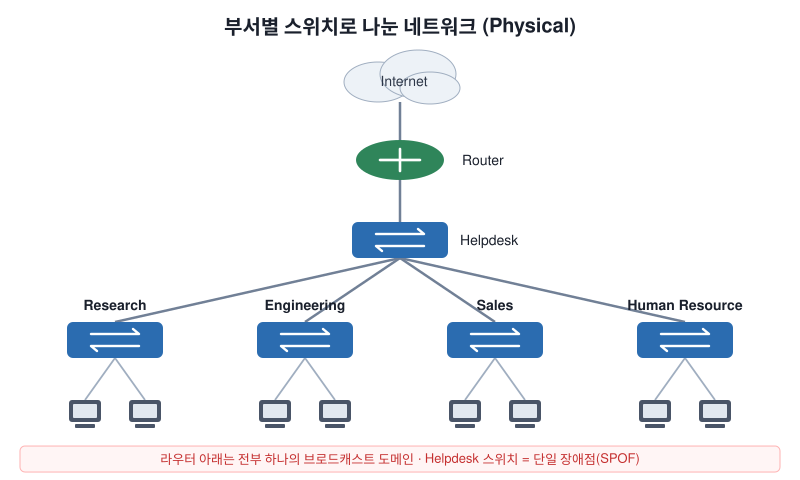
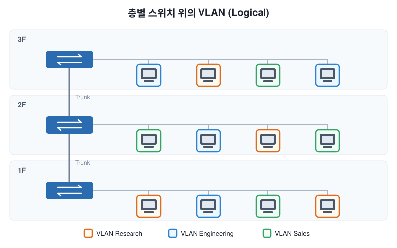

# Introduction to VLANs

## 1. 문제 상황: 부서별로 스위치를 물리적으로 나눈 네트워크

부서마다 스위치를 하나씩 두고, 사용자를 물리적 위치에 따라 해당 스위치에 연결한 구조를 생각해 보자.

언뜻 깔끔해 보이지만, 다음 질문을 던져 보면 약점이 드러난다.

| 질문 | 결과 |
|---|---|
| Research 스위치의 PC가 ARP Request 같은 **브로드캐스트**를 보내면? | 모든 스위치가 프레임을 **flooding** → 네트워크 전체로 퍼짐 |
| **Helpdesk 스위치가 장애**나면? | 다른 부서 스위치들이 고립됨 → 서로 통신 불가, 인터넷 불가 |
| Human Resource 사용자의 **속도**는? | 모든 트래픽이 Helpdesk 스위치를 거침 → 대역폭 공유로 성능 저하 |
| **보안**은 어떻게? | Port Security로 MAC 필터링 가능하지만, MAC은 쉽게 스푸핑됨 → 근본 해결책 아님 |

> 목적지 MAC을 아직 학습하지 못한 **Unknown Unicast** 프레임도 브로드캐스트와 똑같이 flooding된다.

## 2. 브로드캐스트 도메인은 몇 개일까?

- 스위치는 브로드캐스트를 **전달(flood)** 한다.
- 라우터는 브로드캐스트를 **전달하지 않는다** → 라우터가 브로드캐스트 도메인의 **경계**가 된다.

따라서 위 구조의 브로드캐스트 도메인은 **2개**다.

1. 라우터 아래쪽 — 모든 부서 스위치 전체
2. 라우터 위쪽 — 인터넷 연결 구간

즉, 부서가 아무리 많아도 내부는 **하나의 거대한 브로드캐스트 도메인**이다. 이걸 해결하는 방법 중 하나가 VLAN이다.

## 3. Physical Topology vs Logical Topology

| 구분 | 의미 |
|---|---|
| **Physical Topology** | 케이블이 실제로 어떻게 연결되어 있는가 |
| **Logical Topology** | 설정으로 '가상으로' 어떻게 나눠져 있는가 |

**VLAN (Virtual LAN)** 은 하나의 물리 스위치를 논리적으로 여러 개로 나누는 기술이다. 쉽게 말해 **"스위치 안의 스위치"**.

물리적으로는 층별 스위치에 섞여 연결되어 있어도, 논리적으로는 `Research`, `Engineering`, `Sales` 3개의 VLAN으로 묶을 수 있다.

## 4. VLAN의 장점

- **VLAN 1개 = 브로드캐스트 도메인 1개**
  같은 VLAN에 속한 장비만 브로드캐스트를 받는다.
- **VLAN 간 통신은 라우터(L3 장비)가 필요하다**
  기본적으로 같은 VLAN 안에서만 통신 가능 → 부서 간 트래픽을 분리하고 통제할 수 있다.
- **물리적 위치에 묶이지 않는다**
  Engineering 사용자가 1층·2층·3층에 흩어져 있어도 같은 VLAN에 속할 수 있다.

## 5. 핵심 정리

- 스위치만으로 구성된 네트워크는 **하나의 브로드캐스트 도메인** → 불필요한 flooding, 장애 전파, 보안 취약
- **라우터**는 브로드캐스트를 막아 도메인을 나눈다.
- **VLAN**은 물리 구조와 상관없이 스위치를 논리적으로 분할해 **브로드캐스트 도메인을 나눈다.**
- VLAN 간 통신에는 **라우팅**이 필요하다. → 다음 주제: Trunk, Inter-VLAN Routing
