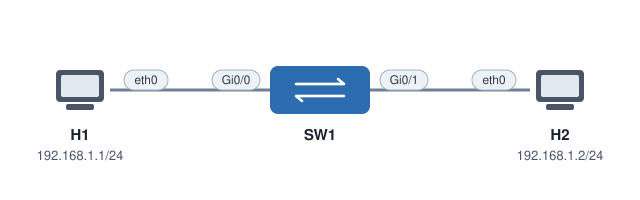

# How to Configure VLANs

Cisco Catalyst 스위치에서 VLAN을 만들고, 인터페이스를 원하는 VLAN에 할당하는 과정을 정리한다.

## 토폴로지



| 장비 | 인터페이스 | IP |
|---|---|---|
| H1 | eth0 ↔ SW1 Gi0/0 | 192.168.1.1/24 |
| H2 | eth0 ↔ SW1 Gi0/1 | 192.168.1.2/24 |

H1과 H2는 같은 서브넷(192.168.1.0/24)에 있다.

---

## 1. 기본 VLAN 상태 확인

```
Switch#show vlan

VLAN Name                             Status    Ports
---- -------------------------------- --------- -------------------------------
1    default                          active    Gi0/0, Gi0/1, Gi0/2, Gi0/3
                                                Gi1/0, Gi1/1, Gi1/2, Gi1/3
1002 fddi-default                     act/unsup
1003 token-ring-default               act/unsup
1004 fddinet-default                  act/unsup
1005 trnet-default                    act/unsup
```

- **VLAN 1이 기본(default) VLAN**이고, 모든 활성 포트가 처음엔 VLAN 1에 속해 있다.
- 1002~1005는 FDDI·Token Ring용 레거시 VLAN으로, 지우거나 쓸 수 없다.

> **VLAN 정보는 running-config / startup-config에 저장되지 않는다.**
> 플래시의 별도 파일 **`vlan.dat`** 에 저장된다. VLAN 정보를 초기화하려면 이 파일을 지운다.
>
> ```
> Switch#delete flash:vlan.dat
> ```

## 2. 기본 상태에서 통신 확인

```
VPC> ping 192.168.1.2

84 bytes from 192.168.1.2 icmp_seq=1 ttl=64 time=2.163 ms
84 bytes from 192.168.1.2 icmp_seq=2 ttl=64 time=1.094 ms
84 bytes from 192.168.1.2 icmp_seq=3 ttl=64 time=2.265 ms
```

아무 설정을 안 해도 두 포트가 모두 VLAN 1이라 H1 ↔ H2 통신이 된다.

## 3. VLAN 생성

```
Switch(config)#vlan 50
Switch(config-vlan)#name Computers
Switch(config-vlan)#exit
```

- `vlan <번호>` 로 VLAN 생성
- `name` 은 **선택 사항** (여기선 `Computers`)

```
Switch#show vlan

VLAN Name                             Status    Ports
---- -------------------------------- --------- -------------------------------
1    default                          active    Gi0/0, Gi0/1, Gi0/2, Gi0/3
                                                Gi1/0, Gi1/1, Gi1/2, Gi1/3
50   Computers                        active
```

VLAN 50은 **active** 상태지만, 아직 **할당된 포트가 없다.**

## 4. 인터페이스를 VLAN에 할당

```
Switch(config)#interface g0/0
Switch(config-if)#switchport mode access
Switch(config-if)#switchport access vlan 50
Switch(config-if)#exit
Switch(config)#interface g0/1
Switch(config-if)#sw mo ac
Switch(config-if)#sw ac vlan 50
```

| 명령어 | 역할 |
|---|---|
| `switchport mode access` | 포트를 **Access 모드**로 고정 (VLAN 하나만 전달) |
| `switchport access vlan 50` | 해당 포트를 **VLAN 50**에 할당 |

> `sw mo ac`, `sw ac vlan 50` 처럼 줄여 써도 된다.

```
Switch#show vlan

VLAN Name                             Status    Ports
---- -------------------------------- --------- -------------------------------
1    default                          active    Gi0/2, Gi0/3, Gi1/0, Gi1/1
                                                Gi1/2, Gi1/3
50   Computers                        active    Gi0/0, Gi0/1
```

Gi0/0, Gi0/1이 VLAN 1에서 빠지고 **VLAN 50**으로 이동했다.

## 5. 검증

### 5-1. Ping

```
VPC> ping 192.168.1.2

84 bytes from 192.168.1.2 icmp_seq=1 ttl=64 time=1.182 ms
84 bytes from 192.168.1.2 icmp_seq=2 ttl=64 time=1.101 ms
84 bytes from 192.168.1.2 icmp_seq=3 ttl=64 time=2.577 ms
```

같은 VLAN 50 안에 있으니 통신 정상.

### 5-2. `show interfaces switchport`

```
Switch#show interfaces g0/0 switchport
Name: Gi0/0
Switchport: Enabled
Administrative Mode: static access
Operational Mode: static access
Administrative Trunking Encapsulation: negotiate
Operational Trunking Encapsulation: native
Negotiation of Trunking: Off
Access Mode VLAN: 50 (Computers)
Trunking Native Mode VLAN: 1 (default)
```

| 항목 | 의미 |
|---|---|
| `Operational Mode: static access` | 실제로 **Access 모드**로 동작 중 |
| `Negotiation of Trunking: Off` | DTP 협상 꺼짐 (mode access 지정했기 때문) |
| `Access Mode VLAN: 50 (Computers)` | 이 포트는 **VLAN 50** 소속 |

Gi0/1도 동일하게 확인된다.

---

## 핵심 정리

- 모든 포트는 기본적으로 **VLAN 1**
- VLAN 정보는 config가 아니라 **`flash:vlan.dat`** 에 저장
- 생성: `vlan <ID>` → (선택) `name <이름>`
- 할당: `switchport mode access` → `switchport access vlan <ID>`
- 확인: `show vlan`, `show interfaces <if> switchport`
- 다음 주제: 스위치 간에 여러 VLAN을 전달하는 **Trunk**
