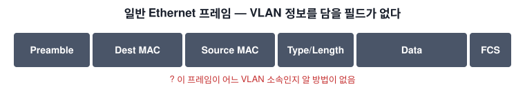
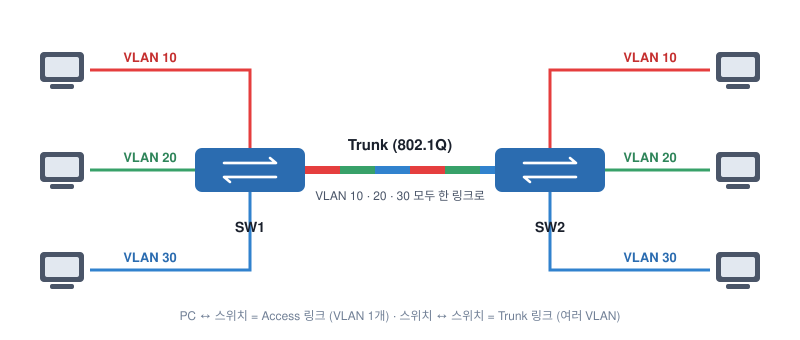
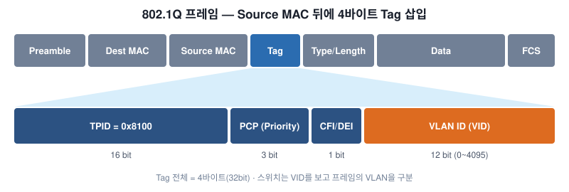

# 802.1Q Encapsulation

## 1. 문제: 스위치 사이로 VLAN 트래픽을 보내려면?

일반 Ethernet 프레임에는 **"이 프레임은 몇 번 VLAN 소속"** 이라고 적을 필드가 없다.
그래서 다른 스위치로부터 프레임을 받은 스위치는 그게 어느 VLAN 트래픽인지 알 수 없다.
→ VLAN 정보를 실어 나를 **별도의 프로토콜**이 필요하다.

## 2. Trunk

**Trunk** 는 겉보기엔 평범한 링크지만,

- **여러 VLAN의 트래픽을 하나의 링크로** 전달할 수 있고
- 각 프레임이 **어느 VLAN 소속인지 구분하는 방법**을 가지고 있다.

양쪽 스위치에 VLAN 10·20·30 PC가 흩어져 있어도, 스위치 사이를 Trunk로 연결하면 모든 VLAN 트래픽이 오갈 수 있다.

| 링크 종류 | 연결 | 전달하는 VLAN |
|---|---|---|
| **Access** | 스위치 ↔ PC | VLAN 1개 |
| **Trunk** | 스위치 ↔ 스위치 (또는 라우터) | 여러 VLAN |

## 3. Trunking 프로토콜

| 프로토콜 | 특징 |
|---|---|
| **802.1Q (dot1q)** | IEEE **표준**. 가장 널리 쓰이고 대부분의 벤더가 지원 |
| **ISL** | **Cisco 전용** 프로토콜. 지원하지 않는 스위치도 많음 (현재는 거의 안 씀) |

## 4. 802.1Q 프레임 구조

일반 Ethernet 프레임의 **Source MAC과 Type/Length 사이에 4바이트 Tag**를 끼워 넣는다.

| 필드 | 크기 | 설명 |
|---|---|---|
| **TPID** | 16 bit | 값 `0x8100` → "이 프레임은 802.1Q 태그가 붙어 있다"는 표시 |
| **PCP (Priority)** | 3 bit | 트래픽 우선순위 (0~7). CoS 값으로 쓰임 |
| **CFI / DEI** | 1 bit | 혼잡 시 먼저 버려도 되는 프레임 표시 |
| **VLAN ID (VID)** | 12 bit | 프레임이 속한 **VLAN 번호** (0~4095, 실사용 1~4094) |

- 스위치는 **VLAN ID**를 보고 이 프레임이 어느 VLAN 소속인지 판단한다.
- **Priority**는 VLAN별로 트래픽 우선순위를 다르게 줄 때 쓴다.
  예) Voice VLAN과 Data VLAN을 나눴다면 VoIP에 높은 우선순위를 줘야 통화 품질이 떨어지지 않는다.

> Tag가 추가되면서 프레임 내용이 바뀌므로 **FCS도 다시 계산**된다.

## 5. 핵심 정리

- 일반 Ethernet 프레임에는 **VLAN 정보가 없다.**
- 스위치 간에 여러 VLAN을 전달하려면 **Trunk**가 필요하다.
- Trunking 프로토콜: **802.1Q(표준)**, ISL(Cisco 전용)
- 802.1Q는 프레임에 **4바이트 Tag**를 삽입하고, 그 안의 **12bit VLAN ID**로 VLAN을 구분한다.
- 다음 주제: Cisco Catalyst 스위치에서 **Trunk 설정하기**
