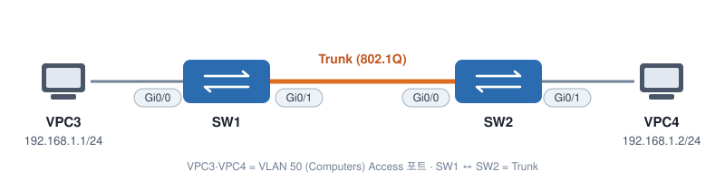

# How to Configure Trunk

스위치 사이로 VLAN 트래픽을 전달하려면 **Trunk**가 필요하다. Cisco Catalyst 스위치 두 대 사이에 Trunk를 설정하고, 스위치포트 모드(Access / Trunk / Dynamic)별 동작을 확인한다.

## 토폴로지



| 장비 | 연결 | IP / 역할 |
|---|---|---|
| VPC3 | eth0 ↔ SW1 Gi0/0 | 192.168.1.1/24 (VLAN 50) |
| VPC4 | eth0 ↔ SW2 Gi0/1 | 192.168.1.2/24 (VLAN 50) |
| SW1 ↔ SW2 | Gi0/1 ↔ Gi0/0 | Trunk |

---

## 1. VLAN 생성 (양쪽 스위치)

```
SW1(config)#vlan 50
SW1(config-vlan)#name Computers
SW1(config-vlan)#exit
```
```
SW2(config)#vlan 50
SW2(config-vlan)#name Computers
SW2(config-vlan)#exit
```

## 2. PC 연결 포트를 VLAN 50에 할당

```
SW1(config)#interface g0/0
SW1(config-if)#switchport access vlan 50
```
```
SW2(config)#interface g0/1
SW2(config-if)#switchport access vlan 50
```

> 지금은 VLAN이 50 하나뿐이라 스위치 간 링크를 access로 둬도 통신은 된다. 하지만 VLAN이 여러 개가 되면 Trunk가 반드시 필요하다.

## 3. Trunk 설정

### 3-1. 캡슐화 방식을 먼저 정해야 하는 경우

```
SW1(config)#interface g0/1
SW1(config-if)#switchport mode trunk
Command rejected: An interface whose trunk encapsulation is "Auto" can not be configured to "trunk" mode.
```

802.1Q와 ISL을 **둘 다 지원하는 스위치**는 기본 캡슐화가 `negotiate(Auto)` 라서, 바로 `mode trunk`를 넣으면 거부된다. 먼저 캡슐화를 지정한다.

```
SW1(config-if)#switchport trunk encapsulation ?
  dot1q      Interface uses only 802.1q trunking encapsulation when trunking
  isl        Interface uses only ISL trunking encapsulation when trunking
  negotiate  Device will negotiate trunking encapsulation with peer on interface
```

| 옵션 | 의미 |
|---|---|
| `dot1q` | 802.1Q만 사용 (표준) |
| `isl` | ISL만 사용 (Cisco 전용) |
| `negotiate` | 상대와 협상 (기본값) |

```
SW1(config-if)#switchport trunk encapsulation dot1q
SW2(config-if)#switchport trunk encapsulation dot1q
```

```
SW1#show interfaces g0/1 switchport
Name: Gi0/1
Switchport: Enabled
Administrative Mode: dynamic auto
Operational Mode: static access
Administrative Trunking Encapsulation: dot1q
Operational Trunking Encapsulation: native
```

캡슐화는 `dot1q`로 바뀌었지만, 아직 모드가 `dynamic auto`라서 실제로는 access로 동작 중이다.

> 802.1Q만 지원하는 스위치(예: Catalyst 2960)에는 `switchport trunk encapsulation` 명령 자체가 없다. 바로 `switchport mode trunk`를 쓰면 된다.

### 3-2. Trunk 모드로 변경

```
SW1(config)#interface g0/1
SW1(config-if)#switchport mode trunk
```
```
SW2(config)#interface g0/0
SW2(config-if)#sw mo tr
```

```
SW1#show interfaces g0/1 switchport
Name: Gi0/1
Switchport: Enabled
Administrative Mode: trunk
Operational Mode: trunk
Administrative Trunking Encapsulation: dot1q
Operational Trunking Encapsulation: dot1q
```

`Operational Mode: trunk`, `Operational Trunking Encapsulation: dot1q` → Trunk 정상 동작.

## 4. 검증

### 4-1. Ping

```
VPC3> ping 192.168.1.2

84 bytes from 192.168.1.2 icmp_seq=1 ttl=64 time=3.364 ms
84 bytes from 192.168.1.2 icmp_seq=2 ttl=64 time=2.847 ms
84 bytes from 192.168.1.2 icmp_seq=3 ttl=64 time=2.015 ms
```

### 4-2. `show vlan` 에는 Trunk 포트가 안 보인다

```
SW2#show vlan

VLAN Name                             Status    Ports
---- -------------------------------- --------- -------------------------------
1    default                          active    Gi0/2, Gi0/3, Gi1/0, Gi1/1
                                                Gi1/2, Gi1/3
50   Computers                        active    Gi0/1
```

Gi0/0(Trunk)이 목록에 없다. **`show vlan`은 Access 포트만 보여주기 때문**이고, 정상이다.

### 4-3. `show interfaces trunk`

```
SW2#show interfaces g0/0 trunk

Port        Mode             Encapsulation  Status        Native vlan
Gi0/0       on               802.1q         trunking      1

Port        Vlans allowed on trunk
Gi0/0       1-4094

Port        Vlans allowed and active in management domain
Gi0/0       1,50

Port        Vlans in spanning tree forwarding state and not pruned
Gi0/0       1,50
```

| 항목 | 의미 |
|---|---|
| `Mode: on` / `Status: trunking` | Trunk로 동작 중 |
| `Encapsulation: 802.1q` | 사용 중인 Trunk 프로토콜 |
| `Native vlan: 1` | 태그 없이 전달되는 Native VLAN |
| `Vlans allowed on trunk: 1-4094` | 이 Trunk로 허용된 VLAN (기본: 전부) |
| `allowed and active` | 허용되면서 스위치에 실제로 존재하는 VLAN → 1, 50 |
| `spanning tree forwarding state` | STP에서 forwarding 상태인 VLAN |

---

## 5. Switchport 모드

```
SW2(config-if)#switchport mode ?
  access        Set trunking mode to ACCESS unconditionally
  dot1q-tunnel  set trunking mode to TUNNEL unconditionally
  dynamic       Set trunking mode to dynamically negotiate access or trunk mode
  private-vlan  Set private-vlan mode
  trunk         Set trunking mode to TRUNK unconditionally
```
```
SW2(config-if)#switchport mode dynamic ?
  auto       Set trunking mode dynamic negotiation parameter to AUTO
  desirable  Set trunking mode dynamic negotiation parameter to DESIRABLE
```

| 모드 | 동작 |
|---|---|
| `access` | 무조건 Access |
| `trunk` | 무조건 Trunk |
| `dynamic auto` | **수동적**. 상대가 Trunk를 원하면 Trunk, 아니면 Access |
| `dynamic desirable` | **능동적**. 먼저 Trunk가 되자고 요청 |

`dynamic` 모드는 **DTP (Dynamic Trunking Protocol)** 로 상대 스위치와 협상해 Access/Trunk를 자동 결정한다. 실습 스위치의 기본값은 `dynamic auto`였다.

## 6. 모드 조합별 결과 (SW1 Gi0/0 ↔ SW2 Gi0/0)

실습에서 확인한 조합:

| SW1 | SW2 | 결과 (Operational Mode) |
|---|---|---|
| dynamic auto | dynamic auto | **Access** — 둘 다 기다리기만 함 |
| dynamic desirable | dynamic desirable | **Trunk** |
| dynamic desirable | dynamic auto | **Trunk** — desirable이 요청, auto가 수락 |
| dynamic auto | trunk | **Trunk** |
| dynamic auto | access | **Access** |
| dynamic desirable | trunk | **Trunk** |
| access | trunk | ⚠️ 불일치 — SW1은 access, SW2는 trunk |

### 전체 조합표

| | **Trunk** | **Access** | **Dynamic Auto** | **Dynamic Desirable** |
|---|---|---|---|---|
| **Trunk** | Trunk | ⚠️ Limited | Trunk | Trunk |
| **Access** | ⚠️ Limited | Access | Access | Access |
| **Dynamic Auto** | Trunk | Access | Access | Trunk |
| **Dynamic Desirable** | Trunk | Access | Trunk | Trunk |

> **Limited** = 한쪽은 Access, 한쪽은 Trunk인 **설정 불일치** 상태. 태그 있는 프레임과 없는 프레임이 섞여 정상 통신이 안 되고, 루프 방지 프로토콜인 **Spanning Tree**가 이를 감지해 포트를 막을 수 있다. 실무에선 절대 이렇게 두지 않는다.

---

## 핵심 정리

- 스위치 간 여러 VLAN 전달 → **Trunk**
- 캡슐화 자동인 스위치는 `switchport trunk encapsulation dot1q` 먼저, 그다음 `switchport mode trunk`
- `show vlan` 에는 Trunk 포트가 안 나옴 → **`show interfaces trunk`** 로 확인
- `dynamic auto` + `dynamic auto` = **Access**, 한쪽이라도 `desirable`/`trunk`면 **Trunk**
- Access ↔ Trunk 혼합은 **불일치** → 반드시 양쪽 모드를 맞춘다
- 실무에선 DTP에 맡기지 말고 **`switchport mode trunk` / `access`로 명시**하는 게 안전하다
