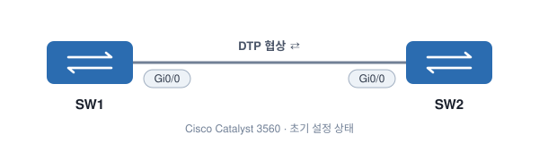

# Cisco Dynamic Trunking Protocol (DTP)

**DTP (Dynamic Trunking Protocol)** 는 Cisco 스위치끼리 DTP 패킷을 주고받아, 연결된 포트를 **Access로 쓸지 Trunk로 쓸지 자동으로 협상**하는 Cisco 전용 프로토콜이다.

- DTP는 **기본으로 켜져 있다.**
- 포트 기본 모드는 `dynamic auto` 또는 `dynamic desirable` (스위치 모델·IOS 버전마다 다름)
- Trunk를 요청하는 DTP 패킷을 받으면 포트가 Trunk가 될 수 있다.

> 모드별 조합 결과는 [How to Configure Trunk](04-How-to-Configure-Trunk.md#6-모드-조합별-결과-sw1-gi00--sw2-gi00) 참고.

## 토폴로지



SW1 Gi0/0 ↔ SW2 Gi0/0. 아무 설정도 하지 않은 상태에서 시작한다.

---

## 1. 기본 상태 확인

```
SW1#show interfaces g0/0 switchport
Name: Gi0/0
Switchport: Enabled
Administrative Mode: dynamic auto
Operational Mode: static access
Administrative Trunking Encapsulation: negotiate
Operational Trunking Encapsulation: native
Negotiation of Trunking: On
```

SW2도 동일하다.

| 항목 | 값 | 의미 |
|---|---|---|
| `Administrative Mode` | dynamic auto | 설정된 모드 (기본값) |
| `Operational Mode` | static access | 양쪽 다 `auto`라 아무도 Trunk를 요청 안 함 → **Access** |
| `Negotiation of Trunking` | **On** | DTP 협상 **켜져 있음** |

---

## 2. DTP를 끄는 두 가지 방법

| 방법 | 명령어 | 비고 |
|---|---|---|
| ① 포트를 **Access로 고정** | `switchport mode access` | Access로 고정하면 DTP 자동 Off |
| ② **nonegotiate** 사용 | `switchport nonegotiate` | Trunk 포트에서 DTP를 끌 때 사용 |

> ⚠️ **`switchport mode trunk` 만으로는 DTP가 꺼지지 않는다.**

### ① Access 모드로 고정

```
SW1(config)#interface g0/0
SW1(config-if)#switchport mode access
```
```
SW2(config)#interface g0/0
SW2(config-if)#sw mo ac
```

```
SW1#show interfaces g0/0 switchport
Name: Gi0/0
Switchport: Enabled
Administrative Mode: static access
Operational Mode: static access
Administrative Trunking Encapsulation: negotiate
Operational Trunking Encapsulation: native
Negotiation of Trunking: Off
```

`Negotiation of Trunking: Off` → Access로 직접 지정하면 **DTP가 꺼진다.**

### Trunk로 직접 지정하면?

```
SW1(config)#interface g0/0
SW1(config-if)#switchport trunk encapsulation dot1q
SW1(config-if)#switchport mode trunk
```
```
SW2(config)#interface g0/0
SW2(config-if)#sw tr en dot
SW2(config-if)#sw mo tr
```

```
SW1#show interfaces g0/0 switchport | include Negotiation
Negotiation of Trunking: On
```

Trunk로 직접 설정해도 **DTP는 여전히 On**이다. Trunk 포트는 계속 DTP 패킷을 보낸다.

### ② `switchport nonegotiate`

```
SW1(config)#interface g0/0
SW1(config-if)#switchport nonegotiate
```
```
SW2(config)#interface g0/0
SW2(config-if)#sw no
```

```
SW1#show interfaces g0/0 switchport | include Negotiation
Negotiation of Trunking: Off
```

이제 Trunk 포트에서도 **DTP가 꺼졌다.**

> `switchport nonegotiate` 는 포트가 `access` 또는 `trunk`로 **고정**되어 있을 때만 쓸 수 있다. `dynamic` 모드에서는 협상이 필요하므로 거부된다.
>
> 한쪽만 `trunk + nonegotiate`이고 상대가 `dynamic auto`라면, 상대는 DTP 요청을 받지 못해 **Access로 남는다.** → 양쪽 모두 `trunk`로 명시해야 한다.

---

## 3. 왜 DTP를 꺼야 할까?

- **보안**: 공격자 PC가 DTP 패킷을 흉내 내 스위치 포트를 Trunk로 만들면, 모든 VLAN 트래픽에 접근할 수 있다. → **Switch Spoofing (VLAN Hopping)** 공격
- **예측 가능성**: 자동 협상에 맡기면 의도와 다른 모드가 될 수 있다.
- **불필요한 트래픽 제거**: 고정된 포트는 DTP 패킷을 보낼 필요가 없다.

**권장 설정 (실무 기준)**

```
! PC·서버 연결 포트
interface g0/1
 switchport mode access
 switchport access vlan 50

! 스위치 간 Trunk 포트
interface g0/0
 switchport trunk encapsulation dot1q   ! 필요한 모델만
 switchport mode trunk
 switchport nonegotiate
```

---

## 핵심 정리

- **DTP** = Cisco 전용 Access/Trunk 자동 협상 프로토콜, **기본 On**
- 기본 모드 `dynamic auto` + `dynamic auto` → **Access**
- DTP 끄기: ① `switchport mode access` ② `switchport nonegotiate`
- **`switchport mode trunk`만으로는 DTP가 안 꺼진다**
- 확인: `show interfaces <if> switchport | include Negotiation`
- 실무에선 모든 포트를 **access / trunk로 명시**하고, Trunk엔 **nonegotiate** 를 붙인다
