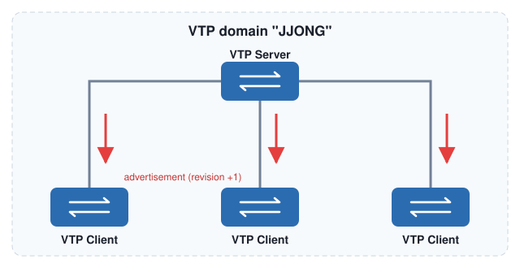
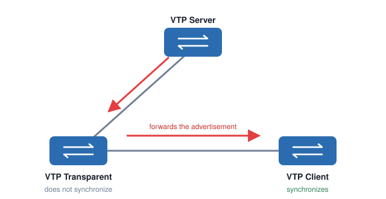
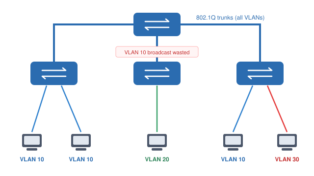
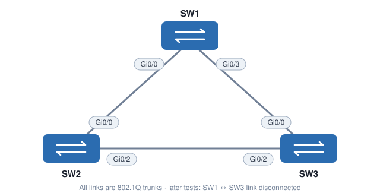

# Introduction to VLAN Trunking Protocol (VTP)

[한국어](../06-Introduction-to-VTP.md) | [English](06-Introduction-to-VTP.en.md) | [日本語](06-Introduction-to-VTP.ja.md) | [简体中文](06-Introduction-to-VTP.zh-CN.md) | [Español](06-Introduction-to-VTP.es.md) | **Français**

Avec 20 switchs et 50 VLAN, créer chaque VLAN à la main sur chaque switch prend beaucoup trop de temps. Avec **VTP (VLAN Trunking Protocol)**, vous créez les VLAN sur un seul switch, et les autres reçoivent ces informations et **se synchronisent automatiquement**.

- Un protocole propriétaire Cisco
- Les informations VTP circulent **uniquement sur les liens trunk**
- Seuls les switchs ayant le même **nom de domaine VTP** se synchronisent entre eux

---

## 1. Fonctionnement de VTP



1. Ajoutez / modifiez / supprimez des VLAN sur le **VTP Server**.
2. Chaque modification augmente de 1 le numéro de **Configuration Revision**.
3. Les informations les plus récentes (advertisement) sont envoyées à tous les VTP Client.
4. Un VTP Client se synchronise lorsqu'il reçoit des informations avec une **révision supérieure à la sienne**.

> Un VTP Server se synchronise aussi (il joue également le rôle de client). On peut donc avoir plusieurs VTP Server et modifier les VLAN sur n'importe lequel.

---

## 2. Les modes VTP

### VTP Transparent



Un switch VTP Transparent **se contente de relayer** les advertisements vers les autres switchs et **ne se synchronise pas**. En revanche, il peut créer des VLAN **localement**.

Quand vous créez le VLAN 20 sur le VTP Server :
1. Le VLAN 20 est créé sur le VTP Server
2. Le numéro de révision augmente
3. Le VTP Server envoie l'advertisement au switch Transparent
4. Le Transparent ne se synchronise pas, mais **relaie** l'advertisement vers le Client
5. Le Client se synchronise avec les informations les plus récentes

### Comparaison des modes

| | **VTP Server** | **VTP Client** | **VTP Transparent** |
| --- | --- | --- | --- |
| Créer / modifier / supprimer des VLAN | ✅ | ❌ | Localement uniquement |
| Se synchronise | ✅ | ✅ | ❌ |
| Relaie les advertisements | ✅ | ✅ | ✅ |
| Stockage des informations VLAN | `vlan.dat` | `vlan.dat` | **running-config** (+ `vlan.dat`) |

> Il existe aussi un **mode `off`** qui désactive complètement VTP. Il ressemble au mode Transparent, mais **ne relaie pas non plus** les advertisements (VTP version 3, ou IOS qui le prennent en charge).

---

## 3. Le danger de VTP : le numéro de révision

VTP est pratique, mais présente un risque sérieux. **Un VTP Server se synchronise aussi comme un Client**, et tous les switchs suivent les informations ayant le **numéro de révision le plus élevé**.

Voici ce qui peut arriver :

1. Vous retirez un switch VTP Client du réseau de production pour l'emmener en salle de TP
2. Vous le passez en mode VTP Server
3. Vous créez et modifiez des VLAN pour tester → la **révision augmente** à chaque modification
4. Une fois terminé, vous **supprimez tous les VLAN**
5. Vous le repassez en mode VTP Client
6. Vous **rebranchez** ce switch sur le réseau de production

Comme la révision de ce switch est **supérieure** à celle du réseau de production, les autres switchs se synchronisent sur lui → **tous les VLAN de production disparaissent.** Les ports qui appartenaient à ces VLAN ne reviennent même pas dans le VLAN 1 : ils restent dans des VLAN qui n'existent plus, et **le trafic s'arrête.**

> **Prévention**
> - Avant de brancher un switch utilisé ailleurs, **remettez sa révision à 0** : changez temporairement le nom de domaine VTP puis remettez-le, ou passez en mode Transparent puis revenez.
> - Définissez un mot de passe de domaine avec `vtp password`.
> - Avec **VTP version 3**, seul le switch désigné comme **Primary Server** peut modifier les informations VLAN, ce qui évite cet accident.
> - Beaucoup de réseaux qui n'ont pas besoin de VTP fonctionnent simplement en mode **Transparent** (ou `off`).

---

## 4. VTP pruning



Il y a des PC dans les VLAN 10, 20 et 30, et les liens entre switchs sont des **trunks 802.1Q** qui transportent tous les VLAN.
Quand un PC du VLAN 10 envoie un **broadcast**, les switchs l'inondent et les trunks transportent tous les VLAN : il **atteint donc tous les switchs.**

Mais le switch du milieu **n'a aucun PC dans le VLAN 10** (seulement le VLAN 20). Ce broadcast est de la **bande passante gaspillée**.

Avec le **VTP pruning** activé, le trafic d'un VLAN n'est plus envoyé sur les trunks vers les switchs qui n'ont aucun équipement dans ce VLAN.

```
Switch(config)#vtp pruning
```

- L'activer sur un Server l'applique à tout le domaine.
- Selon le modèle de switch, il est activé ou désactivé par défaut.
- Le VLAN 1 et les VLAN 1002 ~ 1005 ne sont jamais élagués.

---

## 5. TP de configuration VTP



Trois switchs (SW1, SW2, SW3) sont reliés par des trunks. La base de données VLAN et la startup-config ont été effacées sur tous les switchs.

### 5-1. Vérifier l'état par défaut

```
SW1#show vtp status
VTP Version capable             : 1 to 3
VTP version running             : 1
VTP Domain Name                 :
VTP Pruning Mode                : Disabled
VTP Traps Generation            : Disabled
Configuration last modified by 0.0.0.0 at 0-0-00 00:00:00

Feature VLAN:
--------------
VTP Operating Mode                : Server
Maximum VLANs supported locally   : 1005
Number of existing VLANs          : 5
Configuration Revision            : 0
```

SW2 et SW3 affichent la même chose.

| Champ | Signification |
| --- | --- |
| `Configuration Revision : 0` | Augmente à chaque ajout ou suppression de VLAN. Toujours 0 car rien n'a changé |
| `VTP Operating Mode : Server` | Le mode par défaut est **Server** |
| `VTP Pruning Mode : Disabled` | Le pruning est désactivé |
| `VTP version running : 1` | Prend en charge les versions 1 à 3, mais fonctionne actuellement en version 1 |
| `VTP Domain Name :` (vide) | Pas encore de nom de domaine |

### 5-2. Créer un VLAN sur SW1

```
SW1(config)#vlan 10
SW1(config-vlan)#name Printers
```

```
SW1#show vlan
VLAN Name                             Status    Ports
---- -------------------------------- --------- -------------------------------
1    default                          active    Gi0/0, Gi0/1, Gi0/2, Gi0/3
                                                Gi1/0, Gi1/1, Gi1/2, Gi1/3
10   Printers                         active
```

```
SW1#show vtp status | include Revision
Configuration Revision            : 1
```

La révision de SW1 est passée à **1**. Mais SW2 et SW3 sont toujours à **0** et n'ont pas le VLAN 10.
→ Parce qu'aucun **nom de domaine VTP** n'a été configuré.

### 5-3. Configurer le domaine VTP

Activez le debug sur SW2 et SW3 pour observer en temps réel.

```
SW2#debug sw-vlan vtp events
vtp events debugging is on
```

Définissez le nom de domaine sur SW1.

```
SW1(config)#vtp domain JJONG
Changing VTP domain name from NULL to JJONG
```

Sortie du debug sur SW3 :

```
VTP LOG RUNTIME: Summary packet received in NULL domain state
VTP LOG RUNTIME: Summary packet received, domain = JJONG, rev = 1, followers = 1, length 77, trunk Gi0/0
VTP LOG RUNTIME: Transitioning from NULL to JJONG domain
VTP LOG RUNTIME: Summary packet rev 1 greater than domain JJONG rev 0
```

- Un switch **sans nom de domaine (NULL)** **adopte** le nom de domaine du paquet VTP reçu (`JJONG`). (Il ne le change pas s'il a déjà un nom de domaine.)
- La révision du paquet reçu (**1**) est supérieure à la sienne (**0**) : il **se synchronise.**

Le debug est très bavard : désactivez-le toujours.

```
SW2#no debug all
All possible debugging has been turned off
```

```
SW2#show vtp status | include Domain|Revision
VTP Domain Name                 : JJONG
Configuration Revision          : 1
```

```
SW2#show vlan
VLAN Name                             Status    Ports
---- -------------------------------- --------- -------------------------------
1    default                          active    Gi0/1, Gi0/3, Gi1/0, Gi1/1
                                                Gi1/2, Gi1/3
10   Printers                         active
```

SW2 et SW3 ont **appris le VLAN 10** via VTP.

### 5-4. Créer des VLAN sur plusieurs Server

Les trois switchs sont actuellement Server : on peut donc créer des VLAN sur n'importe lequel.

```
SW2(config)#vlan 20
SW2(config-vlan)#name Servers
```
```
SW3(config)#vlan 30
SW3(config-vlan)#name Management
```

```
SW1#show vlan
VLAN Name                             Status
---- -------------------------------- ---------
1    default                          active
10   Printers                         active
20   Servers                          active
30   Management                       active
```

SW2 et SW3 ont aussi les VLAN 10, 20 et 30, et la révision est de **3** sur les trois switchs. Elle augmente de 1 à chaque nouveau VLAN.

### 5-5. Mode VTP Client

```
SW2(config)#vtp mode client
Setting device to VTP Client mode for VLANS.
```

```
SW2#show vtp status | include Operating
VTP Operating Mode                : Client
```

SW1 et SW3 sont maintenant Server et SW2 est Client. Pour ce test, **débranchez le lien SW1 ↔ SW3** afin qu'il n'y ait pas de connexion directe entre eux. (SW1 — SW2 — SW3)

```
SW1(config)#vlan 40
SW1(config-vlan)#name Engineering
```

```
SW2#show vlan
VLAN Name                             Status
---- -------------------------------- ---------
1    default                          active
10   Printers                         active
20   Servers                          active
30   Management                       active
40   Engineering                      active
```

SW3 apprend aussi le VLAN 40, par le chemin SW1 → **SW2 (Client)** → SW3.
→ **Un Client se synchronise lui-même et relaie aussi les advertisements vers les autres switchs.**

On ne peut pas créer de VLAN sur un Client.

```
SW2(config)#vlan 50
VTP VLAN configuration not allowed when device is in CLIENT mode.
```

### 5-6. Mode VTP Transparent

Avec le lien SW1 ↔ SW3 toujours débranché, passez SW2 en Transparent.

```
SW2(config)#vtp mode transparent
Setting device to VTP Transparent mode for VLANS.
```

Créez le VLAN 50 sur SW1.

```
SW1(config)#vlan 50
SW1(config-vlan)#name Research
```

| Switch | VLAN 50 | Pourquoi |
| --- | --- | --- |
| SW1 (Server) | ✅ Présent | Créé ici |
| SW2 (Transparent) | ❌ Absent | Le Transparent **ne se synchronise pas** |
| SW3 (Server) | ✅ Présent | SW2 a **relayé** l'advertisement |

Créez maintenant le VLAN 60 sur SW2 (Transparent).

```
SW2(config)#vlan 60
SW2(config-vlan)#name Cameras
```

```
SW2#show vlan
VLAN Name                             Status
---- -------------------------------- ---------
1    default                          active
10   Printers                         active
20   Servers                          active
30   Management                       active
40   Engineering                      active
60   Cameras                          active
```

Un switch Transparent peut créer des VLAN **localement**. Mais le VLAN 60 **n'apparaît pas** sur SW1 ni SW3, car les VLAN d'un switch Transparent restent locaux et ne sont pas annoncés.

### 5-7. Le Transparent stocke les VLAN dans la running-config

```
SW2#show running-config
...
vlan 10
 name Printers
!
vlan 20
 name Servers
!
vlan 30
 name Management
!
vlan 40
 name Engineering
!
vlan 60
 name Cameras
!
```

| Mode | Stockage des informations VLAN |
| --- | --- |
| Server / Client | `flash:vlan.dat` (n'apparaît pas dans la running-config) |
| **Transparent** | Aussi dans la **running-config** → sauvegarder avec `copy run start` |

---

## 6. Récapitulatif des commandes

| Commande | Description |
| --- | --- |
| `vtp domain <nom>` | Définit le nom de domaine VTP (sensible à la casse) |
| `vtp mode {server \| client \| transparent \| off}` | Change le mode VTP |
| `vtp version {1 \| 2 \| 3}` | Change la version de VTP |
| `vtp password <mot de passe>` | Définit le mot de passe du domaine |
| `vtp pruning` | Active le VTP pruning |
| `show vtp status` | Affiche la version, le domaine, le mode et la révision |
| `show vtp password` | Affiche le mot de passe configuré |
| `debug sw-vlan vtp events` | Affiche les événements VTP en temps réel (désactiver avec `no debug all`) |

---

## 7. À retenir

- VTP **synchronise automatiquement** les VLAN créés sur un switch avec les switchs du même domaine. Il ne fonctionne que si les **noms de domaine sont identiques**, et circule uniquement sur les **trunks**.
- **Server** : crée des VLAN + se synchronise + relaie / **Client** : se synchronise + relaie / **Transparent** : relaie seulement, ses VLAN sont locaux
- Tous les switchs suivent les informations ayant la **révision la plus élevée**. Remettez la **révision à 0** d'un switch déjà utilisé avant de le brancher, sinon vous risquez d'effacer tous les VLAN.
- Le **VTP pruning** économise de la bande passante en bloquant le trafic VLAN sur les trunks où il est inutile.
- Le Transparent stocke les VLAN dans la **running-config** ; Server/Client les stockent dans **vlan.dat**.
