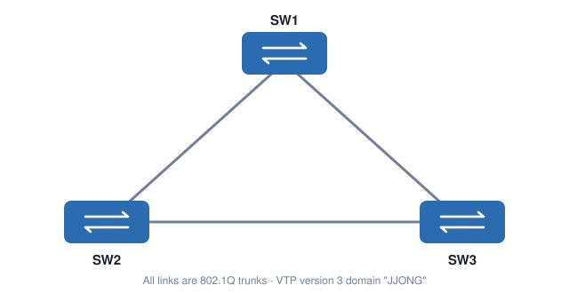

# VTP Version 3

[한국어](../07-VTP-Version-3.md) | **English** | [日本語](07-VTP-Version-3.ja.md) | [简体中文](07-VTP-Version-3.zh-CN.md) | [Español](07-VTP-Version-3.es.md) | [Français](07-VTP-Version-3.fr.md)

The goal of VTP version 3 is still to synchronize VLANs, but it fixes the weaknesses of versions 1 and 2 and adds several features. Older Catalyst IOS versions didn't support it; it is available in recent IOS releases.

> For the VTP basics (Server / Client / Transparent, revision), read [06. Introduction to VTP](06-Introduction-to-VTP.en.md) first.

## What's new in VTP version 3

| Feature | Description |
| --- | --- |
| **Primary Server** | Only the Primary Server can create / modify / delete VLANs → prevents the v1/v2 accident of **wiping every VLAN by mistake** |
| **Extended VLANs** | Extended-range VLANs **1006 ~ 4094** are synchronized too |
| **Private VLANs** | Private VLAN information is synchronized |
| **RSPAN VLANs** | Remote SPAN VLANs are synchronized |
| **MST support** | **MST configuration**, once entered on every switch, is now synchronized |
| **Better authentication** | Passwords can be stored as **hidden / secret** |
| **VTP mode off** | VTP can be **fully disabled** globally or per interface |
| **Compatibility** | **Compatible with version 2**, not with version 1 |

---

## Lab topology



All links between SW1, SW2 and SW3 are trunks.

---

## 1. Basic configuration

### 1-1. The domain name comes first

```
SW1(config)#vtp version 3
```

VTP version 3 **won't start while the domain name is empty (NULL).** Set the domain first.

```
SW1(config)#vtp domain JJONG
SW1(config)#vtp version 3
```

Configure SW2 and SW3 the same way. All three switches run in the default **VTP Server** mode.

### 1-2. Being a Server isn't enough to create VLANs

```
SW1(config)#vlan 10
```

In VTP version 3, even a Server can't change the VLAN database unless it is the **Primary Server**, so this command is rejected.

### 1-3. Make a switch the Primary Server

```
SW1#vtp primary vlan
```

- Run it in **privileged mode (`#`), not configuration mode**.
- After you confirm, SW1 becomes the **Primary Server for the VLAN feature**, and the other switches log that the Primary Server has changed.

```
SW1#show vtp status
```

Under `Feature VLAN` you can see `VTP Operating Mode : Primary Server` and the Primary ID (MAC address). SW2 and SW3 also show **SW1 as the Primary Server**.

### 1-4. See every switch in the domain

```
SW1#show vtp devices
```

A new command in VTP version 3. Unlike CDP, which only shows directly connected devices, it shows **every switch in the same VTP domain**.

### 1-5. VLAN synchronization

```
SW1(config)#vlan 100
```

On SW2 and SW3, `show vlan brief` now shows **VLAN 100**.

### 1-6. Extended-range VLANs (1006 ~ 4094)

```
SW1(config)#vlan 2000
```

```
SW2#show vlan brief | include 2000
```

Versions 1 and 2 couldn't carry extended VLANs over VTP, but in version 3 **VLAN 2000 is synchronized too**.

---

## 2. Private VLANs

VTP version 3 synchronizes private VLAN information. It sends **only the VLAN database information**, not port configuration.

```
SW1(config)#vlan 501
SW1(config-vlan)#private-vlan community
SW1(config-vlan)#vlan 502
SW1(config-vlan)#private-vlan isolated
SW1(config-vlan)#vlan 500
SW1(config-vlan)#private-vlan primary
SW1(config-vlan)#private-vlan association 501,502
```

| VLAN | Type |
| --- | --- |
| 500 | Primary VLAN |
| 501 | Community VLAN |
| 502 | Isolated VLAN |

```
SW2#show vlan private-vlan
```

The private VLAN setup created on SW1 appears **exactly the same** on SW2 and SW3.

---

## 3. Remote SPAN (RSPAN)

RSPAN VLANs are also a special type of VLAN, and they are now synchronized by VTP.

```
SW1(config)#vlan 600
SW1(config-vlan)#remote-span
```

```
SW3#show vlan remote-span
```

VLAN 600 shows up as an **RSPAN VLAN** on every switch.

---

## 4. MST (Multiple Spanning-Tree)

In the past, the same MST configuration had to be typed by hand on every switch. VTP version 3 synchronizes MST as a separate **feature**.

| Feature | What it synchronizes | Default mode |
| --- | --- | --- |
| **VLAN** | VLANs, extended VLANs, private VLANs, RSPAN | Server |
| **MST** | MST configuration | Transparent |
| **UNKNOWN** | Placeholder for future features | Transparent |

MST also needs a **Primary Server**. It can be the same switch as the VLAN Primary or a different one. Here, **SW2** becomes the MST Primary.

```
SW2(config)#vtp mode server mst
SW2(config)#exit
SW2#vtp primary mst
```

```
SW1(config)#vtp mode client mst
SW3(config)#vtp mode client mst
```

Create the MST configuration on SW2.

```
SW2(config)#spanning-tree mst configuration
SW2(config-mst)#name JJONG
SW2(config-mst)#revision 1
SW2(config-mst)#instance 1 vlan 10,20
SW2(config-mst)#instance 2 vlan 30,40
```

Enable MST on every switch.

```
SW1(config)#spanning-tree mode mst
SW2(config)#spanning-tree mode mst
SW3(config)#spanning-tree mode mst
```

```
SW1#show spanning-tree mst configuration
```

SW1 and SW3 received the MST configuration created on SW2, and it is **saved in the running-config** too. No more copying and pasting MST configuration.

---

## 5. The UNKNOWN feature

Besides VLAN and MST, `show vtp status` also lists an **UNKNOWN** feature. It is a placeholder for when VTP version 3 uses new features in the future.

- For now, **only Transparent mode** is allowed.
- `vtp mode server unknown` and `vtp mode client unknown` return an error.

```
SW1(config)#vtp mode transparent unknown
```

---

## 6. Authentication

In version 3, the password can be stored as **hidden**.

```
SW1(config)#vtp password <PASSWORD> hidden
```

```
SW1#show vtp password
```

With hidden, the password is shown only as an **encrypted hexadecimal string**, not in clear text, and the original password can't be extracted from the switch.
When adding a new switch to the domain, paste that string as a **secret**.

```
SW4(config)#vtp password <encrypted-string> secret
```

> Making a switch the Primary Server (`vtp primary`) also asks for the password. A hidden password protects even Primary Server changes.

---

## 7. VTP mode off

Version 3 supports an `off` mode that **fully disables** VTP.

| Mode | Synchronizes itself | Forwards advertisements |
| --- | --- | --- |
| Transparent | ❌ | ✅ keeps forwarding |
| **Off** | ❌ | ❌ **doesn't forward either** |

Disable globally (per feature):

```
SW1(config)#vtp mode off
SW1(config)#vtp mode off vlan
SW1(config)#vtp mode off mst
```

Disable per interface:

```
SW1(config)#interface GigabitEthernet0/1
SW1(config-if)#no vtp
```

This interface no longer takes part in VTP.

---

## 8. Backward compatibility

- VTP version 3 is **compatible with version 2** and **not compatible with version 1.**
- When a version 3 switch receives a version 2 advertisement, it forwards an advertisement compatible with version 2.
- Version 2 doesn't understand the new password mechanism, so **remove the password on version 3 switches** when mixing them.
- If things behave oddly, check with debug. (In the original lab, a Catalyst 3750 with an older IOS would not receive VTP at all.)

```
SW1#debug sw-vlan vtp events
SW1#no debug all
```

---

## Command summary

| Command | Description |
| --- | --- |
| `vtp domain <name>` | Set the domain name (required for version 3) |
| `vtp version 3` | Switch to VTP version 3 |
| `vtp primary [vlan \| mst]` | Make this switch the Primary Server (privileged mode) |
| `vtp mode {server \| client \| transparent \| off} [vlan \| mst \| unknown]` | VTP mode per feature |
| `vtp password <password> [hidden \| secret]` | Set the password |
| `no vtp` (interface) | Disable VTP on that interface |
| `show vtp status` | Check mode, Primary Server, revision |
| `show vtp devices` | Show every VTP switch in the domain |
| `show vtp password` | Show the password (an encrypted string if hidden) |

---

## Key takeaways

- VTP version 3 **requires a domain name**, and **only the Primary Server** can change VLANs, which prevents the "every VLAN wiped" accident.
- It also synchronizes **extended VLANs, private VLANs, RSPAN VLANs and MST configuration**.
- Functions are split into **VLAN / MST / UNKNOWN features**, each with its own mode and Primary Server.
- **Hidden passwords** and **off mode** (global and per interface) were added.
- It is compatible **only with version 2**.
