# How to Troubleshoot VLANs and Trunks

[한국어](../08-How-to-Troubleshoot-VLANs-and-Trunks.md) | **English** | [日本語](08-How-to-Troubleshoot-VLANs-and-Trunks.ja.md) | [简体中文](08-How-to-Troubleshoot-VLANs-and-Trunks.zh-CN.md) | [Español](08-How-to-Troubleshoot-VLANs-and-Trunks.es.md) | [Français](08-How-to-Troubleshoot-VLANs-and-Trunks.fr.md)

If you've checked the interface settings (speed / duplex, errors, etc.) and hosts still can't communicate, the problem may be with **VLANs or trunks**. Here are 5 common situations, with lab screenshots.

## Troubleshooting order at a glance

| Step | What to check | Command |
| --- | --- | --- |
| 1 | Are the interfaces up / up? | `show ip interface brief`, `show interfaces <if>` |
| 2 | Are both ports in the **same VLAN**? | `show vlan` |
| 3 | Is the port in the **right mode (access / trunk)**? | `show interfaces <if> switchport` |
| 4 | Is port security blocking anything? | `show port-security` |
| 5 | Is a **VACL** blocking traffic inside the VLAN? | `show vlan filter`, `show vlan access-map` |
| 6 | Do both trunk ends use the **same encapsulation**? | `show interfaces <if> switchport` |
| 7 | Does the trunk **allow** that VLAN? | `show interfaces <if> trunk` |

---

## 1. VLAN assignment issues

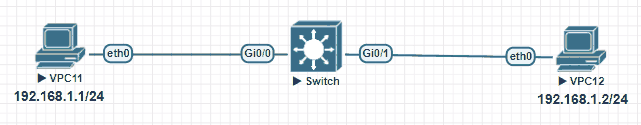

VPC11 (192.168.1.1/24) can't ping VPC12 (192.168.1.2/24). The hosts are fine; the problem is on the switch.

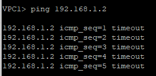

First, check the interfaces for problems.

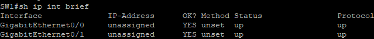

Both are up / up. Now check the VLAN assignments.

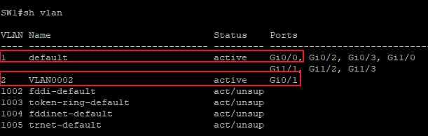

`show vlan` shows **Gi0/0 in VLAN 1 and Gi0/1 in VLAN 2**. Same subnet, but **different VLANs**, so they can't talk. Move Gi0/1 to VLAN 1.

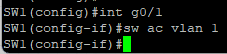

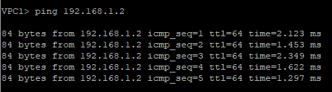

> **Lesson**: If hosts in the same subnet can't communicate, use `show vlan` to check that **both ports are in the same VLAN** first.

---

## 2. Switchport mode issues

Same topology, different problem. Both interfaces are up / up. Check the VLAN assignments.

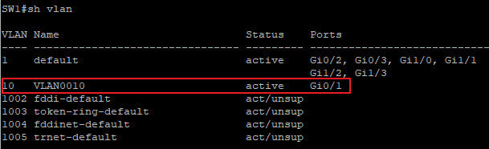

**Gi0/1 is in VLAN 10**, but **Gi0/0 doesn't appear anywhere.** There are two possible causes:
- The interface itself is broken → no, it's up / up
- The interface is a **trunk**, not an access port (`show vlan` only lists access ports)

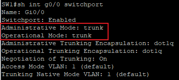

Gi0/0 is in **trunk mode** with native VLAN 1. The PC doesn't tag its frames with 802.1Q, so VPC11's traffic ends up in **native VLAN 1** and can't reach VPC12 in VLAN 10. Change it to access mode and put it in VLAN 10.

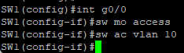

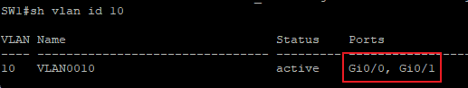

Both ports are now in VLAN 10. Check the operational mode too.

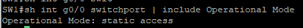

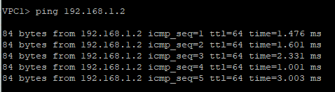

> **Lesson**: Make sure the port is in the **right switchport mode (access / trunk)**. If a port is missing from `show vlan`, it is probably a trunk.

---

## 3. VACL (VLAN access-list) issues

Same PCs, same switch, yet another problem. Let's check one item at a time.

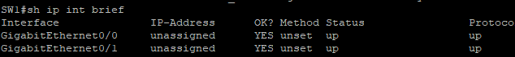

Interfaces up / up. VLAN assignments?

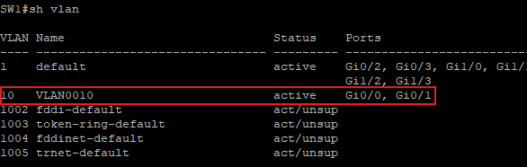

Both ports are in **VLAN 10**. Port security, then?

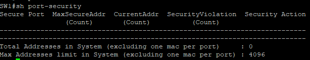

No port security either. Interfaces fine, same VLAN, no port security… if traffic is still blocked, suspect a **VACL**. A VACL can permit or deny traffic **within the same VLAN**.

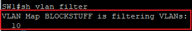

A VLAN access-map named `BLOCKSTUFF` is applied to VLAN 10.

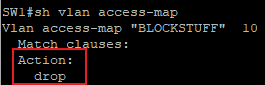

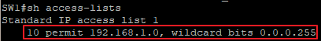

- The access-map action is **drop**.
- The match condition is access-list 1, and its `permit 192.168.1.0 0.0.0.255` doesn't mean "allow" — it means **"matches this range"**.
- Both PCs are in that range, so they match → **dropped**.

Change the action to **forward**.

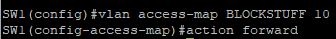

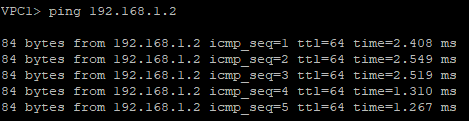

> **Lesson**: If everything else looks fine but hosts in the same VLAN can't communicate, check for a **VACL**. A `permit` in the ACL inside a VACL means "match"; the access-map **action** decides whether traffic is forwarded or dropped.

---

## 4. Trunk encapsulation issues

So far the problems were inside a single switch. When traffic has to cross several switches, check the **trunks** as well.

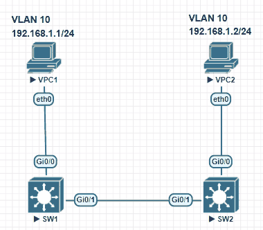

Each switch has a PC in VLAN 10, but they can't reach each other. Start with the PC-facing port on SW1.

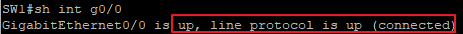

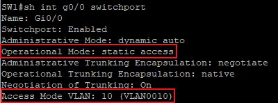

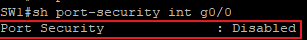

Up, access, **VLAN 10**, no port security. Check the same things on SW2.

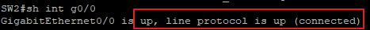

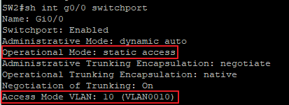

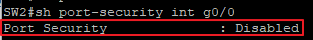

The PC-facing ports on both sides are fine. Now there are two options:
- Connect another VLAN 10 PC to the same switch and check whether hosts on the same switch can talk
- Check the **link between SW1 and SW2** ← where plenty can go wrong

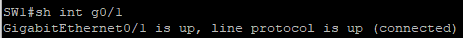

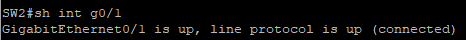

The interfaces are fine. Look at the switchport information.

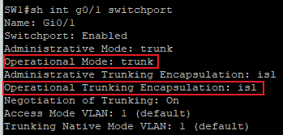

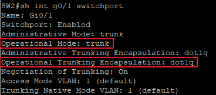

Both are trunks, but **SW1 uses ISL and SW2 uses 802.1Q**. With different encapsulations, neither side can understand the other's frames. Change SW1 to 802.1Q.

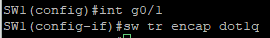

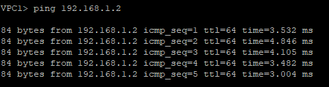

> **Lesson**: Both ends of a trunk must use the **same encapsulation**.
> Also, depending on the switch model, the default mode may be `dynamic auto` — and **if both ends are `dynamic auto`, the link becomes access**. It's safest to set trunks explicitly with `switchport mode trunk`. ([05. DTP](../05-Dynamic-Trunking-Protocol.md))

---

## 5. Trunk allowed VLAN issues

Same topology. Assume these items have already been checked and are fine:
- Interfaces (speed / duplex)
- Port security
- Switchport configuration (VLAN assignment, access mode)

Check the trunk between the switches.

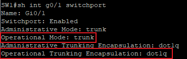

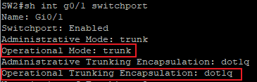

Both are trunks, both use 802.1Q. Fine so far. But an operational trunk **doesn't mean every VLAN is allowed** across it.

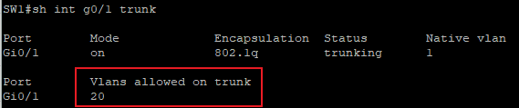

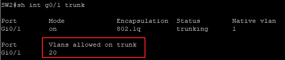

`Vlans allowed on trunk` is only **20**. VLAN 10 can't cross this trunk. Allow all VLANs.

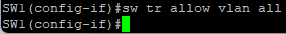

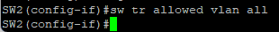

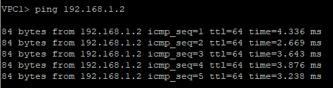

> **Lesson**: Always check whether a trunk **allows every VLAN** you need.
> In production, you often allow only the needed VLANs instead of `all`. To **add** a VLAN to the existing list, use `switchport trunk allowed vlan add 10`. Typing `allowed vlan 10` without `add` **overwrites** the list and can cut off other VLANs.

---

## Fix summary

| Case | Cause | Fix |
| --- | --- | --- |
| 1. VLAN assignment | The two ports are in different VLANs | `switchport access vlan 1` |
| 2. Switchport mode | The PC port is a trunk | `switchport mode access` → `switchport access vlan 10` |
| 3. VACL | access-map action is drop | `vlan access-map BLOCKSTUFF 10` → `action forward` |
| 4. Trunk encapsulation | ISL ↔ 802.1Q mismatch | `switchport trunk encapsulation dot1q` |
| 5. Allowed VLANs | Trunk allows only VLAN 20 | `switchport trunk allowed vlan all` |

## Key takeaways

- Work **from the bottom up**: interface → VLAN assignment → switchport mode → port security → VACL → trunk.
- If a port is missing from `show vlan`, it may be a **trunk**.
- If hosts in the same VLAN are still blocked, suspect a **VACL**.
- For trunks, check **mode and encapsulation on both ends** and the **allowed VLAN list**.
