# 802.1Q Q-in-Q Tunneling

[한국어](../09-802.1Q-Q-in-Q-Tunneling.md) | [English](09-802.1Q-Q-in-Q-Tunneling.en.md) | [日本語](09-802.1Q-Q-in-Q-Tunneling.ja.md) | [简体中文](09-802.1Q-Q-in-Q-Tunneling.zh-CN.md) | **Español** | [Français](09-802.1Q-Q-in-Q-Tunneling.fr.md)

El **túnel 802.1Q (Q-in-Q)** lo usan a menudo los proveedores de Metro Ethernet para ofrecer a sus clientes una **VPN de capa 2**. La idea es sencilla: el proveedor añade **una etiqueta 802.1Q más a cada trama** que recibe del cliente. Usando una etiqueta VLAN distinta por cliente, separa el tráfico de cada uno y lo transporta de forma transparente por su red.

| Ventaja | Descripción |
| --- | --- |
| Fácil de implementar | Funciona con switches normales, sin hardware especial |
| Sin enrutamiento | A diferencia de MPLS VPN, no hace falta protocolo de enrutamiento entre proveedor y cliente |
| Visto por el cliente | Las dos sedes parecen **conectadas directamente en capa 2** |

> Para la estructura de la etiqueta 802.1Q, lee primero [03. 802.1Q Encapsulation](../03-802.1Q-Encapsulation.md).

---

## Topología del laboratorio

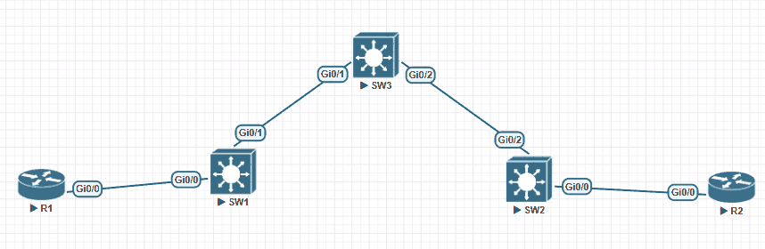

- **R1, R2**: sedes del cliente (el cliente usa la **VLAN 12** entre las sedes)
- **SW1, SW2, SW3**: red del proveedor (todo el tráfico de este cliente viaja en la **VLAN 123**)

## Cómo funciona

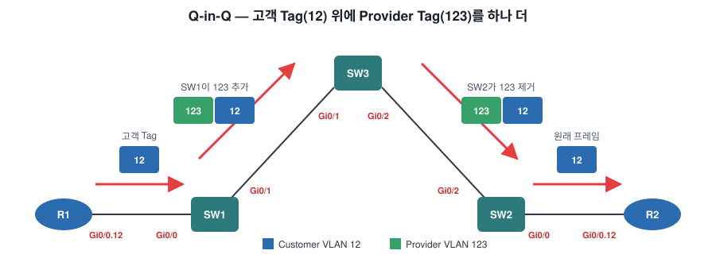

1. R1 envía tramas etiquetadas con la **VLAN 12**.
2. El switch del proveedor SW1 añade encima otra etiqueta **VLAN 123**.
3. Tras pasar por SW3, SW2 **quita la etiqueta exterior (123)** y reenvía a R2 la trama original de VLAN 12 que envió R1.

Visto como tramas:

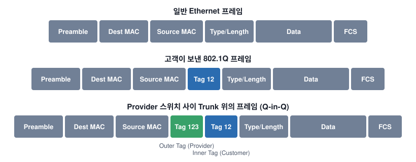

| Dónde | Trama |
| --- | --- |
| Cliente → SW1 | Tag 12 (interior, cliente) |
| Trunks SW1 ↔ SW3 ↔ SW2 | **Tag 123 (exterior, proveedor)** + Tag 12 |
| SW2 → Cliente | Tag 12 |

---

## 1. Configuración de los routers del cliente

R1 y R2 usan **subinterfaces** en la subred `192.168.12.0/24` y etiquetan todas las tramas con la **VLAN 12**.

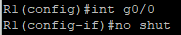

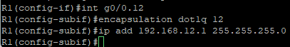

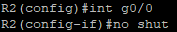

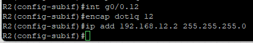

```
R1(config)#int g0/0
R1(config-if)#no shut
R1(config-if)#int g0/0.12
R1(config-subif)#encapsulation dot1q 12
R1(config-subif)#ip add 192.168.12.1 255.255.255.0
```

R2 es igual, solo cambia la IP: `192.168.12.2`.

---

## 2. Trunks entre los switches del proveedor

Configura **trunks 802.1Q** entre SW1 – SW3 y SW2 – SW3.

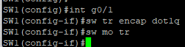

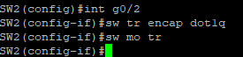

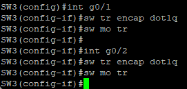

```
SW1(config)#int g0/1
SW1(config-if)#sw tr encap dot1q
SW1(config-if)#sw mo tr
```

---

## 3. Configuración del túnel Q-in-Q

Ahora la parte "Q-in-Q" de verdad. Todo lo que entra por las interfaces hacia los routers del cliente se etiqueta una vez más con la **VLAN 123**.

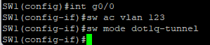

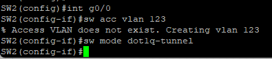

```
SW1(config)#int g0/0
SW1(config-if)#switchport access vlan 123
SW1(config-if)#switchport mode dot1q-tunnel
```

| Comando | Significado |
| --- | --- |
| `switchport mode dot1q-tunnel` | Añade **otra** etiqueta al tráfico que entra por este puerto |
| `switchport access vlan 123` | Define la **VLAN Q-in-Q (123)** exterior |

La VLAN 123 tiene que existir en **SW1, SW2 y SW3**. SW1 y SW2 la crearon automáticamente al asignarla como VLAN de acceso (`% Access VLAN does not exist. Creating vlan 123`), pero en SW3, que está en medio, hay que crearla a mano.

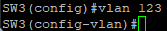

---

## 4. Verificación

### 4-1. Ping

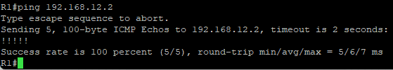

El ping de R1 → R2 funciona (5/5).

### 4-2. `show dot1q-tunnel`

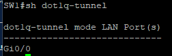

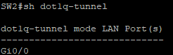

Este comando no da mucha información: solo muestra las **interfaces configuradas con dot1q-tunnel**.

### 4-3. En los trunks solo aparece la VLAN 123

Los **trunks entre switches** demuestran que el proveedor realmente está tunelizando las tramas del cliente.

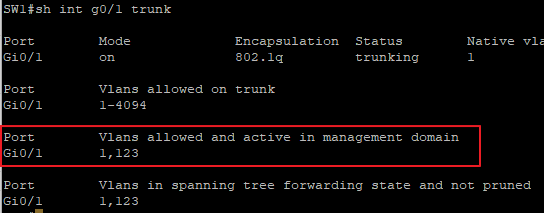

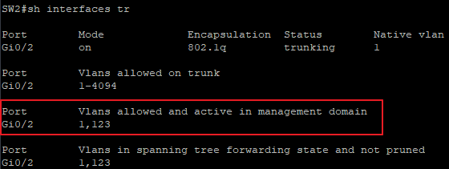

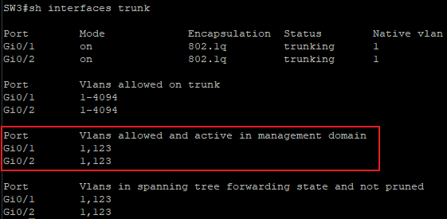

Aparte de la VLAN 1, `Vlans allowed and active in management domain` solo muestra **123**. **La VLAN 12 no aparece**, porque el tráfico del cliente va encapsulado dentro de la VLAN 123.

### 4-4. Tampoco hay VLAN 12 en spanning-tree

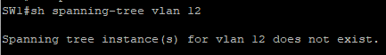

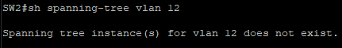

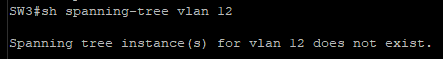

Los tres switches dicen `Spanning tree instance(s) for vlan 12 does not exist.` A los switches del proveedor **no les importa qué VLAN usa el cliente**; solo ven la VLAN 123.

---

## 5. Túnel de protocolos de capa 2

El túnel 802.1Q también puede llevar los **protocolos de capa 2** del cliente al otro lado de la red del proveedor.

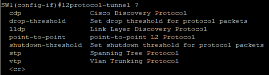

| Opción | Qué se tuneliza |
| --- | --- |
| `cdp` | Cisco Discovery Protocol |
| `lldp` | Link Layer Discovery Protocol |
| `stp` | Spanning Tree Protocol |
| `vtp` | VLAN Trunking Protocol |
| `point-to-point` | Protocolos punto a punto como PAgP y LACP (EtherChannel) |
| `drop-threshold` / `shutdown-threshold` | Descartar / apagar según el número de paquetes del protocolo |

Por ejemplo, si tunelizas CDP, R1 y R2 se ven como vecinos CDP aunque haya switches del proveedor en medio.

```
SW1(config-if)#l2protocol-tunnel cdp
```

---

## Ideas clave

- Q-in-Q = una **VPN de capa 2** que añade la etiqueta del proveedor (**exterior**) sobre la del cliente (**interior**).
- Puerto hacia el cliente: `switchport mode dot1q-tunnel` + `switchport access vlan <VLAN del proveedor>`.
- La VLAN del proveedor debe existir en **todos los switches** del camino (en los de tránsito, créala a mano).
- En los trunks y en spanning-tree del proveedor **no aparece la VLAN del cliente (12)**, solo la del proveedor (123).
- Con `l2protocol-tunnel` también se pueden tunelizar CDP / LLDP / STP / VTP / LACP·PAgP.
