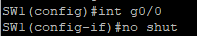
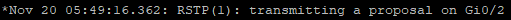
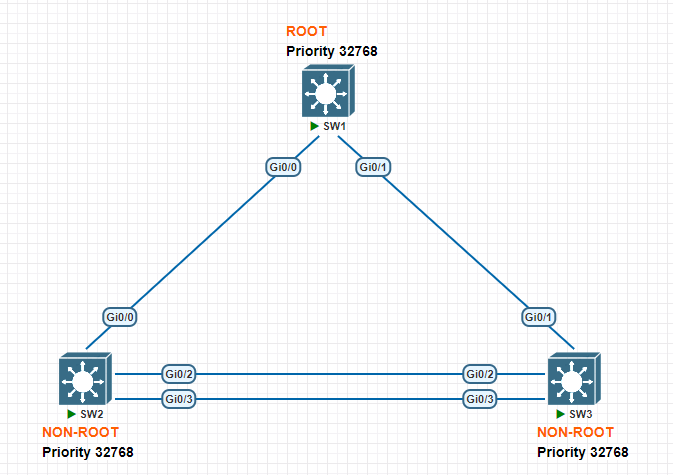
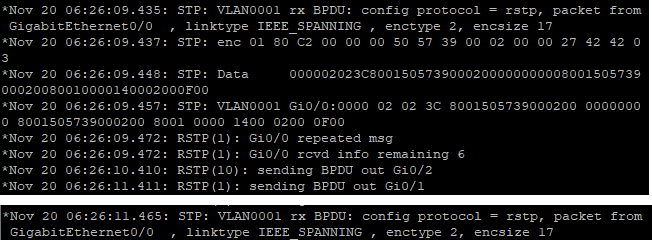

# Rapid Spanning-Tree (RSTP) Configuration

**한국어** | [English](README/02-Rapid-Spanning-Tree-Configuration.en.md) | [日本語](README/02-Rapid-Spanning-Tree-Configuration.ja.md) | [简体中文](README/02-Rapid-Spanning-Tree-Configuration.zh-CN.md) | [Español](README/02-Rapid-Spanning-Tree-Configuration.es.md) | [Français](README/02-Rapid-Spanning-Tree-Configuration.fr.md)

이전 문서에서 Classic Spanning Tree와 Rapid Spanning Tree의 차이, 그리고 RSTP가 어떻게 동작하는지 정리했습니다. 이번에는 실제로 RSTP를 설정하고, **debug와 show 명령으로 그 동작을 직접 확인**합니다.

> RSTP 동작 원리는 [01. Rapid Spanning-Tree](01-Rapid-Spanning-Tree.md) 를 먼저 보세요.

## 이번 실습에서 쓰는 명령어

| 명령어 | 용도 |
| --- | --- |
| `spanning-tree mode rapid-pvst` | RSTP(Rapid PVST+) 켜기 |
| `spanning-tree mode pvst` | Classic Spanning Tree(PVST)로 되돌리기 |
| `debug spanning-tree events` | Proposal / Agreement, 포트 역할 변화 보기 |
| `debug spanning-tree bpdu` | BPDU 송수신 보기 |
| `show spanning-tree` | Root Bridge, 포트 역할·상태, Link type 확인 |
| `spanning-tree portfast` | 포트를 **Edge port** 로 지정 |

---

## 실습 토폴로지


SW1이 Root Bridge가 되는 3대 스위치 삼각형 토폴로지입니다. 먼저 모든 스위치에서 Rapid Spanning Tree를 켭니다.


**명령어 하나**면 끝입니다. Cisco에서 쓰는 RSTP 구현은 **rapid-pvst** 이고, **VLAN마다** Rapid Spanning Tree를 따로 계산합니다.

---

## 1. Sync 메커니즘

먼저 Sync 동작을 확인합니다. SW1의 인터페이스를 모두 shutdown 합니다.


동작을 보기 위해 세 스위치 모두 debug를 켭니다.


이제 SW1의 인터페이스 하나를 다시 켭니다.



SW1에서 보이는 내용입니다.


SW1의 Gi0/0은 Designated가 되지만 바로 Forwarding으로 가지 않고, 먼저 SW2에게 **Proposal** 을 보냅니다.


SW2는 그동안 자기가 Root Bridge라고 생각하고 Proposal을 보내고 있었습니다. 그런데 Gi0/0으로 **superior BPDU** 를 받자 이 포트를 **Root port** 로 바꿉니다. 그리고 SW3 쪽 Gi0/2를 **Sync** 상태로 만듭니다.


Gi0/2가 SW3와 연결된 인터페이스입니다. Sync가 끝나면 SW2는 SW1에게 **Agreement** 로 응답합니다.


SW1에서도 Agreement를 받은 것을 볼 수 있습니다.


Agreement를 받은 SW1의 Gi0/0은 바로 **Forwarding** 이 됩니다. 이어서 SW2도 SW3에게 Proposal을 보냅니다.



SW3는 Proposal을 받으면 Agreement를 보냅니다.


SW2가 SW3의 Agreement를 받습니다.


SW3의 Agreement를 받은 SW2의 인터페이스도 Forwarding이 됩니다. 이게 전부입니다. **타이머 없이 몇 번의 핸드셰이크만으로** 인터페이스가 Forwarding으로 넘어갑니다.

---

## 2. Port State와 Port Role

연결을 완전히 복구하기 위해 남은 인터페이스도 켭니다.


전체 상태를 확인합니다.


- SW1이 **Root Bridge** 입니다 (`This bridge is the root`).
- `Spanning tree enabled protocol rstp`: RSTP로 동작 중입니다.
- Link type이 **P2p** 입니다. 인터페이스가 기본으로 **Full duplex** 이기 때문입니다.

나머지 두 스위치에서도 같은 명령을 실행합니다.


새로운 내용은 없습니다. Classic Spanning Tree와 같은 정보입니다. 지금 토폴로지를 그림으로 그리면 다음과 같습니다.


> 그림은 교재 기준(MAC AAA/BBB/CCC, FastEthernet 번호)입니다. 실습 장비에서는 SW3의 MAC이 SW2보다 낮아서 Alternate port가 **SW2 Gi0/2** 에 생겼습니다. Bridge ID가 낮은 쪽이 Designated가 된다는 원리는 같습니다.

SW2와 SW3 사이에 링크를 하나 더 연결해서, 토폴로지에 영향이 있는지 봅니다.




특별한 변화는 없습니다. 한쪽에 **Designated port** 가 하나, 다른 쪽에 **Alternate port** 가 하나 더 생겼을 뿐입니다.


### Hub를 넣으면: Backup port

지금까지는 RSTP 토폴로지가 Classic Spanning Tree와 똑같아 보입니다. 이번에는 처음 보는 것을 확인합니다. **SW2와 SW3 사이에 Hub를 넣습니다.** (Hub 실습은 교재 예시로, FastEthernet 인터페이스입니다.)


인터페이스를 다시 확인합니다.

```
SW2#show spanning-tree
VLAN0001
  Spanning tree enabled protocol rstp
  Root ID    Priority    32769
             Address     0001.C73E.A040
             Cost        19
             Port        14(FastEthernet0/14)
             Hello Time  2 sec  Max Age 20 sec  Forward Delay 15 sec

  Bridge ID  Priority    32769  (priority 32768 sys-id-ext 1)
             Address     0003.E489.C1D8
             Hello Time  2 sec  Max Age 20 sec  Forward Delay 15 sec
             Aging Time  20

Interface        Role Sts Cost      Prio.Nbr Type
---------------- ---- --- --------- -------- --------------------------------
Fa0/19           Back BLK 19        128.19   Shr
Fa0/14           Root FWD 19        128.14   P2p
Fa0/16           Desg FWD 19        128.16   Shr
```

```
SW3#show spanning-tree
VLAN0001
  Spanning tree enabled protocol rstp
  Root ID    Priority    32769
             Address     0001.C73E.A040
             Cost        19
             Port        14(FastEthernet0/14)
             Hello Time  2 sec  Max Age 20 sec  Forward Delay 15 sec

  Bridge ID  Priority    32769  (priority 32768 sys-id-ext 1)
             Address     00E0.F757.02B5
             Hello Time  2 sec  Max Age 20 sec  Forward Delay 15 sec
             Aging Time  20

Interface        Role Sts Cost      Prio.Nbr Type
---------------- ---- --- --------- -------- --------------------------------
Fa0/14           Root FWD 19        128.14   P2p
Fa0/16           Altn BLK 19        128.16   Shr
Fa0/19           Altn BLK 19        128.19   Shr
```

- SW2의 Fa0/19가 **Backup port (Back BLK)** 가 됐습니다. 자기 Fa0/16이 보낸 BPDU를 Hub를 통해 다시 받기 때문입니다.
- Link type이 **Shr (shared)** 입니다. Hub 때문에 인터페이스가 **Half duplex** 로 바뀌었기 때문입니다.

요즘은 Hub를 거의 쓰지 않아서 실제 네트워크에서 Backup port를 볼 일은 드뭅니다. 하지만 보게 된다면 이유는 이제 알 수 있습니다.

---

## 3. BPDU

RSTP에서는 모든 스위치가 **2초(hello time)마다** BPDU를 보냅니다. debug로 직접 확인할 수 있습니다.


`debug spanning-tree bpdu` 명령은 주고받는 BPDU를 보여 줍니다.



BPDU 내용을 자세히 보기에는 불편하지만, SW2가 BPDU를 **받고**, 자기 인터페이스로 **보내고** 있다는 것은 확인할 수 있습니다. BPDU 내용을 자세히 보고 싶다면 **Wireshark** 로 패킷을 캡처하는 것을 추천합니다.

---

## 4. Link Failure

Hub를 빼고, 이번에는 링크 장애를 만들어 RSTP가 어떻게 대응하는지 봅니다.


### 직접 장애 (Direct link failure)


SW1의 Gi0/1(SW3 쪽)을 shutdown 합니다.


SW3에서 보이는 내용입니다.


SW3는 Root port(Gi0/1)에 문제가 생긴 것을 **거의 바로** 알아채고, **Alternate port(Gi0/2)를 Root port로** 바꿉니다. Classic Spanning Tree의 **UplinkFast** 와 같은 동작인데, RSTP에서는 **기본으로 켜져 있습니다.**

다음 실습 전에 연결을 복구합니다.


### 간접 장애 (Indirect link failure)

Classic Spanning Tree에는 **BackboneFast** 기능이 있습니다. RSTP에도 비슷한 메커니즘이 **기본으로** 들어 있습니다. SW1에서 SW2와 연결된 인터페이스를 shutdown 합니다.


SW3 입장에서는 간접 장애입니다. SW2에서 보이는 내용입니다.


SW2는 Root port를 잃고 잠깐 **자기가 Root Bridge라고** 생각합니다(`we become the root bridge`). 그러다 SW3에게서 **superior BPDU** 를 받고 Gi0/2를 새 Root port로 바꿉니다. 이 과정이 **눈 깜짝할 사이에** 끝납니다. shutdown을 풀고 다음으로 넘어갑니다.


---

## 5. Edge Port

이번에는 Edge port를 봅니다. SW2의 Gi0/1에 **VPC(PC)** 를 연결했습니다.


다른 장비가 연결된 인터페이스를 RSTP가 어떻게 처리하는지 봅니다.


Sync 메커니즘 때문에 PC 쪽으로 **Proposal을 계속 보냅니다.** PC는 Agreement를 보내지 않으므로, 시간이 지나 만료(`fdwhile Expired`)된 뒤에야 Forwarding이 됩니다. 결국 Forwarding이 되기는 하지만 **시간이 걸립니다.**

그래서 PC가 연결된 인터페이스는 **Edge port** 라고 알려 줘야 합니다. "Edge"는 Spanning Tree 토폴로지의 **가장자리** 라는 뜻입니다. **portfast** 를 켜면 됩니다.


차이를 보기 위해 인터페이스를 shutdown 했다가 다시 켭니다.


결과입니다.


인터페이스가 **바로 Forwarding** 이 됩니다. 스위치는 이 포트가 Spanning Tree의 가장자리라는 것을 알기 때문에 Proposal을 보낼 필요가 없습니다.

---

## 6. 호환성 (Compatibility)

마지막으로 Classic Spanning Tree와의 호환성을 봅니다. SW2를 **PVST 모드** 로 바꾸고, SW1과 SW3는 Rapid PVST로 둡니다.


SW2에서 보이는 내용입니다.


SW2는 Root Bridge에게서 BPDU를 받고, 인터페이스가 **Listening → Learning → Forwarding** 단계를 거치는 것을 볼 수 있습니다. RSTP 스위치는 Classic Spanning Tree BPDU를 받으면 **자기도 Classic BPDU를 만들어 보내므로**, 네트워크는 계속 정상 동작합니다.

인터페이스를 다시 확인합니다.


- SW1 Gi0/0, SW3 Gi0/2: SW2와 맞닿은 포트에 **`Peer(STP)`** 가 붙었습니다. 상대가 Classic STP라는 뜻입니다.
- SW2 Gi0/1: PC가 연결된 포트라 **`Edge`** 로 표시됩니다.

모든 스위치가 Port State에 대해 여전히 같은 결론을 내리고, 모든 것이 정상 동작합니다.

---

## 핵심 정리

- `spanning-tree mode rapid-pvst` **명령어 하나**로 RSTP를 켭니다. VLAN마다 Rapid Spanning Tree를 계산합니다.
- **Proposal → Sync → Agreement** 핸드셰이크로 타이머 없이 Forwarding이 됩니다 (`debug spanning-tree events` 로 확인).
- Full duplex 링크는 **P2p**, Hub처럼 Half duplex 링크는 **Shr**. Hub에서는 **Backup port** 가 생깁니다.
- 모든 스위치가 **2초마다** BPDU를 보냅니다 (`debug spanning-tree bpdu`). 내용은 Wireshark로 보는 것이 편합니다.
- **UplinkFast**(직접 장애)와 **BackboneFast**(간접 장애)와 같은 동작이 **기본으로** 들어 있습니다.
- PC 같은 끝단 장비 포트는 **`spanning-tree portfast`** 로 **Edge port** 를 만들어야 바로 Forwarding이 됩니다.
- Classic STP와 **호환**됩니다. 맞닿은 포트는 **`Peer(STP)`** 로 표시되고 Classic 방식으로 동작합니다.
