# Rapid Spanning-Tree (RSTP) Configuration

[한국어](../02-Rapid-Spanning-Tree-Configuration.md) | **English** | [日本語](02-Rapid-Spanning-Tree-Configuration.ja.md) | [简体中文](02-Rapid-Spanning-Tree-Configuration.zh-CN.md) | [Español](02-Rapid-Spanning-Tree-Configuration.es.md) | [Français](02-Rapid-Spanning-Tree-Configuration.fr.md)

The previous note covered the differences between classic and rapid spanning tree, and how RSTP works. This time we actually configure RSTP and **watch it work with debug and show commands**.

> For how RSTP works, read [01. Rapid Spanning-Tree](../../01-Rapid-Spanning-Tree/README/01-Rapid-Spanning-Tree.en.md) first.

## Commands used in this lab

| Command | Purpose |
| --- | --- |
| `spanning-tree mode rapid-pvst` | Enable RSTP (Rapid PVST+) |
| `spanning-tree mode pvst` | Go back to classic spanning tree (PVST) |
| `debug spanning-tree events` | Watch proposals / agreements and port role changes |
| `debug spanning-tree bpdu` | Watch BPDUs sent and received |
| `show spanning-tree` | Check the root bridge, port roles/states and link type |
| `spanning-tree portfast` | Make a port an **edge port** |

---

## Lab topology


A triangle of three switches, with SW1 as the root bridge. First, enable rapid spanning tree on every switch.


That's it — **just one command**. Cisco's RSTP implementation is **rapid-pvst**, which calculates a separate rapid spanning tree **for each VLAN**.

---

## 1. Sync mechanism

First, let's look at sync. Shut down the interfaces on SW1.


Enable a debug on all three switches to see it in action.

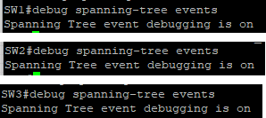

Now bring one of SW1's interfaces back up.


Here's what SW1 shows.


SW1's Gi0/0 becomes designated, but it doesn't go to forwarding right away. It first sends a **proposal** to SW2.


Until now, SW2 thought it was the root bridge and was sending its own proposals. When it receives a **superior BPDU** on Gi0/0, it makes that port its **root port**. Then it puts Gi0/2, towards SW3, into **sync**.


Gi0/2 is the interface that connects to SW3. Once sync is done, SW2 answers SW1 with an **agreement**.

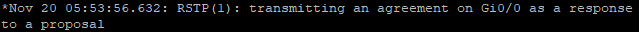

We can see the agreement arrive on SW1 as well.


With the agreement in hand, SW1's Gi0/0 goes to **forwarding** immediately. Next, SW2 sends a proposal to SW3.


When SW3 receives it, it sends an agreement.


SW2 receives the agreement from SW3.


With SW3's agreement, SW2's interface goes to forwarding too. That's all there is to it: **a few handshakes and no timers**, and the interfaces move to forwarding.

---

## 2. Port states and port roles

Bring the remaining interface back up to fully restore connectivity.

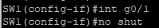

Let's check the overview.


- SW1 is the **root bridge** (`This bridge is the root`).
- `Spanning tree enabled protocol rstp`: we are running RSTP.
- The link type is **P2p**, because the interfaces are **full duplex** by default.

Run the same command on the other two switches.


Nothing new here — it's the same information as classic spanning tree. Drawn as a picture, the topology now looks like this.

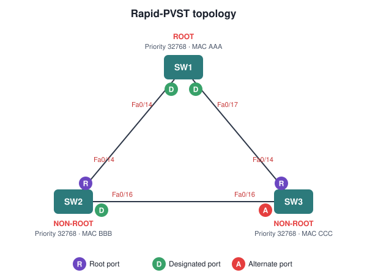

> The figure follows the textbook (MAC AAA/BBB/CCC, FastEthernet numbers). In the lab, SW3's MAC is lower than SW2's, so the alternate port ended up on **SW2 Gi0/2**. The principle is the same: the side with the lower bridge ID becomes designated.

Let's add a second link between SW2 and SW3 to see whether it changes the topology.


Nothing spectacular. We just get one more **designated port** on one side and one more **alternate port** on the other.


### Adding a hub: the backup port

So far, the RSTP topology looks exactly like classic spanning tree. Now for something new: **put a hub between SW2 and SW3.** (The hub lab is a textbook example using FastEthernet interfaces.)


Check the interfaces again.

```
SW2#show spanning-tree
VLAN0001
  Spanning tree enabled protocol rstp
  Root ID    Priority    32769
             Address     0001.C73E.A040
             Cost        19
             Port        14(FastEthernet0/14)
             Hello Time  2 sec  Max Age 20 sec  Forward Delay 15 sec

  Bridge ID  Priority    32769  (priority 32768 sys-id-ext 1)
             Address     0003.E489.C1D8
             Hello Time  2 sec  Max Age 20 sec  Forward Delay 15 sec
             Aging Time  20

Interface        Role Sts Cost      Prio.Nbr Type
---------------- ---- --- --------- -------- --------------------------------
Fa0/19           Back BLK 19        128.19   Shr
Fa0/14           Root FWD 19        128.14   P2p
Fa0/16           Desg FWD 19        128.16   Shr
```

```
SW3#show spanning-tree
VLAN0001
  Spanning tree enabled protocol rstp
  Root ID    Priority    32769
             Address     0001.C73E.A040
             Cost        19
             Port        14(FastEthernet0/14)
             Hello Time  2 sec  Max Age 20 sec  Forward Delay 15 sec

  Bridge ID  Priority    32769  (priority 32768 sys-id-ext 1)
             Address     00E0.F757.02B5
             Hello Time  2 sec  Max Age 20 sec  Forward Delay 15 sec
             Aging Time  20

Interface        Role Sts Cost      Prio.Nbr Type
---------------- ---- --- --------- -------- --------------------------------
Fa0/14           Root FWD 19        128.14   P2p
Fa0/16           Altn BLK 19        128.16   Shr
Fa0/19           Altn BLK 19        128.19   Shr
```

- SW2's Fa0/19 became a **backup port (Back BLK)**, because it hears the BPDUs that its own Fa0/16 sends, through the hub.
- The link type is **Shr (shared)**, because the hub makes the interfaces run at **half duplex**.

Hubs are rare these days, so you probably won't see a backup port in a production network. But if you do, now you know why.

---

## 3. BPDU

With RSTP, every switch sends a BPDU **every 2 seconds (hello time)**. You can prove it with a debug.

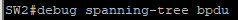

The `debug spanning-tree bpdu` command shows BPDUs being sent and received.


It isn't very handy for reading what's inside a BPDU, but it does show that SW2 is **receiving** BPDUs and **sending** them on its interfaces. To look at the contents of a BPDU, a packet capture with **Wireshark** is the better choice.

---

## 4. Link failures

Remove the hub. This time we create link failures and see how RSTP deals with them.


### Direct link failure


Shut down SW1's Gi0/1 (towards SW3).

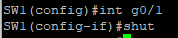

Here's what SW3 shows.


SW3 notices the problem on its root port (Gi0/1) **almost immediately** and changes its **alternate port (Gi0/2) into the root port**. This is the same as **UplinkFast** in classic spanning tree, but in RSTP it is **enabled by default**.

Restore connectivity before the next test.

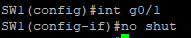

### Indirect link failure

Classic spanning tree has the **BackboneFast** feature. RSTP has a similar mechanism that is **enabled by default**. Shut down the interface on SW1 that connects to SW2.

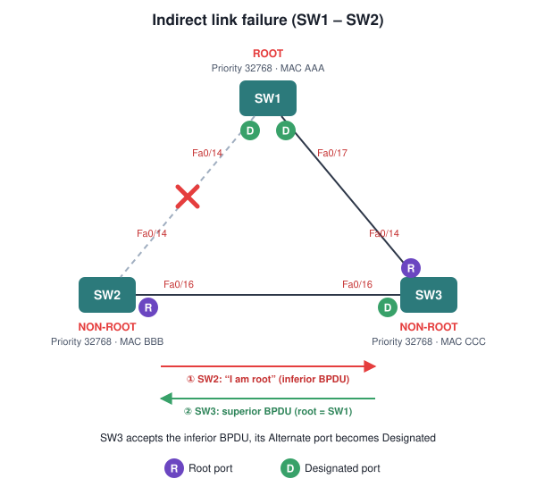

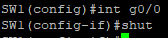

For SW3, this is an indirect link failure. Here's what SW2 shows.


SW2 loses its root port and briefly thinks **it is the root bridge** (`we become the root bridge`). Then it receives a **superior BPDU** from SW3 and makes Gi0/2 its new root port. All of this happens **in the blink of an eye**. Remove the shutdown and move on.


---

## 5. Edge ports

Now let's look at edge ports. A **VPC (PC)** is connected to SW2's Gi0/1.

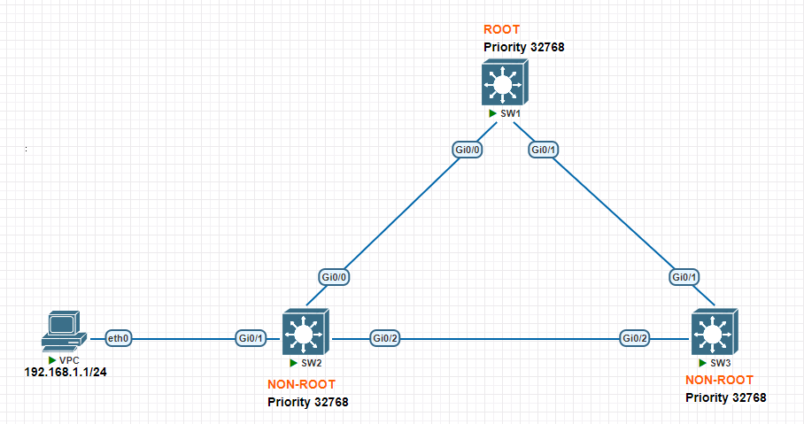

Let's see how RSTP handles an interface that connects to another device.


Because of the sync mechanism, it **keeps sending proposals** towards the PC. The PC never sends an agreement, so the port only goes to forwarding after they expire (`fdwhile Expired`). It does end up forwarding, but **it takes a while**.

That's why you have to tell RSTP that the interface connecting the PC is an **edge port**. "Edge" means the **border** of the spanning tree topology. Just enable **portfast**.


To see the difference, shut the interface and bring it back up.


Here's the result.


The interface goes to **forwarding right away**. The switch knows this port is the edge of the spanning tree, so it doesn't need to send proposals to it.

---

## 6. Compatibility

Last, compatibility with classic spanning tree. Change SW2 to **PVST mode**, and leave SW1 and SW3 on rapid PVST.

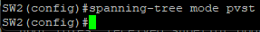

Here's what SW2 shows.


SW2 receives BPDUs from the root bridge, and its interfaces go through **listening → learning → forwarding**. When RSTP switches receive a classic spanning tree BPDU, **they start sending classic BPDUs themselves**, so the network keeps working.

Check the interfaces again.


- SW1 Gi0/0, SW3 Gi0/2: the ports facing SW2 now show **`Peer(STP)`**, meaning the neighbor runs classic STP.
- SW2 Gi0/1: the port with the PC is shown as **`Edge`**.

All switches still agree on the port states, and everything works as it should.

---

## Key points

- **One command**, `spanning-tree mode rapid-pvst`, enables RSTP. A rapid spanning tree is calculated per VLAN.
- The **proposal → sync → agreement** handshake moves ports to forwarding without timers (check with `debug spanning-tree events`).
- Full-duplex links are **P2p**, half-duplex links such as a hub are **Shr**. A hub creates a **backup port**.
- Every switch sends a BPDU **every 2 seconds** (`debug spanning-tree bpdu`). Wireshark is easier for reading the contents.
- Behavior like **UplinkFast** (direct failure) and **BackboneFast** (indirect failure) is built in **by default**.
- Ports for end devices such as PCs need **`spanning-tree portfast`** to become **edge ports** and forward right away.
- RSTP is **compatible** with classic STP. Ports facing it show **`Peer(STP)`** and run the classic way.
