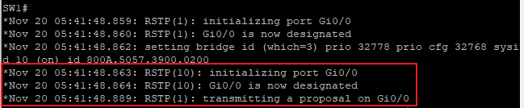
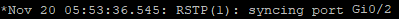
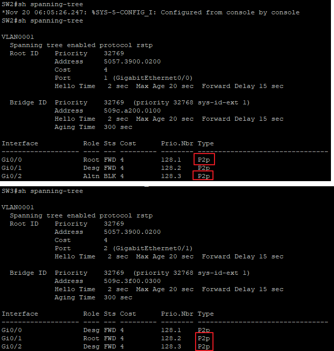
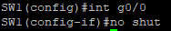
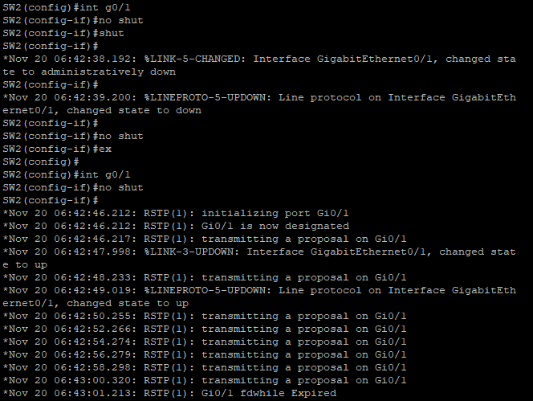
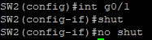
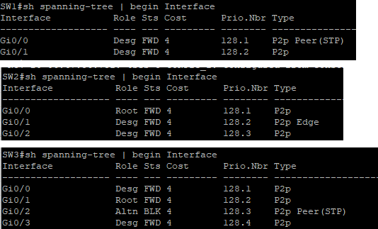

# Rapid Spanning-Tree (RSTP) Configuration

[한국어](../02-Rapid-Spanning-Tree-Configuration.md) | [English](02-Rapid-Spanning-Tree-Configuration.en.md) | [日本語](02-Rapid-Spanning-Tree-Configuration.ja.md) | [简体中文](02-Rapid-Spanning-Tree-Configuration.zh-CN.md) | **Español** | [Français](02-Rapid-Spanning-Tree-Configuration.fr.md)

En la nota anterior vimos las diferencias entre el spanning tree clásico y el rapid spanning tree, y cómo funciona RSTP. Esta vez configuramos RSTP de verdad y **observamos su funcionamiento con comandos debug y show**.

> Para entender cómo funciona RSTP, lee primero [01. Rapid Spanning-Tree](../../01-Rapid-Spanning-Tree/README/01-Rapid-Spanning-Tree.es.md).

## Comandos usados en este laboratorio

| Comando | Para qué sirve |
| --- | --- |
| `spanning-tree mode rapid-pvst` | Activar RSTP (Rapid PVST+) |
| `spanning-tree mode pvst` | Volver al spanning tree clásico (PVST) |
| `debug spanning-tree events` | Ver proposals / agreements y cambios de rol de puerto |
| `debug spanning-tree bpdu` | Ver los BPDU enviados y recibidos |
| `show spanning-tree` | Comprobar el root bridge, roles/estados de puerto y link type |
| `spanning-tree portfast` | Convertir un puerto en **edge port** |

---

## Topología del laboratorio


Un triángulo de tres switches, con SW1 como root bridge. Primero activamos rapid spanning tree en todos los switches.


Eso es todo: **un solo comando**. La implementación de RSTP de Cisco es **rapid-pvst**, que calcula un rapid spanning tree independiente **para cada VLAN**.

---

## 1. Mecanismo de sync

Primero veamos el sync. Apagamos (shutdown) las interfaces de SW1.


Activamos un debug en los tres switches para verlo en acción.


Ahora volvemos a encender una de las interfaces de SW1.


Esto es lo que muestra SW1.



Gi0/0 de SW1 pasa a designated, pero no entra en forwarding enseguida. Primero envía una **proposal** a SW2.


Hasta ese momento, SW2 creía ser el root bridge y enviaba sus propias proposals. Al recibir un **superior BPDU** en Gi0/0, convierte ese puerto en su **root port**. Después pone Gi0/2, hacia SW3, en estado de **sync**.



Gi0/2 es la interfaz que conecta con SW3. Cuando termina el sync, SW2 responde a SW1 con un **agreement**.


También vemos que el agreement llega a SW1.


Con el agreement recibido, Gi0/0 de SW1 pasa a **forwarding** de inmediato. A continuación, SW2 envía una proposal a SW3.


Cuando SW3 la recibe, envía un agreement.


SW2 recibe el agreement de SW3.


Con el agreement de SW3, la interfaz de SW2 también pasa a forwarding. Así de simple: **unos pocos handshakes y ningún temporizador**, y las interfaces pasan a forwarding.

---

## 2. Estados y roles de puerto

Encendemos la interfaz que falta para restablecer la conectividad por completo.


Veamos el estado general.


- SW1 es el **root bridge** (`This bridge is the root`).
- `Spanning tree enabled protocol rstp`: estamos ejecutando RSTP.
- El link type es **P2p**, porque las interfaces están en **full duplex** por defecto.

Ejecutamos el mismo comando en los otros dos switches.



Nada nuevo: es la misma información que en el spanning tree clásico. Dibujada, la topología queda así.


> La figura sigue el ejemplo del libro (MAC AAA/BBB/CCC, numeración FastEthernet). En el laboratorio, la MAC de SW3 es menor que la de SW2, así que el alternate port quedó en **SW2 Gi0/2**. El principio es el mismo: el lado con el bridge ID más bajo es el designated.

Añadimos un segundo enlace entre SW2 y SW3 para ver si cambia la topología.


Nada espectacular. Solo aparece un **designated port** más en un lado y un **alternate port** más en el otro.


### Con un hub: el backup port

Hasta ahora, la topología RSTP es idéntica a la del spanning tree clásico. Ahora veamos algo nuevo: **ponemos un hub entre SW2 y SW3.** (El laboratorio del hub es un ejemplo del libro, con interfaces FastEthernet.)


Revisamos de nuevo las interfaces.

```
SW2#show spanning-tree
VLAN0001
  Spanning tree enabled protocol rstp
  Root ID    Priority    32769
             Address     0001.C73E.A040
             Cost        19
             Port        14(FastEthernet0/14)
             Hello Time  2 sec  Max Age 20 sec  Forward Delay 15 sec

  Bridge ID  Priority    32769  (priority 32768 sys-id-ext 1)
             Address     0003.E489.C1D8
             Hello Time  2 sec  Max Age 20 sec  Forward Delay 15 sec
             Aging Time  20

Interface        Role Sts Cost      Prio.Nbr Type
---------------- ---- --- --------- -------- --------------------------------
Fa0/19           Back BLK 19        128.19   Shr
Fa0/14           Root FWD 19        128.14   P2p
Fa0/16           Desg FWD 19        128.16   Shr
```

```
SW3#show spanning-tree
VLAN0001
  Spanning tree enabled protocol rstp
  Root ID    Priority    32769
             Address     0001.C73E.A040
             Cost        19
             Port        14(FastEthernet0/14)
             Hello Time  2 sec  Max Age 20 sec  Forward Delay 15 sec

  Bridge ID  Priority    32769  (priority 32768 sys-id-ext 1)
             Address     00E0.F757.02B5
             Hello Time  2 sec  Max Age 20 sec  Forward Delay 15 sec
             Aging Time  20

Interface        Role Sts Cost      Prio.Nbr Type
---------------- ---- --- --------- -------- --------------------------------
Fa0/14           Root FWD 19        128.14   P2p
Fa0/16           Altn BLK 19        128.16   Shr
Fa0/19           Altn BLK 19        128.19   Shr
```

- Fa0/19 de SW2 se convirtió en **backup port (Back BLK)**, porque recibe a través del hub los BPDU que envía su propia Fa0/16.
- El link type es **Shr (shared)**, porque el hub hace que las interfaces funcionen en **half duplex**.

Hoy los hubs son raros, así que probablemente no verás un backup port en una red de producción. Pero si lo ves, ya sabes por qué.

---

## 3. BPDU

Con RSTP, todos los switches envían un BPDU **cada 2 segundos (hello time)**. Puedes comprobarlo con un debug.


El comando `debug spanning-tree bpdu` muestra los BPDU enviados y recibidos.


No es muy práctico para leer el contenido de un BPDU, pero sí muestra que SW2 está **recibiendo** BPDU y **enviándolos** por sus interfaces. Para ver el contenido de un BPDU, es mejor hacer una captura con **Wireshark**.

---

## 4. Fallos de enlace

Quitamos el hub. Esta vez provocamos fallos de enlace para ver cómo responde RSTP.


### Fallo directo (Direct link failure)


Apagamos Gi0/1 de SW1 (hacia SW3).


Esto es lo que muestra SW3.


SW3 detecta el problema en su root port (Gi0/1) **casi al instante** y convierte su **alternate port (Gi0/2) en root port**. Es lo mismo que **UplinkFast** en el spanning tree clásico, pero en RSTP está **activado por defecto**.

Restablecemos la conectividad antes de la siguiente prueba.


### Fallo indirecto (Indirect link failure)

El spanning tree clásico tiene la función **BackboneFast**. RSTP incluye un mecanismo parecido **por defecto**. Apagamos la interfaz de SW1 que conecta con SW2.


Para SW3 es un fallo indirecto. Esto es lo que muestra SW2.


SW2 pierde su root port y por un momento cree que **es el root bridge** (`we become the root bridge`). Luego recibe un **superior BPDU** de SW3 y convierte Gi0/2 en su nuevo root port. Todo ocurre **en un abrir y cerrar de ojos**. Quitamos el shutdown y seguimos.



---

## 5. Edge ports

Ahora veamos los edge ports. Hay un **VPC (PC)** conectado a Gi0/1 de SW2.


Veamos cómo trata RSTP una interfaz conectada a otro dispositivo.



Por el mecanismo de sync, **sigue enviando proposals** hacia el PC. El PC nunca responde con un agreement, así que el puerto solo pasa a forwarding cuando expiran (`fdwhile Expired`). Al final llega a forwarding, pero **tarda un rato**.

Por eso hay que indicar a RSTP que la interfaz del PC es un **edge port**. "Edge" significa el **borde** de la topología de spanning tree. Basta con activar **portfast**.


Para ver la diferencia, apagamos la interfaz y la volvemos a encender.



Este es el resultado.


La interfaz pasa a **forwarding de inmediato**. El switch sabe que este puerto es el borde del spanning tree, así que no necesita enviarle proposals.

---

## 6. Compatibilidad (Compatibility)

Por último, la compatibilidad con el spanning tree clásico. Cambiamos SW2 a **modo PVST** y dejamos SW1 y SW3 en rapid PVST.


Esto es lo que muestra SW2.


SW2 recibe BPDU del root bridge y sus interfaces pasan por **listening → learning → forwarding**. Cuando los switches RSTP reciben un BPDU del spanning tree clásico, **empiezan a enviar ellos mismos BPDU clásicos**, así que la red sigue funcionando.

Revisamos de nuevo las interfaces.



- SW1 Gi0/0, SW3 Gi0/2: los puertos hacia SW2 muestran **`Peer(STP)`**, es decir, el vecino usa STP clásico.
- SW2 Gi0/1: el puerto del PC aparece como **`Edge`**.

Todos los switches siguen de acuerdo en los estados de puerto, y todo funciona como debe.

---

## Puntos clave

- **Un solo comando**, `spanning-tree mode rapid-pvst`, activa RSTP. Se calcula un rapid spanning tree por VLAN.
- El handshake **proposal → sync → agreement** lleva los puertos a forwarding sin temporizadores (compruébalo con `debug spanning-tree events`).
- Los enlaces full duplex son **P2p**; los half duplex, como un hub, son **Shr**. Un hub crea un **backup port**.
- Todos los switches envían un BPDU **cada 2 segundos** (`debug spanning-tree bpdu`). Para leer el contenido, Wireshark es más cómodo.
- Un comportamiento como **UplinkFast** (fallo directo) y **BackboneFast** (fallo indirecto) viene incluido **por defecto**.
- Los puertos de dispositivos finales como un PC necesitan **`spanning-tree portfast`** para ser **edge ports** y reenviar de inmediato.
- RSTP es **compatible** con STP clásico. Los puertos que dan hacia él muestran **`Peer(STP)`** y funcionan a la manera clásica.
