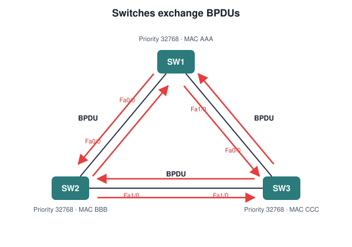
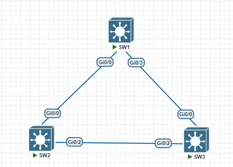
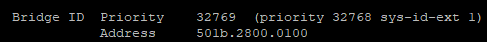
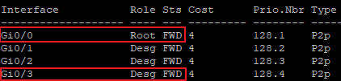

# Introduction to Spanning-Tree

**한국어** | [English](README/01-Introduction-to-Spanning-Tree.en.md) | [日本語](README/01-Introduction-to-Spanning-Tree.ja.md) | [简体中文](README/01-Introduction-to-Spanning-Tree.zh-CN.md) | [Español](README/01-Introduction-to-Spanning-Tree.es.md) | [Français](README/01-Introduction-to-Spanning-Tree.fr.md)

Spanning-tree는 스위치에서 동작하며 **루프 문제를 해결**해 주는 프로토콜입니다. 네트워크 엔지니어라면 반드시 이해해야 하는 프로토콜이고, CCNA 시험에서도 꼭 만나게 됩니다. 이 문서에서는 spanning-tree가 왜 필요한지, 어떻게 동작하는지, 그리고 Cisco 스위치에서 spanning-tree 토폴로지를 어떻게 확인하는지 정리합니다.

---

## 1. Spanning-tree가 왜 필요한가?

루프란 무엇이고, 어떻게 생길까요? 예를 들어 보겠습니다.

위 그림에는 스위치 두 대가 케이블 하나로 연결되어 있습니다. 케이블이 하나뿐이라 **단일 장애점**이 있습니다. 이를 없애기 위해 케이블을 하나 더 연결합니다.

케이블이 하나 더 생겨서 **이중화**가 되었습니다. 하지만 이중화는 **루프**도 함께 가져옵니다. 왜 루프가 생기는지 살펴보겠습니다.

1. H1이 H2의 MAC 주소를 찾기 위해 ARP 요청을 보냅니다. ARP 요청은 **브로드캐스트 프레임**입니다.
2. SW1은 프레임을 받은 인터페이스를 제외한 모든 인터페이스로 이 브로드캐스트를 전달합니다.
3. SW2는 두 개의 브로드캐스트 프레임을 모두 받습니다.

SW2는 이 브로드캐스트 프레임을 어떻게 처리할까요?

1. 프레임을 받은 인터페이스를 제외한 모든 인터페이스로 전달합니다.
2. 즉, Fa0/0으로 받은 프레임은 Fa1/0으로 전달됩니다.
3. Fa1/0으로 받은 프레임은 Fa0/0으로 전달됩니다.

이제 어떻게 될지 보이시나요? **루프**입니다! 두 스위치는 다음 중 하나가 일어날 때까지 프레임을 계속 주고받습니다.

- 케이블 하나를 뽑아서 루프를 없앤다.
- 트래픽이 너무 많아져서 스위치 중 하나가 멈춘다.

이더넷 프레임에는 **TTL(Time to Live) 값이 없기** 때문에 루프가 생기면 영원히 돕니다. ARP 요청 외에도 브로드캐스트되는 프레임은 많습니다. 예를 들어 스위치가 목적지 MAC 주소를 모르면 그 프레임은 **플러딩**됩니다.

---

## 2. Spanning-tree가 루프를 해결하는 방법

Spanning-tree는 **일부 인터페이스를 차단(block)**해서 루프가 없는 토폴로지를 만듭니다. 동작 방식을 예로 보겠습니다.

스위치 세 대를 삼각형으로 연결해 이중화를 구성했습니다. 즉, 여기에도 루프가 있습니다. 예시를 위해 MAC 주소는 단순하게 표시했습니다.

- SW1: MAC AAA
- SW2: MAC BBB
- SW3: MAC CCC

Spanning-tree가 켜져 있으면 모든 스위치는 **BPDU(Bridge Protocol Data Unit)**라는 특별한 프레임을 서로 주고받습니다. BPDU에는 spanning-tree에 필요한 두 가지 정보가 들어 있습니다.

- MAC 주소
- Priority(우선순위)

MAC 주소와 priority를 합친 것이 **Bridge ID**입니다. BPDU는 아래 그림처럼 스위치 사이를 오갑니다.

Spanning-tree는 Bridge ID로 계산을 합니다. 동작 순서는 다음과 같습니다.

- 먼저 **Root Bridge**를 선출합니다. 가장 좋은 Bridge ID를 가진 스위치가 Root Bridge가 됩니다.
- **Bridge ID가 가장 낮은 스위치**가 가장 좋은 스위치입니다.
- Priority 기본값은 **32768**이고, 원하면 바꿀 수 있습니다.

이 예시에서는 누가 Root Bridge가 될까요? **SW1**입니다. Bridge ID는 priority와 MAC 주소로 이루어지는데, 모든 스위치의 priority가 같으므로 MAC 주소로 승부가 납니다. SW1의 MAC 주소가 가장 낮아서 Bridge ID가 가장 좋고, Root Bridge가 됩니다.

Root Bridge의 포트는 **항상 Designated**이고, Forwarding 상태입니다.

SW1이 Root Bridge로 선출되었고, 인터페이스의 "D"는 Designated라는 뜻입니다.

Root Bridge가 정해졌으니, 다음으로 모든 **non-root 스위치**(Root Bridge가 아닌 스위치)는 Root Bridge까지 가는 **가장 짧은 경로**를 찾아야 합니다. Root Bridge로 가는 가장 짧은 경로의 포트를 **Root port**라고 합니다.

SW2와 SW3에 "R"(Root port)을 표시했습니다. 두 스위치의 Fa0/0이 Root Bridge로 가는 가장 짧은 경로입니다. 예시는 단순하게 했지만, spanning-tree에서 "가장 짧은 경로"는 실제로는 **인터페이스 속도**를 봅니다. 인터페이스마다 **cost**가 있고, cost가 가장 낮은 경로가 사용됩니다.

| 속도 | Cost |
| --- | --- |
| 10 Mbit | 100 |
| 100 Mbit | 19 |
| 1000 Mbit | 4 |

Root Bridge에는 Designated port가, non-root 스위치에는 Root port가 생겼습니다. 하지만 아직 루프가 남아 있으므로 **SW2와 SW3 사이의 포트 하나를 차단**해야 합니다. SW2와 SW3 중 어느 쪽 포트를 차단할까요? 다시 Bridge ID를 봅니다.

- **Bridge ID = Priority + MAC 주소**

낮을수록 좋습니다. 두 스위치의 priority가 같으므로 MAC 주소를 비교하는데, SW2의 MAC 주소가 더 낮아서 **SW2가 이깁니다**. 진 쪽인 SW3가 포트를 차단해서 루프를 끊습니다.

SW2와 SW3 사이 링크를 보면 SW3의 Fa1/0에 "A"가 표시되어 있습니다. **Alternate port**라는 뜻이고, Alternate port는 **차단(blocked)** 상태입니다. Alternate port를 **ND(Non Designated) port**라고 부르기도 합니다. 이 인터페이스를 차단해서 루프 문제를 해결했습니다.

Priority 기본값이 32768이므로 Root Bridge 선출은 결국 MAC 주소로 결정됩니다. 그렇다면 실제 운영 네트워크에서는 어떤 스위치가 Root Bridge가 될까요? 새로 산 최신 스위치일까요, 아니면 8년 동안 먼지만 쌓인 낡은 스위치일까요?

낡은 스위치일수록 MAC 주소가 낮을 가능성이 커서, 그 스위치가 Root Bridge가 될 수 있습니다. 좋은 생각은 아니죠? 그래서 **priority를 바꿔서** 어떤 스위치가 Root Bridge가 될지 직접 정합니다.

### 포트 상태 (Port States)

Cisco 스위치에 케이블을 꽂으면 인터페이스 위의 LED가 처음에는 **주황색**이었다가 잠시 후 **초록색**으로 바뀌는 것을 본 적이 있을 겁니다. 이때 spanning-tree가 인터페이스의 상태를 정하고 있습니다. 케이블을 꽂으면 다음과 같이 진행됩니다.

- **Listening** (15초): BPDU를 주고받지만, MAC 주소를 학습하지도 않고 데이터를 전송하지도 않습니다.
- **Learning** (15초): 여전히 BPDU를 주고받으며, 이제 MAC 주소도 학습합니다. 하지만 아직 데이터는 전송하지 않습니다.
- **Forwarding**: 드디어 데이터를 전송합니다.

---

## 3. Cisco 스위치에서 spanning-tree 확인

이제 실제 Cisco 스위치에서 확인해 보겠습니다. 앞에서 본 것과 같은 토폴로지지만 인터페이스 이름은 다릅니다.

> 앞의 그림은 교재 기준(MAC AAA/BBB/CCC, FastEthernet 번호)이고, 실습은 GigabitEthernet 인터페이스를 사용합니다. 실습에서는 MAC 주소 때문에 **SW3**가 Root Bridge가 됩니다.

Spanning-tree는 **기본으로 켜져 있습니다.** show 명령으로 확인합니다.

`show spanning-tree`는 꼭 기억해야 하는 가장 중요한 show 명령입니다. 내용이 많으니 하나씩 나눠서 보겠습니다.

VLAN 1의 spanning-tree 정보입니다. Spanning-tree에는 여러 버전이 있고, Cisco 스위치의 기본값은 **PVST(Per VLAN Spanning-Tree)**입니다. VLAN마다 spanning-tree가 따로 동작합니다.

**Root Bridge의 정보**입니다. Priority는 32769이고 MAC 주소는 5015.9e00.0200입니다. SW1에서 Root Bridge까지의 cost는 4이고, Root Bridge로 가는 포트, 즉 **Root port는 Gi0/0**입니다.

이 부분은 **로컬 스위치(SW1)의 정보**입니다. Priority가 두 가지로 표시되는 점이 재미있습니다.

- Priority 32769
- Priority 32768 sys-id-ext 1

**sys-id-ext 값은 VLAN 번호**입니다. Priority는 32768이지만 spanning-tree가 VLAN 번호를 더하기 때문에 32769가 됩니다. 마지막으로 SW1의 MAC 주소 501b.2800.0100도 볼 수 있습니다.

Spanning-tree가 사용하는 타이머입니다.

- **Hello time**: 2초마다 BPDU를 보냅니다.
- **Max Age**: 20초 동안 BPDU를 받지 못하면 네트워크에 변화가 생긴 것으로 보고 토폴로지를 다시 확인합니다.
- **Forward Delay**: Listening과 Learning 상태에 사용하는 타이머입니다. 각 상태에 이 시간만큼 머물며, 기본값은 15초입니다.

마지막 부분은 **인터페이스와 상태**입니다.

- Gi0/0은 **Root port**이고 Forwarding(FWD) 상태입니다.
- 나머지 인터페이스(Gi0/3 등)는 **Designated port**이고 Forwarding(FWD) 상태입니다.

Prio.Nbr은 **포트 priority**입니다. Root port는 non-root 스위치에만 있으므로, SW1은 non-root 스위치이고 Gi0/0이 Root Bridge로 가는 포트라는 것을 알 수 있습니다.

이번에는 SW2를 확인합니다.

Root Bridge 정보는 SW1에서 본 것과 비슷합니다. SW2의 Root port는 **Gi0/2**입니다.

SW2의 정보입니다. Priority는 SW1과 같고 MAC 주소(5041.9100.0300)만 다릅니다.

여기가 흥미로운 부분입니다.

- Gi0/0은 **Alternate port**이고 Blocking(BLK) 상태입니다.
- Gi0/2는 **Root port**이고 Forwarding(FWD) 상태입니다.

마지막으로 SW3를 확인합니다.

**SW3가 이 네트워크의 Root Bridge**입니다(`This bridge is the root`). SW1과 SW2가 모두 non-root라서 이미 알고 있었지만, SW3에서 직접 확인하는 방법이 이것입니다.

SW3의 MAC 주소도 볼 수 있습니다.

SW3의 인터페이스는 모두 **Designated port**이고 Forwarding(FWD) 상태입니다.

왜 SW3가 Root Bridge로 선출되었을까요? 답을 찾으려면 Bridge ID를 확인해야 합니다.

모든 스위치의 priority가 같으므로(32768) MAC 주소를 비교합니다.

- SW1: 501b.2800.0100
- SW2: 5041.9100.0300
- SW3: 5015.9e00.0200

**SW3의 MAC 주소가 가장 낮아서** Root Bridge가 되었습니다. 그렇다면 왜 SW1의 Gi0/0이 아니라 SW2의 Gi0/0이 차단되었을까요? 다시 Bridge ID를 비교합니다. 두 스위치 모두 priority가 32768이므로 MAC 주소를 봅니다.

- SW1: 501b.2800.0100
- SW2: 5041.9100.0300

SW1의 MAC 주소가 더 낮아서 Bridge ID가 더 좋습니다. 그래서 **SW2가 지고 Gi0/0을 차단**합니다.

---

## 핵심 정리

- 이중화는 **루프**를 만들고, 이더넷 프레임에는 TTL이 없어서 루프가 생기면 영원히 돕니다.
- Spanning-tree는 **BPDU**를 주고받아 일부 포트를 차단하고, 루프 없는 토폴로지를 만듭니다.
- **Bridge ID = Priority(기본 32768) + MAC 주소**. 가장 낮은 스위치가 **Root Bridge**가 됩니다.
- Root Bridge의 포트는 모두 **Designated**, non-root 스위치는 cost가 가장 낮은 경로를 **Root port**로 고르고, 남은 루프는 **Alternate port**를 차단해 끊습니다.
- Cost: 10 Mbit = 100, 100 Mbit = 19, 1000 Mbit = 4.
- 케이블을 꽂으면 **Listening(15초) → Learning(15초) → Forwarding** 순서로 넘어갑니다.
- Cisco 기본값은 **PVST**이고, `show spanning-tree`의 priority에는 **VLAN 번호(sys-id-ext)**가 더해집니다.
