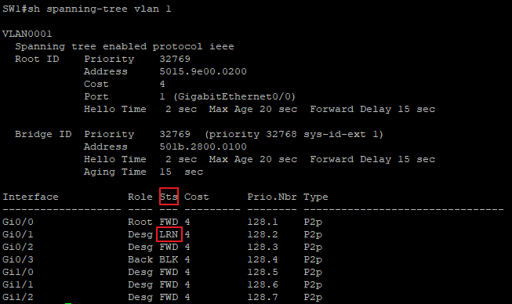

# Spanning-Tree Port States

**한국어** | [English](README/03-Spanning-Tree-Port-States.en.md) | [日本語](README/03-Spanning-Tree-Port-States.ja.md) | [简体中文](README/03-Spanning-Tree-Port-States.zh-CN.md) | [Español](README/03-Spanning-Tree-Port-States.es.md) | [Français](README/03-Spanning-Tree-Port-States.fr.md)

Cisco 스위치에 케이블을 꽂으면 인터페이스 위의 LED가 처음에는 **주황색**이었다가 잠시 후 **초록색**으로 바뀝니다. 이 시간 동안 spanning-tree가 인터페이스의 상태를 정하고 있습니다. 이 문서에서는 각 포트 상태와, 실제 스위치에서 상태가 바뀌는 모습을 확인합니다.

> Spanning-tree의 기본 동작은 [01. Introduction to Spanning-Tree](01-Introduction-to-Spanning-Tree.md) 를 먼저 보세요.

---

## 1. 포트 상태

케이블을 꽂으면 다음 순서로 진행됩니다.

- **Listening**: Root port나 Designated port만 Listening 상태로 넘어갑니다. Non-designated 포트는 Blocking 상태에 머뭅니다. 그동안 토폴로지가 바뀌지 않는지 확인하기 위해 **15초** 동안 데이터를 전송하지 않습니다. 그다음 Learning 상태로 넘어갑니다.
- **Learning**: 이더넷 프레임의 **출발지 MAC 주소**를 보고 MAC 주소 테이블을 채웁니다. 하지만 프레임을 목적지로 전달하지는 않습니다. **15초** 뒤 Forwarding 상태로 넘어갑니다.
- **Forwarding**: 인터페이스의 마지막 상태입니다. 드디어 이더넷 프레임을 전달해서 **데이터가 전송**됩니다.

Designated port나 Root port가 아닌 포트는 **Blocking** 상태에 있습니다.

즉, Listening에서 Forwarding까지 **총 30초**가 걸립니다. 빠르다고 하기는 어렵죠? 그리고 이 과정은 스위치의 모든 인터페이스에서 일어납니다.

Blocking 상태인 인터페이스가 토폴로지 변화 때문에 Forwarding으로 바뀌어야 하는 경우도 있습니다. 이때는 Blocking 상태가 **20초** 동안 이어진 뒤 Listening으로 넘어갑니다. 따라서 20(Blocking) + 15(Listening) + 15(Learning) = **50초**가 지나야 Forwarding이 됩니다.

30초는 긴 시간입니다. SSD를 쓰는 요즘 PC는 그보다 빨리 부팅됩니다. 포트 상태를 정리하면 다음과 같습니다.

| 상태 | 프레임 전달 | MAC 주소 학습 | 시간 |
| --- | --- | --- | --- |
| Blocking | No | No | 20초 |
| Listening | No | No | 15초 |
| Learning | No | Yes | 15초 |
| Forwarding | Yes | Yes | – |

---

## 2. 실제 스위치에서 확인

실제 Cisco 스위치에서는 어떻게 보일까요? 인터페이스의 케이블을 뽑았다가 다시 꽂고(또는 shutdown 후 no shutdown) 바로 show 명령을 실행하면 다음과 같습니다.

포트의 역할은 **Designated**이고 상태는 **Listening(LIS)**입니다. 이 show 명령을 계속 실행하면 약 15초 뒤 다음과 같이 바뀝니다.

**Learning(LRN)** 상태로 넘어갔습니다. 다시 약 15초가 지나면 다음과 같습니다.

인터페이스가 각 포트 상태를 거쳐 **Forwarding(FWD)**이 되는 모습을 직접 확인했습니다. 상태 변화를 더 잘 보려면 **debug**를 켜는 것이 좋습니다.

인터페이스를 다시 껐다 켜면, 포트 상태가 바뀌는 모습을 실시간으로 볼 수 있습니다.

`listening` → `learning` → `forwarding` 순서로 바뀌고, 그 사이 시간 간격이 약 **15초**씩인 것을 확인할 수 있습니다.

---

## 핵심 정리

- **Listening(15초)**: BPDU만 주고받고, MAC 학습과 데이터 전송은 하지 않습니다.
- **Learning(15초)**: MAC 주소 테이블을 채우지만, 아직 프레임은 전달하지 않습니다.
- **Forwarding**: 프레임을 전달합니다. Root·Designated가 아닌 포트는 **Blocking**에 머뭅니다.
- 케이블을 꽂으면 Forwarding까지 **30초**, Blocking에서 시작하면 **50초**(20 + 15 + 15)가 걸립니다.
- `show spanning-tree`를 반복하거나 `debug spanning-tree events`로 상태 변화를 확인합니다.
