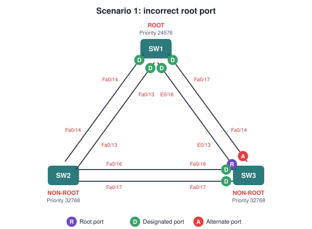
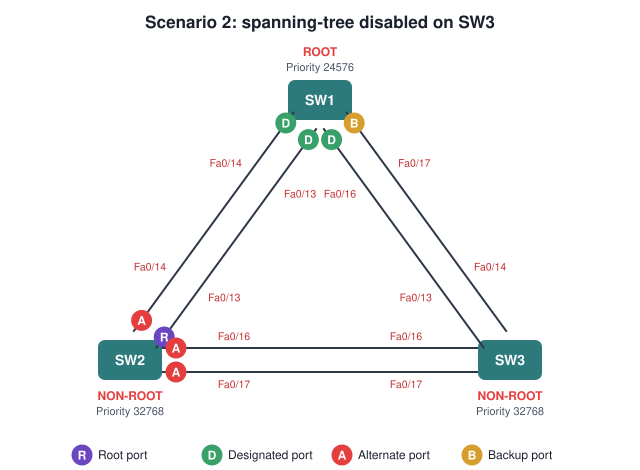
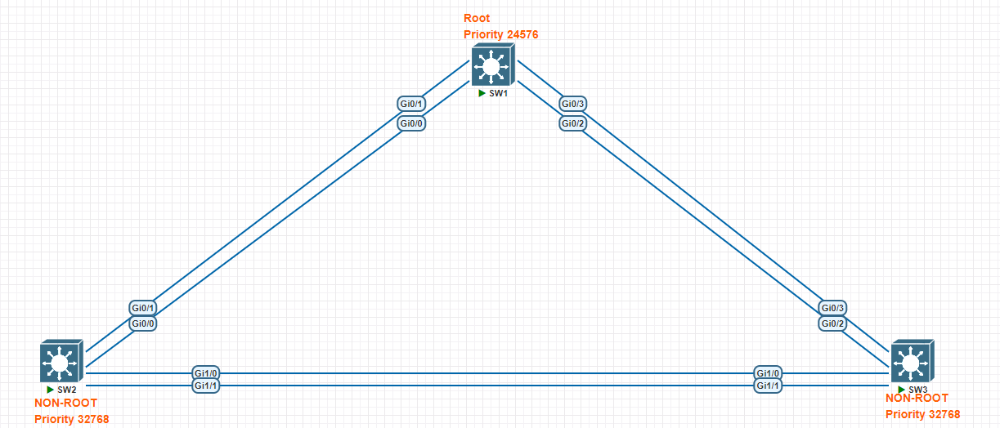
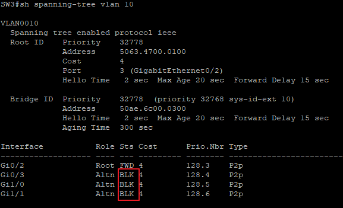
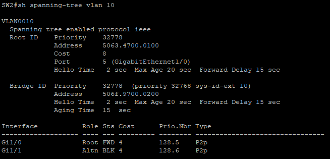

# Troubleshooting Spanning-Tree

**한국어** | [English](README/04-Troubleshooting-Spanning-Tree.en.md) | [日本語](README/04-Troubleshooting-Spanning-Tree.ja.md) | [简体中文](README/04-Troubleshooting-Spanning-Tree.zh-CN.md) | [Español](README/04-Troubleshooting-Spanning-Tree.es.md) | [Français](README/04-Troubleshooting-Spanning-Tree.fr.md)

Spanning-tree는 기본 설정만으로도 루프 없는 토폴로지를 잘 만들어 줍니다. 하지만 기대한 결과와 스위치가 보여주는 결과가 다르거나, 잘못된 설정 때문에 이상한 일이 생길 수 있습니다. 이 문서에서는 네 가지 장애 시나리오를 살펴봅니다.

> 그림은 교재 기준(FastEthernet·Ethernet 인터페이스)이고, 실습 캡처는 GigabitEthernet 인터페이스입니다. 인터페이스 이름은 달라도 원인과 해결 방법은 같습니다.

---

## 1. 잘못된 Root port (Incorrect Root Port)

스위치 세 대가 있고, 이중화를 위해 스위치 사이마다 링크가 두 개씩 있습니다. SW1이 VLAN 1의 Root Bridge로 선출되었습니다. Spanning-tree 문제를 다룰 때는 **네트워크를 간단히 그리고 각 스위치의 인터페이스 역할**(designated, non-designated/alternate, blocked)을 적어 보는 것이 좋습니다. SW1과 SW3 사이 링크 하나는 **Ethernet(10 Mbit)**이고, 나머지는 모두 FastEthernet입니다.

`show spanning-tree`로 SW1과 SW3의 인터페이스 역할을 확인했습니다. SW3가 **Ethernet 0/13을 Root port**로, FastEthernet 0/14를 Alternate port로 골랐습니다. 좋지 않은 선택입니다. 모든 트래픽이 10 Mbit 링크로 가고, 100 Mbit 링크는 전혀 쓰이지 않습니다. 스위치는 Root port를 다음 순서로 고릅니다.

1. Root Bridge까지 **cost가 가장 낮은** 인터페이스를 고릅니다.
2. Cost가 같으면 **포트 priority가 가장 낮은** 인터페이스를 고릅니다.

보통 Ethernet 인터페이스의 cost가 FastEthernet보다 높으므로 FastEthernet을 골라야 합니다. 그런데 왜 SW3는 Ethernet 0/13을 골랐을까요? 두 인터페이스의 **cost가 같기** 때문입니다. Cost가 같으니 포트 priority가 더 낮은 Ethernet 0/13을 골랐습니다. 인터페이스 설정을 확인합니다.

누군가 인터페이스의 **cost를 직접 바꿔 놓았습니다**(교재에서는 FastEthernet 기본값인 19, 실습에서는 `spanning-tree cost 3`). 이 명령을 지웁니다.

결과를 확인합니다.

Cost 명령을 지우자 포트 상태가 바뀌었습니다. 이제 빠른 인터페이스가 **Root port**가 되었고, 느린 인터페이스는 기본 cost로 돌아갔습니다. 문제가 해결되었습니다!

**교훈**: Root port로 쓰고 싶은 인터페이스가 Root Bridge까지 **가장 낮은 cost 경로**인지 확인합니다.

---

## 2. Spanning-tree 비활성화 (Spanning-Tree Disabled)

다른 시나리오입니다. 같은 토폴로지를 사용합니다.

모든 인터페이스가 같은 종류(FastEthernet)입니다. SW1이 VLAN 10의 Root Bridge이고, 인터페이스 역할을 확인하니 다음과 같습니다.

흥미롭습니다. SW1이 Root Bridge인데 FastEthernet 0/17이 **Backup port**로 선출되었습니다. 흔히 보는 모습은 아니죠. SW2는 Root port 하나를 고르고 나머지는 모두 Alternate port입니다. 그런데 **SW3에는 아무것도 보이지 않습니다.** VLAN 10의 spanning-tree를 확인합니다.

SW1과 SW2는 VLAN 10의 spanning-tree를 실행하고 있지만, **SW3는 VLAN 10의 spanning-tree를 실행하지 않습니다.** 무엇이 문제일까요? 혹시 모르니 SW3의 인터페이스를 확인합니다.

모든 인터페이스가 up입니다. Trunk 설정은 어떨까요?

인터페이스는 정상이고, trunk이며, SW3의 모든 인터페이스에서 VLAN 10이 활성화되어 있습니다. 그렇다면 VLAN 10의 spanning-tree가 동작해야 합니다.

이 메시지를 다시 봅니다. VLAN 10의 spanning-tree가 **존재하지 않는다**고 합니다. 이 메시지가 나오는 이유는 두 가지입니다.

- VLAN 10이 활성화된 인터페이스가 없다.
- VLAN 10의 spanning-tree가 **비활성화**되어 있다.

SW3의 모든 인터페이스에서 VLAN 10이 활성화된 것은 확인했으니, spanning-tree가 **전역에서 꺼져 있을** 수 있습니다. `spanning-tree vlan 10`을 입력하고 확인합니다.

이제 VLAN 10의 spanning-tree가 켜지고 정상 동작합니다. 문제가 해결되었습니다! 사소한 문제 같지만 실제 현장에서 가끔 봅니다. 예전에 본 사례는, 무선 장비 업체가 고객에게 **AP가 연결된 인터페이스에서 spanning-tree를 끄라고** 안내한 경우였습니다. 고객은 스위치에 다음과 같이 입력했습니다.

인터페이스 모드에서 `no spanning-tree vlan 10`을 입력했지만, 결과적으로 **전역 설정 모드로 빠져나왔습니다.** 인터페이스에서 이런 식으로 spanning-tree를 끄는 명령은 없기 때문에, 스위치는 이를 **전역 명령**으로 받아들여 VLAN 10의 spanning-tree를 꺼 버리고 전역 설정 모드로 돌려보냅니다.

**교훈**: spanning-tree가 켜져 있는지, 꺼져 있는지 확인합니다.

---

## 3. BPDU 차단 (BPDUs Blocked)

다음 실습도 같은 토폴로지입니다.

이번에는 고객이 **성능이 나쁘다**고 불만을 제기했습니다. 먼저 spanning-tree 토폴로지를 확인합니다.

위 그림을 보세요. SW2와 SW3의 FastEthernet 0/16이 **둘 다 Designated**입니다. SW1의 인터페이스도 모두 Designated입니다. 스위치 중 하나가 브로드캐스트를 보내거나 프레임을 플러딩하면 어떻게 될까요? 맞습니다. **루프**가 생깁니다.

이 토폴로지에서는 원래 SW3의 FastEthernet 0/16과 0/17이 모두 **Alternate port**여야 합니다. SW3의 Bridge ID가 가장 나쁘기 때문입니다. 둘 다 Designated라는 것은 **SW3가 이 인터페이스로 BPDU를 받지 못한다**는 뜻입니다.

왜 spanning-tree가 실패했을까요? 중요한 점은, spanning-tree가 루프 없는 토폴로지를 만들려면 **스위치 사이에 BPDU가 오가야 한다**는 것입니다. BPDU는 MAC access-list, VLAN access-map, 또는 spanning-tree 관련 기능 때문에 걸러질 수 있습니다. 하나씩 확인합니다.

Access-list는 없습니다. Port-security일까요?

Port security도 없습니다. Spanning-tree 관련 명령은 어떨까요?

찾았습니다! SW2의 FastEthernet 0/16과 0/17에 **BPDU filter**가 켜져 있습니다. 그래서 SW3가 SW2의 BPDU를 받지 못했습니다. 이 설정을 지웁니다.

Spanning-tree 토폴로지를 다시 확인합니다.

이제 FastEthernet 0/16과 0/17이 모두 **Alternate port**이고 트래픽을 차단합니다. 토폴로지에 루프가 없어졌습니다. 문제가 해결되었습니다!

**교훈**: 스위치 사이의 BPDU가 **차단되거나 필터링되지 않는지** 확인합니다.

---

## 4. 인터페이스에서 VLAN 비활성 (VLAN Inactive on Interface)

마지막 시나리오도 같은 토폴로지입니다.

SW1이 VLAN 1의 Root Bridge입니다. 포트 상태는 다음과 같습니다.

`show spanning-tree vlan 10`으로 확인한 결과입니다. 모든 인터페이스가 같은데, SW2가 **FastEthernet 0/16을 Root port**로 골랐습니다. FastEthernet 0/13이 Root port여야 하지 않을까요? Root Bridge까지 cost가 FastEthernet 0/16보다 낮습니다. SW2를 자세히 봅니다.

`show spanning-tree interface` 명령으로 인터페이스별 spanning-tree 정보를 볼 수 있습니다. 이 인터페이스들에는 **VLAN 1의 spanning-tree만** 동작하고 있습니다.

확인해 볼 것이 몇 가지 있습니다. 먼저 해당 VLAN의 spanning-tree가 켜져 있는지 확인하는 것이 좋습니다. `no spanning-tree vlan X`로 끌 수 있기 때문입니다. 하지만 이 시나리오에서는 VLAN 10의 다른 인터페이스(FastEthernet 0/16, 0/17)가 보이므로 VLAN 10의 spanning-tree는 켜져 있습니다. 그렇다면 인터페이스에서 spanning-tree가 동작하지 않는 다른 이유는 무엇일까요?

VLAN 10의 spanning-tree가 전역에서 켜져 있다고 해서 **모든 인터페이스에서 동작하는 것은 아닙니다.** `show interfaces switchport` 명령으로 인터페이스에서 VLAN 10이 동작하는지 확인합니다.

흥미로운 정보가 보입니다. 이 인터페이스들은 **access 모드이고 VLAN 1**에 속해 있습니다. VLAN 10 트래픽이 지나갈 수 있도록 **trunk로 바꿉니다.**

VLAN 10의 spanning-tree 토폴로지를 다시 확인합니다.

이제 VLAN 10 트래픽이 이 인터페이스들로 지나가고, 원래 기대했던 인터페이스가 **Root port**로 선출되었습니다. 문제가 해결되었습니다!

**교훈**: spanning-tree 문제를 보기 전에 **인터페이스에서 VLAN이 활성화되어 있는지** 확인합니다.

---

## 핵심 정리

- Spanning-tree 명령을 보기 전에 **인터페이스가 정상 동작하는지**, **VLAN이 인터페이스에서 활성화되어 있는지** 먼저 확인합니다.
- 잘못된 Root port: 누군가 바꾼 **`spanning-tree cost`**가 원인일 수 있습니다. Cost가 같으면 포트 priority로 결정됩니다.
- "Spanning tree instance(s) for vlan X does not exist": VLAN이 활성화된 인터페이스가 없거나 **`no spanning-tree vlan X`**로 꺼진 경우입니다. 인터페이스 모드에서 입력해도 전역 명령으로 처리됩니다.
- 양쪽이 모두 Designated라면 **BPDU가 걸러지는 것**을 의심합니다(MAC ACL, VLAN access-map, **BPDU filter**).
- 원하는 포트가 Root port가 되지 않으면 `show interfaces switchport`로 **access/trunk 모드와 VLAN**을 확인합니다.
