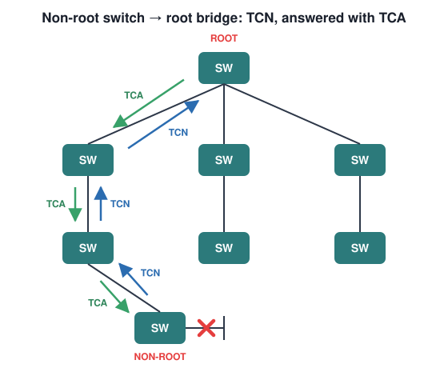
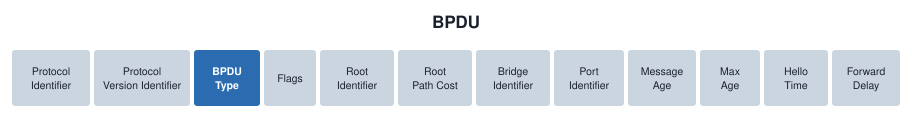

# Spanning-Tree Topology Change Notification (TCN)

**한국어** | [English](README/05-Spanning-Tree-Topology-Change-Notification.en.md) | [日本語](README/05-Spanning-Tree-Topology-Change-Notification.ja.md) | [简体中文](README/05-Spanning-Tree-Topology-Change-Notification.zh-CN.md) | [Español](README/05-Spanning-Tree-Topology-Change-Notification.es.md) | [Français](README/05-Spanning-Tree-Topology-Change-Notification.fr.md)

Spanning-tree는 토폴로지 변화를 어떻게 처리할까요? 스위치가 많은 네트워크를 다룬다면 꼭 이해해야 하는 내용입니다. 예시를 통해 몇 가지를 설명하겠습니다.

> 그림은 교재 기준(FastEthernet 번호)이고, 실습 캡처는 GigabitEthernet 인터페이스입니다.

---

## 1. 실습 토폴로지

MAC 주소 테이블을 채우기 위해 컴퓨터 두 대를 연결했습니다. 모든 스위치는 기본 설정입니다.

**SW3를 Root Bridge로 만들고, SW2의 fa0/19 인터페이스를 차단**하려고 합니다. 이유는 곧 설명하겠습니다.

모든 인터페이스의 상태를 확인합니다.

인터페이스 정보를 토폴로지 그림으로 그리면 다음과 같습니다.

H1과 H2 사이의 트래픽은 **SW2 → SW1 → SW3 → SW4**로 흐릅니다. SW2의 fa0/19 인터페이스는 차단되어 있습니다.

---

## 2. MAC 주소 테이블과 Aging Time

스위치들이 컴퓨터의 MAC 주소를 학습하도록 트래픽을 만들어 봅니다.

간단한 ping만으로도 프레임이 생기고, 스위치가 MAC 주소를 학습합니다. 이 실습에서 컴퓨터의 MAC 주소는 다음과 같습니다.

- VPC1: 0050.7966.6802
- VPC2: 0050.7966.6801

MAC 주소 테이블을 보면 트래픽 경로를 확인할 수 있습니다. 고정 MAC 주소 목록을 넘겨 보지 않도록 `show mac address-table dynamic` 명령을 사용합니다.

스위치는 MAC 주소를 얼마나 오래 저장할까요? 스위치 하나에서 MAC 주소 테이블의 **기본 aging time**을 확인합니다.

**300초**(기본 5분)입니다. 호스트가 5분 동안 조용하면 그 MAC 주소는 테이블에서 지워집니다.

---

## 3. 링크 장애가 일어나면

Aging time이 왜 중요할까요? 직접 보여드리겠습니다. 먼저 VPC1에서 VPC2로 트래픽을 계속 보냅니다. `ping -t`를 쓰면 멈추지 않고 계속 실행됩니다.

다음으로 케이블 하나를 뽑습니다.

SW1과 SW3 사이 링크가 끊어졌다고 가정합니다. **SW2의 fa0/19가 Forwarding이 될 때까지** H1과 H2는 통신할 수 없습니다. SW2가 fa0/19를 Blocking에서 Listening, Learning을 거쳐 Forwarding으로 바꾸는 데 **최대 50초**가 걸립니다.

그동안 SW2의 MAC 주소 테이블에는 여전히 H2의 MAC 주소가 SW1 방향으로 남아 있어서, SW2는 계속 SW1로 프레임을 보내고 SW1에서 버려집니다. MAC 주소 테이블이 aging out될 때까지 **300초 동안** 두 컴퓨터는 통신할 수 없습니다.

> "아무 프레임도 가 본 적 없는 곳으로 이더넷 프레임을 보내는 것은, 사용자를 행복하게 만드는 좋은 방법이 아닙니다…"

MAC 주소 테이블이 300초 뒤에 aging out되는 방식은 안정된 네트워크에서는 잘 동작하지만, **토폴로지가 바뀔 때는 문제**가 됩니다. 그래서 spanning-tree에는 **토폴로지 변화 메커니즘**이 있습니다.

스위치가 네트워크 변화(인터페이스가 down되거나 Forwarding 상태가 됨)를 감지하면, 이 사실을 **스위치 네트워크 전체에 알립니다.** 이 메시지를 받은 스위치는 MAC 주소 테이블의 aging time을 **300초에서 15초**(Forward Delay 타이머)로 줄입니다. 이 메시지를 **TCN(Topology Change Notification)**이라고 합니다.

---

## 4. TCN 동작 확인

TCN을 자세히 보려면 debug가 필요합니다. 모든 스위치에서 `debug spanning-tree events`를 켭니다.

SW1의 인터페이스를 shutdown 해서 링크 장애를 만듭니다(교재의 fa0/16).

다음과 같은 내용이 보입니다.

debug 정보가 많이 나오지만, 그중에 **SW1이 TCN을 만들어 SW2 쪽 인터페이스로 보내는** 내용이 있습니다. SW2에서는 다음이 보입니다.

SW2도 debug를 많이 쏟아내지만, 찾던 내용은 이것입니다. SW2가 SW1에게서 **TCN을 받았습니다.** TCN을 받은 SW2는 MAC 주소 테이블을 **15초** 안에 aging out합니다.

SW2는 이 정보로 무엇을 할까요?

SW2는 **fa0/19를 새 Root port**로 정하고, Listening → Learning → Forwarding으로 바뀌는 것을 볼 수 있습니다. 또한 SW4에게도 TCN을 보냅니다.

SW3는 fa0/19로 TCN을 받고, MAC 주소 테이블의 aging time을 15초로 줄입니다.

SW4는 SW2에게서 TCN을 받고, 그 결과 MAC 주소 테이블의 aging time을 15초로 줄입니다. SW3에게도 TCN을 보냅니다.

모든 스위치가 TCN을 받고 aging time을 15초로 줄였습니다. SW2는 fa0/14로 H2의 MAC 주소를 출발지로 하는 프레임을 더 이상 받지 않으므로, 이 항목을 MAC 주소 테이블에서 지웁니다.

그동안 SW2의 fa0/19는 Blocking에서 Listening, Learning, Forwarding으로 바뀝니다(총 50초). 이제 SW2는 **fa0/19로 H2의 MAC 주소를 학습**하고, 모든 것이 정상이 됩니다. SW4에서도 H1의 MAC 주소에 대해 같은 일이 일어납니다.

정리하면, 이처럼 트래픽이 블랙홀에 빠지는 것을 막기 위해 **TCN으로 MAC 주소 테이블의 aging time을 300초에서 15초로** 줄여야 합니다.

---

## 5. TCN은 어디로 전달되는가

어떤 스위치가 TCN을 보내고 전달할까요? 모든 스위치로 플러딩될까요? 확인해 보겠습니다.

평소에 non-root 스위치는 Root port로 BPDU를 받기만 하고, **Root Bridge 쪽으로는 BPDU를 보내지 않습니다.** Non-root 스위치가 토폴로지 변화를 감지하면, **TCN을 만들어 Root port로 Root Bridge 쪽에 보냅니다.**

TCN을 받은 스위치는 Designated port로 아래쪽 스위치에게 **TCA(Topology Change Acknowledgment)**를 보냅니다. 그리고 자신도 TCN을 만들어 자기 Root port로 보냅니다. 이렇게 **Root Bridge에 도달할 때까지** 트리를 거슬러 올라갑니다.

TCN에는 어떤 메시지를 쓸까요? 아래 BPDU를 보세요.

**BPDU Type** 필드가 있습니다. 이 값이 바뀌어서 TCN이라는 것을 나타냅니다.

TCN이 Root Bridge에 도달하면, Root Bridge는 자신이 보내는 BPDU에 **TC(Topology Change) 비트**를 설정합니다.

이 BPDU는 네트워크의 다른 모든 스위치로 전달되어, 각 스위치가 MAC 주소 테이블의 aging time을 줄이게 됩니다. 스위치는 이 메시지를 **Forwarding 포트와 차단된 포트 모두**에서 받습니다.

Root Bridge는 BPDU의 **Flags** 필드에 토폴로지 변화를 표시해서 보냅니다.

---

## 6. 호스트 포트와 TCN, 그리고 PortFast

Spanning-tree가 토폴로지 변화를 처리하는 방법은 여기까지입니다. 이 메커니즘에 대해 하나 더 보여드리겠습니다.

H1은 SW2의 fa0/2 인터페이스에 연결되어 있습니다. 이 인터페이스가 down되면 어떻게 되는지 봅니다.

SW2의 이 인터페이스는 **Designated이고 Forwarding** 상태입니다. debug를 켜고 인터페이스를 shutdown 합니다.

SW2에서 다음이 보입니다.

인터페이스를 shutdown 하자마자 SW2는 **TCN을 만들어 Root port로 보냅니다.** 인터페이스를 다시 켭니다.

다음이 보입니다.

인터페이스를 켜면 Listening과 Learning을 거쳐 Forwarding 상태가 됩니다. 그리고 스위치는 **TCN을 한 번 더 만들어** Root port로 보냅니다.

이것이 어떤 문제를 일으킬까요? 호스트가 **아주 많은** 네트워크를 생각해 보세요. 인터페이스가 up되거나 down될 때마다 TCN이 만들어지고, **모든 스위치**가 aging time을 15초로 줄입니다. 호스트 하나가 토폴로지 변화를 일으키므로, 호스트가 많으면 네트워크가 **계속 "토폴로지 변화" 상태**에 있을 수 있습니다.

다음과 같은 상황이 생길 수 있습니다.

서버가 LAN 백업 장비로 백업을 보내고 있습니다. 서버에서 LAN 백업 장비로 많은 **유니캐스트** 트래픽이 흐를 것입니다.

인터페이스 하나가 down되면 TCN이 만들어지고, 그 결과 모든 스위치가 MAC 주소 테이블의 aging time을 15초로 줄입니다. 장비들의 MAC 주소가 모두 테이블에서 지워집니다.

서버는 계속 LAN 백업 장비로 트래픽을 보내므로 스위치는 서버의 MAC 주소를 금방 다시 학습합니다. 하지만 LAN 백업 장비가 **트래픽을 받기만 하고 보내지 않으면**, 스위치가 그 MAC 주소를 다시 학습할 방법이 없습니다.

알 수 없는 유니캐스트 트래픽은 어떻게 될까요? 맞습니다. 들어온 인터페이스를 제외한 **모든 인터페이스로 플러딩**됩니다. 그래서 LAN 백업 장비가 이더넷 프레임을 보내 스위치가 MAC 주소를 다시 학습할 때까지, 네트워크는 트래픽 부담을 안게 됩니다.

이 상황은 어떻게 해결할까요? **PortFast**가 해결책입니다. PortFast는 토폴로지 변화를 처리하기 위한 Cisco 전용 기능이고, 두 가지를 해 줍니다.

- PortFast가 켜진 인터페이스는 up되면 **바로 Forwarding**이 됩니다. Listening과 Learning을 건너뜁니다.
- PortFast가 켜진 인터페이스에 대해서는 **TCN을 만들지 않습니다.**

호스트가 연결된 인터페이스는 자주 up/down되므로 **PortFast를 켜는 것이 좋습니다.** 단, **허브나 다른 스위치로 연결된 인터페이스에는 켜지 않습니다.**

---

## 핵심 정리

- 링크 장애 뒤에도 MAC 주소 테이블에 옛 경로가 남아 있으면, aging time(**300초**)이 지날 때까지 트래픽이 블랙홀에 빠집니다.
- 토폴로지 변화(인터페이스 down, 또는 Forwarding 진입)를 감지한 스위치는 **TCN**을 보내고, 모든 스위치가 aging time을 **15초**(Forward Delay)로 줄입니다.
- TCN은 **Root port로 Root Bridge까지** 올라가고, 각 스위치는 **TCA**로 응답합니다. TCN은 **BPDU Type** 필드로 구분합니다.
- Root Bridge는 **TC 플래그**(Flags 필드)를 설정한 BPDU를 모든 스위치로 보냅니다.
- 호스트 포트가 up/down될 때마다 TCN이 생겨 MAC 테이블이 비워지고, 조용한 장비로 가는 유니캐스트가 **플러딩**될 수 있습니다.
- 호스트 포트에는 **PortFast**를 켭니다. 바로 Forwarding이 되고 TCN을 만들지 않습니다. 스위치·허브 연결 포트에는 켜지 않습니다.
