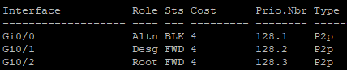
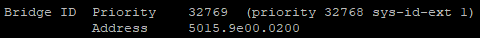
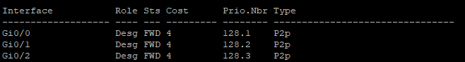

# Introduction to Spanning-Tree

[한국어](../01-Introduction-to-Spanning-Tree.md) | **English** | [日本語](01-Introduction-to-Spanning-Tree.ja.md) | [简体中文](01-Introduction-to-Spanning-Tree.zh-CN.md) | [Español](01-Introduction-to-Spanning-Tree.es.md) | [Français](01-Introduction-to-Spanning-Tree.fr.md)

Spanning-tree is a protocol that runs on our switches and **solves loops**. Every network engineer has to understand it, and you will certainly meet it in the CCNA exam. This note covers why we need spanning-tree, how it works, and how to check the spanning-tree topology on Cisco switches.

---

## 1. Why do we need spanning-tree?

What is a loop, and how do we get one? Let's look at an example.

In the picture above, two switches are connected with a single cable. With only one cable, there is a **single point of failure**. To get rid of it, we add another cable.

With the extra cable we now have **redundancy**. Unfortunately, redundancy also brings **loops**. Let's see why.

1. H1 sends an ARP request because it is looking for the MAC address of H2. An ARP request is a **broadcast frame**.
2. SW1 forwards this broadcast on all its interfaces except the one it received the frame on.
3. SW2 receives both broadcast frames.

What does SW2 do with those broadcast frames?

1. It forwards them on every interface except the one where it received the frame.
2. So the frame received on Fa0/0 is forwarded on Fa1/0.
3. The frame received on Fa1/0 is forwarded on Fa0/0.

Do you see where this is going? We have a **loop**! Both switches keep forwarding the frames until one of these happens:

- You fix the loop by disconnecting one of the cables.
- One of the switches crashes because it is overloaded with traffic.

Ethernet frames **have no TTL (Time to Live) value**, so they loop forever. Besides ARP requests, many frames are broadcast. For example, when a switch doesn't know a destination MAC address, the frame is **flooded**.

---

## 2. How spanning-tree solves loops

Spanning-tree creates a loop-free topology by **blocking certain interfaces**. Let's look at an example.

Three switches are connected in a triangle for redundancy, which also means we have a loop here. The MAC addresses are simplified for this example.

- SW1: MAC AAA
- SW2: MAC BBB
- SW3: MAC CCC

With spanning-tree enabled, all switches send each other a special frame called a **BPDU (Bridge Protocol Data Unit)**. A BPDU carries two pieces of information that spanning-tree needs:

- MAC address
- Priority

Together, the MAC address and the priority make up the **bridge ID**. BPDUs are sent between the switches as shown below.

Spanning-tree uses the bridge ID for its calculation. Here is how it works:

- First, it elects a **root bridge**: the switch with the best bridge ID.
- **The switch with the lowest bridge ID** is the best one.
- The default priority is **32768**, but we can change it.

So who becomes the root bridge in our example? **SW1**! The bridge ID is made of the priority and the MAC address. Since the priority is the same on all switches, the MAC address is the tie-breaker. SW1 has the lowest MAC address, so it has the best bridge ID and becomes the root bridge.

The ports on the root bridge are **always designated**, which means they are in the forwarding state.

SW1 has been elected as the root bridge, and the "D" on its interfaces stands for designated.

Now that the root bridge is agreed on, every **non-root** switch (every switch that is not the root) has to find the **shortest path** to the root bridge. The port with the shortest path to the root bridge is called the **root port**.

I've put an "R" (root port) on SW2 and SW3. Their Fa0/0 interface is the shortest path to the root bridge. The example is simple, but in spanning-tree the "shortest path" really looks at the **interface speed**. Each interface has a **cost**, and the path with the lowest cost is used.

| Speed | Cost |
| --- | --- |
| 10 Mbit | 100 |
| 100 Mbit | 19 |
| 1000 Mbit | 4 |

We now have designated ports on the root bridge and root ports on the non-root bridges. However, we still have a loop, so we need to **block a port between SW2 and SW3**. Which one — on SW2 or on SW3? We look at the bridge ID again.

- **Bridge ID = Priority + MAC address**

Lower is better. Both switches have the same priority, but SW2 has the lower MAC address, so **SW2 wins**. SW3 loses and has to block its port, breaking the loop.

On the link between SW2 and SW3, the Fa1/0 interface of SW3 shows an "A", which stands for **alternate port**. An alternate port is **blocked**. It is sometimes called the **ND (Non Designated) port**. By blocking this interface, we have solved the loop.

Because the default priority is 32768, the MAC address decides the root bridge. Which switch do you think becomes the root bridge in a production network? Your brand-new switch, or that dusty old switch that has been collecting dust for 8 years?

The old switch probably has a lower MAC address and will become the root bridge. Not a good idea, right? That's why we **change the priority** to choose which switch becomes the root bridge.

### Port states

If you have used Cisco switches before, you may have noticed that when you plug in a cable, the LED above the interface is **orange** at first and turns **green** after a while. At that moment, spanning-tree is deciding the state of the interface. This is what happens when you plug in a cable:

- **Listening** (15 seconds): BPDUs are sent and received, but no MAC addresses are learned and no data is transmitted.
- **Learning** (15 seconds): still sending and receiving BPDUs, and now the switch also learns MAC addresses. Still no data transmission.
- **Forwarding**: finally, data is transmitted.

---

## 3. Checking spanning-tree on Cisco switches

Now let's check it on real Cisco switches. The topology is the same as before, but the interface names are different.

> The earlier figures follow the textbook (MAC AAA/BBB/CCC, FastEthernet numbers); the lab uses GigabitEthernet interfaces. In the lab, **SW3** becomes the root bridge because of its MAC address.

Spanning-tree is **enabled by default**. Let's check it with show commands.

`show spanning-tree` is the most important show command to remember. There is quite a lot here, so let's break it down.

This is the spanning-tree information for VLAN 1. Spanning-tree has several versions, and the default on Cisco switches is **PVST (Per VLAN Spanning-Tree)**: a separate spanning-tree runs for each VLAN.

This is the **root bridge information**. Its priority is 32769 and its MAC address is 5015.9e00.0200. From SW1, the cost to reach the root bridge is 4, and the port that leads to the root bridge — the **root port — is Gi0/0**.

This part shows the **local switch (SW1)**. There's something funny about the priority — it shows two things:

- Priority 32769
- Priority 32768 sys-id-ext 1

**The sys-id-ext value is the VLAN number.** The priority is 32768, but spanning-tree adds the VLAN number, so we end up with 32769. Last but not least, we see SW1's MAC address, 501b.2800.0100.

These are the timers spanning-tree uses:

- **Hello time**: a BPDU is sent every 2 seconds.
- **Max Age**: if we don't receive BPDUs for 20 seconds, something has changed in the network and the topology must be checked again.
- **Forward Delay**: used for the listening and learning states. We stay in each state for this long, 15 seconds by default.

The last part shows the **interfaces and their status**:

- Gi0/0 is the **root port** and is forwarding (FWD).
- The other interfaces (Gi0/3 and so on) are **designated ports** and are forwarding (FWD).

Prio.Nbr is the **port priority**. Only non-root switches have a root port, so SW1 is a non-root switch and Gi0/0 leads to the root bridge.

Next, let's check SW2.

The root bridge information is similar to what we saw on SW1. The root port of SW2 is **Gi0/2**.

This is SW2's information. The priority is the same as on SW1; only the MAC address (5041.9100.0300) is different.

This part is interesting:

- Gi0/0 is an **alternate port** and is blocking (BLK).
- Gi0/2 is the **root port** and is forwarding (FWD).

Last but not least, let's check SW3.

**SW3 is the root bridge** in this network (`This bridge is the root`). We already knew that because SW1 and SW2 are both non-root, but this is how we verify it on SW3.

We can also see SW3's MAC address.

All interfaces on SW3 are **designated ports** and are forwarding (FWD).

Why was SW3 chosen as the root bridge? To answer that, we check the bridge IDs.

The priority is the same on all switches (32768), so we compare the MAC addresses:

- SW1: 501b.2800.0100
- SW2: 5041.9100.0300
- SW3: 5015.9e00.0200

**SW3 has the lowest MAC address**, so it became the root bridge. And why was Gi0/0 on SW2 blocked instead of Gi0/0 on SW1? Again we compare the bridge IDs. The priority is 32768 on both, so we look at the MAC addresses:

- SW1: 501b.2800.0100
- SW2: 5041.9100.0300

SW1 has the lower MAC address and therefore the better bridge ID. That's why **SW2 loses and blocks its Gi0/0**.

---

## Key points

- Redundancy creates **loops**, and since Ethernet frames have no TTL, a loop goes on forever.
- Spanning-tree exchanges **BPDUs** and blocks some ports to build a loop-free topology.
- **Bridge ID = Priority (default 32768) + MAC address.** The lowest one becomes the **root bridge**.
- All ports on the root bridge are **designated**, non-root switches pick the lowest-cost path as their **root port**, and the remaining loop is broken by blocking an **alternate port**.
- Cost: 10 Mbit = 100, 100 Mbit = 19, 1000 Mbit = 4.
- When a cable is plugged in, the port goes **listening (15 s) → learning (15 s) → forwarding**.
- The Cisco default is **PVST**, and the priority in `show spanning-tree` includes the **VLAN number (sys-id-ext)**.
