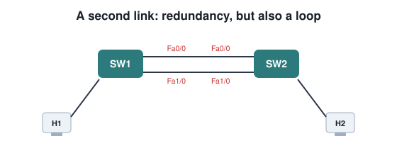
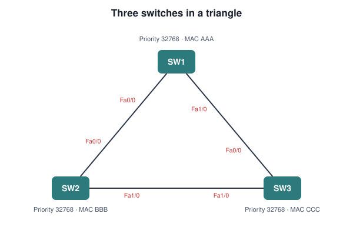
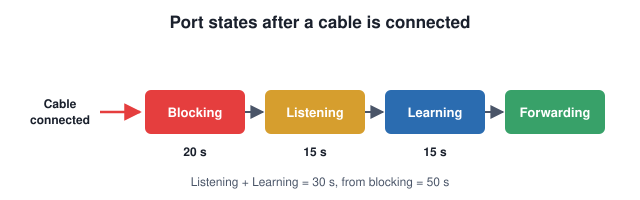
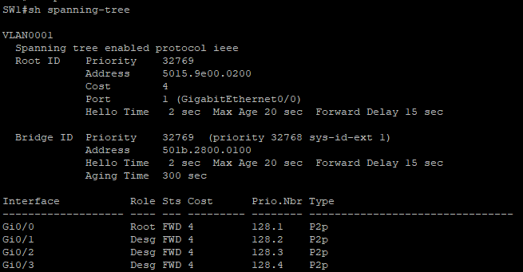
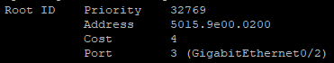
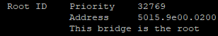
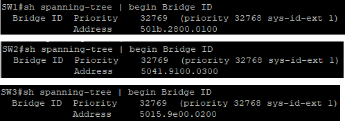

# Introduction to Spanning-Tree

[한국어](../01-Introduction-to-Spanning-Tree.md) | [English](01-Introduction-to-Spanning-Tree.en.md) | [日本語](01-Introduction-to-Spanning-Tree.ja.md) | [简体中文](01-Introduction-to-Spanning-Tree.zh-CN.md) | **Español** | [Français](01-Introduction-to-Spanning-Tree.fr.md)

Spanning-tree es un protocolo que se ejecuta en los switches y **resuelve los bucles**. Todo ingeniero de redes debe entenderlo, y seguro que aparece en el examen CCNA. Esta nota explica por qué necesitamos spanning-tree, cómo funciona y cómo comprobar la topología de spanning-tree en switches Cisco.

---

## 1. ¿Por qué necesitamos spanning-tree?

¿Qué es un bucle y cómo se produce? Veamos un ejemplo.

En la figura, dos switches están conectados con un solo cable. Con un único cable hay un **punto único de fallo**. Para eliminarlo, añadimos otro cable.

Con el cable extra tenemos **redundancia**. Por desgracia, la redundancia también trae **bucles**. Veamos por qué.

1. H1 envía una petición ARP porque busca la dirección MAC de H2. Una petición ARP es una **trama de broadcast**.
2. SW1 reenvía este broadcast por todas sus interfaces excepto por la que lo recibió.
3. SW2 recibe las dos tramas de broadcast.

¿Qué hace SW2 con esas tramas de broadcast?

1. Las reenvía por todas las interfaces excepto por la que las recibió.
2. Así, la trama recibida en Fa0/0 se reenvía por Fa1/0.
3. La trama recibida en Fa1/0 se reenvía por Fa0/0.

¿Ves adónde lleva esto? ¡Tenemos un **bucle**! Los dos switches siguen reenviando las tramas hasta que ocurra una de estas cosas:

- Arreglas el bucle desconectando uno de los cables.
- Uno de los switches se cae porque está saturado de tráfico.

Las tramas Ethernet **no tienen valor TTL (Time to Live)**, así que dan vueltas para siempre. Además de las peticiones ARP, muchas tramas se envían por broadcast. Por ejemplo, cuando un switch no conoce una dirección MAC de destino, la trama se **inunda (flooding)**.

---

## 2. Cómo resuelve spanning-tree los bucles

Spanning-tree crea una topología sin bucles **bloqueando ciertas interfaces**. Veamos un ejemplo.

Tres switches están conectados en triángulo para tener redundancia, lo que también significa que aquí hay un bucle. Las direcciones MAC están simplificadas para el ejemplo.

- SW1: MAC AAA
- SW2: MAC BBB
- SW3: MAC CCC

Con spanning-tree activado, todos los switches se envían una trama especial llamada **BPDU (Bridge Protocol Data Unit)**. Una BPDU lleva dos datos que spanning-tree necesita:

- Dirección MAC
- Prioridad (priority)

Juntas, la dirección MAC y la prioridad forman el **bridge ID**. Las BPDU se envían entre los switches como muestra la figura.

Spanning-tree usa el bridge ID para sus cálculos. Funciona así:

- Primero elige un **root bridge**: el switch con el mejor bridge ID.
- **El switch con el bridge ID más bajo** es el mejor.
- La prioridad por defecto es **32768**, pero se puede cambiar.

¿Quién será el root bridge en nuestro ejemplo? ¡**SW1**! El bridge ID está formado por la prioridad y la dirección MAC. Como la prioridad es igual en todos los switches, decide la dirección MAC. SW1 tiene la MAC más baja, así que tiene el mejor bridge ID y se convierte en root bridge.

Los puertos del root bridge son **siempre designated**, es decir, están en estado forwarding.

SW1 ha sido elegido root bridge, y la "D" de sus interfaces significa designated.

Una vez acordado el root bridge, cada switch **non-root** (todo switch que no es el root) tiene que encontrar el **camino más corto** hacia el root bridge. El puerto con el camino más corto hacia el root bridge se llama **root port**.

He puesto una "R" (root port) en SW2 y SW3. Su interfaz Fa0/0 es el camino más corto hacia el root bridge. El ejemplo es sencillo, pero en spanning-tree el "camino más corto" en realidad mira la **velocidad de la interfaz**. Cada interfaz tiene un **coste (cost)**, y se usa el camino con el coste más bajo.

| Velocidad | Cost |
| --- | --- |
| 10 Mbit | 100 |
| 100 Mbit | 19 |
| 1000 Mbit | 4 |

Ya tenemos puertos designated en el root bridge y root ports en los switches non-root. Pero todavía hay un bucle, así que hay que **bloquear un puerto entre SW2 y SW3**. ¿Cuál, el de SW2 o el de SW3? Volvemos a mirar el bridge ID.

- **Bridge ID = Prioridad + dirección MAC**

Cuanto más bajo, mejor. Los dos switches tienen la misma prioridad, pero SW2 tiene la MAC más baja, así que **gana SW2**. SW3 pierde y debe bloquear su puerto, rompiendo el bucle.

En el enlace entre SW2 y SW3, la interfaz Fa1/0 de SW3 muestra una "A", de **alternate port**. Un alternate port está **bloqueado**. A veces se le llama **puerto ND (Non Designated)**. Bloqueando esta interfaz hemos resuelto el bucle.

Como la prioridad por defecto es 32768, la dirección MAC decide el root bridge. ¿Qué switch crees que será el root bridge en una red de producción? ¿Tu switch nuevecito, o ese switch viejo que lleva 8 años acumulando polvo?

El switch viejo probablemente tenga una MAC más baja y será el root bridge. No parece buena idea, ¿verdad? Por eso **cambiamos la prioridad** para elegir qué switch será el root bridge.

### Estados de puerto (Port States)

Si has usado switches Cisco, habrás notado que al conectar un cable el LED encima de la interfaz es **naranja** al principio y se pone **verde** al rato. En ese momento, spanning-tree está decidiendo el estado de la interfaz. Esto es lo que ocurre al conectar un cable:

- **Listening** (15 segundos): se envían y reciben BPDU, pero no se aprenden direcciones MAC ni se transmiten datos.
- **Learning** (15 segundos): se siguen enviando y recibiendo BPDU, y ahora el switch también aprende direcciones MAC. Todavía no hay transmisión de datos.
- **Forwarding**: por fin se transmiten datos.

---

## 3. Comprobar spanning-tree en switches Cisco

Ahora vamos a verlo en switches Cisco reales. La topología es la misma que antes, pero con otros nombres de interfaz.

> Las figuras anteriores siguen el libro (MAC AAA/BBB/CCC, números FastEthernet); el laboratorio usa interfaces GigabitEthernet. En el laboratorio, **SW3** es el root bridge por su dirección MAC.

Spanning-tree está **activado por defecto**. Lo comprobamos con comandos show.

`show spanning-tree` es el comando show más importante que hay que recordar. Hay bastante información, así que vamos por partes.

Esta es la información de spanning-tree para la VLAN 1. Spanning-tree tiene varias versiones, y la versión por defecto en switches Cisco es **PVST (Per VLAN Spanning-Tree)**: se ejecuta un spanning-tree independiente por cada VLAN.

Esta es la **información del root bridge**. Su prioridad es 32769 y su MAC es 5015.9e00.0200. Desde SW1, el coste hasta el root bridge es 4, y el puerto que lleva al root bridge —el **root port— es Gi0/0**.

Esta parte muestra el **switch local (SW1)**. Hay algo curioso con la prioridad: muestra dos cosas.

- Priority 32769
- Priority 32768 sys-id-ext 1

**El valor sys-id-ext es el número de VLAN.** La prioridad es 32768, pero spanning-tree le suma el número de VLAN, así que queda 32769. Por último, vemos la MAC de SW1, 501b.2800.0100.

Estos son los temporizadores que usa spanning-tree:

- **Hello time**: se envía una BPDU cada 2 segundos.
- **Max Age**: si no recibimos BPDU durante 20 segundos, algo ha cambiado en la red y hay que volver a comprobar la topología.
- **Forward Delay**: se usa para los estados listening y learning. Se permanece en cada estado durante este tiempo, 15 segundos por defecto.

La última parte muestra las **interfaces y su estado**:

- Gi0/0 es el **root port** y está en forwarding (FWD).
- Las demás interfaces (Gi0/3, etc.) son **designated ports** y están en forwarding (FWD).

Prio.Nbr es la **prioridad del puerto**. Solo los switches non-root tienen root port, así que SW1 es non-root y Gi0/0 lleva al root bridge.

Ahora veamos SW2.

La información del root bridge es parecida a la de SW1. El root port de SW2 es **Gi0/2**.

Esta es la información de SW2. La prioridad es la misma que en SW1; solo cambia la MAC (5041.9100.0300).

Esta parte es interesante:

- Gi0/0 es un **alternate port** y está bloqueando (BLK).
- Gi0/2 es el **root port** y está en forwarding (FWD).

Por último, veamos SW3.

**SW3 es el root bridge** de esta red (`This bridge is the root`). Ya lo sabíamos porque SW1 y SW2 son non-root, pero así se verifica en SW3.

También vemos la MAC de SW3.

Todas las interfaces de SW3 son **designated ports** y están en forwarding (FWD).

¿Por qué se eligió SW3 como root bridge? Para responder, comprobamos los bridge ID.

La prioridad es la misma en todos los switches (32768), así que comparamos las MAC:

- SW1: 501b.2800.0100
- SW2: 5041.9100.0300
- SW3: 5015.9e00.0200

**SW3 tiene la MAC más baja**, así que es el root bridge. ¿Y por qué se bloqueó Gi0/0 de SW2 y no Gi0/0 de SW1? De nuevo comparamos los bridge ID. La prioridad es 32768 en ambos, así que miramos las MAC:

- SW1: 501b.2800.0100
- SW2: 5041.9100.0300

SW1 tiene la MAC más baja y, por tanto, el mejor bridge ID. Por eso **SW2 pierde y bloquea su Gi0/0**.

---

## Puntos clave

- La redundancia crea **bucles**, y como las tramas Ethernet no tienen TTL, un bucle no termina nunca.
- Spanning-tree intercambia **BPDU** y bloquea algunos puertos para crear una topología sin bucles.
- **Bridge ID = prioridad (32768 por defecto) + dirección MAC.** El más bajo es el **root bridge**.
- Todos los puertos del root bridge son **designated**, los switches non-root eligen el camino de menor coste como **root port**, y el bucle restante se rompe bloqueando un **alternate port**.
- Coste: 10 Mbit = 100, 100 Mbit = 19, 1000 Mbit = 4.
- Al conectar un cable, el puerto pasa por **listening (15 s) → learning (15 s) → forwarding**.
- El valor por defecto de Cisco es **PVST**, y la prioridad de `show spanning-tree` incluye el **número de VLAN (sys-id-ext)**.
