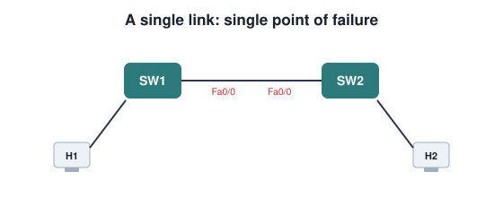
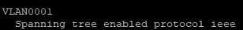
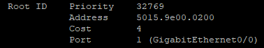
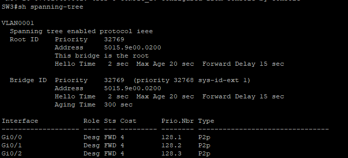

# Introduction to Spanning-Tree

[한국어](../01-Introduction-to-Spanning-Tree.md) | [English](01-Introduction-to-Spanning-Tree.en.md) | [日本語](01-Introduction-to-Spanning-Tree.ja.md) | [简体中文](01-Introduction-to-Spanning-Tree.zh-CN.md) | [Español](01-Introduction-to-Spanning-Tree.es.md) | **Français**

Le spanning-tree est un protocole qui tourne sur les switchs et qui **résout les boucles**. Tout ingénieur réseau doit le comprendre, et vous le rencontrerez forcément à l'examen CCNA. Cette note explique pourquoi on a besoin du spanning-tree, comment il fonctionne et comment vérifier la topologie spanning-tree sur des switchs Cisco.

---

## 1. Pourquoi a-t-on besoin du spanning-tree ?

Qu'est-ce qu'une boucle, et comment apparaît-elle ? Prenons un exemple.

Sur la figure, deux switchs sont reliés par un seul câble. Avec un seul câble, il y a un **point unique de défaillance**. Pour le supprimer, on ajoute un autre câble.

Avec ce câble supplémentaire, on a de la **redondance**. Malheureusement, la redondance amène aussi des **boucles**. Voyons pourquoi.

1. H1 envoie une requête ARP pour trouver l'adresse MAC de H2. Une requête ARP est une **trame de broadcast**.
2. SW1 transmet ce broadcast sur toutes ses interfaces sauf celle sur laquelle il l'a reçu.
3. SW2 reçoit les deux trames de broadcast.

Que fait SW2 de ces trames de broadcast ?

1. Il les transmet sur toutes les interfaces sauf celle sur laquelle il les a reçues.
2. La trame reçue sur Fa0/0 est donc transmise sur Fa1/0.
3. La trame reçue sur Fa1/0 est transmise sur Fa0/0.

Vous voyez où cela mène ? Nous avons une **boucle** ! Les deux switchs continuent de se renvoyer les trames jusqu'à ce que l'une de ces situations se produise :

- Vous supprimez la boucle en débranchant l'un des câbles.
- L'un des switchs plante parce qu'il est submergé de trafic.

Les trames Ethernet **n'ont pas de valeur TTL (Time to Live)**, elles tournent donc indéfiniment. En plus des requêtes ARP, beaucoup de trames sont envoyées en broadcast. Par exemple, quand un switch ne connaît pas une adresse MAC de destination, la trame est **inondée (flooding)**.

---

## 2. Comment le spanning-tree résout les boucles

Le spanning-tree crée une topologie sans boucle en **bloquant certaines interfaces**. Voyons un exemple.

Trois switchs sont reliés en triangle pour la redondance, ce qui veut dire qu'il y a aussi une boucle ici. Les adresses MAC sont simplifiées pour l'exemple.

- SW1 : MAC AAA
- SW2 : MAC BBB
- SW3 : MAC CCC

Quand le spanning-tree est activé, tous les switchs s'envoient une trame spéciale appelée **BPDU (Bridge Protocol Data Unit)**. Une BPDU contient deux informations dont le spanning-tree a besoin :

- Adresse MAC
- Priorité (priority)

Ensemble, l'adresse MAC et la priorité forment le **bridge ID**. Les BPDU circulent entre les switchs comme sur la figure.

Le spanning-tree utilise le bridge ID pour ses calculs. Voici comment :

- D'abord, il élit un **root bridge** : le switch qui a le meilleur bridge ID.
- **Le switch qui a le bridge ID le plus bas** est le meilleur.
- La priorité par défaut est **32768**, mais on peut la modifier.

Qui devient le root bridge dans notre exemple ? **SW1** ! Le bridge ID est composé de la priorité et de l'adresse MAC. Comme la priorité est la même sur tous les switchs, c'est l'adresse MAC qui départage. SW1 a l'adresse MAC la plus basse, donc le meilleur bridge ID : il devient root bridge.

Les ports du root bridge sont **toujours designated**, c'est-à-dire en état forwarding.

SW1 a été élu root bridge, et le « D » sur ses interfaces signifie designated.

Une fois le root bridge choisi, chaque switch **non-root** (tout switch qui n'est pas le root) doit trouver le **chemin le plus court** vers le root bridge. Le port qui offre le chemin le plus court vers le root bridge s'appelle le **root port**.

J'ai mis un « R » (root port) sur SW2 et SW3. Leur interface Fa0/0 est le chemin le plus court vers le root bridge. L'exemple est simple, mais dans le spanning-tree, le « chemin le plus court » dépend en réalité de la **vitesse de l'interface**. Chaque interface a un **coût (cost)**, et le chemin au coût le plus bas est utilisé.

| Vitesse | Cost |
| --- | --- |
| 10 Mbit | 100 |
| 100 Mbit | 19 |
| 1000 Mbit | 4 |

Nous avons maintenant des ports designated sur le root bridge et des root ports sur les switchs non-root. Mais il reste une boucle, il faut donc **bloquer un port entre SW2 et SW3**. Lequel, celui de SW2 ou celui de SW3 ? On regarde de nouveau le bridge ID.

- **Bridge ID = priorité + adresse MAC**

Plus c'est bas, mieux c'est. Les deux switchs ont la même priorité, mais SW2 a l'adresse MAC la plus basse : **SW2 gagne**. SW3 perd et doit bloquer son port, ce qui casse la boucle.

Sur le lien entre SW2 et SW3, l'interface Fa1/0 de SW3 porte un « A », pour **alternate port**. Un alternate port est **bloqué**. On l'appelle parfois **port ND (Non Designated)**. En bloquant cette interface, nous avons résolu la boucle.

Comme la priorité par défaut est 32768, c'est l'adresse MAC qui désigne le root bridge. À votre avis, quel switch devient root bridge dans un réseau de production ? Votre switch tout neuf, ou ce vieux switch qui prend la poussière depuis 8 ans ?

Le vieux switch a probablement une adresse MAC plus basse et deviendra root bridge. Pas une bonne idée, n'est-ce pas ? C'est pourquoi on **modifie la priorité** pour choisir le switch qui sera root bridge.

### États des ports (Port States)

Si vous avez déjà utilisé des switchs Cisco, vous avez peut-être remarqué qu'en branchant un câble, la LED au-dessus de l'interface est d'abord **orange**, puis devient **verte** au bout d'un moment. À ce moment-là, le spanning-tree décide de l'état de l'interface. Voici ce qui se passe quand on branche un câble :

- **Listening** (15 secondes) : les BPDU sont envoyées et reçues, mais aucune adresse MAC n'est apprise et aucune donnée n'est transmise.
- **Learning** (15 secondes) : les BPDU sont toujours échangées, et le switch apprend maintenant les adresses MAC. Toujours pas de transmission de données.
- **Forwarding** : enfin, les données sont transmises.

---

## 3. Vérifier le spanning-tree sur des switchs Cisco

Voyons maintenant sur de vrais switchs Cisco. La topologie est la même que précédemment, mais avec d'autres noms d'interfaces.

> Les figures précédentes suivent le manuel (MAC AAA/BBB/CCC, numéros FastEthernet) ; le lab utilise des interfaces GigabitEthernet. Dans le lab, c'est **SW3** qui devient root bridge à cause de son adresse MAC.

Le spanning-tree est **activé par défaut**. Vérifions-le avec des commandes show.

`show spanning-tree` est la commande show la plus importante à retenir. Il y a beaucoup d'informations, alors décomposons-les.

Voici les informations spanning-tree du VLAN 1. Le spanning-tree existe en plusieurs versions, et la version par défaut sur les switchs Cisco est **PVST (Per VLAN Spanning-Tree)** : un spanning-tree distinct tourne pour chaque VLAN.

Voici les **informations du root bridge**. Sa priorité est 32769 et son adresse MAC 5015.9e00.0200. Depuis SW1, le coût pour atteindre le root bridge est 4, et le port qui mène au root bridge — le **root port — est Gi0/0**.

Cette partie montre le **switch local (SW1)**. La priorité a quelque chose de curieux : elle affiche deux valeurs.

- Priority 32769
- Priority 32768 sys-id-ext 1

**La valeur sys-id-ext est le numéro de VLAN.** La priorité est 32768, mais le spanning-tree y ajoute le numéro de VLAN, ce qui donne 32769. Enfin, on voit l'adresse MAC de SW1, 501b.2800.0100.

Voici les temporisateurs utilisés par le spanning-tree :

- **Hello time** : une BPDU est envoyée toutes les 2 secondes.
- **Max Age** : si l'on ne reçoit pas de BPDU pendant 20 secondes, quelque chose a changé dans le réseau et il faut revérifier la topologie.
- **Forward Delay** : utilisé pour les états listening et learning. On reste dans chaque état pendant cette durée, 15 secondes par défaut.

La dernière partie montre les **interfaces et leur état** :

- Gi0/0 est le **root port** et est en forwarding (FWD).
- Les autres interfaces (Gi0/3, etc.) sont des **designated ports** en forwarding (FWD).

Prio.Nbr est la **priorité du port**. Seuls les switchs non-root ont un root port, donc SW1 est non-root et Gi0/0 mène au root bridge.

Voyons maintenant SW2.

Les informations du root bridge sont semblables à celles de SW1. Le root port de SW2 est **Gi0/2**.

Voici les informations de SW2. La priorité est la même que sur SW1 ; seule l'adresse MAC (5041.9100.0300) change.

Cette partie est intéressante :

- Gi0/0 est un **alternate port** et est en blocking (BLK).
- Gi0/2 est le **root port** et est en forwarding (FWD).

Enfin, voyons SW3.

**SW3 est le root bridge** de ce réseau (`This bridge is the root`). Nous le savions déjà puisque SW1 et SW2 sont non-root, mais c'est ainsi qu'on le vérifie sur SW3.

On voit aussi l'adresse MAC de SW3.

Toutes les interfaces de SW3 sont des **designated ports** en forwarding (FWD).

Pourquoi SW3 a-t-il été choisi comme root bridge ? Pour répondre, on vérifie les bridge ID.

La priorité est la même sur tous les switchs (32768), on compare donc les adresses MAC :

- SW1 : 501b.2800.0100
- SW2 : 5041.9100.0300
- SW3 : 5015.9e00.0200

**SW3 a l'adresse MAC la plus basse**, il est donc root bridge. Et pourquoi Gi0/0 de SW2 a-t-il été bloqué plutôt que Gi0/0 de SW1 ? On compare encore les bridge ID. La priorité est 32768 sur les deux, on regarde donc les adresses MAC :

- SW1 : 501b.2800.0100
- SW2 : 5041.9100.0300

SW1 a l'adresse MAC la plus basse, donc le meilleur bridge ID. C'est pourquoi **SW2 perd et bloque son Gi0/0**.

---

## Points clés

- La redondance crée des **boucles**, et comme les trames Ethernet n'ont pas de TTL, une boucle ne s'arrête jamais.
- Le spanning-tree échange des **BPDU** et bloque certains ports pour créer une topologie sans boucle.
- **Bridge ID = priorité (32768 par défaut) + adresse MAC.** Le plus bas devient **root bridge**.
- Tous les ports du root bridge sont **designated**, les switchs non-root choisissent le chemin au coût le plus bas comme **root port**, et la boucle restante est cassée en bloquant un **alternate port**.
- Coût : 10 Mbit = 100, 100 Mbit = 19, 1000 Mbit = 4.
- Quand on branche un câble, le port passe par **listening (15 s) → learning (15 s) → forwarding**.
- Le mode par défaut de Cisco est **PVST**, et la priorité affichée par `show spanning-tree` inclut le **numéro de VLAN (sys-id-ext)**.
