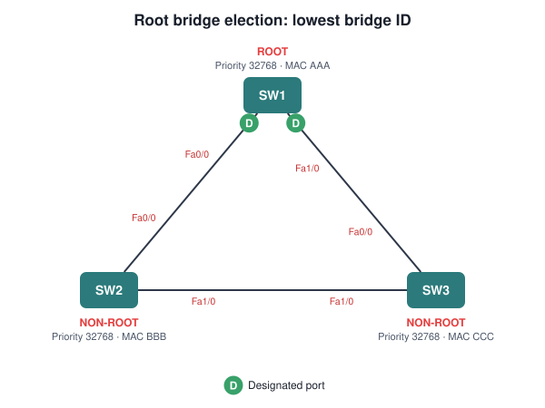
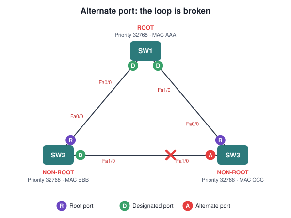
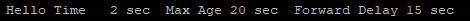
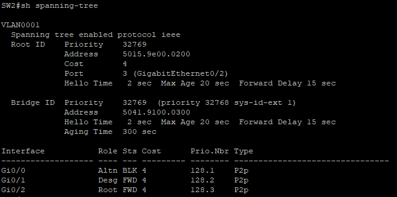

# Introduction to Spanning-Tree

[한국어](../01-Introduction-to-Spanning-Tree.md) | [English](01-Introduction-to-Spanning-Tree.en.md) | **日本語** | [简体中文](01-Introduction-to-Spanning-Tree.zh-CN.md) | [Español](01-Introduction-to-Spanning-Tree.es.md) | [Français](01-Introduction-to-Spanning-Tree.fr.md)

Spanning-tree はスイッチ上で動作し、**ループの問題を解決**するプロトコルです。ネットワークエンジニアなら必ず理解すべきプロトコルで、CCNA 試験でも必ず出てきます。このノートでは、spanning-tree がなぜ必要か、どう動作するか、そして Cisco スイッチで spanning-tree トポロジーをどう確認するかをまとめます。

---

## 1. なぜ spanning-tree が必要なのか?

ループとは何で、どうやって発生するのでしょうか?例で見てみましょう。

上の図では、2 台のスイッチが 1 本のケーブルでつながっています。ケーブルが 1 本だけなので、**単一障害点**があります。これをなくすため、ケーブルをもう 1 本つなぎます。

ケーブルが 1 本増えて**冗長化**できました。しかし冗長化は**ループ**も一緒に連れてきます。なぜループが起きるのか見てみましょう。

1. H1 は H2 の MAC アドレスを探すために ARP 要求を送ります。ARP 要求は**ブロードキャストフレーム**です。
2. SW1 は、フレームを受信したインターフェイス以外のすべてのインターフェイスにこのブロードキャストを転送します。
3. SW2 は 2 つのブロードキャストフレームを両方とも受信します。

SW2 はこのブロードキャストフレームをどう処理するでしょうか?

1. フレームを受信したインターフェイス以外のすべてのインターフェイスに転送します。
2. つまり、Fa0/0 で受信したフレームは Fa1/0 に転送されます。
3. Fa1/0 で受信したフレームは Fa0/0 に転送されます。

どうなるか見えてきましたか?**ループ**です!2 台のスイッチは、次のどちらかが起きるまでフレームをやり取りし続けます。

- ケーブルを 1 本抜いてループをなくす。
- トラフィックが多すぎてスイッチのどちらかが止まる。

イーサネットフレームには **TTL(Time to Live)値がない**ため、ループが起きると永遠に回り続けます。ARP 要求以外にもブロードキャストされるフレームはたくさんあります。たとえば、スイッチが宛先 MAC アドレスを知らないと、そのフレームは**フラッディング**されます。

---

## 2. spanning-tree がループを解決する方法

Spanning-tree は**一部のインターフェイスをブロック**して、ループのないトポロジーを作ります。例で動作を見てみましょう。

3 台のスイッチを三角形につないで冗長化しています。つまり、ここにもループがあります。例のため MAC アドレスは簡略化しています。

- SW1: MAC AAA
- SW2: MAC BBB
- SW3: MAC CCC

Spanning-tree が有効なら、すべてのスイッチは **BPDU(Bridge Protocol Data Unit)**という特別なフレームを互いに送り合います。BPDU には spanning-tree に必要な 2 つの情報が入っています。

- MAC アドレス
- Priority(優先度)

MAC アドレスと priority を合わせたものが **Bridge ID** です。BPDU は下の図のようにスイッチ間でやり取りされます。

Spanning-tree は Bridge ID を使って計算します。動作の流れは次のとおりです。

- まず **Root Bridge** を選出します。最も良い Bridge ID を持つスイッチが Root Bridge になります。
- **Bridge ID が最も小さいスイッチ**が最も良いスイッチです。
- Priority のデフォルト値は **32768** で、必要なら変更できます。

この例では誰が Root Bridge になるでしょうか?**SW1** です。Bridge ID は priority と MAC アドレスでできていますが、すべてのスイッチの priority が同じなので MAC アドレスで決まります。SW1 の MAC アドレスが最も小さいので Bridge ID が最も良く、Root Bridge になります。

Root Bridge のポートは**常に Designated** で、Forwarding 状態です。

SW1 が Root Bridge に選出され、インターフェイスの「D」は Designated という意味です。

Root Bridge が決まったので、次にすべての **non-root スイッチ**(Root Bridge ではないスイッチ)は Root Bridge までの**最短経路**を見つける必要があります。Root Bridge への最短経路のポートを **Root port** といいます。

SW2 と SW3 に「R」(Root port)を付けました。両スイッチの Fa0/0 が Root Bridge への最短経路です。例は簡単にしていますが、spanning-tree の「最短経路」は実際には**インターフェイスの速度**を見ます。インターフェイスごとに **cost** があり、cost が最も小さい経路が使われます。

| 速度 | Cost |
| --- | --- |
| 10 Mbit | 100 |
| 100 Mbit | 19 |
| 1000 Mbit | 4 |

Root Bridge には Designated port が、non-root スイッチには Root port ができました。しかしまだループが残っているので、**SW2 と SW3 の間のポートを 1 つブロック**する必要があります。SW2 と SW3 のどちらのポートをブロックするでしょうか?もう一度 Bridge ID を見ます。

- **Bridge ID = Priority + MAC アドレス**

小さいほど良いです。2 台の priority は同じなので MAC アドレスを比べますが、SW2 の MAC アドレスのほうが小さいので **SW2 の勝ち**です。負けた SW3 がポートをブロックして、ループを断ち切ります。

SW2 と SW3 の間のリンクを見ると、SW3 の Fa1/0 に「A」と表示されています。**Alternate port** という意味で、Alternate port は**ブロック(blocked)**状態です。Alternate port は **ND(Non Designated)port** と呼ばれることもあります。このインターフェイスをブロックして、ループの問題を解決しました。

Priority のデフォルト値は 32768 なので、Root Bridge の選出は結局 MAC アドレスで決まります。では、実際の運用ネットワークではどのスイッチが Root Bridge になるでしょうか?新しく買った最新のスイッチでしょうか、それとも 8 年間ほこりをかぶっていた古いスイッチでしょうか?

古いスイッチほど MAC アドレスが小さい可能性が高く、そのスイッチが Root Bridge になるかもしれません。良い考えではありませんよね?そのため **priority を変更して**、どのスイッチを Root Bridge にするかを自分で決めます。

### ポート状態(Port States)

Cisco スイッチにケーブルを挿すと、インターフェイスの上の LED が最初は**オレンジ色**で、しばらくすると**緑色**に変わるのを見たことがあるでしょう。このとき spanning-tree がインターフェイスの状態を決めています。ケーブルを挿すと次のように進みます。

- **Listening**(15 秒):BPDU はやり取りしますが、MAC アドレスの学習もデータの送信もしません。
- **Learning**(15 秒):引き続き BPDU をやり取りし、MAC アドレスも学習します。ただし、まだデータは送信しません。
- **Forwarding**:ようやくデータを送信します。

---

## 3. Cisco スイッチで spanning-tree を確認

では、実際の Cisco スイッチで確認してみましょう。前と同じトポロジーですが、インターフェイス名は異なります。

> 前の図は教材の例(MAC AAA/BBB/CCC、FastEthernet 番号)で、実習では GigabitEthernet インターフェイスを使います。実習では MAC アドレスのため **SW3** が Root Bridge になります。

Spanning-tree は**デフォルトで有効**です。show コマンドで確認します。

`show spanning-tree` は必ず覚えておくべき最も重要な show コマンドです。内容が多いので、1 つずつ分けて見ていきます。

VLAN 1 の spanning-tree の情報です。Spanning-tree にはいくつかのバージョンがあり、Cisco スイッチのデフォルトは **PVST(Per VLAN Spanning-Tree)**です。VLAN ごとに spanning-tree が別々に動作します。

**Root Bridge の情報**です。Priority は 32769、MAC アドレスは 5015.9e00.0200 です。SW1 から Root Bridge までの cost は 4 で、Root Bridge へ向かうポート、つまり **Root port は Gi0/0** です。

この部分は**ローカルスイッチ(SW1)の情報**です。Priority が 2 通りに表示されている点がおもしろいところです。

- Priority 32769
- Priority 32768 sys-id-ext 1

**sys-id-ext の値は VLAN 番号**です。Priority は 32768 ですが、spanning-tree が VLAN 番号を足すので 32769 になります。最後に SW1 の MAC アドレス 501b.2800.0100 も確認できます。

Spanning-tree が使うタイマーです。

- **Hello time**:2 秒ごとに BPDU を送ります。
- **Max Age**:20 秒間 BPDU を受信しないと、ネットワークに変化があったとみなしてトポロジーを再確認します。
- **Forward Delay**:Listening と Learning の状態に使うタイマーです。各状態にこの時間だけとどまり、デフォルトは 15 秒です。

最後の部分は**インターフェイスとその状態**です。

- Gi0/0 は **Root port** で、Forwarding(FWD)状態です。
- 残りのインターフェイス(Gi0/3 など)は **Designated port** で、Forwarding(FWD)状態です。

Prio.Nbr は**ポート priority** です。Root port は non-root スイッチにしかないので、SW1 は non-root スイッチで、Gi0/0 が Root Bridge へ向かうポートだとわかります。

次に SW2 を確認します。

Root Bridge の情報は SW1 で見たものと似ています。SW2 の Root port は **Gi0/2** です。

SW2 の情報です。Priority は SW1 と同じで、MAC アドレス(5041.9100.0300)だけが違います。

ここがおもしろいところです。

- Gi0/0 は **Alternate port** で、Blocking(BLK)状態です。
- Gi0/2 は **Root port** で、Forwarding(FWD)状態です。

最後に SW3 を確認します。

**SW3 がこのネットワークの Root Bridge** です(`This bridge is the root`)。SW1 と SW2 がどちらも non-root なのですでにわかっていましたが、SW3 で直接確認する方法がこれです。

SW3 の MAC アドレスも確認できます。

SW3 のインターフェイスはすべて **Designated port** で、Forwarding(FWD)状態です。

なぜ SW3 が Root Bridge に選ばれたのでしょうか?答えを知るには Bridge ID を確認する必要があります。

すべてのスイッチの priority が同じ(32768)なので、MAC アドレスを比べます。

- SW1: 501b.2800.0100
- SW2: 5041.9100.0300
- SW3: 5015.9e00.0200

**SW3 の MAC アドレスが最も小さい**ので Root Bridge になりました。では、なぜ SW1 の Gi0/0 ではなく SW2 の Gi0/0 がブロックされたのでしょうか?もう一度 Bridge ID を比べます。両方とも priority は 32768 なので MAC アドレスを見ます。

- SW1: 501b.2800.0100
- SW2: 5041.9100.0300

SW1 の MAC アドレスのほうが小さく、Bridge ID が良いです。そのため **SW2 が負けて Gi0/0 をブロック**します。

---

## まとめ

- 冗長化は**ループ**を生み、イーサネットフレームには TTL がないため、ループが起きると永遠に回ります。
- Spanning-tree は **BPDU** をやり取りして一部のポートをブロックし、ループのないトポロジーを作ります。
- **Bridge ID = Priority(デフォルト 32768)+ MAC アドレス**。最も小さいスイッチが **Root Bridge** になります。
- Root Bridge のポートはすべて **Designated**、non-root スイッチは cost が最も小さい経路を **Root port** に選び、残ったループは **Alternate port** をブロックして断ち切ります。
- Cost:10 Mbit = 100、100 Mbit = 19、1000 Mbit = 4。
- ケーブルを挿すと **Listening(15 秒)→ Learning(15 秒)→ Forwarding** の順に進みます。
- Cisco のデフォルトは **PVST** で、`show spanning-tree` の priority には **VLAN 番号(sys-id-ext)**が加算されます。
