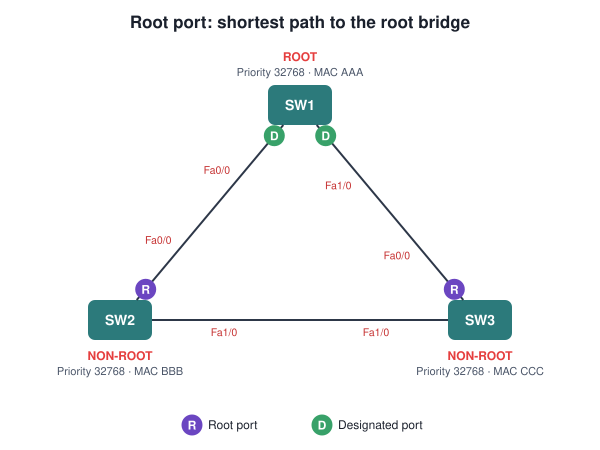
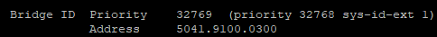

# Introduction to Spanning-Tree

[한국어](../01-Introduction-to-Spanning-Tree.md) | [English](01-Introduction-to-Spanning-Tree.en.md) | [日本語](01-Introduction-to-Spanning-Tree.ja.md) | **简体中文** | [Español](01-Introduction-to-Spanning-Tree.es.md) | [Français](01-Introduction-to-Spanning-Tree.fr.md)

Spanning-tree 是运行在交换机上、用来**解决环路问题**的协议。网络工程师必须理解它,CCNA 考试中也一定会遇到。本笔记整理 spanning-tree 为什么需要、如何工作,以及如何在 Cisco 交换机上查看 spanning-tree 拓扑。

---

## 1. 为什么需要 spanning-tree?

什么是环路,又是怎么产生的?来看一个例子。

上图中,两台交换机用一根线缆连接。只有一根线缆,所以存在**单点故障**。为了消除它,我们再连一根线缆。

多了一根线缆,就有了**冗余**。但冗余也会带来**环路**。来看看为什么会产生环路。

1. H1 为了查找 H2 的 MAC 地址而发送 ARP 请求。ARP 请求是**广播帧**。
2. SW1 会把这个广播转发到除接收接口以外的所有接口。
3. SW2 会收到两个广播帧。

SW2 会如何处理这些广播帧?

1. 转发到除接收接口以外的所有接口。
2. 也就是说,从 Fa0/0 收到的帧会从 Fa1/0 转发出去。
3. 从 Fa1/0 收到的帧会从 Fa0/0 转发出去。

看出会发生什么了吗?**环路**!两台交换机会一直互相转发帧,直到发生下面的情况之一:

- 拔掉一根线缆来消除环路。
- 流量太大,其中一台交换机崩溃。

以太网帧**没有 TTL(Time to Live)值**,所以一旦出现环路就会永远循环。除了 ARP 请求,还有很多帧会被广播。例如,交换机不知道目的 MAC 地址时,这个帧就会被**泛洪**。

---

## 2. spanning-tree 如何解决环路

Spanning-tree 通过**阻塞(block)部分接口**来建立无环路的拓扑。来看一个例子。

三台交换机连成三角形实现冗余,也就是说这里也有环路。为了举例,MAC 地址做了简化。

- SW1: MAC AAA
- SW2: MAC BBB
- SW3: MAC CCC

启用 spanning-tree 后,所有交换机会互相发送一种叫 **BPDU(Bridge Protocol Data Unit)**的特殊帧。BPDU 中有 spanning-tree 需要的两项信息:

- MAC 地址
- Priority(优先级)

MAC 地址和 priority 合起来就是 **Bridge ID**。BPDU 如下图所示在交换机之间传递。

Spanning-tree 用 Bridge ID 进行计算,过程如下:

- 首先选举 **Root Bridge**。Bridge ID 最好的交换机成为 Root Bridge。
- **Bridge ID 最低的交换机**就是最好的。
- Priority 默认值是 **32768**,需要的话可以修改。

在这个例子里谁会成为 Root Bridge?是 **SW1**!Bridge ID 由 priority 和 MAC 地址组成,所有交换机的 priority 都一样,所以由 MAC 地址决定。SW1 的 MAC 地址最低,Bridge ID 最好,因此成为 Root Bridge。

Root Bridge 的端口**总是 Designated**,处于 Forwarding 状态。

SW1 被选为 Root Bridge,接口上的“D”表示 Designated。

Root Bridge 确定后,所有 **non-root 交换机**(不是 Root Bridge 的交换机)都要找到到达 Root Bridge 的**最短路径**。通往 Root Bridge 最短路径的端口叫 **Root port**。

我在 SW2 和 SW3 上标了“R”(Root port)。两台交换机的 Fa0/0 就是到达 Root Bridge 的最短路径。例子做了简化,但 spanning-tree 中的“最短路径”实际上看的是**接口速度**。每个接口都有 **cost**,cost 最低的路径会被使用。

| 速度 | Cost |
| --- | --- |
| 10 Mbit | 100 |
| 100 Mbit | 19 |
| 1000 Mbit | 4 |

Root Bridge 上有了 Designated port,non-root 交换机上有了 Root port。但环路还在,所以需要**阻塞 SW2 和 SW3 之间的一个端口**。阻塞 SW2 还是 SW3 的端口?再来看 Bridge ID。

- **Bridge ID = Priority + MAC 地址**

越低越好。两台交换机的 priority 相同,所以比较 MAC 地址;SW2 的 MAC 地址更低,**SW2 获胜**。输掉的 SW3 阻塞自己的端口,打断环路。

看 SW2 和 SW3 之间的链路,SW3 的 Fa1/0 上标着“A”,表示 **Alternate port**。Alternate port 处于**阻塞(blocked)**状态,有时也叫 **ND(Non Designated)port**。阻塞这个接口后,环路问题就解决了。

Priority 默认是 32768,所以 Root Bridge 最终由 MAC 地址决定。那么在实际生产网络中,哪台交换机会成为 Root Bridge?是新买的最新交换机,还是落了 8 年灰的旧交换机?

旧交换机的 MAC 地址很可能更低,于是它会成为 Root Bridge。这不是个好主意吧?所以我们会**修改 priority**,自己决定哪台交换机成为 Root Bridge。

### 端口状态(Port States)

如果用过 Cisco 交换机,你可能注意到插上线缆后,接口上方的 LED 一开始是**橙色**,过一会儿才变成**绿色**。这段时间 spanning-tree 正在决定接口的状态。插上线缆后会这样进行:

- **Listening**(15 秒):收发 BPDU,但既不学习 MAC 地址,也不传输数据。
- **Learning**(15 秒):继续收发 BPDU,现在也学习 MAC 地址,但仍不传输数据。
- **Forwarding**:终于开始传输数据。

---

## 3. 在 Cisco 交换机上查看 spanning-tree

现在在实际的 Cisco 交换机上查看。拓扑和前面相同,但接口名称不同。

> 前面的图按教材示例绘制(MAC AAA/BBB/CCC,FastEthernet 编号),实验使用 GigabitEthernet 接口。实验中由于 MAC 地址的原因,**SW3** 成为 Root Bridge。

Spanning-tree **默认启用**。用 show 命令查看。

`show spanning-tree` 是必须记住的最重要的 show 命令。内容很多,我们逐段拆开来看。

这是 VLAN 1 的 spanning-tree 信息。Spanning-tree 有多个版本,Cisco 交换机默认是 **PVST(Per VLAN Spanning-Tree)**,每个 VLAN 各自运行一个 spanning-tree。

这是 **Root Bridge 的信息**。Priority 是 32769,MAC 地址是 5015.9e00.0200。从 SW1 到 Root Bridge 的 cost 是 4,通往 Root Bridge 的端口,也就是 **Root port,是 Gi0/0**。

这部分是**本地交换机(SW1)的信息**。有意思的是 priority 显示了两种:

- Priority 32769
- Priority 32768 sys-id-ext 1

**sys-id-ext 的值就是 VLAN 号**。Priority 是 32768,但 spanning-tree 会加上 VLAN 号,所以变成 32769。最后还能看到 SW1 的 MAC 地址 501b.2800.0100。

这是 spanning-tree 使用的计时器:

- **Hello time**:每 2 秒发送一次 BPDU。
- **Max Age**:20 秒内没有收到 BPDU,就认为网络发生了变化,需要重新检查拓扑。
- **Forward Delay**:用于 Listening 和 Learning 状态的计时器。每个状态停留这么长时间,默认 15 秒。

最后一部分是**接口及其状态**:

- Gi0/0 是 **Root port**,处于 Forwarding(FWD)状态。
- 其余接口(Gi0/3 等)是 **Designated port**,处于 Forwarding(FWD)状态。

Prio.Nbr 是**端口 priority**。只有 non-root 交换机才有 Root port,所以可以知道 SW1 是 non-root 交换机,Gi0/0 通往 Root Bridge。

接下来查看 SW2。

Root Bridge 的信息和 SW1 上看到的类似。SW2 的 Root port 是 **Gi0/2**。

这是 SW2 的信息。Priority 和 SW1 相同,只有 MAC 地址(5041.9100.0300)不同。

这部分很有意思:

- Gi0/0 是 **Alternate port**,处于 Blocking(BLK)状态。
- Gi0/2 是 **Root port**,处于 Forwarding(FWD)状态。

最后查看 SW3。

**SW3 是这个网络的 Root Bridge**(`This bridge is the root`)。因为 SW1 和 SW2 都是 non-root,我们其实已经知道了,但这就是在 SW3 上直接确认的方法。

还能看到 SW3 的 MAC 地址。

SW3 的接口都是 **Designated port**,处于 Forwarding(FWD)状态。

为什么 SW3 被选为 Root Bridge?要找答案,需要查看 Bridge ID。

所有交换机的 priority 都相同(32768),所以比较 MAC 地址:

- SW1: 501b.2800.0100
- SW2: 5041.9100.0300
- SW3: 5015.9e00.0200

**SW3 的 MAC 地址最低**,所以成为 Root Bridge。那为什么被阻塞的是 SW2 的 Gi0/0,而不是 SW1 的 Gi0/0?再比较 Bridge ID。两台的 priority 都是 32768,所以看 MAC 地址:

- SW1: 501b.2800.0100
- SW2: 5041.9100.0300

SW1 的 MAC 地址更低,Bridge ID 更好。所以 **SW2 输掉,阻塞自己的 Gi0/0**。

---

## 核心总结

- 冗余会产生**环路**,而以太网帧没有 TTL,一旦出现环路就会永远循环。
- Spanning-tree 通过收发 **BPDU** 阻塞部分端口,建立无环路的拓扑。
- **Bridge ID = Priority(默认 32768)+ MAC 地址**。最低的交换机成为 **Root Bridge**。
- Root Bridge 的端口全部是 **Designated**,non-root 交换机选 cost 最低的路径作为 **Root port**,剩下的环路通过阻塞 **Alternate port** 打断。
- Cost:10 Mbit = 100,100 Mbit = 19,1000 Mbit = 4。
- 插上线缆后按 **Listening(15 秒)→ Learning(15 秒)→ Forwarding** 的顺序进入转发。
- Cisco 默认是 **PVST**,`show spanning-tree` 中的 priority 加上了 **VLAN 号(sys-id-ext)**。
