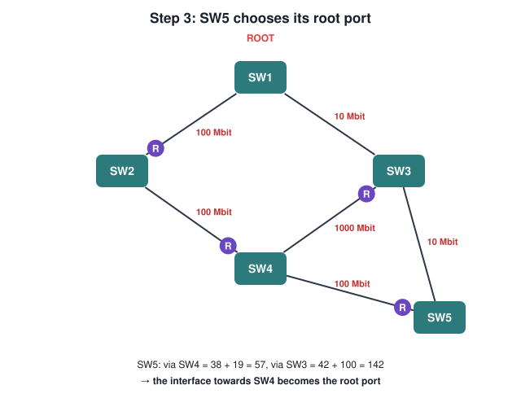

# Spanning-Tree Cost Calculation

[한국어](../02-Spanning-Tree-Cost-Calculation.md) | **English** | [日本語](02-Spanning-Tree-Cost-Calculation.ja.md) | [简体中文](02-Spanning-Tree-Cost-Calculation.zh-CN.md) | [Español](02-Spanning-Tree-Cost-Calculation.es.md) | [Français](02-Spanning-Tree-Cost-Calculation.fr.md)

Non-root bridges need to find the **shortest path** to the root bridge. What happens with a mix of interface types such as Ethernet, FastEthernet and Gigabit? Let's work it out.

> For basics such as the root bridge and root port, read [01. Introduction to Spanning-Tree](01-Introduction-to-Spanning-Tree.en.md) first.

---

## 1. Cost and root path cost

The picture above shows a larger network with several switches and different interface types: Ethernet (10 Mbit), FastEthernet (100 Mbit) and Gigabit (1000 Mbit). SW1 on top is the root bridge, so all other switches are non-root and need to find the shortest path to the root bridge.

Spanning-tree uses **cost** to decide the shortest path to the root bridge. **The slower the interface, the higher the cost**, and the path with the lowest cost is used.

| Bandwidth | Cost |
| --- | --- |
| 10 Mbit | 100 |
| 100 Mbit | 19 |
| 1000 Mbit | 4 |

The cost value lives inside the BPDU.

The BPDU has a field called **root path cost**. Each switch puts the cost of its shortest path to the root bridge in this field. Once the switches know which switch is the root bridge, they look for the shortest path to get there. **BPDUs flow from the root bridge downwards** to all switches.

If you studied CCNA or CCNP, this story about cost may sound familiar. **OSPF** also uses cost to find the shortest path to a destination. But there is one big difference: OSPF builds a **topology database (LSDB)**, so every router knows exactly what the network looks like. Spanning-tree is "dumb": **switches have no idea what the topology looks like.** They decide based only on the BPDUs coming down from the root bridge.

---

## 2. Step-by-step calculation

Let's see how the cost is calculated in this topology, step by step.

- SW2 uses its direct link to SW1 as its **root port**. It is a 100 Mbit interface with a cost of 19.
- SW2 forwards BPDUs towards SW4, with a root path cost of **19** in the BPDU.
- SW3 also receives BPDUs from SW1, so **at this moment** it may select its 10 Mbit interface as the root port. Let's continue.

This picture needs some explanation:

- SW3 receives BPDUs on its 10 Mbit interface (cost 100) and on its 1000 Mbit interface (cost 4). It uses the **1000 Mbit interface as its root port** (the shortest path to the root bridge is 19 + 19 + 4 = **42**).
- At first, the BPDU that SW3 sends to SW4 has a root path cost of **100**.
- SW4 receives a BPDU from SW2 with a root path cost of 19, and one from SW3 with a root path cost of 100.
- The path through SW2 is shorter, so **the interface towards SW2 becomes SW4's root port**.
- SW4 forwards BPDUs towards SW3 and SW5 with a root path cost of **38** (its own root path cost of 19 + its interface cost of 19).
- SW3 forwards BPDUs towards SW5 with a root path cost of **42** (19 + 19 + 4).

This is the complete picture. SW5 receives BPDUs from SW3 and SW4 and sees these values in the root path cost field:

- BPDU from SW3: cost 42
- BPDU from SW4: cost 38

SW5 adds the cost of its own interface. Through SW4: 38 + 19 (100 Mbit) = **57**. Through SW3: 42 + 100 (10 Mbit) = **142**. So it selects **the interface towards SW4 as its root port**.

Are you following so far? The key point is that **switches only decide based on the BPDUs they receive**. They don't know the topology. All they know is **on which interface they received the best BPDU** — the one with the shortest path to the root bridge.

---

## 3. What if the cost is equal?

SW1 is the root bridge and SW2 is non-root. There are two links between them for redundancy. Redundancy means a loop, so spanning-tree blocks one interface on SW2.

SW2 receives BPDUs on both interfaces, but **the root path cost is the same**. Which one is blocked, Fa0/1 or Fa0/2? When the cost is equal, spanning-tree looks at the **port priority**. By default the port priority is the same on all interfaces, so the **interface number** is the tie-breaker.

**The lowest interface number** is chosen, so Fa0/2 is blocked here. Of course, the port priority can be changed, so we can choose which interface gets blocked.

Whenever spanning-tree has to make a decision, it always uses this list:

1. **Lowest bridge ID**: the switch with the lowest bridge ID becomes the root bridge.
2. **Lowest path cost to the root bridge**: when a switch receives several BPDUs, it selects the interface with the lowest cost to the root bridge as its root port.
3. **Lowest sender bridge ID**: when a switch is connected to two switches it can use to reach the root bridge and the cost is the same, it selects the interface connected to the switch with the lowest bridge ID as its root port.
4. **Lowest sender port ID**: when a switch has two interfaces to the same switch and the cost is the same, it uses the interface with the lowest number as its root port.

Write this list down and remember it.

---

## Key points

- Spanning-tree chooses the shortest path to the root bridge by **cost**. Slower interfaces have a higher cost (10 Mbit = 100, 100 Mbit = 19, 1000 Mbit = 4).
- Each switch puts its own path cost in the BPDU's **root path cost** field and passes it downwards.
- A switch **adds its own interface cost** to the received root path cost before comparing (e.g. SW5 via SW4: 38 + 19 = 57).
- Unlike OSPF, switches **don't know the topology** and decide only from the BPDUs they receive.
- Decision order: **bridge ID → root path cost → sender bridge ID → sender port ID**, lower is always better.
