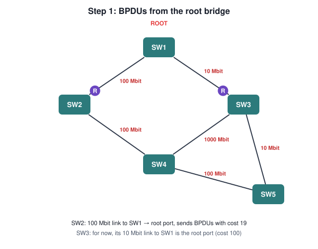

# Spanning-Tree Cost Calculation

[한국어](../02-Spanning-Tree-Cost-Calculation.md) | [English](02-Spanning-Tree-Cost-Calculation.en.md) | [日本語](02-Spanning-Tree-Cost-Calculation.ja.md) | [简体中文](02-Spanning-Tree-Cost-Calculation.zh-CN.md) | **Español** | [Français](02-Spanning-Tree-Cost-Calculation.fr.md)

Los switches non-root necesitan encontrar el **camino más corto** hacia el root bridge. ¿Qué pasa si hay una mezcla de interfaces como Ethernet, FastEthernet y Gigabit? Vamos a calcularlo.

> Para conceptos básicos como root bridge y root port, lee primero [01. Introduction to Spanning-Tree](01-Introduction-to-Spanning-Tree.es.md).

---

## 1. Coste y root path cost

La figura muestra una red más grande con varios switches y distintos tipos de interfaz: Ethernet (10 Mbit), FastEthernet (100 Mbit) y Gigabit (1000 Mbit). SW1, arriba, es el root bridge, así que todos los demás switches son non-root y deben encontrar el camino más corto hacia él.

Spanning-tree usa el **coste (cost)** para decidir el camino más corto hacia el root bridge. **Cuanto más lenta la interfaz, mayor el coste**, y se usa el camino con el coste más bajo.

| Bandwidth | Cost |
| --- | --- |
| 10 Mbit | 100 |
| 100 Mbit | 19 |
| 1000 Mbit | 4 |

El valor del coste está dentro de la BPDU.

La BPDU tiene un campo llamado **root path cost**. Cada switch pone en este campo el coste de su camino más corto hacia el root bridge. Cuando los switches saben cuál es el root bridge, buscan el camino más corto para llegar a él. **Las BPDU fluyen desde el root bridge hacia abajo** a todos los switches.

Si has estudiado CCNA o CCNP, esta historia del coste te sonará. **OSPF** también usa el coste para encontrar el camino más corto a un destino. Pero hay una gran diferencia: OSPF construye una **base de datos de topología (LSDB)**, así que cada router sabe exactamente cómo es la red. Spanning-tree es "tonto": **los switches no tienen ni idea de cómo es la topología.** Deciden solo con las BPDU que bajan desde el root bridge.

---

## 2. Cálculo paso a paso

Veamos paso a paso cómo se calcula el coste en esta topología.

- SW2 usa su enlace directo con SW1 como **root port**. Es una interfaz de 100 Mbit con coste 19.
- SW2 reenvía BPDU hacia SW4, con un root path cost de **19** en la BPDU.
- SW3 también recibe BPDU de SW1, así que **en este momento** puede elegir su interfaz de 10 Mbit como root port. Sigamos.

Esta figura necesita una explicación:

- SW3 recibe BPDU por su interfaz de 10 Mbit (coste 100) y por su interfaz de 1000 Mbit (coste 4). Usa la **interfaz de 1000 Mbit como root port** (el camino más corto hacia el root bridge es 19 + 19 + 4 = **42**).
- Al principio, la BPDU que SW3 envía a SW4 tiene un root path cost de **100**.
- SW4 recibe una BPDU de SW2 con root path cost 19 y otra de SW3 con root path cost 100.
- El camino por SW2 es más corto, así que **la interfaz hacia SW2 se convierte en el root port de SW4**.
- SW4 reenvía BPDU hacia SW3 y SW5 con un root path cost de **38** (su root path cost de 19 + el coste de su interfaz, 19).
- SW3 reenvía BPDU hacia SW5 con un root path cost de **42** (19 + 19 + 4).

Esta es la imagen completa. SW5 recibe BPDU de SW3 y de SW4 y ve estos valores en el campo root path cost:

- BPDU de SW3: coste 42
- BPDU de SW4: coste 38

SW5 suma el coste de su propia interfaz. Por SW4: 38 + 19 (100 Mbit) = **57**. Por SW3: 42 + 100 (10 Mbit) = **142**. Así que elige **la interfaz hacia SW4 como root port**.

¿Me sigues hasta aquí? Lo importante es que **los switches solo deciden con las BPDU que reciben**. No conocen la topología. Lo único que saben es **por qué interfaz recibieron la mejor BPDU**, es decir, la que tiene el camino más corto hacia el root bridge.

---

## 3. ¿Y si el coste es igual?

SW1 es el root bridge y SW2 es non-root. Hay dos enlaces entre ellos para tener redundancia. Redundancia significa bucle, así que spanning-tree bloquea una interfaz de SW2.

SW2 recibe BPDU por las dos interfaces, pero **el root path cost es el mismo**. ¿Cuál se bloquea, Fa0/1 o Fa0/2? Cuando el coste es igual, spanning-tree mira la **prioridad del puerto**. Por defecto es la misma en todas las interfaces, así que desempata el **número de interfaz**.

Se elige **el número de interfaz más bajo**, así que aquí se bloquea Fa0/2. Por supuesto, la prioridad del puerto se puede cambiar para elegir qué interfaz se bloquea.

Cuando spanning-tree tiene que tomar una decisión, siempre usa esta lista:

1. **Bridge ID más bajo**: el switch con el bridge ID más bajo se convierte en root bridge.
2. **Menor coste de camino hacia el root bridge**: si un switch recibe varias BPDU, elige como root port la interfaz con el menor coste hacia el root bridge.
3. **Menor bridge ID del emisor**: si un switch está conectado a dos switches por los que puede llegar al root bridge y el coste es igual, elige como root port la interfaz conectada al switch con el bridge ID más bajo.
4. **Menor port ID del emisor**: si un switch tiene dos interfaces hacia el mismo switch y el coste es igual, usa como root port la interfaz con el número más bajo.

Apunta esta lista y recuérdala.

---

## Puntos clave

- Spanning-tree elige el camino más corto hacia el root bridge por **coste**. Las interfaces más lentas tienen más coste (10 Mbit = 100, 100 Mbit = 19, 1000 Mbit = 4).
- Cada switch pone su propio coste en el campo **root path cost** de la BPDU y lo pasa hacia abajo.
- Un switch **suma el coste de su interfaz** al root path cost recibido antes de comparar (p. ej., SW5 por SW4: 38 + 19 = 57).
- A diferencia de OSPF, los switches **no conocen la topología** y deciden solo con las BPDU recibidas.
- Orden de decisión: **bridge ID → root path cost → bridge ID del emisor → port ID del emisor**; siempre gana el más bajo.
