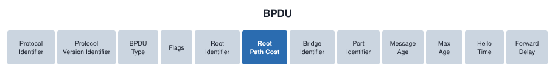
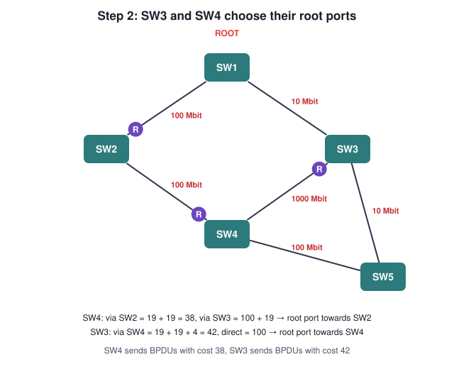

# Spanning-Tree Cost Calculation

[한국어](../02-Spanning-Tree-Cost-Calculation.md) | [English](02-Spanning-Tree-Cost-Calculation.en.md) | [日本語](02-Spanning-Tree-Cost-Calculation.ja.md) | [简体中文](02-Spanning-Tree-Cost-Calculation.zh-CN.md) | [Español](02-Spanning-Tree-Cost-Calculation.es.md) | **Français**

Les switchs non-root doivent trouver le **chemin le plus court** vers le root bridge. Que se passe-t-il avec un mélange d'interfaces Ethernet, FastEthernet et Gigabit ? Faisons le calcul.

> Pour les bases comme le root bridge et le root port, lisez d'abord [01. Introduction to Spanning-Tree](01-Introduction-to-Spanning-Tree.fr.md).

---

## 1. Coût et root path cost

La figure montre un réseau plus grand avec plusieurs switchs et différents types d'interfaces : Ethernet (10 Mbit), FastEthernet (100 Mbit) et Gigabit (1000 Mbit). SW1, en haut, est le root bridge ; tous les autres switchs sont donc non-root et doivent trouver le chemin le plus court vers lui.

Le spanning-tree utilise le **coût (cost)** pour déterminer le chemin le plus court vers le root bridge. **Plus l'interface est lente, plus le coût est élevé**, et le chemin au coût le plus bas est utilisé.

| Bandwidth | Cost |
| --- | --- |
| 10 Mbit | 100 |
| 100 Mbit | 19 |
| 1000 Mbit | 4 |

La valeur du coût se trouve dans la BPDU.

La BPDU contient un champ appelé **root path cost**. Chaque switch y inscrit le coût de son chemin le plus court vers le root bridge. Une fois que les switchs savent qui est le root bridge, ils cherchent le chemin le plus court pour l'atteindre. **Les BPDU descendent du root bridge** vers tous les switchs.

Si vous avez étudié le CCNA ou le CCNP, cette histoire de coût vous dira peut-être quelque chose. **OSPF** utilise aussi un coût pour trouver le chemin le plus court vers une destination. Mais il y a une grosse différence : OSPF construit une **base de données de topologie (LSDB)**, si bien que chaque routeur sait exactement à quoi ressemble le réseau. Le spanning-tree est « bête » : **les switchs n'ont aucune idée de la topologie.** Ils décident uniquement d'après les BPDU qui descendent du root bridge.

---

## 2. Calcul étape par étape

Voyons étape par étape comment le coût est calculé dans cette topologie.

- SW2 utilise son lien direct vers SW1 comme **root port**. C'est une interface 100 Mbit de coût 19.
- SW2 transmet des BPDU vers SW4, avec un root path cost de **19**.
- SW3 reçoit aussi des BPDU de SW1, donc **pour l'instant** il peut choisir son interface 10 Mbit comme root port. Continuons.

Cette figure mérite quelques explications :

- SW3 reçoit des BPDU sur son interface 10 Mbit (coût 100) et sur son interface 1000 Mbit (coût 4). Il utilise l'**interface 1000 Mbit comme root port** (le chemin le plus court vers le root bridge vaut 19 + 19 + 4 = **42**).
- Au départ, la BPDU que SW3 envoie à SW4 a un root path cost de **100**.
- SW4 reçoit une BPDU de SW2 avec un root path cost de 19, et une de SW3 avec un root path cost de 100.
- Le chemin par SW2 est plus court, donc **l'interface vers SW2 devient le root port de SW4**.
- SW4 transmet des BPDU vers SW3 et SW5 avec un root path cost de **38** (son root path cost de 19 + le coût de son interface, 19).
- SW3 transmet des BPDU vers SW5 avec un root path cost de **42** (19 + 19 + 4).

Voici la vue complète. SW5 reçoit des BPDU de SW3 et de SW4 et voit ces valeurs dans le champ root path cost :

- BPDU de SW3 : coût 42
- BPDU de SW4 : coût 38

SW5 ajoute le coût de sa propre interface. Par SW4 : 38 + 19 (100 Mbit) = **57**. Par SW3 : 42 + 100 (10 Mbit) = **142**. Il choisit donc **l'interface vers SW4 comme root port**.

Vous suivez ? Le point essentiel est que **les switchs décident uniquement d'après les BPDU qu'ils reçoivent**. Ils ne connaissent pas la topologie. Tout ce qu'ils savent, c'est **sur quelle interface ils ont reçu la meilleure BPDU**, c'est-à-dire celle qui a le chemin le plus court vers le root bridge.

---

## 3. Et si le coût est égal ?

SW1 est le root bridge et SW2 est non-root. Il y a deux liens entre eux pour la redondance. Redondance signifie boucle, donc le spanning-tree bloque une interface de SW2.

SW2 reçoit des BPDU sur les deux interfaces, mais **le root path cost est le même**. Laquelle est bloquée, Fa0/1 ou Fa0/2 ? Quand le coût est égal, le spanning-tree regarde la **priorité du port**. Par défaut, elle est identique sur toutes les interfaces, donc c'est le **numéro d'interface** qui départage.

C'est **le numéro d'interface le plus bas** qui est choisi, donc Fa0/2 est bloquée ici. Bien sûr, la priorité du port peut être modifiée pour choisir l'interface à bloquer.

Chaque fois que le spanning-tree doit prendre une décision, il utilise toujours cette liste :

1. **Bridge ID le plus bas** : le switch au bridge ID le plus bas devient root bridge.
2. **Coût de chemin le plus bas vers le root bridge** : quand un switch reçoit plusieurs BPDU, il choisit comme root port l'interface au coût le plus bas vers le root bridge.
3. **Bridge ID de l'émetteur le plus bas** : quand un switch est relié à deux switchs par lesquels il peut atteindre le root bridge et que le coût est égal, il choisit comme root port l'interface reliée au switch au bridge ID le plus bas.
4. **Port ID de l'émetteur le plus bas** : quand un switch a deux interfaces vers le même switch et que le coût est égal, il utilise comme root port l'interface au numéro le plus bas.

Notez cette liste et retenez-la.

---

## Points clés

- Le spanning-tree choisit le chemin le plus court vers le root bridge par le **coût**. Les interfaces lentes ont un coût plus élevé (10 Mbit = 100, 100 Mbit = 19, 1000 Mbit = 4).
- Chaque switch inscrit son propre coût dans le champ **root path cost** de la BPDU et le transmet vers le bas.
- Un switch **ajoute le coût de son interface** au root path cost reçu avant de comparer (ex. : SW5 par SW4 = 38 + 19 = 57).
- Contrairement à OSPF, les switchs **ne connaissent pas la topologie** et décident uniquement d'après les BPDU reçues.
- Ordre de décision : **bridge ID → root path cost → bridge ID de l'émetteur → port ID de l'émetteur** ; le plus bas gagne toujours.
