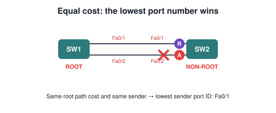

# Spanning-Tree Cost Calculation

[한국어](../02-Spanning-Tree-Cost-Calculation.md) | [English](02-Spanning-Tree-Cost-Calculation.en.md) | **日本語** | [简体中文](02-Spanning-Tree-Cost-Calculation.zh-CN.md) | [Español](02-Spanning-Tree-Cost-Calculation.es.md) | [Français](02-Spanning-Tree-Cost-Calculation.fr.md)

Non-root スイッチは Root Bridge までの**最短経路**を見つける必要があります。Ethernet、FastEthernet、Gigabit のように種類の違うインターフェイスが混在していたらどうなるでしょうか?このノートで実際に計算してみます。

> Root Bridge、Root port などの基本は、先に [01. Introduction to Spanning-Tree](01-Introduction-to-Spanning-Tree.ja.md) を参照してください。

---

## 1. Cost と Root Path Cost

上の図はスイッチが何台もある、より大きなネットワークです。インターフェイスの種類も Ethernet(10 Mbit)、FastEthernet(100 Mbit)、Gigabit(1000 Mbit)とさまざまです。いちばん上の SW1 が Root Bridge なので、ほかのスイッチはすべて non-root で、Root Bridge までの最短経路を見つける必要があります。

Spanning-tree は **cost** で Root Bridge までの最短経路を決めます。**インターフェイスが遅いほど cost が大きく**、cost が最も小さい経路が使われます。

| Bandwidth | Cost |
| --- | --- |
| 10 Mbit | 100 |
| 100 Mbit | 19 |
| 1000 Mbit | 4 |

Cost の値は BPDU の中にあります。

BPDU には **Root Path Cost** というフィールドがあります。各スイッチは、このフィールドに自分から Root Bridge までの最短経路の cost を入れます。どのスイッチが Root Bridge かがわかると、スイッチはそこまでの最短経路を探します。**BPDU は Root Bridge から下に向かって**すべてのスイッチに届きます。

CCNA や CCNP を勉強したなら、cost の話はなじみがあるかもしれません。**OSPF** も cost で宛先までの最短経路を計算します。ただし大きな違いがあります。OSPF は**トポロジーデータベース(LSDB)**を作るので、すべてのルーターがネットワークの形を正確に知っています。一方 spanning-tree は「単純」です。**スイッチはトポロジーの形をまったく知りません。** Root Bridge から下りてくる BPDU だけを見て判断します。

---

## 2. 段階ごとの計算

このトポロジーで cost がどう計算されるか、段階ごとに見ていきます。

- SW2 は SW1 と直接つながるリンクを **Root port** にします。100 Mbit のインターフェイスで cost は 19 です。
- SW2 は SW4 に向けて BPDU を送り、BPDU の Root Path Cost フィールドには **19** が入ります。
- SW3 も SW1 から BPDU を受け取るので、**この時点では** 10 Mbit のインターフェイスを Root port に選ぶことがあります。続けて見てみましょう。

この図は少し説明が必要です。

- SW3 は 10 Mbit のインターフェイス(cost 100)と 1000 Mbit のインターフェイス(cost 4)で BPDU を受け取ります。**1000 Mbit のインターフェイスを Root port** にします(Root Bridge までの最短経路は 19 + 19 + 4 = **42**)。
- 最初に SW3 が SW4 に送る BPDU の Root Path Cost は **100** です。
- SW4 は SW2 から Root Path Cost 19 の BPDU を、SW3 から Root Path Cost 100 の BPDU を受け取ります。
- SW2 を経由する経路のほうが短いので、**SW2 側が SW4 の Root port** になります。
- SW4 は SW3 と SW5 に向けて BPDU を送ります。Root Path Cost は **38** です(自分の Root Path Cost 19 + 自分のインターフェイスの cost 19)。
- SW3 は SW5 に向けて BPDU を送り、Root Path Cost に **42**(19 + 19 + 4)を入れます。

全体像は上のとおりです。SW5 は SW3 と SW4 から BPDU を受け取り、Root Path Cost フィールドで次の値を見ます。

- SW3 の BPDU:cost 42
- SW4 の BPDU:cost 38

SW5 はここに自分のインターフェイスの cost を足します。SW4 経由なら 38 + 19(100 Mbit)= **57**、SW3 経由なら 42 + 100(10 Mbit)= **142** です。そのため **SW4 側のインターフェイスを Root port** に選びます。

ここまでついてこられましたか?必ず覚えておくべき点は、**スイッチは受信した BPDU だけを見て判断する**ということです。スイッチはトポロジーの形を知りません。知っているのは**どのインターフェイスで最も良い BPDU を受け取ったか**だけで、最も良い BPDU とは Root Bridge までの経路が最も短い BPDU です。

---

## 3. Cost が同じなら?

SW1 は Root Bridge で、SW2 は non-root です。冗長化のため、2 台の間にリンクが 2 本あります。冗長化はループを意味するので、spanning-tree は SW2 のインターフェイスを 1 つブロックします。

SW2 は両方のインターフェイスで BPDU を受け取りますが、**Root Path Cost が同じ**です。では Fa0/1 と Fa0/2 のどちらをブロックするでしょうか?Cost が同じなら、spanning-tree は**ポート priority** を見ます。デフォルトではすべてのインターフェイスのポート priority が同じなので、**インターフェイス番号**で決まります。

**最も小さいインターフェイス番号**が選ばれるので、ここでは Fa0/2 がブロックされます。もちろんポート priority は変更できるので、どのインターフェイスをブロックするかを自分で決めることもできます。

Spanning-tree は何かを決めるとき、常に次の順番に従います。

1. **最も小さい Bridge ID**:Bridge ID が最も小さいスイッチが Root Bridge になります。
2. **Root Bridge までの最も小さい path cost**:BPDU を複数受け取ったら、Root Bridge までの cost が最も小さいインターフェイスを Root port に選びます。
3. **最も小さい送信元 Bridge ID**:Root Bridge へ行ける 2 台のスイッチとつながっていて cost が同じなら、Bridge ID が小さいスイッチとつながるインターフェイスを Root port に選びます。
4. **最も小さい送信元 Port ID**:同じスイッチと 2 つのインターフェイスでつながっていて cost が同じなら、番号が最も小さいインターフェイスを Root port に選びます。

このリストは書き留めて、必ず覚えておきましょう。

---

## まとめ

- Spanning-tree は **cost** で Root Bridge までの最短経路を選びます。遅いインターフェイスほど cost が大きくなります(10 Mbit = 100、100 Mbit = 19、1000 Mbit = 4)。
- 各スイッチは BPDU の **Root Path Cost** フィールドに自分の経路 cost を入れて下流へ渡します。
- 受け取った Root Path Cost に**自分のインターフェイスの cost を足して**比べます(例:SW5 → SW4 経由 38 + 19 = 57)。
- OSPF と違い、スイッチは**トポロジーを知らず**、受け取った BPDU だけで判断します。
- 決定の順番:**Bridge ID → Root path cost → 送信元 Bridge ID → 送信元 Port ID**、いずれも小さいほど良いです。
