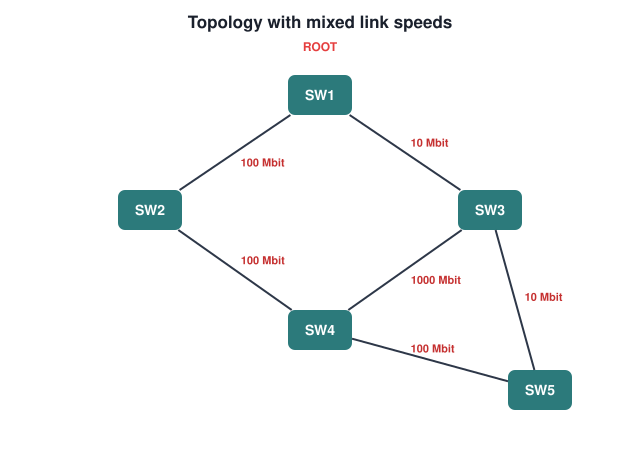

# Spanning-Tree Cost Calculation

[한국어](../02-Spanning-Tree-Cost-Calculation.md) | [English](02-Spanning-Tree-Cost-Calculation.en.md) | [日本語](02-Spanning-Tree-Cost-Calculation.ja.md) | **简体中文** | [Español](02-Spanning-Tree-Cost-Calculation.es.md) | [Français](02-Spanning-Tree-Cost-Calculation.fr.md)

Non-root 交换机需要找到到达 Root Bridge 的**最短路径**。如果 Ethernet、FastEthernet、Gigabit 这些不同类型的接口混在一起,会怎么样?本笔记来实际算一算。

> Root Bridge、Root port 等基本概念请先阅读 [01. Introduction to Spanning-Tree](01-Introduction-to-Spanning-Tree.zh-CN.md)。

---

## 1. Cost 与 Root Path Cost

上图是一个有多台交换机的更大网络,接口类型也有 Ethernet(10 Mbit)、FastEthernet(100 Mbit)、Gigabit(1000 Mbit)多种。最上面的 SW1 是 Root Bridge,其余交换机都是 non-root,需要找到到达 Root Bridge 的最短路径。

Spanning-tree 用 **cost** 决定到达 Root Bridge 的最短路径。**接口越慢,cost 越高**,cost 最低的路径会被使用。

| Bandwidth | Cost |
| --- | --- |
| 10 Mbit | 100 |
| 100 Mbit | 19 |
| 1000 Mbit | 4 |

Cost 值位于 BPDU 中。

BPDU 中有一个叫 **Root Path Cost** 的字段。每台交换机都会把自己到 Root Bridge 最短路径的 cost 填进这个字段。交换机知道谁是 Root Bridge 后,就会寻找到达那里的最短路径。**BPDU 从 Root Bridge 向下**传给所有交换机。

如果学过 CCNA 或 CCNP,cost 的概念可能很熟悉。**OSPF** 也用 cost 计算到目的地的最短路径。但有一个很大的区别:OSPF 会建立**拓扑数据库(LSDB)**,所有路由器都准确知道网络的样子。而 spanning-tree 很“简单”:**交换机完全不知道拓扑长什么样。**它只根据从 Root Bridge 传下来的 BPDU 做判断。

---

## 2. 分步计算

来一步步看这个拓扑中的 cost 是如何计算的。

- SW2 把与 SW1 直连的链路作为 **Root port**。这是 100 Mbit 接口,cost 为 19。
- SW2 向 SW4 发送 BPDU,BPDU 的 Root Path Cost 字段中填的是 **19**。
- SW3 也从 SW1 收到 BPDU,所以**此时**它可能会把 10 Mbit 接口选为 Root port。继续往下看。

这张图需要一些解释:

- SW3 在 10 Mbit 接口(cost 100)和 1000 Mbit 接口(cost 4)上都收到 BPDU。它把 **1000 Mbit 接口作为 Root port**(到 Root Bridge 的最短路径是 19 + 19 + 4 = **42**)。
- 一开始 SW3 发给 SW4 的 BPDU 的 Root Path Cost 是 **100**。
- SW4 从 SW2 收到 Root Path Cost 为 19 的 BPDU,从 SW3 收到 Root Path Cost 为 100 的 BPDU。
- 经过 SW2 的路径更短,所以**朝向 SW2 的接口成为 SW4 的 Root port**。
- SW4 向 SW3 和 SW5 发送 BPDU,Root Path Cost 为 **38**(自己的 Root Path Cost 19 + 自己接口的 cost 19)。
- SW3 向 SW5 发送 BPDU,Root Path Cost 填 **42**(19 + 19 + 4)。

完整的图如上。SW5 从 SW3 和 SW4 收到 BPDU,在 Root Path Cost 字段中看到以下值:

- 来自 SW3 的 BPDU:cost 42
- 来自 SW4 的 BPDU:cost 38

SW5 再加上自己接口的 cost。经过 SW4 是 38 + 19(100 Mbit)= **57**,经过 SW3 是 42 + 100(10 Mbit)= **142**。所以它选择**朝向 SW4 的接口作为 Root port**。

到这里都跟上了吗?一定要记住:**交换机只根据收到的 BPDU 做判断。**交换机不知道拓扑的样子,它只知道**在哪个接口上收到了最好的 BPDU**,而最好的 BPDU 就是到 Root Bridge 路径最短的那个。

---

## 3. Cost 相同时怎么办?

SW1 是 Root Bridge,SW2 是 non-root。为了冗余,两台交换机之间有两条链路。冗余意味着环路,所以 spanning-tree 会阻塞 SW2 的一个接口。

SW2 在两个接口上都收到 BPDU,但 **Root Path Cost 相同**。那么阻塞 Fa0/1 还是 Fa0/2?Cost 相同时,spanning-tree 会看**端口 priority**。默认所有接口的端口 priority 相同,所以由**接口编号**决定。

选择**编号最低的接口**,所以这里 Fa0/2 被阻塞。当然端口 priority 可以修改,所以也可以自己决定阻塞哪个接口。

Spanning-tree 需要做决定时,总是按照下面的顺序:

1. **最低的 Bridge ID**:Bridge ID 最低的交换机成为 Root Bridge。
2. **到 Root Bridge 最低的 path cost**:收到多个 BPDU 时,选择到 Root Bridge cost 最低的接口作为 Root port。
3. **最低的发送方 Bridge ID**:连接到两台都能到达 Root Bridge 的交换机且 cost 相同时,选择连接 Bridge ID 更低的交换机的接口作为 Root port。
4. **最低的发送方 Port ID**:用两个接口连接到同一台交换机且 cost 相同时,选择编号最低的接口作为 Root port。

把这个列表记下来,一定要记住。

---

## 核心总结

- Spanning-tree 用 **cost** 选择到达 Root Bridge 的最短路径。接口越慢 cost 越高(10 Mbit = 100,100 Mbit = 19,1000 Mbit = 4)。
- 每台交换机把自己的路径 cost 填进 BPDU 的 **Root Path Cost** 字段并向下传递。
- 把收到的 Root Path Cost **加上自己接口的 cost** 再比较(例:SW5 经 SW4 为 38 + 19 = 57)。
- 与 OSPF 不同,交换机**不知道拓扑**,只根据收到的 BPDU 做判断。
- 决定顺序:**Bridge ID → Root path cost → 发送方 Bridge ID → 发送方 Port ID**,都是越低越好。
