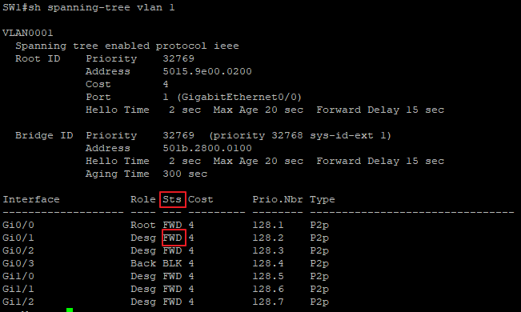

# Spanning-Tree Port States

[한국어](../03-Spanning-Tree-Port-States.md) | [English](03-Spanning-Tree-Port-States.en.md) | [日本語](03-Spanning-Tree-Port-States.ja.md) | [简体中文](03-Spanning-Tree-Port-States.zh-CN.md) | **Español** | [Français](03-Spanning-Tree-Port-States.fr.md)

Al conectar un cable a un switch Cisco, el LED encima de la interfaz es **naranja** al principio y se pone **verde** al rato. Durante ese tiempo, spanning-tree está decidiendo el estado de la interfaz. Esta nota explica cada estado de puerto y muestra cómo cambian en un switch real.

> Para lo básico de spanning-tree, lee primero [01. Introduction to Spanning-Tree](01-Introduction-to-Spanning-Tree.es.md).

---

## 1. Estados de puerto

Al conectar un cable, ocurre lo siguiente:

- **Listening**: solo un root port o un designated port pasa a listening. Un puerto non-designated se queda en blocking. No se transmiten datos durante **15 segundos**, para asegurarse de que la topología no cambia mientras tanto. Después pasa a learning.
- **Learning**: la interfaz procesa las tramas Ethernet mirando la **dirección MAC de origen** para llenar la tabla de direcciones MAC. Pero las tramas no se reenvían a su destino. A los **15 segundos** pasa a forwarding.
- **Forwarding**: el estado final. Por fin la interfaz reenvía tramas Ethernet, así que **se transmiten datos**.

Un puerto que no es designated ni root está en estado **blocking**.

Así que se tarda **30 segundos en total** en pasar de listening a forwarding. No es muy rápido, ¿verdad? Y esto ocurre en todas las interfaces del switch.

A veces una interfaz en blocking tiene que pasar a forwarding porque cambió la topología. En ese caso, el estado blocking dura **20 segundos** antes de pasar a listening. Así que se tarda 20 (blocking) + 15 (listening) + 15 (learning) = **50 segundos** hasta que la interfaz está en forwarding.

Treinta segundos es mucho tiempo. Un PC moderno con SSD arranca más rápido. Este es el resumen de los estados de puerto:

| Estado | Reenvía tramas | Aprende direcciones MAC | Duración |
| --- | --- | --- | --- |
| Blocking | No | No | 20 segundos |
| Listening | No | No | 15 segundos |
| Learning | No | Yes | 15 segundos |
| Forwarding | Yes | Yes | – |

---

## 2. Comprobarlo en un switch real

¿Cómo se ve esto en un switch Cisco real? Desconecté y volví a conectar el cable de una interfaz (o hice shutdown y no shutdown) y ejecuté el comando show enseguida:

El rol del puerto es **designated** y el estado es **listening (LIS)**. Si sigues ejecutando el comando show, a los 15 segundos más o menos se ve así:

Ha pasado al estado **learning (LRN)**. Tras otros 15 segundos aproximadamente, se ve así:

Acabas de ver una interfaz pasar por los estados de puerto hasta **forwarding (FWD)**. Una forma mejor de ver los cambios es activar un **debug**.

Al desactivar y volver a activar la interfaz, vemos cambiar los estados de puerto en tiempo real.

El estado cambia `listening` → `learning` → `forwarding`, con unos **15 segundos** entre cada paso.

---

## Puntos clave

- **Listening (15 s)**: solo se intercambian BPDU; no se aprenden MAC ni se transmiten datos.
- **Learning (15 s)**: se llena la tabla de direcciones MAC, pero todavía no se reenvían tramas.
- **Forwarding**: se reenvían tramas. Los puertos que no son root ni designated se quedan en **blocking**.
- Tras conectar un cable se tarda **30 segundos** en reenviar, y **50 segundos** (20 + 15 + 15) si se parte de blocking.
- Comprueba los cambios de estado repitiendo `show spanning-tree` o con `debug spanning-tree events`.
