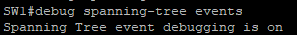

# Spanning-Tree Port States

[한국어](../03-Spanning-Tree-Port-States.md) | [English](03-Spanning-Tree-Port-States.en.md) | [日本語](03-Spanning-Tree-Port-States.ja.md) | [简体中文](03-Spanning-Tree-Port-States.zh-CN.md) | [Español](03-Spanning-Tree-Port-States.es.md) | **Français**

Quand on branche un câble sur un switch Cisco, la LED au-dessus de l'interface est d'abord **orange**, puis devient **verte** au bout d'un moment. Pendant ce temps, le spanning-tree décide de l'état de l'interface. Cette note présente chaque état de port et montre les changements d'état sur un vrai switch.

> Pour les bases du spanning-tree, lisez d'abord [01. Introduction to Spanning-Tree](01-Introduction-to-Spanning-Tree.fr.md).

---

## 1. États des ports

Quand on branche un câble, voici ce qui se passe :

- **Listening** : seul un root port ou un designated port passe en listening. Un port non-designated reste en blocking. Aucune donnée n'est transmise pendant **15 secondes**, pour s'assurer que la topologie ne change pas entre-temps. Le port passe ensuite en learning.
- **Learning** : l'interface traite les trames Ethernet en regardant l'**adresse MAC source** pour remplir la table d'adresses MAC. Mais les trames ne sont pas transmises à leur destination. Au bout de **15 secondes**, le port passe en forwarding.
- **Forwarding** : l'état final. L'interface transmet enfin les trames Ethernet, donc **les données passent**.

Un port qui n'est ni designated ni root est en état **blocking**.

Il faut donc **30 secondes au total** pour passer de listening à forwarding. Pas très rapide, n'est-ce pas ? Et cela se produit sur toutes les interfaces du switch.

Il arrive qu'une interface en blocking doive passer en forwarding parce que la topologie a changé. Dans ce cas, l'état blocking dure **20 secondes** avant de passer en listening. Il faut donc 20 (blocking) + 15 (listening) + 15 (learning) = **50 secondes** pour que l'interface soit en forwarding.

Trente secondes, c'est long. Un PC moderne avec un SSD démarre plus vite que ça. Voici un récapitulatif des états de port :

| État | Transmet les trames | Apprend les adresses MAC | Durée |
| --- | --- | --- | --- |
| Blocking | No | No | 20 secondes |
| Listening | No | No | 15 secondes |
| Learning | No | Yes | 15 secondes |
| Forwarding | Yes | Yes | – |

---

## 2. Vérification sur un vrai switch

À quoi cela ressemble-t-il sur un vrai switch Cisco ? J'ai débranché puis rebranché le câble d'une interface (ou fait un shutdown puis un no shutdown) et lancé la commande show aussitôt :

Le rôle du port est **designated** et l'état est **listening (LIS)**. En relançant la commande show, au bout d'environ 15 secondes on obtient ceci :

Le port est passé en **learning (LRN)**. Après encore environ 15 secondes, on obtient ceci :

Vous venez de voir une interface passer par les différents états jusqu'au **forwarding (FWD)**. Pour mieux voir les changements, le mieux est d'activer un **debug**.

En désactivant puis en réactivant l'interface, on voit les états de port changer en temps réel.

L'état passe par `listening` → `learning` → `forwarding`, avec environ **15 secondes** entre chaque étape.

---

## Points clés

- **Listening (15 s)** : seules les BPDU sont échangées ; pas d'apprentissage MAC ni de transmission de données.
- **Learning (15 s)** : la table d'adresses MAC se remplit, mais les trames ne sont pas encore transmises.
- **Forwarding** : les trames sont transmises. Les ports ni root ni designated restent en **blocking**.
- Après le branchement d'un câble, il faut **30 secondes** pour transmettre, et **50 secondes** (20 + 15 + 15) en partant de blocking.
- Vérifiez les changements d'état en relançant `show spanning-tree` ou avec `debug spanning-tree events`.
