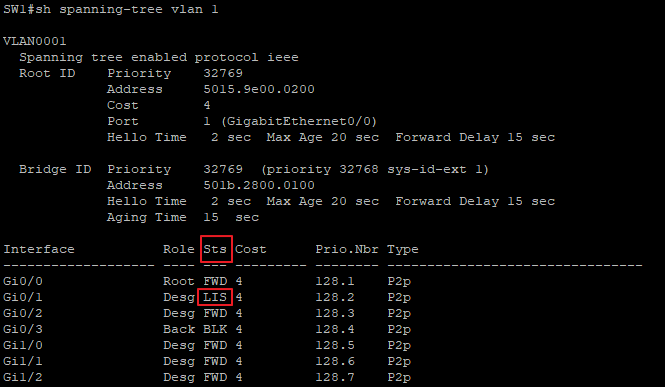

# Spanning-Tree Port States

[한국어](../03-Spanning-Tree-Port-States.md) | [English](03-Spanning-Tree-Port-States.en.md) | **日本語** | [简体中文](03-Spanning-Tree-Port-States.zh-CN.md) | [Español](03-Spanning-Tree-Port-States.es.md) | [Français](03-Spanning-Tree-Port-States.fr.md)

Cisco スイッチにケーブルを挿すと、インターフェイスの上の LED が最初は**オレンジ色**で、しばらくすると**緑色**に変わります。この間、spanning-tree がインターフェイスの状態を決めています。このノートでは各ポート状態と、実際のスイッチで状態が変わる様子を確認します。

> Spanning-tree の基本動作は、先に [01. Introduction to Spanning-Tree](01-Introduction-to-Spanning-Tree.ja.md) を参照してください。

---

## 1. ポート状態

ケーブルを挿すと、次の順に進みます。

- **Listening**:Root port か Designated port だけが Listening 状態に進みます。Non-designated ポートは Blocking 状態にとどまります。その間にトポロジーが変わらないか確かめるため、**15 秒**間データを送信しません。そのあと Learning 状態に進みます。
- **Learning**:イーサネットフレームの**送信元 MAC アドレス**を見て MAC アドレステーブルを埋めます。ただし、フレームを宛先へは転送しません。**15 秒**後に Forwarding 状態に進みます。
- **Forwarding**:インターフェイスの最後の状態です。ようやくイーサネットフレームを転送し、**データが送信**されます。

Designated port でも Root port でもないポートは **Blocking** 状態にあります。

つまり Listening から Forwarding まで**合計 30 秒**かかります。速いとはいえませんよね?しかもこれはスイッチのすべてのインターフェイスで起こります。

Blocking 状態のインターフェイスが、トポロジーの変化によって Forwarding に変わる必要がある場合もあります。このときは Blocking 状態が **20 秒**続いてから Listening に進みます。したがって 20(Blocking)+ 15(Listening)+ 15(Learning)= **50 秒**たってから Forwarding になります。

30 秒は長い時間です。SSD を使う最近の PC はそれより速く起動します。ポート状態をまとめると次のとおりです。

| 状態 | フレームの転送 | MAC アドレスの学習 | 時間 |
| --- | --- | --- | --- |
| Blocking | No | No | 20 秒 |
| Listening | No | No | 15 秒 |
| Learning | No | Yes | 15 秒 |
| Forwarding | Yes | Yes | – |

---

## 2. 実際のスイッチで確認

実際の Cisco スイッチではどう見えるでしょうか?インターフェイスのケーブルを抜いて挿し直し(または shutdown してから no shutdown)、すぐに show コマンドを実行すると次のようになります。

ポートの役割は **Designated** で、状態は **Listening(LIS)**です。この show コマンドを繰り返し実行すると、約 15 秒後に次のように変わります。

**Learning(LRN)**状態に進みました。さらに約 15 秒たつと次のようになります。

インターフェイスが各ポート状態を経て **Forwarding(FWD)**になる様子を実際に確認できました。状態の変化をもっとよく見るには **debug** を有効にするのがおすすめです。

インターフェイスをもう一度無効にしてから有効にすると、ポート状態が変わる様子をリアルタイムで見られます。

`listening` → `learning` → `forwarding` の順に変わり、その間隔がそれぞれ約 **15 秒**であることが確認できます。

---

## まとめ

- **Listening(15 秒)**:BPDU だけをやり取りし、MAC の学習もデータの送信もしません。
- **Learning(15 秒)**:MAC アドレステーブルを埋めますが、まだフレームは転送しません。
- **Forwarding**:フレームを転送します。Root でも Designated でもないポートは **Blocking** にとどまります。
- ケーブルを挿してから Forwarding まで **30 秒**、Blocking から始まると **50 秒**(20 + 15 + 15)かかります。
- `show spanning-tree` を繰り返すか、`debug spanning-tree events` で状態の変化を確認します。
