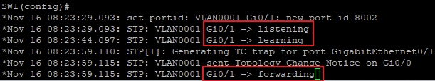

# Spanning-Tree Port States

[한국어](../03-Spanning-Tree-Port-States.md) | [English](03-Spanning-Tree-Port-States.en.md) | [日本語](03-Spanning-Tree-Port-States.ja.md) | **简体中文** | [Español](03-Spanning-Tree-Port-States.es.md) | [Français](03-Spanning-Tree-Port-States.fr.md)

在 Cisco 交换机上插上线缆后,接口上方的 LED 一开始是**橙色**,过一会儿变成**绿色**。这段时间里 spanning-tree 正在决定接口的状态。本笔记介绍各个端口状态,并在实际交换机上观察状态的变化。

> Spanning-tree 的基本工作方式请先阅读 [01. Introduction to Spanning-Tree](01-Introduction-to-Spanning-Tree.zh-CN.md)。

---

## 1. 端口状态

插上线缆后,会按以下顺序进行:

- **Listening**:只有 Root port 或 Designated port 会进入 Listening 状态,non-designated 端口留在 Blocking 状态。为了确认这段时间拓扑没有变化,**15 秒**内不传输数据。之后进入 Learning 状态。
- **Learning**:查看以太网帧的**源 MAC 地址**来填充 MAC 地址表,但不会把帧转发到目的地。**15 秒**后进入 Forwarding 状态。
- **Forwarding**:接口的最终状态。终于开始转发以太网帧,**传输数据**。

既不是 Designated port 也不是 Root port 的端口处于 **Blocking** 状态。

也就是说,从 Listening 到 Forwarding **一共需要 30 秒**。不算快吧?而且交换机的所有接口都会这样。

处于 Blocking 状态的接口也可能因为拓扑变化需要转为 Forwarding。这时 Blocking 状态会持续 **20 秒**,然后才进入 Listening。所以要经过 20(Blocking)+ 15(Listening)+ 15(Learning)= **50 秒**才会进入 Forwarding。

30 秒是很长的时间,使用 SSD 的现代 PC 开机都比这快。端口状态总结如下:

| 状态 | 转发帧 | 学习 MAC 地址 | 时间 |
| --- | --- | --- | --- |
| Blocking | No | No | 20 秒 |
| Listening | No | No | 15 秒 |
| Learning | No | Yes | 15 秒 |
| Forwarding | Yes | Yes | – |

---

## 2. 在实际交换机上查看

在实际的 Cisco 交换机上是什么样子?把接口的线缆拔掉再插上(或者 shutdown 再 no shutdown),马上执行 show 命令,结果如下:

端口角色是 **Designated**,状态是 **Listening(LIS)**。持续执行这个 show 命令,大约 15 秒后变成这样:

进入了 **Learning(LRN)**状态。再过大约 15 秒,变成这样:

我们亲眼看到了接口经过各个端口状态,最终进入 **Forwarding(FWD)**。想更清楚地看到状态变化,最好开启 **debug**。

再把接口关闭后打开,就能实时看到端口状态的变化。

可以看到状态按 `listening` → `learning` → `forwarding` 的顺序变化,每一步之间间隔约 **15 秒**。

---

## 核心总结

- **Listening(15 秒)**:只收发 BPDU,不学习 MAC,也不传输数据。
- **Learning(15 秒)**:填充 MAC 地址表,但还不转发帧。
- **Forwarding**:转发帧。既不是 Root 也不是 Designated 的端口留在 **Blocking**。
- 插上线缆后到 Forwarding 需要 **30 秒**,从 Blocking 开始则需要 **50 秒**(20 + 15 + 15)。
- 可以反复执行 `show spanning-tree`,或用 `debug spanning-tree events` 查看状态变化。
