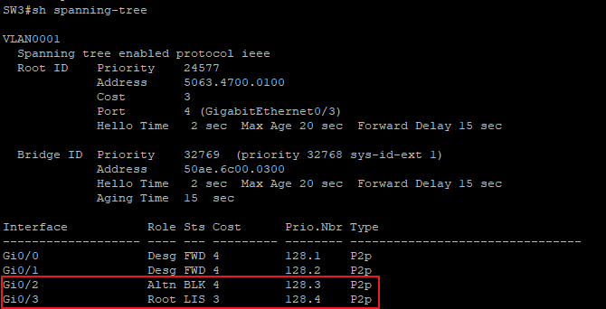
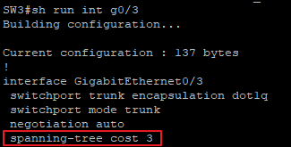
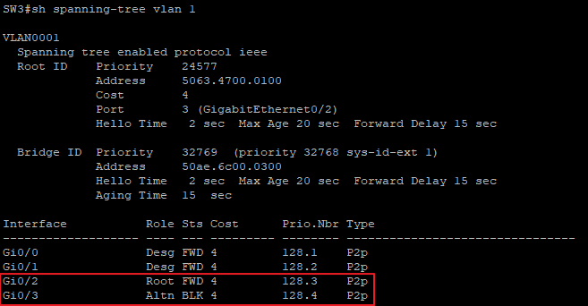
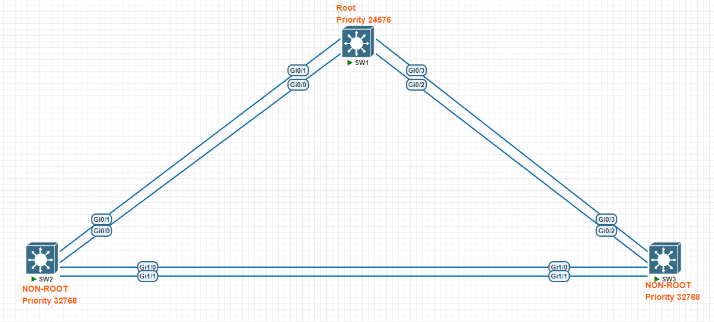
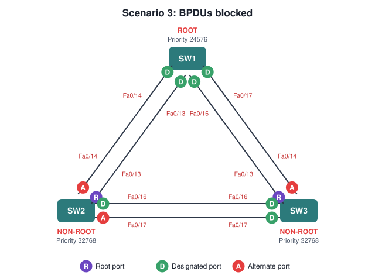
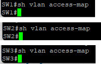
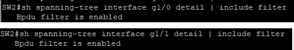
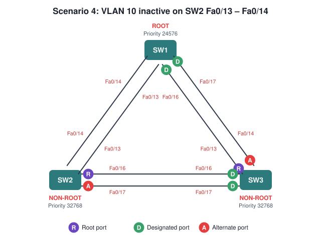
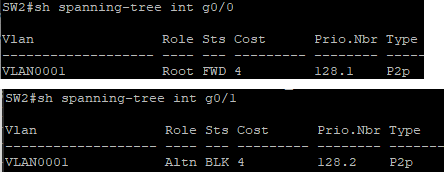

# Troubleshooting Spanning-Tree

[한국어](../04-Troubleshooting-Spanning-Tree.md) | **English** | [日本語](04-Troubleshooting-Spanning-Tree.ja.md) | [简体中文](04-Troubleshooting-Spanning-Tree.zh-CN.md) | [Español](04-Troubleshooting-Spanning-Tree.es.md) | [Français](04-Troubleshooting-Spanning-Tree.fr.md)

Out of the box, spanning-tree does a fine job of creating a loop-free topology. But the output may not be what you expect, or a misconfiguration may cause some funky things. This note looks at four troubleshooting scenarios.

> The figures follow the textbook (FastEthernet and Ethernet interfaces); the lab captures use GigabitEthernet interfaces. The names differ, but the causes and fixes are the same.

---

## 1. Incorrect root port

There are three switches with two links between each pair for redundancy. SW1 has been elected as the root bridge for VLAN 1. When you deal with spanning-tree, it's best to **draw a small picture of the network and write down the interface roles** of each switch (designated, non-designated/alternate or blocked). One of the links between SW1 and SW3 is an **Ethernet (10 Mbit)** link; all the others are FastEthernet.

I used `show spanning-tree` to check the interface roles on SW1 and SW3. SW3 elected **Ethernet 0/13 as its root port** and FastEthernet 0/14 as an alternate port. Not a good idea: all traffic goes down the 10 Mbit link while the 100 Mbit link isn't used at all. A switch selects its root port like this:

1. Choose the interface with the **lowest cost** to the root bridge.
2. If the cost is equal, choose the interface with the **lowest port priority**.

Normally an Ethernet interface has a higher cost than FastEthernet, so FastEthernet should be selected. Why did SW3 pick Ethernet 0/13? Because both interfaces **have the same cost**. With equal cost, it chose Ethernet 0/13, which has the lower port priority. Let's check the interface configuration.

Someone **changed the cost of the interface** (to 19, the FastEthernet default, in the textbook; to `spanning-tree cost 3` in the lab). Let's get rid of it.

Let's check the result.

After removing the cost command, the port states changed. The fast interface is now the **root port**, and the slow interface is back to its default cost. Problem solved!

**Lesson learned**: make sure the interface you want as the root port has the **lowest-cost path** to the root bridge.

---

## 2. Spanning-tree disabled

A different scenario, with the same topology.

All interfaces are the same type (FastEthernet). SW1 is the root bridge for VLAN 10, and this is what we find after checking the interface roles:

Interesting… SW1 is the root bridge, and FastEthernet 0/17 has been elected as a **backup port**. That's not something you see every day. SW2 elected a root port, and all its other interfaces are alternate ports. But **there is nothing on SW3**. Let's look at the spanning-tree for VLAN 10.

SW1 and SW2 run spanning-tree for VLAN 10, but **SW3 does not**. What could be the issue? Just in case, let's check SW3's interfaces.

All interfaces are up. What about the trunk configuration?

The interfaces look good: they are trunks, and VLAN 10 is active on all of SW3's interfaces. That means spanning-tree should be running for VLAN 10.

Let's look at this message again. It says spanning-tree for VLAN 10 **does not exist**. There are two reasons for this message:

- No interfaces are active for VLAN 10.
- Spanning-tree has been **disabled** for VLAN 10.

We confirmed that VLAN 10 is active on all of SW3's interfaces, so maybe spanning-tree has been **disabled globally**. Let's type `spanning-tree vlan 10` and verify.

There we go — spanning-tree is now enabled for VLAN 10 and working. Problem solved! It may sound a bit lame, but I see it every now and then in the real world. One case I saw was a customer whose wireless vendor told them to **disable spanning-tree on the interfaces connected to the access points**. This is what the customer typed on the switch:

They typed `no spanning-tree vlan 10` on the interface, but ended up **back in global configuration mode**. There is no command to disable spanning-tree on an interface like this, so the switch treats it as the **global command**: it disables spanning-tree for VLAN 10 and kicks you back to global configuration mode.

**Lesson learned**: check whether spanning-tree is enabled or disabled.

---

## 3. BPDUs blocked

On to the next exercise, same topology.

This time the customer is complaining about **bad performance**. Let's start by verifying the spanning-tree topology.

Look at the picture above. FastEthernet 0/16 on SW2 and on SW3 are **both designated**. On SW1, all interfaces are designated. What happens when one of the switches forwards a broadcast or floods a frame? Bingo — a **loop**.

In this topology, FastEthernet 0/16 and 0/17 on SW3 should both be **alternate ports**, because SW3 has the worst bridge ID. Since they are both designated, we can assume **SW3 is not receiving BPDUs** on these interfaces.

So why did spanning-tree fail? An important detail: to create a loop-free topology, spanning-tree **requires BPDUs to be sent between the switches**. BPDUs can be filtered by MAC access-lists, VLAN access-maps or something from the spanning-tree toolkit. Let's check them all.

No access-lists… port security, maybe?

No port security either. What about spanning-tree related commands?

Found it! **BPDU filter** is enabled on FastEthernet 0/16 and 0/17 of SW2. Because of this, SW3 doesn't receive BPDUs from SW2. Let's get rid of it.

Now let's check the spanning-tree topology again.

FastEthernet 0/16 and 0/17 are now both **alternate ports** and block traffic. The topology is loop-free again. Problem solved!

**Lesson learned**: make sure BPDUs are **not blocked or filtered** between switches.

---

## 4. VLAN inactive on interface

One more scenario, same topology.

SW1 is the root bridge for VLAN 1. These are the port states:

This is what we see with `show spanning-tree vlan 10`. All interfaces are equal, yet SW2 selected **FastEthernet 0/16 as its root port**. Shouldn't FastEthernet 0/13 be the root port? It has a lower cost to the root bridge than FastEthernet 0/16. Let's take a closer look at SW2.

The `show spanning-tree interface` command shows the spanning-tree information per interface. On these interfaces, **only the spanning-tree for VLAN 1** is active.

There are a few things to check. First, it's always a good idea to check whether spanning-tree is active for the VLAN, because it can be disabled with `no spanning-tree vlan X`. In this scenario, though, spanning-tree is active for VLAN 10 because we can see other VLAN 10 interfaces (FastEthernet 0/16 and 0/17). So what other reason could stop spanning-tree from running on an interface?

Spanning-tree being active globally for VLAN 10 **doesn't mean it is active on every interface**. The `show interfaces switchport` command shows whether VLAN 10 runs on the interfaces.

This reveals something interesting: these interfaces ended up **in access mode and in VLAN 1**. Let's **change them to trunks** so VLAN 10 traffic can flow through them.

Now look at the spanning-tree topology for VLAN 10 again.

VLAN 10 traffic now runs on these interfaces, and the interface we expected is elected as the **root port**. Problem solved!

**Lesson learned**: make sure the **VLAN is active on the interface** before looking at spanning-tree issues.

---

## Key points

- Before looking at spanning-tree commands, check that **the interfaces are operational** and that **the VLANs are active on them**.
- Incorrect root port: a manually changed **`spanning-tree cost`** may be the cause. With equal cost, the port priority decides.
- "Spanning tree instance(s) for vlan X does not exist": no interface is active in the VLAN, or it was disabled with **`no spanning-tree vlan X`**. Typed in interface mode, it is still treated as a global command.
- If both ends are designated, suspect **filtered BPDUs** (MAC ACL, VLAN access-map, **BPDU filter**).
- If the expected port doesn't become the root port, check the **access/trunk mode and VLAN** with `show interfaces switchport`.
