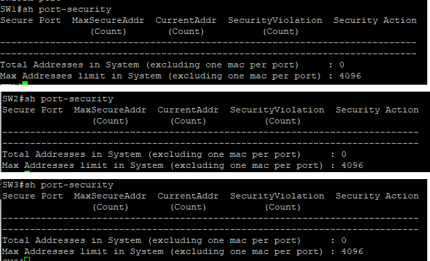
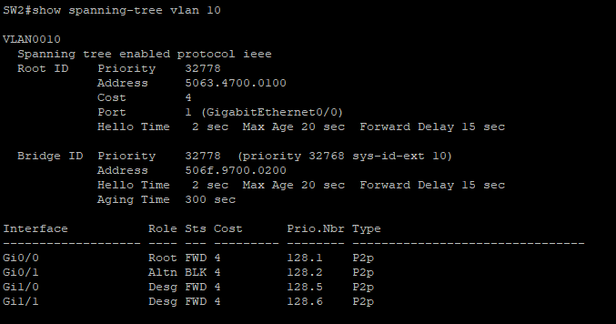

# Troubleshooting Spanning-Tree

[한국어](../04-Troubleshooting-Spanning-Tree.md) | [English](04-Troubleshooting-Spanning-Tree.en.md) | [日本語](04-Troubleshooting-Spanning-Tree.ja.md) | [简体中文](04-Troubleshooting-Spanning-Tree.zh-CN.md) | **Español** | [Français](04-Troubleshooting-Spanning-Tree.fr.md)

Con la configuración por defecto, spanning-tree crea bastante bien una topología sin bucles. Pero puede que la salida no sea la que esperas, o que un error de configuración provoque cosas raras. Esta nota repasa cuatro escenarios de resolución de problemas.

> Las figuras siguen el libro (interfaces FastEthernet y Ethernet); las capturas del laboratorio usan interfaces GigabitEthernet. Los nombres cambian, pero las causas y soluciones son las mismas.

---

## 1. Root port incorrecto (Incorrect Root Port)

Hay tres switches con dos enlaces entre cada par para tener redundancia. SW1 ha sido elegido root bridge de la VLAN 1. Cuando trabajas con spanning-tree, lo mejor es **dibujar la red y anotar los roles de las interfaces** de cada switch (designated, non-designated/alternate o blocked). Uno de los enlaces entre SW1 y SW3 es **Ethernet (10 Mbit)**; todos los demás son FastEthernet.

Con `show spanning-tree` comprobé los roles de las interfaces en SW1 y SW3. SW3 eligió **Ethernet 0/13 como root port** y FastEthernet 0/14 como alternate port. Mala idea: todo el tráfico va por el enlace de 10 Mbit y el de 100 Mbit no se usa. Un switch elige su root port así:

1. Elige la interfaz con el **coste más bajo** hacia el root bridge.
2. Si el coste es igual, elige la interfaz con la **prioridad de puerto más baja**.

Normalmente una interfaz Ethernet tiene más coste que una FastEthernet, así que debería elegirse la FastEthernet. ¿Por qué SW3 eligió Ethernet 0/13? Porque las dos interfaces **tienen el mismo coste**. Con el mismo coste, eligió Ethernet 0/13, que tiene la prioridad de puerto más baja. Comprobemos la configuración de la interfaz.

Alguien **cambió el coste de la interfaz** (a 19, el valor por defecto de FastEthernet, en el libro; a `spanning-tree cost 3` en el laboratorio). Vamos a quitarlo.

Comprobemos el resultado.

Tras quitar el comando de coste, los estados de puerto cambiaron. La interfaz rápida es ahora el **root port** y la lenta ha vuelto a su coste por defecto. ¡Problema resuelto!

**Lección aprendida**: asegúrate de que la interfaz que quieres como root port tiene el **camino de menor coste** hacia el root bridge.

---

## 2. Spanning-tree desactivado (Spanning-Tree Disabled)

Otro escenario, con la misma topología.

Todas las interfaces son del mismo tipo (FastEthernet). SW1 es el root bridge de la VLAN 10, y esto es lo que encontramos al revisar los roles de las interfaces:

Interesante… SW1 es el root bridge y FastEthernet 0/17 ha sido elegido como **backup port**. No es algo que se vea todos los días. SW2 eligió un root port y todas sus demás interfaces son alternate ports. Pero **en SW3 no hay nada**. Veamos el spanning-tree de la VLAN 10.

SW1 y SW2 ejecutan spanning-tree para la VLAN 10, pero **SW3 no**. ¿Cuál puede ser el problema? Por si acaso, revisemos las interfaces de SW3.

Todas las interfaces están up. ¿Y la configuración de trunk?

Las interfaces están bien: son trunks y la VLAN 10 está activa en todas las interfaces de SW3. Eso significa que spanning-tree debería funcionar para la VLAN 10.

Volvamos a mirar este mensaje. Dice que el spanning-tree de la VLAN 10 **no existe**. Hay dos motivos para este mensaje:

- No hay interfaces activas en la VLAN 10.
- Spanning-tree se ha **desactivado** para la VLAN 10.

Ya confirmamos que la VLAN 10 está activa en todas las interfaces de SW3, así que quizá spanning-tree se ha **desactivado globalmente**. Escribamos `spanning-tree vlan 10` y comprobemos.

Listo: spanning-tree está activado para la VLAN 10 y funciona. ¡Problema resuelto! Parece una tontería, pero lo veo de vez en cuando en el mundo real. Un caso que vi fue el de un cliente cuyo proveedor de wifi le dijo que **desactivara spanning-tree en las interfaces conectadas a los puntos de acceso**. Esto es lo que escribió el cliente en el switch:

Escribió `no spanning-tree vlan 10` en la interfaz, pero acabó **de vuelta en el modo de configuración global**. No existe un comando para desactivar spanning-tree en una interfaz de esta forma, así que el switch lo interpreta como el **comando global**: desactiva spanning-tree para la VLAN 10 y te devuelve al modo de configuración global.

**Lección aprendida**: comprueba si spanning-tree está activado o desactivado.

---

## 3. BPDU bloqueadas (BPDUs Blocked)

Siguiente ejercicio, misma topología.

Esta vez el cliente se queja de **mal rendimiento**. Empecemos por verificar la topología de spanning-tree.

Mira la figura. FastEthernet 0/16 de SW2 y de SW3 son **ambas designated**. En SW1, todas las interfaces son designated. ¿Qué pasa cuando un switch reenvía un broadcast o inunda una trama? ¡Bingo! Un **bucle**.

En esta topología, FastEthernet 0/16 y 0/17 de SW3 deberían ser **alternate ports**, porque SW3 tiene el peor bridge ID. Como las dos son designated, podemos suponer que **SW3 no recibe BPDU** por esas interfaces.

¿Por qué falló spanning-tree? Un detalle importante: para crear una topología sin bucles, spanning-tree **necesita que se envíen BPDU entre los switches**. Las BPDU pueden filtrarse con access-lists de MAC, VLAN access-maps o algo del kit de herramientas de spanning-tree. Revisémoslos todos.

No hay access-lists… ¿port security, quizá?

Tampoco hay port security. ¿Y los comandos relacionados con spanning-tree?

¡Lo encontramos! **BPDU filter** está activado en FastEthernet 0/16 y 0/17 de SW2. Por eso SW3 no recibe BPDU de SW2. Vamos a quitarlo.

Comprobemos de nuevo la topología de spanning-tree.

Ahora FastEthernet 0/16 y 0/17 son **alternate ports** y bloquean el tráfico. La topología vuelve a estar libre de bucles. ¡Problema resuelto!

**Lección aprendida**: asegúrate de que las BPDU **no se bloquean ni se filtran** entre switches.

---

## 4. VLAN inactiva en la interfaz (VLAN Inactive on Interface)

Un escenario más, misma topología.

SW1 es el root bridge de la VLAN 1. Estos son los estados de puerto:

Esto es lo que vemos con `show spanning-tree vlan 10`. Todas las interfaces son iguales y, sin embargo, SW2 eligió **FastEthernet 0/16 como root port**. ¿No debería ser FastEthernet 0/13? Tiene menos coste hacia el root bridge que FastEthernet 0/16. Miremos SW2 con más detalle.

El comando `show spanning-tree interface` muestra la información de spanning-tree por interfaz. En estas interfaces **solo está activo el spanning-tree de la VLAN 1**.

Hay varias cosas que comprobar. Primero, conviene verificar si spanning-tree está activo para la VLAN, porque se puede desactivar con `no spanning-tree vlan X`. Sin embargo, en este escenario spanning-tree está activo para la VLAN 10, porque vemos otras interfaces de la VLAN 10 (FastEthernet 0/16 y 0/17). ¿Qué otro motivo puede impedir que spanning-tree funcione en una interfaz?

Que spanning-tree esté activo globalmente para la VLAN 10 **no significa que esté activo en todas las interfaces**. El comando `show interfaces switchport` muestra si la VLAN 10 funciona en las interfaces.

Aparece algo interesante: estas interfaces han quedado **en modo access y en la VLAN 1**. **Cambiémoslas a trunk** para que pueda pasar el tráfico de la VLAN 10.

Veamos de nuevo la topología de spanning-tree de la VLAN 10.

Ahora el tráfico de la VLAN 10 pasa por estas interfaces y la interfaz esperada es elegida como **root port**. ¡Problema resuelto!

**Lección aprendida**: asegúrate de que **la VLAN está activa en la interfaz** antes de buscar problemas de spanning-tree.

---

## Puntos clave

- Antes de mirar comandos de spanning-tree, comprueba que **las interfaces funcionan** y que **las VLAN están activas en ellas**.
- Root port incorrecto: la causa puede ser un **`spanning-tree cost`** cambiado a mano. Con el mismo coste, decide la prioridad del puerto.
- "Spanning tree instance(s) for vlan X does not exist": ninguna interfaz está activa en la VLAN, o se desactivó con **`no spanning-tree vlan X`**. Escrito en modo interfaz, se trata igualmente como comando global.
- Si los dos extremos son designated, sospecha de **BPDU filtradas** (ACL de MAC, VLAN access-map, **BPDU filter**).
- Si el puerto esperado no es el root port, revisa el **modo access/trunk y la VLAN** con `show interfaces switchport`.
