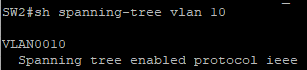
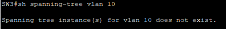
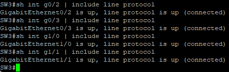
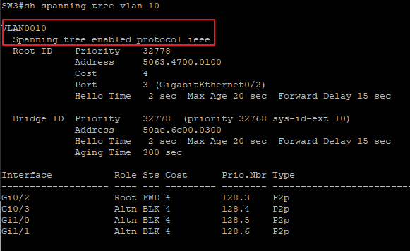
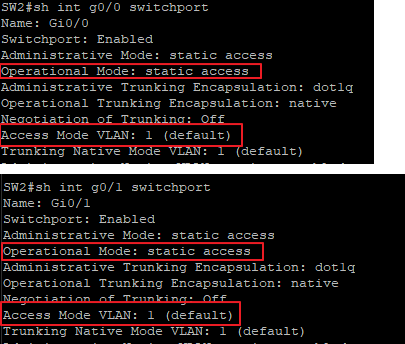

# Troubleshooting Spanning-Tree

[한국어](../04-Troubleshooting-Spanning-Tree.md) | [English](04-Troubleshooting-Spanning-Tree.en.md) | [日本語](04-Troubleshooting-Spanning-Tree.ja.md) | [简体中文](04-Troubleshooting-Spanning-Tree.zh-CN.md) | [Español](04-Troubleshooting-Spanning-Tree.es.md) | **Français**

Avec sa configuration par défaut, le spanning-tree crée très bien une topologie sans boucle. Mais le résultat n'est pas toujours celui qu'on attend, ou une erreur de configuration peut provoquer des choses bizarres. Cette note passe en revue quatre scénarios de dépannage.

> Les figures suivent le manuel (interfaces FastEthernet et Ethernet) ; les captures du lab utilisent des interfaces GigabitEthernet. Les noms diffèrent, mais les causes et les solutions sont les mêmes.

---

## 1. Mauvais root port (Incorrect Root Port)

Il y a trois switchs, avec deux liens entre chaque paire pour la redondance. SW1 a été élu root bridge du VLAN 1. Face à un problème de spanning-tree, le mieux est de **dessiner le réseau et de noter le rôle des interfaces** de chaque switch (designated, non-designated/alternate ou blocked). L'un des liens entre SW1 et SW3 est un lien **Ethernet (10 Mbit)** ; tous les autres sont en FastEthernet.

Avec `show spanning-tree`, j'ai vérifié le rôle des interfaces sur SW1 et SW3. SW3 a choisi **Ethernet 0/13 comme root port** et FastEthernet 0/14 comme alternate port. Mauvaise idée : tout le trafic passe par le lien 10 Mbit, et le lien 100 Mbit n'est pas utilisé du tout. Un switch choisit son root port ainsi :

1. Il choisit l'interface au **coût le plus bas** vers le root bridge.
2. Si le coût est égal, il choisit l'interface à la **priorité de port la plus basse**.

Normalement, une interface Ethernet a un coût plus élevé qu'une FastEthernet, donc la FastEthernet devrait être choisie. Pourquoi SW3 a-t-il pris Ethernet 0/13 ? Parce que les deux interfaces **ont le même coût**. À coût égal, il a choisi Ethernet 0/13, qui a la priorité de port la plus basse. Vérifions la configuration de l'interface.

Quelqu'un a **modifié le coût de l'interface** (à 19, la valeur par défaut de FastEthernet, dans le manuel ; à `spanning-tree cost 3` dans le lab). Supprimons-le.

Vérifions le résultat.

Après suppression de la commande de coût, les états des ports ont changé. L'interface rapide est maintenant le **root port**, et l'interface lente a retrouvé son coût par défaut. Problème résolu !

**Leçon à retenir** : assurez-vous que l'interface que vous voulez comme root port offre le **chemin au coût le plus bas** vers le root bridge.

---

## 2. Spanning-tree désactivé (Spanning-Tree Disabled)

Un autre scénario, avec la même topologie.

Toutes les interfaces sont du même type (FastEthernet). SW1 est le root bridge du VLAN 10, et voici ce qu'on trouve en vérifiant le rôle des interfaces :

Intéressant… SW1 est le root bridge, et FastEthernet 0/17 a été élu **backup port**. Ce n'est pas tous les jours qu'on voit ça. SW2 a élu un root port, et toutes ses autres interfaces sont des alternate ports. Mais **il n'y a rien sur SW3**. Regardons le spanning-tree du VLAN 10.

SW1 et SW2 font tourner le spanning-tree pour le VLAN 10, mais **pas SW3**. Quel peut être le problème ? Par précaution, vérifions les interfaces de SW3.

Toutes les interfaces sont up. Et la configuration trunk ?

Les interfaces sont correctes : ce sont des trunks, et le VLAN 10 est actif sur toutes les interfaces de SW3. Le spanning-tree devrait donc tourner pour le VLAN 10.

Relisons ce message. Il indique que le spanning-tree du VLAN 10 **n'existe pas**. Ce message a deux causes possibles :

- Aucune interface n'est active dans le VLAN 10.
- Le spanning-tree a été **désactivé** pour le VLAN 10.

Nous avons confirmé que le VLAN 10 est actif sur toutes les interfaces de SW3, donc le spanning-tree a peut-être été **désactivé globalement**. Tapons `spanning-tree vlan 10` et vérifions.

Voilà : le spanning-tree est activé pour le VLAN 10 et fonctionne. Problème résolu ! Cela peut paraître anodin, mais je le vois de temps en temps sur le terrain. Un cas que j'ai rencontré : le fournisseur Wi-Fi d'un client lui avait dit de **désactiver le spanning-tree sur les interfaces reliées aux points d'accès**. Voici ce que le client a tapé sur le switch :

Il a tapé `no spanning-tree vlan 10` sur l'interface, mais s'est retrouvé **ramené en mode de configuration globale**. Il n'existe pas de commande pour désactiver le spanning-tree sur une interface de cette façon : le switch l'interprète donc comme la **commande globale**, désactive le spanning-tree pour le VLAN 10 et vous renvoie en mode de configuration globale.

**Leçon à retenir** : vérifiez si le spanning-tree est activé ou désactivé.

---

## 3. BPDU bloquées (BPDUs Blocked)

Exercice suivant, même topologie.

Cette fois, le client se plaint de **mauvaises performances**. Commençons par vérifier la topologie spanning-tree.

Regardez la figure. FastEthernet 0/16 sur SW2 et sur SW3 sont **toutes deux designated**. Sur SW1, toutes les interfaces sont designated. Que se passe-t-il quand un switch transmet un broadcast ou inonde une trame ? Bingo : une **boucle**.

Dans cette topologie, FastEthernet 0/16 et 0/17 sur SW3 devraient être des **alternate ports**, car SW3 a le moins bon bridge ID. Puisqu'elles sont toutes deux designated, on peut supposer que **SW3 ne reçoit pas de BPDU** sur ces interfaces.

Pourquoi le spanning-tree a-t-il échoué ? Un détail important : pour créer une topologie sans boucle, le spanning-tree **a besoin que des BPDU circulent entre les switchs**. Les BPDU peuvent être filtrées par des access-lists MAC, des VLAN access-maps ou un outil de la boîte à outils spanning-tree. Vérifions-les tous.

Pas d'access-list… du port security, peut-être ?

Pas de port security non plus. Et les commandes liées au spanning-tree ?

Trouvé ! Le **BPDU filter** est activé sur FastEthernet 0/16 et 0/17 de SW2. À cause de cela, SW3 ne reçoit pas les BPDU de SW2. Supprimons-le.

Vérifions à nouveau la topologie spanning-tree.

FastEthernet 0/16 et 0/17 sont maintenant des **alternate ports** et bloquent le trafic. La topologie est de nouveau sans boucle. Problème résolu !

**Leçon à retenir** : assurez-vous que les BPDU **ne sont ni bloquées ni filtrées** entre les switchs.

---

## 4. VLAN inactif sur l'interface (VLAN Inactive on Interface)

Un dernier scénario, même topologie.

SW1 est le root bridge du VLAN 1. Voici les états des ports :

Voici ce qu'on voit avec `show spanning-tree vlan 10`. Toutes les interfaces sont identiques, et pourtant SW2 a choisi **FastEthernet 0/16 comme root port**. FastEthernet 0/13 ne devrait-elle pas être le root port ? Son coût vers le root bridge est plus bas que celui de FastEthernet 0/16. Regardons SW2 de plus près.

La commande `show spanning-tree interface` affiche les informations spanning-tree par interface. Sur ces interfaces, **seul le spanning-tree du VLAN 1** est actif.

Il y a plusieurs choses à vérifier. D'abord, il est toujours utile de vérifier que le spanning-tree est actif pour le VLAN, car on peut le désactiver avec `no spanning-tree vlan X`. Dans ce scénario, cependant, le spanning-tree est actif pour le VLAN 10, puisqu'on voit d'autres interfaces du VLAN 10 (FastEthernet 0/16 et 0/17). Quelle autre raison pourrait empêcher le spanning-tree de tourner sur une interface ?

Que le spanning-tree soit actif globalement pour le VLAN 10 **ne signifie pas qu'il l'est sur toutes les interfaces**. La commande `show interfaces switchport` indique si le VLAN 10 passe sur les interfaces.

On découvre quelque chose d'intéressant : ces interfaces se sont retrouvées **en mode access et dans le VLAN 1**. **Passons-les en trunk** pour que le trafic du VLAN 10 puisse y circuler.

Regardons de nouveau la topologie spanning-tree du VLAN 10.

Le trafic du VLAN 10 passe maintenant par ces interfaces, et l'interface attendue est élue **root port**. Problème résolu !

**Leçon à retenir** : assurez-vous que **le VLAN est actif sur l'interface** avant de chercher un problème de spanning-tree.

---

## Points clés

- Avant de regarder les commandes spanning-tree, vérifiez que **les interfaces fonctionnent** et que **les VLAN y sont actifs**.
- Mauvais root port : la cause peut être un **`spanning-tree cost`** modifié manuellement. À coût égal, c'est la priorité du port qui décide.
- « Spanning tree instance(s) for vlan X does not exist » : aucune interface n'est active dans le VLAN, ou il a été désactivé avec **`no spanning-tree vlan X`**. Tapée en mode interface, la commande est quand même traitée comme globale.
- Si les deux extrémités sont designated, soupçonnez des **BPDU filtrées** (ACL MAC, VLAN access-map, **BPDU filter**).
- Si le port attendu ne devient pas root port, vérifiez le **mode access/trunk et le VLAN** avec `show interfaces switchport`.
