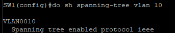
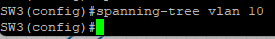
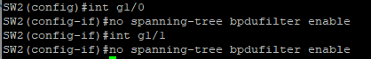
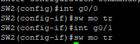

# Troubleshooting Spanning-Tree

[한국어](../04-Troubleshooting-Spanning-Tree.md) | [English](04-Troubleshooting-Spanning-Tree.en.md) | **日本語** | [简体中文](04-Troubleshooting-Spanning-Tree.zh-CN.md) | [Español](04-Troubleshooting-Spanning-Tree.es.md) | [Français](04-Troubleshooting-Spanning-Tree.fr.md)

Spanning-tree はデフォルト設定のままでも、ループのないトポロジーをうまく作ってくれます。しかし、期待した結果とスイッチが示す結果が違ったり、設定ミスでおかしなことが起きたりします。このノートでは 4 つの障害シナリオを見ていきます。

> 図は教材の例(FastEthernet・Ethernet インターフェイス)で、実習のキャプチャは GigabitEthernet インターフェイスです。インターフェイス名は違っても、原因と解決方法は同じです。

---

## 1. 誤った Root port(Incorrect Root Port)

3 台のスイッチがあり、冗長化のためスイッチ間にそれぞれ 2 本のリンクがあります。SW1 が VLAN 1 の Root Bridge に選出されています。Spanning-tree の問題を扱うときは、**ネットワークを簡単に描いて各スイッチのインターフェイスの役割**(designated、non-designated/alternate、blocked)を書き出すのがおすすめです。SW1 と SW3 の間のリンクの 1 本は **Ethernet(10 Mbit)**で、ほかはすべて FastEthernet です。

`show spanning-tree` で SW1 と SW3 のインターフェイスの役割を確認しました。SW3 は **Ethernet 0/13 を Root port** に、FastEthernet 0/14 を Alternate port に選んでいます。良い選択ではありません。すべてのトラフィックが 10 Mbit のリンクに流れ、100 Mbit のリンクはまったく使われません。スイッチは Root port を次の順番で選びます。

1. Root Bridge までの **cost が最も小さい**インターフェイスを選びます。
2. Cost が同じなら、**ポート priority が最も小さい**インターフェイスを選びます。

通常、Ethernet インターフェイスの cost は FastEthernet より大きいので、FastEthernet を選ぶはずです。では、なぜ SW3 は Ethernet 0/13 を選んだのでしょうか?2 つのインターフェイスの **cost が同じ**だからです。Cost が同じなので、ポート priority が小さい Ethernet 0/13 を選びました。インターフェイスの設定を確認します。

誰かがインターフェイスの **cost を手動で変更**していました(教材では FastEthernet のデフォルト値の 19、実習では `spanning-tree cost 3`)。このコマンドを削除します。

結果を確認します。

Cost のコマンドを削除すると、ポート状態が変わりました。速いインターフェイスが **Root port** になり、遅いインターフェイスはデフォルトの cost に戻りました。問題解決です!

**教訓**:Root port にしたいインターフェイスが、Root Bridge まで**最も cost の小さい経路**になっているか確認します。

---

## 2. Spanning-tree の無効化(Spanning-Tree Disabled)

別のシナリオです。同じトポロジーを使います。

すべてのインターフェイスが同じ種類(FastEthernet)です。SW1 が VLAN 10 の Root Bridge で、インターフェイスの役割を確認すると次のようになっています。

おもしろいですね。SW1 が Root Bridge なのに、FastEthernet 0/17 が **Backup port** に選出されています。めったに見ない状態です。SW2 は Root port を 1 つ選び、ほかはすべて Alternate port です。ところが **SW3 には何も表示されていません。** VLAN 10 の spanning-tree を確認します。

SW1 と SW2 は VLAN 10 の spanning-tree を実行していますが、**SW3 は VLAN 10 の spanning-tree を実行していません。** 何が問題でしょうか?念のため SW3 のインターフェイスを確認します。

すべてのインターフェイスが up です。トランクの設定はどうでしょうか?

インターフェイスは正常で、トランクになっており、SW3 のすべてのインターフェイスで VLAN 10 が有効です。それなら VLAN 10 の spanning-tree が動作しているはずです。

このメッセージをもう一度見ます。VLAN 10 の spanning-tree が**存在しない**といっています。このメッセージが出る理由は 2 つあります。

- VLAN 10 が有効なインターフェイスがない。
- VLAN 10 の spanning-tree が**無効化**されている。

SW3 のすべてのインターフェイスで VLAN 10 が有効なことは確認したので、spanning-tree が**グローバルで無効**になっているのかもしれません。`spanning-tree vlan 10` を入力して確認します。

これで VLAN 10 の spanning-tree が有効になり、正常に動作しています。問題解決です!ささいな問題に聞こえますが、実際の現場でもときどき見かけます。以前見た例は、無線機器のベンダーが顧客に **AP がつながるインターフェイスで spanning-tree を無効にするよう**案内したケースでした。顧客はスイッチに次のように入力しました。

インターフェイスモードで `no spanning-tree vlan 10` を入力しましたが、結果として**グローバルコンフィギュレーションモードに戻って**しまいました。インターフェイスでこのように spanning-tree を無効にするコマンドはないため、スイッチはこれを**グローバルコマンド**として受け付け、VLAN 10 の spanning-tree を無効にしてグローバルコンフィギュレーションモードに戻します。

**教訓**:spanning-tree が有効か無効かを確認します。

---

## 3. BPDU のブロック(BPDUs Blocked)

次の演習も同じトポロジーです。

今回は顧客が**性能が悪い**と苦情を言っています。まず spanning-tree のトポロジーを確認します。

上の図を見てください。SW2 と SW3 の FastEthernet 0/16 が**両方とも Designated** です。SW1 のインターフェイスもすべて Designated です。スイッチのどれかがブロードキャストを送ったりフレームをフラッディングしたりすると、どうなるでしょうか?そのとおり、**ループ**が起きます。

このトポロジーでは、本来 SW3 の FastEthernet 0/16 と 0/17 は両方とも **Alternate port** のはずです。SW3 の Bridge ID が最も悪いからです。両方とも Designated ということは、**SW3 がこのインターフェイスで BPDU を受け取っていない**ということです。

なぜ spanning-tree が失敗したのでしょうか?重要なのは、spanning-tree がループのないトポロジーを作るには**スイッチ間で BPDU がやり取りされる必要がある**という点です。BPDU は MAC アクセスリスト、VLAN アクセスマップ、または spanning-tree 関連の機能でフィルタリングされることがあります。1 つずつ確認します。

アクセスリストはありません。ポートセキュリティでしょうか?

ポートセキュリティもありません。Spanning-tree 関連のコマンドはどうでしょうか?

見つけました!SW2 の FastEthernet 0/16 と 0/17 で **BPDU filter** が有効になっています。そのため SW3 は SW2 の BPDU を受け取れませんでした。この設定を削除します。

Spanning-tree のトポロジーをもう一度確認します。

これで FastEthernet 0/16 と 0/17 は両方とも **Alternate port** になり、トラフィックをブロックしています。トポロジーからループがなくなりました。問題解決です!

**教訓**:スイッチ間の BPDU が**ブロックやフィルタリングされていないか**確認します。

---

## 4. インターフェイスで VLAN が無効(VLAN Inactive on Interface)

最後のシナリオも同じトポロジーです。

SW1 が VLAN 1 の Root Bridge です。ポート状態は次のとおりです。

`show spanning-tree vlan 10` で確認した結果です。すべてのインターフェイスが同じなのに、SW2 は **FastEthernet 0/16 を Root port** に選んでいます。FastEthernet 0/13 が Root port になるべきではないでしょうか?Root Bridge までの cost が FastEthernet 0/16 より小さいはずです。SW2 を詳しく見てみます。

`show spanning-tree interface` コマンドで、インターフェイスごとの spanning-tree の情報を確認できます。これらのインターフェイスでは **VLAN 1 の spanning-tree だけ**が動作しています。

確認すべきことがいくつかあります。まず、その VLAN の spanning-tree が有効かどうかを確認するのがよいでしょう。`no spanning-tree vlan X` で無効にできるからです。ただしこのシナリオでは、VLAN 10 のほかのインターフェイス(FastEthernet 0/16、0/17)が見えているので、VLAN 10 の spanning-tree は有効です。では、インターフェイスで spanning-tree が動作しないほかの理由は何でしょうか?

VLAN 10 の spanning-tree がグローバルで有効だからといって、**すべてのインターフェイスで動作しているとは限りません。** `show interfaces switchport` コマンドで、インターフェイスで VLAN 10 が動作しているか確認します。

おもしろい情報が見つかりました。これらのインターフェイスは **access モードで VLAN 1** に属しています。VLAN 10 のトラフィックが通れるように**トランクに変更します。**

VLAN 10 の spanning-tree のトポロジーをもう一度確認します。

これで VLAN 10 のトラフィックがこれらのインターフェイスを通り、期待していたインターフェイスが **Root port** に選出されました。問題解決です!

**教訓**:spanning-tree の問題を見る前に、**インターフェイスで VLAN が有効になっているか**確認します。

---

## まとめ

- Spanning-tree のコマンドを見る前に、**インターフェイスが正常に動作しているか**、**VLAN がインターフェイスで有効か**を先に確認します。
- 誤った Root port:誰かが変更した **`spanning-tree cost`** が原因の場合があります。Cost が同じならポート priority で決まります。
- 「Spanning tree instance(s) for vlan X does not exist」:VLAN が有効なインターフェイスがないか、**`no spanning-tree vlan X`** で無効にされています。インターフェイスモードで入力してもグローバルコマンドとして処理されます。
- 両側とも Designated なら **BPDU がフィルタリングされている**ことを疑います(MAC ACL、VLAN アクセスマップ、**BPDU filter**)。
- 期待したポートが Root port にならないときは、`show interfaces switchport` で **access/trunk モードと VLAN** を確認します。
