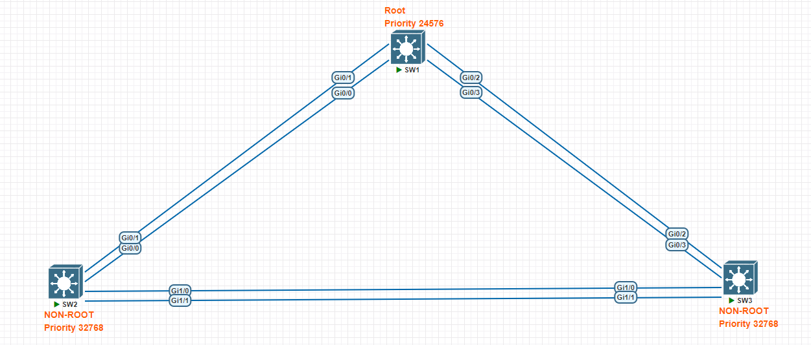
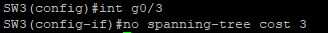
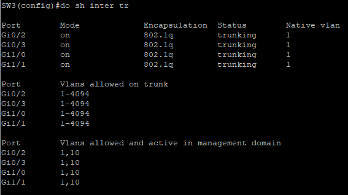
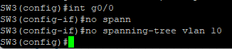

# Troubleshooting Spanning-Tree

[한국어](../04-Troubleshooting-Spanning-Tree.md) | [English](04-Troubleshooting-Spanning-Tree.en.md) | [日本語](04-Troubleshooting-Spanning-Tree.ja.md) | **简体中文** | [Español](04-Troubleshooting-Spanning-Tree.es.md) | [Français](04-Troubleshooting-Spanning-Tree.fr.md)

Spanning-tree 用默认配置就能很好地建立无环路的拓扑。但有时交换机显示的结果和预期不同,或者因为配置错误出现奇怪的情况。本笔记介绍四个故障场景。

> 图按教材示例绘制(FastEthernet・Ethernet 接口),实验截图使用 GigabitEthernet 接口。接口名称不同,但原因和解决方法相同。

---

## 1. 错误的 Root port(Incorrect Root Port)

有三台交换机,为了冗余,每两台交换机之间都有两条链路。SW1 被选为 VLAN 1 的 Root Bridge。处理 spanning-tree 问题时,最好**简单画出网络,写下每台交换机的接口角色**(designated、non-designated/alternate 或 blocked)。SW1 和 SW3 之间有一条链路是 **Ethernet(10 Mbit)**,其余都是 FastEthernet。

用 `show spanning-tree` 查看了 SW1 和 SW3 的接口角色。SW3 把 **Ethernet 0/13 选为 Root port**,把 FastEthernet 0/14 选为 Alternate port。这不是好的选择:所有流量都走 10 Mbit 链路,100 Mbit 链路完全没被使用。交换机按以下顺序选择 Root port:

1. 选择到 Root Bridge **cost 最低**的接口。
2. Cost 相同时,选择**端口 priority 最低**的接口。

通常 Ethernet 接口的 cost 比 FastEthernet 高,所以应该选 FastEthernet。那 SW3 为什么选了 Ethernet 0/13?因为两个接口的 **cost 相同**。Cost 相同,就选了端口 priority 更低的 Ethernet 0/13。查看接口配置。

有人**手动修改了接口的 cost**(教材中是 FastEthernet 的默认值 19,实验中是 `spanning-tree cost 3`)。把这条命令删掉。

查看结果。

删除 cost 命令后,端口状态变了。快的接口成为 **Root port**,慢的接口恢复了默认 cost。问题解决!

**教训**:确认想作为 Root port 的接口到 Root Bridge 是**cost 最低的路径**。

---

## 2. Spanning-tree 被禁用(Spanning-Tree Disabled)

另一个场景,使用相同的拓扑。

所有接口类型相同(FastEthernet)。SW1 是 VLAN 10 的 Root Bridge,查看接口角色后发现如下情况:

有意思。SW1 是 Root Bridge,但 FastEthernet 0/17 被选为 **Backup port**,这可不常见。SW2 选出了一个 Root port,其余都是 Alternate port。可是 **SW3 上什么都看不到**。查看 VLAN 10 的 spanning-tree。

SW1 和 SW2 都在运行 VLAN 10 的 spanning-tree,但 **SW3 没有运行 VLAN 10 的 spanning-tree**。问题出在哪里?以防万一,先查看 SW3 的接口。

所有接口都是 up。Trunk 配置呢?

接口正常,是 trunk,而且 SW3 所有接口上 VLAN 10 都是活动的。那么 VLAN 10 的 spanning-tree 应该在运行才对。

再看一下这条消息:VLAN 10 的 spanning-tree **不存在**。出现这条消息有两个原因:

- 没有接口在 VLAN 10 中处于活动状态。
- VLAN 10 的 spanning-tree 被**禁用**了。

已经确认 SW3 所有接口上 VLAN 10 都是活动的,所以 spanning-tree 可能被**全局禁用**了。输入 `spanning-tree vlan 10` 并确认。

现在 VLAN 10 的 spanning-tree 已启用并正常工作。问题解决!这个问题听起来有点低级,但在实际现场偶尔会遇到。我以前见过的案例是,无线设备厂商告诉客户**在连接 AP 的接口上禁用 spanning-tree**。客户在交换机上这样输入:

客户在接口模式下输入了 `no spanning-tree vlan 10`,结果却**回到了全局配置模式**。接口上没有这种禁用 spanning-tree 的命令,所以交换机把它当作**全局命令**,禁用了 VLAN 10 的 spanning-tree,并退回到全局配置模式。

**教训**:检查 spanning-tree 是启用还是禁用。

---

## 3. BPDU 被阻断(BPDUs Blocked)

下一个练习,同样的拓扑。

这次客户抱怨**性能很差**。先查看 spanning-tree 拓扑。

看上图。SW2 和 SW3 的 FastEthernet 0/16 **都是 Designated**,SW1 的接口也都是 Designated。如果某台交换机转发广播或泛洪帧,会怎样?没错,会出现**环路**。

在这个拓扑中,SW3 的 FastEthernet 0/16 和 0/17 本应都是 **Alternate port**,因为 SW3 的 Bridge ID 最差。两者都是 Designated,说明 **SW3 在这些接口上收不到 BPDU**。

为什么 spanning-tree 失败了?关键在于:spanning-tree 要建立无环路的拓扑,**交换机之间必须交换 BPDU**。BPDU 可能会被 MAC 访问列表、VLAN access-map 或 spanning-tree 相关功能过滤。逐一检查。

没有访问列表。会是 port-security 吗?

也没有 port security。那 spanning-tree 相关的命令呢?

找到了!SW2 的 FastEthernet 0/16 和 0/17 上启用了 **BPDU filter**,所以 SW3 收不到 SW2 的 BPDU。把这个配置删掉。

再次查看 spanning-tree 拓扑。

现在 FastEthernet 0/16 和 0/17 都是 **Alternate port**,阻塞流量。拓扑中的环路消失了。问题解决!

**教训**:确认交换机之间的 BPDU **没有被阻断或过滤**。

---

## 4. 接口上 VLAN 未激活(VLAN Inactive on Interface)

最后一个场景,同样的拓扑。

SW1 是 VLAN 1 的 Root Bridge。端口状态如下:

这是用 `show spanning-tree vlan 10` 看到的结果。所有接口都一样,但 SW2 把 **FastEthernet 0/16 选为 Root port**。FastEthernet 0/13 不是应该成为 Root port 吗?它到 Root Bridge 的 cost 比 FastEthernet 0/16 低。仔细看看 SW2。

`show spanning-tree interface` 命令可以查看每个接口的 spanning-tree 信息。这些接口上**只运行着 VLAN 1 的 spanning-tree**。

有几件事可以检查。首先最好确认该 VLAN 的 spanning-tree 是否启用,因为可以用 `no spanning-tree vlan X` 禁用它。不过在这个场景中能看到 VLAN 10 的其他接口(FastEthernet 0/16、0/17),所以 VLAN 10 的 spanning-tree 是启用的。那么接口上不运行 spanning-tree 还有什么原因?

VLAN 10 的 spanning-tree 全局启用,**并不代表它在所有接口上都运行**。用 `show interfaces switchport` 命令查看接口上是否运行 VLAN 10。

发现了有意思的信息:这些接口处于 **access 模式,属于 VLAN 1**。为了让 VLAN 10 的流量通过,**把它们改为 trunk**。

再次查看 VLAN 10 的 spanning-tree 拓扑。

现在 VLAN 10 的流量经过这些接口,预期的接口被选为 **Root port**。问题解决!

**教训**:在查看 spanning-tree 问题之前,先确认**接口上的 VLAN 已激活**。

---

## 核心总结

- 查看 spanning-tree 命令之前,先确认**接口是否正常工作**、**VLAN 是否在接口上激活**。
- 错误的 Root port:可能是有人修改了 **`spanning-tree cost`**。Cost 相同时由端口 priority 决定。
- “Spanning tree instance(s) for vlan X does not exist”:没有接口在该 VLAN 中活动,或被 **`no spanning-tree vlan X`** 禁用。在接口模式下输入也会被当作全局命令处理。
- 如果两端都是 Designated,怀疑 **BPDU 被过滤**(MAC ACL、VLAN access-map、**BPDU filter**)。
- 预期的端口没有成为 Root port 时,用 `show interfaces switchport` 检查 **access/trunk 模式和 VLAN**。
