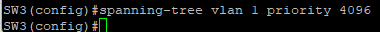
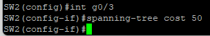
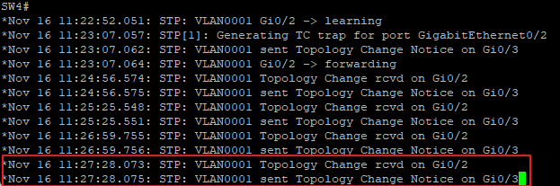
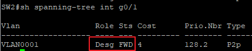
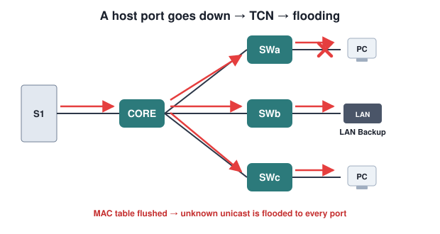

# Spanning-Tree Topology Change Notification (TCN)

[한국어](../05-Spanning-Tree-Topology-Change-Notification.md) | **English** | [日本語](05-Spanning-Tree-Topology-Change-Notification.ja.md) | [简体中文](05-Spanning-Tree-Topology-Change-Notification.zh-CN.md) | [Español](05-Spanning-Tree-Topology-Change-Notification.es.md) | [Français](05-Spanning-Tree-Topology-Change-Notification.fr.md)

How does spanning-tree deal with topology changes? It's very important to understand if you work with a network that has a lot of switches. Let me use an example to explain a couple of things.

> The figures follow the textbook (FastEthernet numbers); the lab captures use GigabitEthernet interfaces.

---

## 1. Lab topology

Two computers are connected so the switches have something to fill their MAC address tables with. All switches have the default configuration.

I want **SW3 to be the root bridge and the fa0/19 interface of SW2 to be blocked**. I'll show you why in a minute.

Let's check the state of all interfaces.

Drawn as a topology picture, the interfaces look like this:

Traffic between H1 and H2 flows **SW2 → SW1 → SW3 → SW4**. Interface fa0/19 on SW2 is blocked.

---

## 2. MAC address table and aging time

Let's generate some traffic so the switches learn the MAC addresses of the computers.

A simple ping generates frames, and the switches learn the MAC addresses. In this lab, the computers have these MAC addresses:

- VPC1: 0050.7966.6802
- VPC2: 0050.7966.6801

We can confirm the traffic path in the MAC address table. I like `show mac address-table dynamic` so we don't have to browse through a list of static MAC addresses.

How long does a switch keep a MAC address? Let's check the **default aging time** of the MAC address table on one of the switches.

It's **300 seconds** (5 minutes by default). If a host is silent for 5 minutes, its MAC address is removed from the table.

---

## 3. When a link fails

Why do we care about the aging time? Let me show you. First, keep traffic going from VPC1 to VPC2. With `ping -t` the ping runs forever.

Next, unplug one of the cables.

Assume the link between SW1 and SW3 fails. H1 and H2 can't communicate **until fa0/19 on SW2 goes to forwarding**. It takes SW2 **up to 50 seconds** to move fa0/19 from blocking through listening and learning to forwarding.

Meanwhile, SW2 still has H2's MAC address in its table towards SW1, so it keeps forwarding frames to SW1, where they are dropped. The computers can't talk to each other for **300 seconds**, until the MAC address tables age out.

> "Sending Ethernet frames to a place where no frame has gone before doesn't sound like a good idea if you want to keep your users happy…"

MAC address tables that age out after 300 seconds work fine in a stable network, but **not when the topology changes**. That's why spanning-tree has a **topology change mechanism**.

When a switch detects a change in the network (an interface going down or into forwarding), it **advertises the event to the whole switched network**. Switches that receive this message reduce the aging time of their MAC address table **from 300 seconds to 15 seconds** (the forward delay timer). This message is called the **TCN (Topology Change Notification)**.

---

## 4. Watching the TCN

To look at the TCN closely, we need a debug. Enable `debug spanning-tree events` on all switches.

Shut an interface on SW1 to simulate a link failure (fa0/16 in the textbook).

Here's what you'll see:

There is a lot of debug output, but somewhere you'll see **SW1 generating a TCN and sending it on its interface towards SW2**. This is what SW2 shows:

SW2 also throws a lot of debug output at you, but this is what I was looking for: SW2 **received the TCN** from SW1. When the TCN arrives, SW2 ages out its MAC address table in **15 seconds**.

What does SW2 do with this information?

SW2 decides that **fa0/19 is the new root port**, and you can see it go from listening to learning and forwarding. It also sends a TCN to SW4.

SW3 receives a TCN on its fa0/19 interface and reduces the aging time of its MAC address table to 15 seconds.

SW4 receives the TCN from SW2 and, as a result, reduces the aging time of its MAC address table to 15 seconds. It also sends a TCN to SW3.

All switches received the TCN and set their aging time to 15 seconds. SW2 no longer receives frames with H2's MAC address as the source on fa0/14, so it removes this entry from its MAC address table.

Meanwhile, fa0/19 on SW2 goes from blocking through listening and learning to forwarding (50 seconds in total). SW2 now **learns H2's MAC address on fa0/19**, and life is good! The same happens for H1's MAC address on SW4.

To keep a long story short: we need the **TCN to reduce the MAC address table aging time from 300 to 15 seconds**, so traffic isn't blackholed like this.

---

## 5. Where is the TCN sent?

Which switches send and forward TCNs? Are they flooded to all switches? Let's check.

Normally, a non-root switch receives BPDUs on its root port but **never sends BPDUs towards the root bridge**. When a non-root switch detects a topology change, it **generates a TCN and sends it on its root port towards the root bridge**.

A switch that receives a TCN sends a **TCA (Topology Change Acknowledgment)** on its designated port to the downstream switch. It also creates a TCN itself and sends it on its own root port. This works its way up the tree **until it reaches the root bridge**.

What kind of message is used for the TCN? Look at this BPDU:

There is a **BPDU type** field. Its value changes to indicate that this is a TCN.

Once the TCN reaches the root bridge, the root bridge sets the **TC (topology change) bit** in the BPDUs it sends.

These BPDUs are forwarded to all other switches so they can reduce the aging time of their MAC address tables. Switches receive these messages on **both forwarding and blocked ports**.

The root bridge sets the **flags** field in its BPDUs to signal the topology change.

---

## 6. Host ports, TCNs and PortFast

That's how spanning-tree deals with topology changes. There's one more thing I want to show you about this mechanism.

H1 is connected to SW2 on its fa0/2 interface. Let's see what happens when this interface goes down.

This interface on SW2 is **designated and forwarding**. Let's enable a debug and shut the interface.

This is what happens on SW2:

Right after the shutdown, SW2 **generates a TCN and sends it on its root port**. Let's bring the interface up again.

This is what you'll see:

When the interface comes up, it goes through listening and learning and ends in forwarding. The switch **generates another TCN** and sends it on its root port.

What kind of problems could this cause? Imagine a network with a **lot** of hosts. Every time an interface goes up or down, a TCN is generated and **all switches** set their aging time to 15 seconds. Each host triggers a topology change, so with many hosts the network may end up in a **constant state of "topology changes"**.

Here's a situation that could occur:

A server is sending a backup to a LAN backup device. That means a lot of **unicast** traffic from the server to the LAN backup device.

When an interface goes down, a TCN is generated and, as a result, all switches reduce the aging time of their MAC address tables to 15 seconds. All the devices' MAC addresses are flushed from the tables.

The switches quickly re-learn the server's MAC address because it is actively sending traffic to the LAN backup device. But if the LAN backup device **only receives traffic and never sends any**, the switches have no way to re-learn its MAC address.

What happens to unknown unicast traffic? That's right — it is **flooded on all interfaces** except the one it came from. So the network is burdened with traffic until the LAN backup device sends an Ethernet frame and the switches re-learn its MAC address.

How can we deal with this? **PortFast** to the rescue! PortFast is a Cisco proprietary feature for dealing with topology changes. It does two things:

- An interface with PortFast that comes up goes **straight to forwarding**, skipping listening and learning.
- A switch **never generates a TCN** for an interface that has PortFast enabled.

Interfaces connected to hosts go up and down all the time, so it's a good idea to **enable PortFast on them**. **Don't enable it on an interface to a hub or another switch.**

---

## Key points

- If the MAC address table still points to the old path after a link failure, traffic is blackholed until the aging time (**300 seconds**) expires.
- A switch that detects a topology change (an interface going down or into forwarding) sends a **TCN**, and all switches reduce their aging time to **15 seconds** (forward delay).
- The TCN travels **up the root ports to the root bridge**, and each switch answers with a **TCA**. A TCN is identified by the **BPDU type** field.
- The root bridge sends BPDUs with the **TC flag** (flags field) set to all switches.
- Every time a host port goes up or down, a TCN flushes the MAC tables, and unicast to silent devices can be **flooded**.
- Enable **PortFast** on host ports: they forward immediately and never generate TCNs. Don't enable it on ports to switches or hubs.
