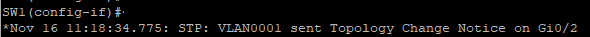
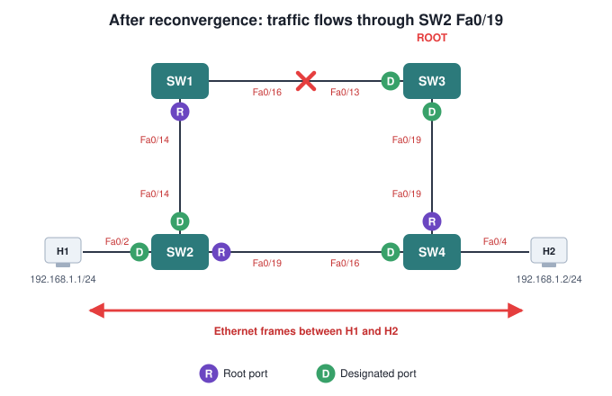
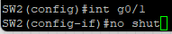
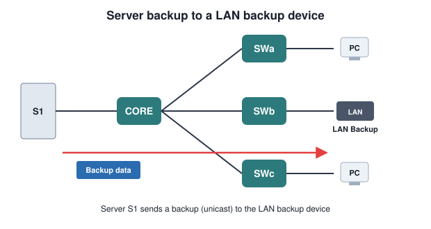

# Spanning-Tree Topology Change Notification (TCN)

[한국어](../05-Spanning-Tree-Topology-Change-Notification.md) | [English](05-Spanning-Tree-Topology-Change-Notification.en.md) | [日本語](05-Spanning-Tree-Topology-Change-Notification.ja.md) | [简体中文](05-Spanning-Tree-Topology-Change-Notification.zh-CN.md) | **Español** | [Français](05-Spanning-Tree-Topology-Change-Notification.fr.md)

¿Cómo gestiona spanning-tree los cambios de topología? Es muy importante entenderlo si trabajas con una red con muchos switches. Voy a usar un ejemplo para explicar un par de cosas.

> Las figuras siguen el libro (números FastEthernet); las capturas del laboratorio usan interfaces GigabitEthernet.

---

## 1. Topología del laboratorio

Hay dos ordenadores conectados para que los switches tengan algo con lo que llenar sus tablas de direcciones MAC. Todos los switches tienen la configuración por defecto.

Quiero que **SW3 sea el root bridge y que la interfaz fa0/19 de SW2 esté bloqueada**. Enseguida verás por qué.

Veamos el estado de todas las interfaces.

Dibujadas como topología, las interfaces quedan así:

El tráfico entre H1 y H2 va **SW2 → SW1 → SW3 → SW4**. La interfaz fa0/19 de SW2 está bloqueada.

---

## 2. Tabla de direcciones MAC y aging time

Generemos algo de tráfico para que los switches aprendan las direcciones MAC de los ordenadores.

Un simple ping genera tramas y los switches aprenden las direcciones MAC. En este laboratorio, los ordenadores tienen estas MAC:

- VPC1: 0050.7966.6802
- VPC2: 0050.7966.6801

Podemos confirmar el camino del tráfico en la tabla de direcciones MAC. Me gusta `show mac address-table dynamic` para no tener que recorrer una lista de direcciones MAC estáticas.

¿Cuánto tiempo guarda un switch una dirección MAC? Comprobemos el **aging time por defecto** de la tabla de direcciones MAC en uno de los switches.

Son **300 segundos** (5 minutos por defecto). Si un host no envía nada durante 5 minutos, su dirección MAC se elimina de la tabla.

---

## 3. Cuando falla un enlace

¿Por qué nos importa el aging time? Te lo enseño. Primero, mantengamos tráfico de VPC1 a VPC2. Con `ping -t` el ping no se detiene.

Después, desconectamos uno de los cables.

Supongamos que falla el enlace entre SW1 y SW3. H1 y H2 no pueden comunicarse **hasta que fa0/19 de SW2 pase a forwarding**. SW2 tarda **hasta 50 segundos** en llevar fa0/19 de blocking a forwarding pasando por listening y learning.

Mientras tanto, SW2 sigue teniendo la MAC de H2 en su tabla apuntando hacia SW1, así que sigue reenviando tramas a SW1, donde se descartan. Los ordenadores no pueden hablar entre sí durante **300 segundos**, hasta que las tablas de direcciones MAC caducan.

> "Enviar tramas Ethernet a un lugar al que ninguna trama ha llegado antes no parece buena idea si quieres tener contentos a tus usuarios…"

Que las tablas de direcciones MAC caduquen a los 300 segundos funciona bien en una red estable, pero **no cuando cambia la topología**. Por eso spanning-tree tiene un **mecanismo de cambio de topología**.

Cuando un switch detecta un cambio en la red (una interfaz que cae o que pasa a forwarding), **anuncia el evento a toda la red conmutada**. Los switches que reciben este mensaje reducen el aging time de su tabla de direcciones MAC **de 300 a 15 segundos** (el temporizador forward delay). Este mensaje se llama **TCN (Topology Change Notification)**.

---

## 4. Observar el TCN

Para ver el TCN de cerca necesitamos un debug. Activa `debug spanning-tree events` en todos los switches.

Apaga una interfaz de SW1 para simular un fallo de enlace (fa0/16 en el libro).

Esto es lo que verás:

Hay mucha salida de debug, pero en algún punto verás que **SW1 genera un TCN y lo envía por su interfaz hacia SW2**. Esto es lo que muestra SW2:

SW2 también suelta mucha salida de debug, pero esto es lo que buscaba: SW2 **recibió el TCN** de SW1. Al llegar el TCN, SW2 hace caducar su tabla de direcciones MAC en **15 segundos**.

¿Qué hace SW2 con esta información?

SW2 decide que **fa0/19 es el nuevo root port**, y se ve cómo pasa de listening a learning y forwarding. También envía un TCN a SW4.

SW3 recibe un TCN por su interfaz fa0/19 y reduce el aging time de su tabla de direcciones MAC a 15 segundos.

SW4 recibe el TCN de SW2 y, como resultado, reduce el aging time de su tabla de direcciones MAC a 15 segundos. También envía un TCN a SW3.

Todos los switches recibieron el TCN y fijaron su aging time en 15 segundos. SW2 ya no recibe por fa0/14 tramas con la MAC de H2 como origen, así que elimina esta entrada de su tabla de direcciones MAC.

Mientras tanto, fa0/19 de SW2 pasa de blocking a forwarding a través de listening y learning (50 segundos en total). Ahora SW2 **aprende la MAC de H2 por fa0/19** y ¡todo va bien! Lo mismo ocurre con la MAC de H1 en SW4.

En resumen: necesitamos el **TCN para reducir el aging time de la tabla de direcciones MAC de 300 a 15 segundos**, para que el tráfico no acabe en un agujero negro como este.

---

## 5. ¿Adónde se envía el TCN?

¿Qué switches envían y reenvían los TCN? ¿Se inundan a todos los switches? Veámoslo.

Normalmente, un switch non-root recibe BPDU por su root port pero **nunca envía BPDU hacia el root bridge**. Cuando un switch non-root detecta un cambio de topología, **genera un TCN y lo envía por su root port hacia el root bridge**.

Un switch que recibe un TCN envía un **TCA (Topology Change Acknowledgment)** por su designated port al switch de abajo. También crea su propio TCN y lo envía por su root port. Así se va subiendo por el árbol **hasta llegar al root bridge**.

¿Qué tipo de mensaje se usa para el TCN? Mira esta BPDU:

Hay un campo **BPDU type**. Su valor cambia para indicar que se trata de un TCN.

Cuando el TCN llega al root bridge, este activa el **bit TC (topology change)** en las BPDU que envía.

Estas BPDU se reenvían a todos los demás switches para que reduzcan el aging time de sus tablas de direcciones MAC. Los switches reciben estos mensajes **tanto en los puertos en forwarding como en los bloqueados**.

El root bridge activa el campo **flags** de sus BPDU para señalar el cambio de topología.

---

## 6. Puertos de host, TCN y PortFast

Así es como spanning-tree gestiona los cambios de topología. Hay una cosa más que quiero enseñarte sobre este mecanismo.

H1 está conectado a SW2 por su interfaz fa0/2. Veamos qué pasa cuando esta interfaz cae.

Esta interfaz de SW2 es **designated y está en forwarding**. Activemos un debug y apaguemos la interfaz.

Esto es lo que ocurre en SW2:

Justo después del shutdown, SW2 **genera un TCN y lo envía por su root port**. Volvamos a activar la interfaz.

Esto es lo que verás:

Cuando la interfaz se activa, pasa por listening y learning y termina en forwarding. El switch **genera otro TCN** y lo envía por su root port.

¿Qué problemas puede causar esto? Imagina una red con **muchísimos** hosts. Cada vez que una interfaz sube o baja se genera un TCN y **todos los switches** fijan su aging time en 15 segundos. Cada host provoca un cambio de topología, así que con muchos hosts la red puede acabar en un **estado constante de "cambios de topología"**.

Esta es una situación que podría darse:

Un servidor envía una copia de seguridad a un dispositivo de backup en la LAN. Eso significa mucho tráfico **unicast** del servidor al dispositivo de backup.

Cuando una interfaz cae, se genera un TCN y, como resultado, todos los switches reducen el aging time de sus tablas de direcciones MAC a 15 segundos. Todas las direcciones MAC de los dispositivos se borran de las tablas.

Los switches vuelven a aprender rápido la MAC del servidor porque está enviando tráfico al dispositivo de backup. Pero si el dispositivo de backup **solo recibe tráfico y nunca envía**, los switches no tienen forma de volver a aprender su MAC.

¿Qué pasa con el tráfico unicast desconocido? Exacto: se **inunda por todas las interfaces** excepto por la que llegó. Así que la red soporta esa carga de tráfico hasta que el dispositivo de backup envía una trama Ethernet y los switches vuelven a aprender su MAC.

¿Cómo lo solucionamos? ¡**PortFast** al rescate! PortFast es una función propietaria de Cisco para gestionar los cambios de topología. Hace dos cosas:

- Una interfaz con PortFast que se activa pasa **directamente a forwarding**, saltándose listening y learning.
- Un switch **nunca genera un TCN** por una interfaz con PortFast activado.

Las interfaces conectadas a hosts suben y bajan constantemente, así que es buena idea **activar PortFast en ellas**. **No lo actives en una interfaz hacia un hub o hacia otro switch.**

---

## Puntos clave

- Si tras un fallo de enlace la tabla de direcciones MAC sigue apuntando al camino antiguo, el tráfico cae en un agujero negro hasta que expira el aging time (**300 segundos**).
- Un switch que detecta un cambio de topología (una interfaz que cae o pasa a forwarding) envía un **TCN**, y todos los switches reducen su aging time a **15 segundos** (forward delay).
- El TCN **sube por los root ports hasta el root bridge**, y cada switch responde con un **TCA**. Un TCN se identifica por el campo **BPDU type**.
- El root bridge envía a todos los switches BPDU con el **flag TC** (campo flags) activado.
- Cada vez que un puerto de host sube o baja, un TCN vacía las tablas MAC y el unicast hacia dispositivos silenciosos puede **inundarse**.
- Activa **PortFast** en los puertos de host: reenvían de inmediato y nunca generan TCN. No lo actives en puertos hacia switches o hubs.
