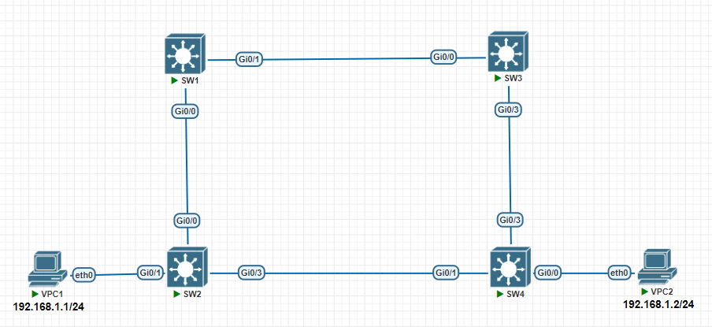
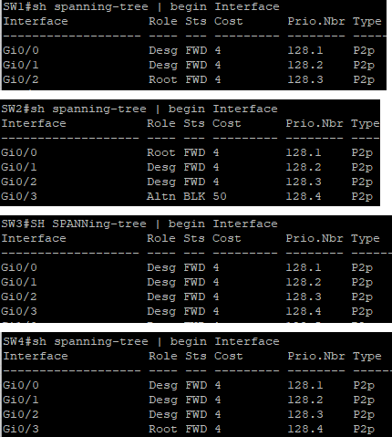
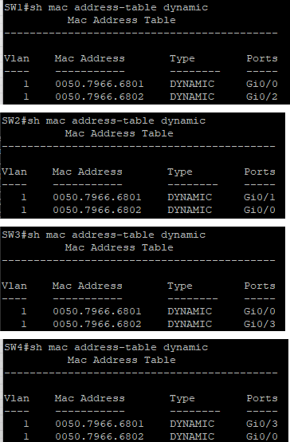
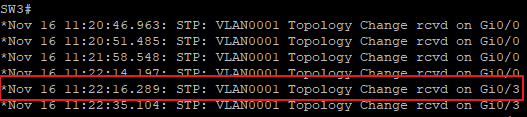
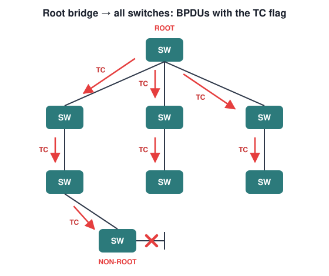
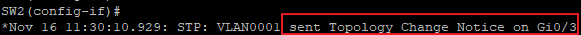

# Spanning-Tree Topology Change Notification (TCN)

[한국어](../05-Spanning-Tree-Topology-Change-Notification.md) | [English](05-Spanning-Tree-Topology-Change-Notification.en.md) | [日本語](05-Spanning-Tree-Topology-Change-Notification.ja.md) | [简体中文](05-Spanning-Tree-Topology-Change-Notification.zh-CN.md) | [Español](05-Spanning-Tree-Topology-Change-Notification.es.md) | **Français**

Comment le spanning-tree gère-t-il les changements de topologie ? C'est très important à comprendre si vous travaillez sur un réseau avec beaucoup de switchs. Je vais utiliser un exemple pour expliquer plusieurs choses.

> Les figures suivent le manuel (numéros FastEthernet) ; les captures du lab utilisent des interfaces GigabitEthernet.

---

## 1. Topologie du lab

Deux ordinateurs sont connectés pour que les switchs aient de quoi remplir leurs tables d'adresses MAC. Tous les switchs ont la configuration par défaut.

Je veux que **SW3 soit le root bridge et que l'interface fa0/19 de SW2 soit bloquée**. Je vous montre pourquoi dans un instant.

Vérifions l'état de toutes les interfaces.

Sous forme de schéma, les interfaces donnent ceci :

Le trafic entre H1 et H2 passe par **SW2 → SW1 → SW3 → SW4**. L'interface fa0/19 de SW2 est bloquée.

---

## 2. Table d'adresses MAC et aging time

Générons un peu de trafic pour que les switchs apprennent les adresses MAC des ordinateurs.

Un simple ping génère des trames, et les switchs apprennent les adresses MAC. Dans ce lab, les ordinateurs ont ces adresses MAC :

- VPC1 : 0050.7966.6802
- VPC2 : 0050.7966.6801

On peut confirmer le chemin du trafic dans la table d'adresses MAC. J'aime utiliser `show mac address-table dynamic` pour ne pas avoir à parcourir une liste d'adresses MAC statiques.

Combien de temps un switch garde-t-il une adresse MAC ? Vérifions l'**aging time par défaut** de la table d'adresses MAC sur l'un des switchs.

C'est **300 secondes** (5 minutes par défaut). Si un hôte reste silencieux pendant 5 minutes, son adresse MAC est supprimée de la table.

---

## 3. Quand un lien tombe

Pourquoi l'aging time est-il important ? Je vais vous le montrer. D'abord, envoyons du trafic en continu de VPC1 vers VPC2. Avec `ping -t`, le ping ne s'arrête jamais.

Ensuite, débranchons l'un des câbles.

Supposons que le lien entre SW1 et SW3 tombe. H1 et H2 ne peuvent pas communiquer **tant que fa0/19 de SW2 n'est pas en forwarding**. Il faut **jusqu'à 50 secondes** à SW2 pour faire passer fa0/19 de blocking à forwarding, en passant par listening et learning.

Pendant ce temps, SW2 a toujours l'adresse MAC de H2 dans sa table en direction de SW1 : il continue d'envoyer des trames à SW1, où elles sont jetées. Les ordinateurs ne peuvent pas communiquer pendant **300 secondes**, jusqu'à l'expiration des entrées de la table d'adresses MAC.

> « Envoyer des trames Ethernet là où aucune trame n'est jamais allée n'est pas une bonne idée si vous voulez garder vos utilisateurs contents… »

Des tables d'adresses MAC qui expirent au bout de 300 secondes, cela fonctionne bien dans un réseau stable, mais **pas quand la topologie change**. C'est pourquoi le spanning-tree dispose d'un **mécanisme de changement de topologie**.

Quand un switch détecte un changement dans le réseau (une interface qui tombe ou qui passe en forwarding), il **annonce l'événement à tout le réseau commuté**. Les switchs qui reçoivent ce message réduisent l'aging time de leur table d'adresses MAC **de 300 à 15 secondes** (le temporisateur forward delay). Ce message s'appelle le **TCN (Topology Change Notification)**.

---

## 4. Observer le TCN

Pour observer le TCN de près, il faut un debug. Activez `debug spanning-tree events` sur tous les switchs.

Désactivez une interface de SW1 pour simuler une panne de lien (fa0/16 dans le manuel).

Voici ce que vous verrez :

Il y a beaucoup de messages de debug, mais quelque part vous verrez **SW1 générer un TCN et l'envoyer sur son interface vers SW2**. Voici ce qu'affiche SW2 :

SW2 vous inonde aussi de messages de debug, mais voici ce que je cherchais : SW2 **a reçu le TCN** de SW1. À l'arrivée du TCN, SW2 fait expirer sa table d'adresses MAC en **15 secondes**.

Que fait SW2 de cette information ?

SW2 décide que **fa0/19 est le nouveau root port**, et on le voit passer de listening à learning puis forwarding. Il envoie aussi un TCN à SW4.

SW3 reçoit un TCN sur son interface fa0/19 et réduit l'aging time de sa table d'adresses MAC à 15 secondes.

SW4 reçoit le TCN de SW2 et, par conséquent, réduit l'aging time de sa table d'adresses MAC à 15 secondes. Il envoie aussi un TCN à SW3.

Tous les switchs ont reçu le TCN et réglé leur aging time sur 15 secondes. SW2 ne reçoit plus sur fa0/14 de trames ayant l'adresse MAC de H2 comme source, il supprime donc cette entrée de sa table d'adresses MAC.

Pendant ce temps, fa0/19 sur SW2 passe de blocking à forwarding en passant par listening et learning (50 secondes au total). SW2 **apprend maintenant l'adresse MAC de H2 sur fa0/19**, et tout va bien ! La même chose se produit pour l'adresse MAC de H1 sur SW4.

Pour résumer : il faut le **TCN pour réduire l'aging time de la table d'adresses MAC de 300 à 15 secondes**, afin que le trafic ne tombe pas dans un trou noir comme ici.

---

## 5. Où le TCN est-il envoyé ?

Quels switchs envoient et relaient les TCN ? Sont-ils inondés vers tous les switchs ? Vérifions.

Normalement, un switch non-root reçoit des BPDU sur son root port mais **n'envoie jamais de BPDU vers le root bridge**. Quand un switch non-root détecte un changement de topologie, il **génère un TCN et l'envoie sur son root port vers le root bridge**.

Un switch qui reçoit un TCN envoie un **TCA (Topology Change Acknowledgment)** sur son designated port au switch en aval. Il crée aussi lui-même un TCN qu'il envoie sur son propre root port. On remonte ainsi l'arbre **jusqu'au root bridge**.

Quel type de message est utilisé pour le TCN ? Regardez cette BPDU :

Elle contient un champ **BPDU type**. Sa valeur change pour indiquer qu'il s'agit d'un TCN.

Une fois le TCN arrivé au root bridge, celui-ci positionne le **bit TC (topology change)** dans les BPDU qu'il envoie.

Ces BPDU sont relayées vers tous les autres switchs pour qu'ils réduisent l'aging time de leurs tables d'adresses MAC. Les switchs reçoivent ces messages **sur les ports en forwarding comme sur les ports bloqués**.

Le root bridge positionne le champ **flags** de ses BPDU pour signaler le changement de topologie.

---

## 6. Ports hôtes, TCN et PortFast

Voilà comment le spanning-tree gère les changements de topologie. Il me reste une chose à vous montrer sur ce mécanisme.

H1 est relié à SW2 sur son interface fa0/2. Voyons ce qui se passe quand cette interface tombe.

Cette interface de SW2 est **designated et en forwarding**. Activons un debug et désactivons l'interface.

Voici ce qui se passe sur SW2 :

Juste après le shutdown, SW2 **génère un TCN et l'envoie sur son root port**. Réactivons l'interface.

Voici ce que vous verrez :

Quand l'interface remonte, elle passe par listening et learning et finit en forwarding. Le switch **génère un autre TCN** et l'envoie sur son root port.

Quels problèmes cela peut-il causer ? Imaginez un réseau avec **énormément** d'hôtes. Chaque fois qu'une interface monte ou descend, un TCN est généré et **tous les switchs** règlent leur aging time sur 15 secondes. Chaque hôte provoque un changement de topologie : avec beaucoup d'hôtes, le réseau peut se retrouver dans un **état permanent de « changements de topologie »**.

Voici une situation qui pourrait se produire :

Un serveur envoie une sauvegarde vers un équipement de sauvegarde sur le LAN. Cela représente beaucoup de trafic **unicast** du serveur vers l'équipement de sauvegarde.

Quand une interface tombe, un TCN est généré et, par conséquent, tous les switchs réduisent l'aging time de leurs tables d'adresses MAC à 15 secondes. Toutes les adresses MAC des équipements sont effacées des tables.

Les switchs réapprennent vite l'adresse MAC du serveur, car il envoie activement du trafic vers l'équipement de sauvegarde. Mais si l'équipement de sauvegarde **ne fait que recevoir du trafic sans jamais en envoyer**, les switchs n'ont aucun moyen de réapprendre son adresse MAC.

Que devient le trafic unicast inconnu ? Exactement : il est **inondé sur toutes les interfaces**, sauf celle d'où il vient. Le réseau supporte donc cette charge jusqu'à ce que l'équipement de sauvegarde envoie une trame Ethernet et que les switchs réapprennent son adresse MAC.

Comment régler ce problème ? **PortFast** à la rescousse ! PortFast est une fonction propriétaire Cisco pour gérer les changements de topologie. Elle fait deux choses :

- Une interface avec PortFast qui monte passe **directement en forwarding**, sans passer par listening et learning.
- Un switch **ne génère jamais de TCN** pour une interface où PortFast est activé.

Les interfaces reliées à des hôtes montent et descendent sans arrêt, il est donc judicieux d'**y activer PortFast**. **Ne l'activez pas sur une interface reliée à un hub ou à un autre switch.**

---

## Points clés

- Si, après une panne de lien, la table d'adresses MAC pointe toujours vers l'ancien chemin, le trafic tombe dans un trou noir jusqu'à l'expiration de l'aging time (**300 secondes**).
- Un switch qui détecte un changement de topologie (une interface qui tombe ou passe en forwarding) envoie un **TCN**, et tous les switchs réduisent leur aging time à **15 secondes** (forward delay).
- Le TCN **remonte par les root ports jusqu'au root bridge**, et chaque switch répond par un **TCA**. Un TCN se reconnaît au champ **BPDU type**.
- Le root bridge envoie à tous les switchs des BPDU avec le **flag TC** (champ flags) positionné.
- Chaque fois qu'un port hôte monte ou descend, un TCN vide les tables MAC, et l'unicast vers des équipements silencieux peut être **inondé**.
- Activez **PortFast** sur les ports hôtes : ils transmettent immédiatement et ne génèrent jamais de TCN. Ne l'activez pas sur des ports vers des switchs ou des hubs.
