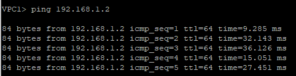
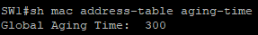
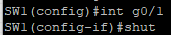
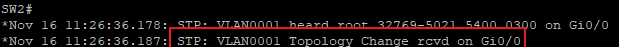
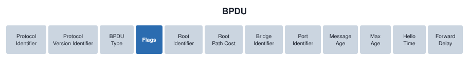
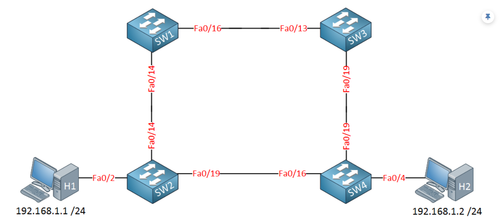
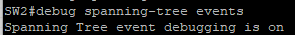
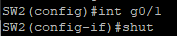

# Spanning-Tree Topology Change Notification (TCN)

[한국어](../05-Spanning-Tree-Topology-Change-Notification.md) | [English](05-Spanning-Tree-Topology-Change-Notification.en.md) | **日本語** | [简体中文](05-Spanning-Tree-Topology-Change-Notification.zh-CN.md) | [Español](05-Spanning-Tree-Topology-Change-Notification.es.md) | [Français](05-Spanning-Tree-Topology-Change-Notification.fr.md)

Spanning-tree はトポロジーの変化をどう扱うのでしょうか?スイッチの多いネットワークを扱うなら、必ず理解しておくべき内容です。例を使っていくつか説明します。

> 図は教材の例(FastEthernet 番号)で、実習のキャプチャは GigabitEthernet インターフェイスです。

---

## 1. 実習トポロジー

MAC アドレステーブルを埋めるため、コンピューターを 2 台つないでいます。すべてのスイッチはデフォルト設定です。

**SW3 を Root Bridge にし、SW2 の fa0/19 インターフェイスをブロック**したいと思います。理由はすぐに説明します。

すべてのインターフェイスの状態を確認します。

インターフェイスの情報をトポロジー図にすると次のようになります。

H1 と H2 の間のトラフィックは **SW2 → SW1 → SW3 → SW4** と流れます。SW2 の fa0/19 インターフェイスはブロックされています。

---

## 2. MAC アドレステーブルと Aging Time

スイッチがコンピューターの MAC アドレスを学習するように、トラフィックを発生させます。

簡単な ping だけでフレームが発生し、スイッチが MAC アドレスを学習します。この実習でのコンピューターの MAC アドレスは次のとおりです。

- VPC1: 0050.7966.6802
- VPC2: 0050.7966.6801

MAC アドレステーブルを見るとトラフィックの経路を確認できます。静的 MAC アドレスの一覧を見なくて済むように、`show mac address-table dynamic` コマンドを使います。

スイッチは MAC アドレスをどのくらいの間保存するのでしょうか?スイッチの 1 台で MAC アドレステーブルの**デフォルトの aging time** を確認します。

**300 秒**(デフォルト 5 分)です。ホストが 5 分間何も送らないと、その MAC アドレスはテーブルから削除されます。

---

## 3. リンク障害が起きると

Aging time はなぜ重要なのでしょうか?実際にお見せします。まず VPC1 から VPC2 にトラフィックを送り続けます。`ping -t` を使うと止まらずに実行され続けます。

次にケーブルを 1 本抜きます。

SW1 と SW3 の間のリンクが切れたとします。**SW2 の fa0/19 が Forwarding になるまで**、H1 と H2 は通信できません。SW2 が fa0/19 を Blocking から Listening、Learning を経て Forwarding にするまで、**最大 50 秒**かかります。

その間、SW2 の MAC アドレステーブルには H2 の MAC アドレスが SW1 方向のまま残っているので、SW2 は SW1 にフレームを送り続け、SW1 で破棄されます。MAC アドレステーブルが aging out するまでの **300 秒間**、2 台のコンピューターは通信できません。

> 「どのフレームも行ったことのない場所にイーサネットフレームを送るのは、ユーザーを幸せにする良い方法とはいえません…」

MAC アドレステーブルが 300 秒で aging out する仕組みは安定したネットワークではうまく動きますが、**トポロジーが変わるときは問題**になります。そのため spanning-tree には**トポロジー変更の仕組み**があります。

スイッチはネットワークの変化(インターフェイスが down する、または Forwarding 状態になる)を検知すると、そのことを**スイッチネットワーク全体に通知します。** このメッセージを受け取ったスイッチは、MAC アドレステーブルの aging time を **300 秒から 15 秒**(Forward Delay タイマー)に短縮します。このメッセージを **TCN(Topology Change Notification)**といいます。

---

## 4. TCN の動作確認

TCN を詳しく見るには debug が必要です。すべてのスイッチで `debug spanning-tree events` を有効にします。

SW1 のインターフェイスを shutdown してリンク障害を起こします(教材の fa0/16)。

次のような内容が表示されます。

debug 情報がたくさん出ますが、その中に **SW1 が TCN を作って SW2 側のインターフェイスに送る**内容があります。SW2 では次のように表示されます。

SW2 もたくさんの debug を出しますが、探していたのはこれです。SW2 が SW1 から **TCN を受け取りました。** TCN を受け取った SW2 は、MAC アドレステーブルを **15 秒**で aging out します。

SW2 はこの情報で何をするのでしょうか?

SW2 は **fa0/19 を新しい Root port** に決め、Listening → Learning → Forwarding と変わっていく様子がわかります。また、SW4 にも TCN を送ります。

SW3 は fa0/19 で TCN を受け取り、MAC アドレステーブルの aging time を 15 秒に短縮します。

SW4 は SW2 から TCN を受け取り、その結果 MAC アドレステーブルの aging time を 15 秒に短縮します。SW3 にも TCN を送ります。

すべてのスイッチが TCN を受け取り、aging time を 15 秒に短縮しました。SW2 は fa0/14 で H2 の MAC アドレスを送信元とするフレームを受け取らなくなるので、このエントリーを MAC アドレステーブルから削除します。

その間、SW2 の fa0/19 は Blocking から Listening、Learning、Forwarding へと変わります(合計 50 秒)。これで SW2 は **fa0/19 で H2 の MAC アドレスを学習**し、すべてが正常になります。SW4 でも H1 の MAC アドレスについて同じことが起こります。

まとめると、このようにトラフィックがブラックホールに落ちるのを防ぐため、**TCN で MAC アドレステーブルの aging time を 300 秒から 15 秒に**短縮する必要があります。

---

## 5. TCN はどこへ送られるのか

どのスイッチが TCN を送り、転送するのでしょうか?すべてのスイッチにフラッディングされるのでしょうか?確認してみましょう。

普段、non-root スイッチは Root port で BPDU を受け取るだけで、**Root Bridge 側には BPDU を送りません。** Non-root スイッチがトポロジーの変化を検知すると、**TCN を作って Root port から Root Bridge 側に送ります。**

TCN を受け取ったスイッチは、Designated port から下流のスイッチに **TCA(Topology Change Acknowledgment)**を送ります。そして自分でも TCN を作って自分の Root port に送ります。こうして **Root Bridge に届くまで**ツリーをさかのぼっていきます。

TCN にはどんなメッセージが使われるのでしょうか?下の BPDU を見てください。

**BPDU Type** フィールドがあります。この値が変わることで TCN であることを示します。

TCN が Root Bridge に届くと、Root Bridge は自分が送る BPDU に **TC(Topology Change)ビット**を設定します。

この BPDU はネットワーク内のほかのすべてのスイッチに転送され、各スイッチが MAC アドレステーブルの aging time を短縮します。スイッチはこのメッセージを **Forwarding のポートでもブロックされたポートでも**受け取ります。

Root Bridge は BPDU の **Flags** フィールドでトポロジーの変化を示して送ります。

---

## 6. ホストポートと TCN、そして PortFast

Spanning-tree がトポロジーの変化を扱う方法はここまでです。この仕組みについて、もう 1 つお見せします。

H1 は SW2 の fa0/2 インターフェイスにつながっています。このインターフェイスが down するとどうなるか見てみます。

SW2 のこのインターフェイスは **Designated で Forwarding** 状態です。debug を有効にしてインターフェイスを shutdown します。

SW2 では次のように表示されます。

インターフェイスを shutdown するとすぐに、SW2 は **TCN を作って Root port に送ります。** インターフェイスをもう一度有効にします。

次のように表示されます。

インターフェイスを有効にすると、Listening と Learning を経て Forwarding 状態になります。そしてスイッチは **TCN をもう一度作って** Root port に送ります。

これはどんな問題を起こすでしょうか?ホストが**非常に多い**ネットワークを考えてみてください。インターフェイスが up または down するたびに TCN が作られ、**すべてのスイッチ**が aging time を 15 秒に短縮します。ホスト 1 台がトポロジーの変化を起こすので、ホストが多いとネットワークが**常に「トポロジー変更」状態**になることがあります。

次のような状況が起こり得ます。

サーバーが LAN バックアップ装置にバックアップを送っています。サーバーから LAN バックアップ装置へ大量の**ユニキャスト**トラフィックが流れるでしょう。

インターフェイスが 1 つ down すると TCN が作られ、その結果すべてのスイッチが MAC アドレステーブルの aging time を 15 秒に短縮します。機器の MAC アドレスはすべてテーブルから消えます。

サーバーは LAN バックアップ装置にトラフィックを送り続けているので、スイッチはサーバーの MAC アドレスをすぐに学習し直します。しかし LAN バックアップ装置が**トラフィックを受け取るだけで送らない**場合、スイッチがその MAC アドレスを学習し直す方法はありません。

未知のユニキャストトラフィックはどうなるでしょうか?そのとおり、受信したインターフェイス以外の**すべてのインターフェイスにフラッディング**されます。そのため LAN バックアップ装置がイーサネットフレームを送ってスイッチが MAC アドレスを学習し直すまで、ネットワークはトラフィックの負担を抱えることになります。

この状況はどう解決すればよいでしょうか?**PortFast** が解決策です。PortFast はトポロジーの変化に対処するための Cisco 独自の機能で、2 つのことをしてくれます。

- PortFast が有効なインターフェイスは、up すると**すぐに Forwarding** になります。Listening と Learning を飛ばします。
- PortFast が有効なインターフェイスについては **TCN を作りません。**

ホストがつながるインターフェイスは頻繁に up/down するので、**PortFast を有効にするのがおすすめ**です。ただし、**ハブやほかのスイッチにつながるインターフェイスでは有効にしません。**

---

## まとめ

- リンク障害のあとも MAC アドレステーブルに古い経路が残っていると、aging time(**300 秒**)が過ぎるまでトラフィックがブラックホールに落ちます。
- トポロジーの変化(インターフェイスの down、または Forwarding への移行)を検知したスイッチは **TCN** を送り、すべてのスイッチが aging time を **15 秒**(Forward Delay)に短縮します。
- TCN は **Root port をたどって Root Bridge まで**上がり、各スイッチは **TCA** で応答します。TCN は **BPDU Type** フィールドで区別します。
- Root Bridge は **TC フラグ**(Flags フィールド)を設定した BPDU をすべてのスイッチに送ります。
- ホストポートが up/down するたびに TCN が発生して MAC テーブルが空になり、静かな機器へのユニキャストが**フラッディング**されることがあります。
- ホストポートには **PortFast** を有効にします。すぐに Forwarding になり、TCN を作りません。スイッチやハブにつながるポートでは有効にしません。
