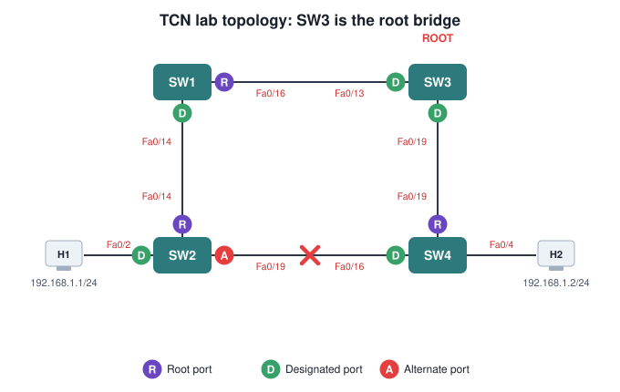
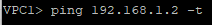
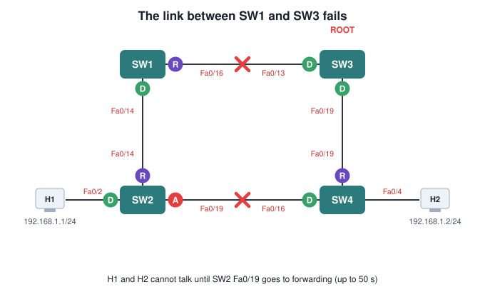
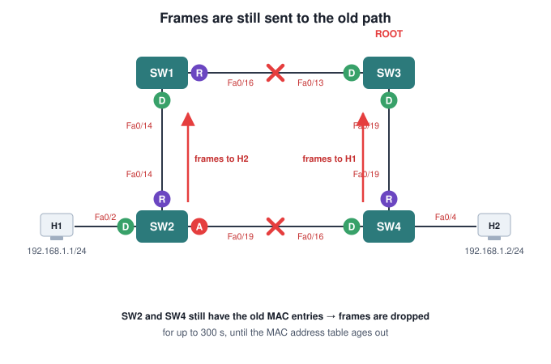
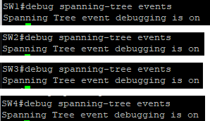
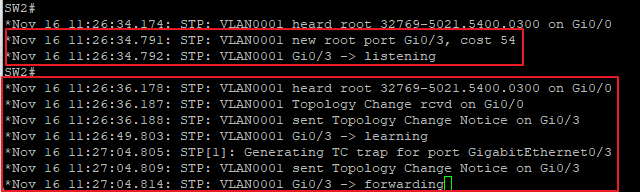
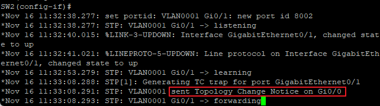

# Spanning-Tree Topology Change Notification (TCN)

[한국어](../05-Spanning-Tree-Topology-Change-Notification.md) | [English](05-Spanning-Tree-Topology-Change-Notification.en.md) | [日本語](05-Spanning-Tree-Topology-Change-Notification.ja.md) | **简体中文** | [Español](05-Spanning-Tree-Topology-Change-Notification.es.md) | [Français](05-Spanning-Tree-Topology-Change-Notification.fr.md)

Spanning-tree 如何处理拓扑变化?如果你管理的网络里有很多交换机,这是必须理解的内容。下面用一个例子来说明几点。

> 图按教材示例绘制(FastEthernet 编号),实验截图使用 GigabitEthernet 接口。

---

## 1. 实验拓扑

为了填充 MAC 地址表,连接了两台电脑。所有交换机都是默认配置。

我想让 **SW3 成为 Root Bridge,并阻塞 SW2 的 fa0/19 接口**。原因稍后说明。

查看所有接口的状态。

把接口信息画成拓扑图如下:

H1 和 H2 之间的流量按 **SW2 → SW1 → SW3 → SW4** 流动。SW2 的 fa0/19 接口被阻塞。

---

## 2. MAC 地址表与 Aging Time

产生一些流量,让交换机学习电脑的 MAC 地址。

一个简单的 ping 就会产生帧,交换机就会学习 MAC 地址。本实验中电脑的 MAC 地址如下:

- VPC1: 0050.7966.6802
- VPC2: 0050.7966.6801

查看 MAC 地址表就能确认流量路径。为了不用翻看静态 MAC 地址列表,使用 `show mac address-table dynamic` 命令。

交换机会保存 MAC 地址多久?在一台交换机上查看 MAC 地址表的**默认 aging time**。

是 **300 秒**(默认 5 分钟)。主机 5 分钟没有发送任何东西,它的 MAC 地址就会从表中删除。

---

## 3. 链路故障时

为什么要关心 aging time?我来演示。先让 VPC1 持续向 VPC2 发送流量。用 `ping -t` 会一直运行不停止。

接下来拔掉一根线缆。

假设 SW1 和 SW3 之间的链路断开。**在 SW2 的 fa0/19 进入 Forwarding 之前**,H1 和 H2 无法通信。SW2 把 fa0/19 从 Blocking 经过 Listening、Learning 转为 Forwarding,**最多需要 50 秒**。

在此期间,SW2 的 MAC 地址表中 H2 的 MAC 地址仍然指向 SW1 方向,所以 SW2 会一直把帧发给 SW1,在 SW1 被丢弃。在 MAC 地址表老化之前的 **300 秒**内,两台电脑都无法通信。

> “把以太网帧发到一个从来没有帧去过的地方,可不是让用户满意的好办法……”

MAC 地址表 300 秒后老化的机制在稳定的网络中运行良好,但**拓扑变化时就成了问题**。所以 spanning-tree 有一个**拓扑变化机制**。

交换机检测到网络变化(接口 down 或进入 Forwarding 状态)时,会把这件事**通告给整个交换网络**。收到这条消息的交换机会把 MAC 地址表的 aging time **从 300 秒缩短到 15 秒**(Forward Delay 计时器)。这条消息叫 **TCN(Topology Change Notification)**。

---

## 4. 观察 TCN

要仔细观察 TCN,需要用 debug。在所有交换机上开启 `debug spanning-tree events`。

在 SW1 上 shutdown 一个接口,模拟链路故障(教材中的 fa0/16)。

会看到如下内容:

debug 信息很多,但其中能看到 **SW1 生成 TCN,并从朝向 SW2 的接口发送出去**。SW2 上显示:

SW2 也输出了很多 debug,但我要找的就是这个:SW2 从 SW1 **收到了 TCN**。收到 TCN 后,SW2 会在 **15 秒**内让 MAC 地址表老化。

SW2 会用这条信息做什么?

SW2 决定 **fa0/19 为新的 Root port**,可以看到它从 Listening 变为 Learning 再到 Forwarding。它还会向 SW4 发送 TCN。

SW3 在 fa0/19 上收到 TCN,把 MAC 地址表的 aging time 缩短到 15 秒。

SW4 从 SW2 收到 TCN,因此把 MAC 地址表的 aging time 缩短到 15 秒。它也向 SW3 发送 TCN。

所有交换机都收到了 TCN,把 aging time 设为 15 秒。SW2 在 fa0/14 上不再收到以 H2 的 MAC 地址为源的帧,于是把这个条目从 MAC 地址表中删除。

与此同时,SW2 的 fa0/19 从 Blocking 经过 Listening、Learning 进入 Forwarding(共 50 秒)。现在 SW2 **在 fa0/19 上学习到 H2 的 MAC 地址**,一切恢复正常!SW4 上 H1 的 MAC 地址也会发生同样的事情。

长话短说:为了防止像这样把流量送进黑洞,需要用 **TCN 把 MAC 地址表的 aging time 从 300 秒缩短到 15 秒**。

---

## 5. TCN 会发到哪里

哪些交换机会发送和转发 TCN?会泛洪到所有交换机吗?来看一下。

正常情况下,non-root 交换机只在 Root port 上接收 BPDU,**从不向 Root Bridge 方向发送 BPDU**。Non-root 交换机检测到拓扑变化时,会**生成 TCN,并从 Root port 发往 Root Bridge 方向**。

收到 TCN 的交换机会从 Designated port 向下游交换机发送 **TCA(Topology Change Acknowledgment)**,同时自己也生成 TCN 并从自己的 Root port 发出。就这样沿着树往上走,**直到到达 Root Bridge**。

TCN 使用什么样的消息?看下面的 BPDU:

有一个 **BPDU Type** 字段,它的值改变就表示这是 TCN。

TCN 到达 Root Bridge 后,Root Bridge 会在它发送的 BPDU 中设置 **TC(Topology Change)位**。

这些 BPDU 会转发给网络中的其他所有交换机,让它们缩短 MAC 地址表的 aging time。交换机在 **Forwarding 端口和被阻塞的端口上**都会收到这些消息。

Root Bridge 在 BPDU 的 **Flags** 字段中标示拓扑变化后发送。

---

## 6. 主机端口、TCN 与 PortFast

Spanning-tree 处理拓扑变化的方法就是这些。关于这个机制,还有一点想给你看。

H1 连接在 SW2 的 fa0/2 接口上。来看看这个接口 down 时会发生什么。

SW2 的这个接口是 **Designated,处于 Forwarding** 状态。开启 debug,然后 shutdown 这个接口。

SW2 上显示如下:

接口一 shutdown,SW2 就**生成 TCN 并从 Root port 发出**。再把接口打开。

会看到如下内容:

接口打开后,经过 Listening 和 Learning 进入 Forwarding 状态。交换机**又生成一个 TCN**,从 Root port 发出。

这会造成什么问题?想象一个有**大量**主机的网络。每次接口 up 或 down 都会生成 TCN,**所有交换机**都会把 aging time 设为 15 秒。一台主机就会触发一次拓扑变化,主机多的话,网络可能会**一直处于“拓扑变化”状态**。

可能会出现这样的情况:

一台服务器正在向 LAN 备份设备发送备份,从服务器到 LAN 备份设备会有大量**单播**流量。

一个接口 down 就会生成 TCN,结果所有交换机都把 MAC 地址表的 aging time 缩短到 15 秒,所有设备的 MAC 地址都从表中被清掉。

服务器一直在向 LAN 备份设备发送流量,所以交换机很快会重新学到服务器的 MAC 地址。但如果 LAN 备份设备**只接收流量、自己不发送**,交换机就没有办法重新学习它的 MAC 地址。

未知单播流量会怎样?没错,会**泛洪到除接收接口以外的所有接口**。所以在 LAN 备份设备发出以太网帧、交换机重新学到它的 MAC 地址之前,网络都要承受流量负担。

这种情况怎么解决?**PortFast** 来救场!PortFast 是 Cisco 专有的、用来处理拓扑变化的功能,它做两件事:

- 启用 PortFast 的接口 up 后会**立即进入 Forwarding**,跳过 Listening 和 Learning。
- 交换机**不会**为启用 PortFast 的接口**生成 TCN**。

连接主机的接口经常 up/down,所以**最好在这些接口上启用 PortFast**。但**不要在连接集线器或其他交换机的接口上启用**。

---

## 核心总结

- 链路故障后如果 MAC 地址表仍指向旧路径,流量会被送进黑洞,直到 aging time(**300 秒**)到期。
- 检测到拓扑变化(接口 down 或进入 Forwarding)的交换机会发送 **TCN**,所有交换机把 aging time 缩短到 **15 秒**(Forward Delay)。
- TCN **沿着 Root port 一路上到 Root Bridge**,每台交换机用 **TCA** 回应。TCN 通过 **BPDU Type** 字段识别。
- Root Bridge 向所有交换机发送设置了 **TC 标志**(Flags 字段)的 BPDU。
- 主机端口每次 up/down 都会产生 TCN,清空 MAC 表,发往安静设备的单播可能被**泛洪**。
- 在主机端口上启用 **PortFast**:立即进入 Forwarding,且不产生 TCN。不要在连接交换机或集线器的端口上启用。
