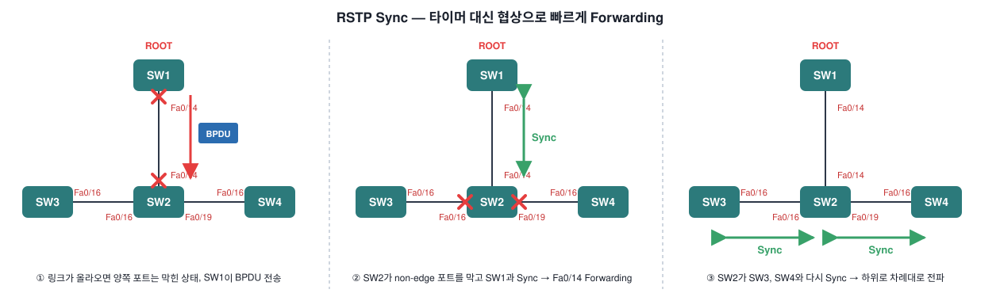
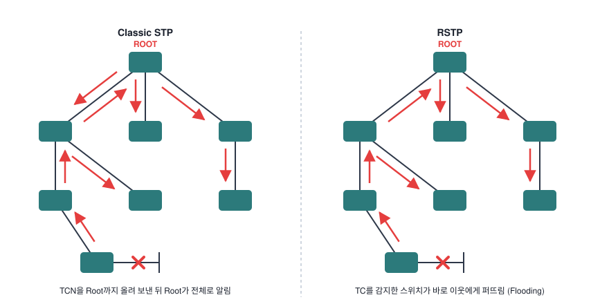
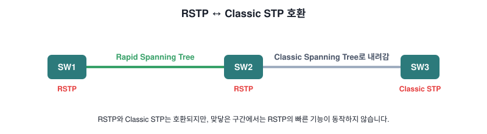

# Rapid Spanning-Tree (RSTP)

[한국어](../01-Rapid-Spanning-Tree.md) | **English** | [日本語](01-Rapid-Spanning-Tree.ja.md) | [简体中文](01-Rapid-Spanning-Tree.zh-CN.md) | [Español](01-Rapid-Spanning-Tree.es.md) | [Français](01-Rapid-Spanning-Tree.fr.md)

Networks use more and more routing these days. Routing protocols like OSPF and EIGRP react to network changes much faster than spanning tree. **Rapid Spanning Tree (RSTP, IEEE 802.1w)** was created to keep up with them.

RSTP is **an evolution, not a revolution** of the original spanning tree. A few things changed behind the scenes to make it faster, but **the configuration stays the same**. Below, the original spanning tree (802.1D) is called **classic spanning tree**.

## Differences at a glance

| Item | Classic STP (802.1D) | RSTP (802.1w) |
| --- | --- | --- |
| Port states | Blocking / Listening / Learning / Forwarding | **Discarding** / Learning / Forwarding |
| Port roles | Root, Designated, Alternate (blocked) | Root, Designated, Alternate, **Backup** |
| BPDU | Only 2 flag bits used (TC, TCA) | **Version 2 BPDU**, all flag bits used |
| Who sends BPDUs | Only the root; others relay | **Every switch, every hello time (2 s)** |
| Failure detection | Max age 20 s | **3 missed BPDUs** (keepalive) |
| Inferior BPDUs | Ignored | **Accepted** (like BackboneFast) |
| Move to forwarding | Timer-based (listening → learning, ~30 s) | **Proposal / agreement negotiation (sync)** |
| PortFast | PortFast | **Edge port** |
| UplinkFast | Configure it yourself | **Built in** |
| Topology change | TCN sent up to the root, root notifies | **Detecting switch floods it right away** |

---

## 1. Port states: 4 → 3

RSTP has only three port states: **discarding, learning and forwarding**. **Discarding** combines the classic blocking and listening states.

| Classic Spanning Tree | Rapid Spanning Tree | Port active in topology? | Learns MAC addresses? |
| --- | --- | --- | --- |
| Blocking | Discarding | No | No |
| Listening | Discarding | Yes | No |
| Learning | Learning | Yes | Yes |
| Forwarding | Forwarding | Yes | Yes |

---

## 2. Port roles

- **Root bridge**: the switch with the best bridge ID (priority + MAC). Here it's SW1 (MAC AAA).
- **Root port**: the port on a non-root switch with the lowest cost to the root.
- **Designated port**: only one per segment. The port that **can send the best BPDU** becomes designated.
- **Alternate port**: SW3's Fa0/16 receives better BPDUs from SW2, so it is blocked. It is a backup path for the root port.

So far, everything is the same as classic spanning tree. The new role in RSTP is the **backup port**.

### Backup port

A **hub** has been added between SW2 and SW3. Without the hub, SW2's Fa0/16 and Fa0/17 would both be designated ports.

Because of the hub, Fa0/16 and Fa0/17 on SW2 are now in **the same collision domain**. SW2 receives its own BPDUs on both Fa0/16 and Fa0/17, so it knows it has two connections to the same segment.

- Fa0/16 → **designated port**
- Fa0/17 → **backup port** for Fa0/16

> You are very unlikely to see a backup port in a production network. Remove the hub and both become designated ports again.

---

## 3. BPDU (version 2)

Classic spanning tree used only **two bits** of the flags field:
- Topology Change
- Topology Change Acknowledgement

RSTP uses **all bits of the flags field**. In particular, the **port role** field tells the role of the port that sent the BPDU:
- Unknown
- Alternate / backup port
- Root port
- Designated port

This new BPDU is called a **version 2 BPDU**. Switches running only classic spanning tree drop it.

---

## 4. Other changes

### Every switch sends BPDUs every hello time
In classic spanning tree, **only the root bridge** generated BPDUs and non-root switches just relayed the ones they received on their root port. In RSTP, **every switch generates BPDUs every 2 seconds (hello time)**. The hello time can be changed.

### BPDU = keepalive
Classic spanning tree waited for **max age (20 s)** before discarding a BPDU. RSTP uses BPDUs as a **keepalive**, like OSPF or EIGRP hellos. If a switch **misses three BPDUs in a row** from a neighbor, it assumes the connection is lost and removes all MAC addresses immediately.

### Inferior BPDUs are accepted
Classic spanning tree ignores inferior BPDUs; RSTP accepts them. This is pretty much the **BackboneFast** feature of classic spanning tree.

### Negotiation instead of timers
Classic spanning tree had to walk through listening and learning before forwarding, which took **30 seconds** with default timers. RSTP decides whether a port can forward using **negotiation** instead of timers. This is the most important change: **fast convergence**.

### PortFast = edge port
With PortFast in classic spanning tree, a port skips listening and learning and goes straight to forwarding, and it doesn't generate topology changes when it goes up or down. RSTP still uses PortFast but calls it an **edge port**.

### Link type
RSTP can only move ports to forwarding quickly on **edge ports** and **point-to-point** links.

| Link type | Duplex | Description |
| --- | --- | --- |
| Point-to-point | Full duplex | Normal links between switches |
| Shared | Half duplex | Links with a hub in between |

---

## 5. Sync: proposal / agreement

SW1 is the root bridge; SW2, SW3 and SW4 are non-root bridges.

1. When the SW1–SW2 link comes up, both ports start **blocked**. When SW2 receives SW1's BPDU, a negotiation called **sync** starts.
2. As soon as SW2 receives the root's BPDU, it **blocks all its non-edge designated ports** (non-edge = ports to other switches, edge = PortFast ports). Then the SW1–SW2 link goes to **forwarding**.
3. SW2 then syncs with SW3 and SW4 so those links can move to forwarding quickly too.

Here is exactly which messages are exchanged, step by step:

| Step | What happens |
| --- | --- |
| 1. Proposal | SW1 sets the **proposal bit** in the BPDU flags. SW2 learns that SW1 is the root |
| 2. Sync | SW2 **blocks all non-edge ports** and prepares to sync toward SW3 and SW4 |
| 3. Agreement | SW2 sends an **agreement** (a copy of the proposal BPDU with proposal OFF, agreement ON). SW2 Fa0/14 forwards |
| 4. Forwarding | When SW1 receives the agreement, it puts Fa0/14 into **forwarding immediately** |
| 5. Proposal | SW2 sends the same proposal on Fa0/16 (SW3) and Fa0/19 (SW4) |
| 6. Agreement | SW3 and SW4 have no other ports, so they answer with an agreement right away |
| 7. Forwarding | SW2 puts Fa0/16 and Fa0/19 into forwarding — done |

> It's just a couple of messages going back and forth, so it is **much faster** than the classic timer-based mechanism (listening → learning → forwarding).

---

## 6. UplinkFast is built in

In classic spanning tree you had to enable **UplinkFast** yourself. RSTP has it by default. When a switch loses its root port, it **puts its alternate port into forwarding immediately**.

Classic UplinkFast needed multicast frames to update the MAC address tables of all switches. RSTP doesn't need this because its topology change mechanism is different.

---

## 7. Topology change

In classic spanning tree, **a link failure triggered a topology change**. In RSTP, a link failure is not a topology change. **Only non-edge ports (to other switches) moving to forwarding** count as a topology change.

The switch that **detects** the topology change:
- Starts a **topology change while timer** for all non-edge designated ports and its root port. The value is **twice the hello time**.
- **Flushes the MAC addresses** learned on these ports.
- While the timer runs, sets the **TC bit** on BPDUs sent out these ports. BPDUs are also sent out of its root port.

A **neighbor switch that receives** a BPDU with the TC bit set:
- Clears the MAC addresses on **all ports except** the one where it received the BPDU.
- Starts its own topology change while timer and sends BPDUs with the TC bit set on all designated ports and its root port.

> Instead of sending it all the way up to the root bridge like classic spanning tree, the topology change is **flooded quickly throughout the network**.

---

## 8. Compatibility with classic spanning tree

RSTP and classic spanning tree are **compatible**. However, where an RSTP switch talks to a classic switch, **all the features that make RSTP fast stop working**.

In the picture, SW1–SW2 runs RSTP, but SW2–SW3 **falls back to classic spanning tree**.

---

## Key takeaways

- RSTP (802.1w) is an **evolution** of classic STP. Same configuration, faster internals.
- Three port states: **discarding / learning / forwarding**. New role: **backup port**.
- **Version 2 BPDU**: all flag bits used, includes port role. Every switch sends one every 2 s; 3 missed = failure.
- Converges through **proposal → sync → agreement** instead of timers. Fast transitions only on **edge ports** and **point-to-point** links.
- **UplinkFast built in**. Topology change happens **only when a non-edge port starts forwarding**, and is spread quickly by **flooding**.
- Compatible with classic STP, but the shared segment runs as classic.
