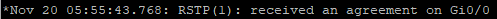
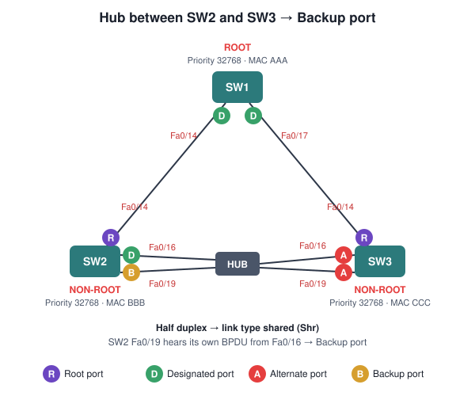
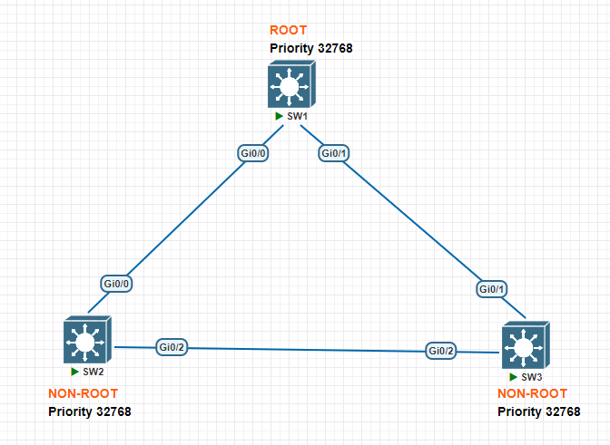
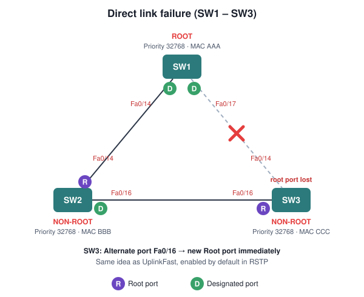
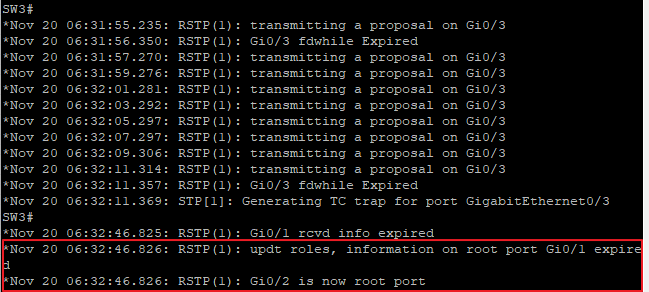
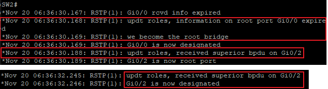
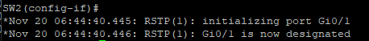

# Rapid Spanning-Tree (RSTP) Configuration

[한국어](../02-Rapid-Spanning-Tree-Configuration.md) | [English](02-Rapid-Spanning-Tree-Configuration.en.md) | [日本語](02-Rapid-Spanning-Tree-Configuration.ja.md) | [简体中文](02-Rapid-Spanning-Tree-Configuration.zh-CN.md) | [Español](02-Rapid-Spanning-Tree-Configuration.es.md) | **Français**

La note précédente présentait les différences entre le spanning tree classique et le rapid spanning tree, ainsi que le fonctionnement de RSTP. Cette fois, nous configurons réellement RSTP et **observons son fonctionnement avec les commandes debug et show**.

> Pour le fonctionnement de RSTP, lisez d'abord [01. Rapid Spanning-Tree](01-Rapid-Spanning-Tree.fr.md).

## Commandes utilisées dans ce lab

| Commande | Rôle |
| --- | --- |
| `spanning-tree mode rapid-pvst` | Activer RSTP (Rapid PVST+) |
| `spanning-tree mode pvst` | Revenir au spanning tree classique (PVST) |
| `debug spanning-tree events` | Voir les proposals / agreements et les changements de rôle des ports |
| `debug spanning-tree bpdu` | Voir les BPDU envoyés et reçus |
| `show spanning-tree` | Vérifier le root bridge, les rôles/états des ports et le link type |
| `spanning-tree portfast` | Faire d'un port un **edge port** |

---

## Topologie du lab


Un triangle de trois switchs, avec SW1 comme root bridge. Commençons par activer le rapid spanning tree sur tous les switchs.


C'est tout : **une seule commande**. L'implémentation RSTP de Cisco est **rapid-pvst**, qui calcule un rapid spanning tree distinct **pour chaque VLAN**.

---

## 1. Mécanisme de sync

Commençons par le sync. On désactive (shutdown) les interfaces de SW1.


On active un debug sur les trois switchs pour voir ce qui se passe.


On réactive maintenant une des interfaces de SW1.


Voici ce qu'affiche SW1.


Gi0/0 de SW1 devient designated, mais ne passe pas tout de suite en forwarding. Elle envoie d'abord une **proposal** à SW2.


Jusque-là, SW2 se croyait root bridge et envoyait ses propres proposals. En recevant un **superior BPDU** sur Gi0/0, il en fait son **root port**. Il met ensuite Gi0/2, vers SW3, en état de **sync**.


Gi0/2 est l'interface reliée à SW3. Une fois le sync terminé, SW2 répond à SW1 par un **agreement**.


On voit aussi l'agreement arriver sur SW1.



Avec l'agreement reçu, Gi0/0 de SW1 passe immédiatement en **forwarding**. Ensuite, SW2 envoie une proposal à SW3.


Quand SW3 la reçoit, il envoie un agreement.


SW2 reçoit l'agreement de SW3.


Avec l'agreement de SW3, l'interface de SW2 passe elle aussi en forwarding. C'est tout : **quelques handshakes et aucun timer**, et les interfaces passent en forwarding.

---

## 2. États et rôles des ports

On réactive l'interface restante pour rétablir complètement la connectivité.


Regardons l'état général.


- SW1 est le **root bridge** (`This bridge is the root`).
- `Spanning tree enabled protocol rstp` : nous utilisons RSTP.
- Le link type est **P2p**, car les interfaces sont en **full duplex** par défaut.

On lance la même commande sur les deux autres switchs.


Rien de nouveau : ce sont les mêmes informations qu'avec le spanning tree classique. Sous forme de schéma, la topologie ressemble maintenant à ceci.


> Le schéma suit l'exemple du manuel (MAC AAA/BBB/CCC, numéros FastEthernet). Dans le lab, la MAC de SW3 est plus petite que celle de SW2, donc l'alternate port se trouve sur **SW2 Gi0/2**. Le principe reste le même : le côté avec le bridge ID le plus bas devient designated.

Ajoutons un second lien entre SW2 et SW3 pour voir si la topologie change.


Rien de spectaculaire. On obtient simplement un **designated port** de plus d'un côté et un **alternate port** de plus de l'autre.


### Avec un hub : le backup port

Jusqu'ici, la topologie RSTP est identique à celle du spanning tree classique. Voyons maintenant quelque chose de nouveau : **on place un hub entre SW2 et SW3.** (Le lab avec le hub est un exemple du manuel, avec des interfaces FastEthernet.)



On vérifie de nouveau les interfaces.

```
SW2#show spanning-tree
VLAN0001
  Spanning tree enabled protocol rstp
  Root ID    Priority    32769
             Address     0001.C73E.A040
             Cost        19
             Port        14(FastEthernet0/14)
             Hello Time  2 sec  Max Age 20 sec  Forward Delay 15 sec

  Bridge ID  Priority    32769  (priority 32768 sys-id-ext 1)
             Address     0003.E489.C1D8
             Hello Time  2 sec  Max Age 20 sec  Forward Delay 15 sec
             Aging Time  20

Interface        Role Sts Cost      Prio.Nbr Type
---------------- ---- --- --------- -------- --------------------------------
Fa0/19           Back BLK 19        128.19   Shr
Fa0/14           Root FWD 19        128.14   P2p
Fa0/16           Desg FWD 19        128.16   Shr
```

```
SW3#show spanning-tree
VLAN0001
  Spanning tree enabled protocol rstp
  Root ID    Priority    32769
             Address     0001.C73E.A040
             Cost        19
             Port        14(FastEthernet0/14)
             Hello Time  2 sec  Max Age 20 sec  Forward Delay 15 sec

  Bridge ID  Priority    32769  (priority 32768 sys-id-ext 1)
             Address     00E0.F757.02B5
             Hello Time  2 sec  Max Age 20 sec  Forward Delay 15 sec
             Aging Time  20

Interface        Role Sts Cost      Prio.Nbr Type
---------------- ---- --- --------- -------- --------------------------------
Fa0/14           Root FWD 19        128.14   P2p
Fa0/16           Altn BLK 19        128.16   Shr
Fa0/19           Altn BLK 19        128.19   Shr
```

- Fa0/19 de SW2 est devenue un **backup port (Back BLK)**, car elle reçoit via le hub les BPDU envoyés par sa propre Fa0/16.
- Le link type est **Shr (shared)**, car le hub fait passer les interfaces en **half duplex**.

Les hubs sont rares aujourd'hui, vous ne verrez donc probablement pas de backup port sur un réseau de production. Mais si cela arrive, vous savez maintenant pourquoi.

---

## 3. BPDU

Avec RSTP, chaque switch envoie un BPDU **toutes les 2 secondes (hello time)**. On peut le vérifier avec un debug.


La commande `debug spanning-tree bpdu` affiche les BPDU envoyés et reçus.


Ce n'est pas très pratique pour lire le contenu d'un BPDU, mais on voit bien que SW2 **reçoit** des BPDU et les **envoie** sur ses interfaces. Pour examiner le contenu d'un BPDU, mieux vaut faire une capture avec **Wireshark**.

---

## 4. Pannes de lien

On retire le hub. Cette fois, on provoque des pannes de lien pour voir comment RSTP réagit.



### Panne directe (Direct link failure)



On désactive Gi0/1 de SW1 (vers SW3).


Voici ce qu'affiche SW3.



SW3 détecte le problème sur son root port (Gi0/1) **presque immédiatement** et transforme son **alternate port (Gi0/2) en root port**. C'est l'équivalent d'**UplinkFast** dans le spanning tree classique, mais avec RSTP c'est **activé par défaut**.

On rétablit la connectivité avant le test suivant.


### Panne indirecte (Indirect link failure)

Le spanning tree classique dispose de la fonction **BackboneFast**. RSTP intègre un mécanisme similaire **par défaut**. On désactive l'interface de SW1 reliée à SW2.


Pour SW3, c'est une panne indirecte. Voici ce qu'affiche SW2.



SW2 perd son root port et se croit un instant **root bridge** (`we become the root bridge`). Puis il reçoit un **superior BPDU** de SW3 et fait de Gi0/2 son nouveau root port. Tout cela se passe **en un clin d'œil**. On retire le shutdown et on continue.


---

## 5. Edge ports

Passons aux edge ports. Un **VPC (PC)** est connecté à Gi0/1 de SW2.


Voyons comment RSTP traite une interface reliée à un autre équipement.


À cause du mécanisme de sync, il **continue d'envoyer des proposals** vers le PC. Le PC ne renvoie jamais d'agreement, donc le port ne passe en forwarding qu'après leur expiration (`fdwhile Expired`). Il finit bien en forwarding, mais **cela prend du temps**.

C'est pourquoi il faut indiquer à RSTP que l'interface du PC est un **edge port**. « Edge » désigne la **bordure** de la topologie spanning tree. Il suffit d'activer **portfast**.


Pour voir la différence, on désactive puis réactive l'interface.


Voici le résultat.



L'interface passe **immédiatement en forwarding**. Le switch sait que ce port est la bordure du spanning tree, il n'a donc pas besoin de lui envoyer de proposals.

---

## 6. Compatibilité (Compatibility)

Pour finir, la compatibilité avec le spanning tree classique. On passe SW2 en **mode PVST** et on laisse SW1 et SW3 en rapid PVST.


Voici ce qu'affiche SW2.


SW2 reçoit des BPDU du root bridge et ses interfaces passent par **listening → learning → forwarding**. Quand les switchs RSTP reçoivent un BPDU du spanning tree classique, **ils se mettent eux-mêmes à envoyer des BPDU classiques**, et le réseau continue de fonctionner.

On vérifie de nouveau les interfaces.


- SW1 Gi0/0, SW3 Gi0/2 : les ports tournés vers SW2 affichent **`Peer(STP)`**, ce qui signifie que le voisin utilise le STP classique.
- SW2 Gi0/1 : le port du PC apparaît comme **`Edge`**.

Tous les switchs restent d'accord sur les états des ports, et tout fonctionne comme prévu.

---

## Points clés

- **Une seule commande**, `spanning-tree mode rapid-pvst`, active RSTP. Un rapid spanning tree est calculé par VLAN.
- Le handshake **proposal → sync → agreement** fait passer les ports en forwarding sans timer (à vérifier avec `debug spanning-tree events`).
- Les liens full duplex sont **P2p**, les liens half duplex comme un hub sont **Shr**. Un hub crée un **backup port**.
- Chaque switch envoie un BPDU **toutes les 2 secondes** (`debug spanning-tree bpdu`). Pour lire le contenu, Wireshark est plus pratique.
- Un comportement équivalent à **UplinkFast** (panne directe) et **BackboneFast** (panne indirecte) est intégré **par défaut**.
- Les ports des équipements terminaux comme un PC ont besoin de **`spanning-tree portfast`** pour devenir des **edge ports** et transmettre immédiatement.
- RSTP est **compatible** avec le STP classique. Les ports tournés vers lui affichent **`Peer(STP)`** et fonctionnent à la manière classique.
