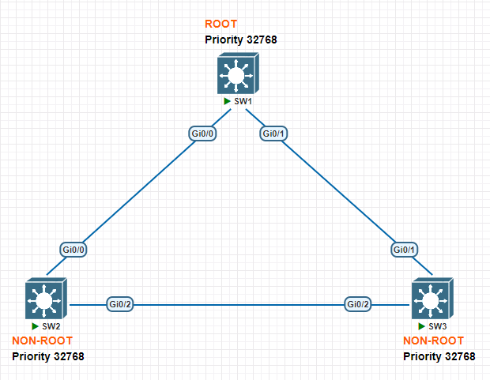
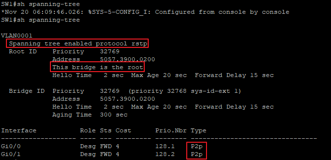
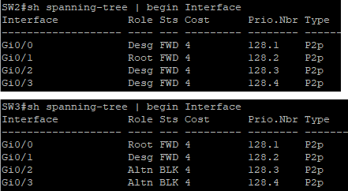
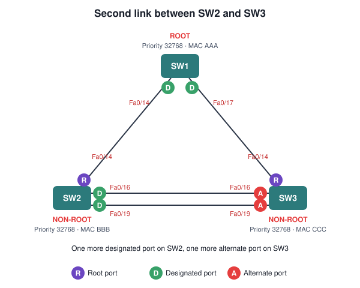

# Rapid Spanning-Tree (RSTP) Configuration

[한국어](../02-Rapid-Spanning-Tree-Configuration.md) | [English](02-Rapid-Spanning-Tree-Configuration.en.md) | **日本語** | [简体中文](02-Rapid-Spanning-Tree-Configuration.zh-CN.md) | [Español](02-Rapid-Spanning-Tree-Configuration.es.md) | [Français](02-Rapid-Spanning-Tree-Configuration.fr.md)

前回のノートでは、Classic Spanning Tree と Rapid Spanning Tree の違い、そして RSTP の動作をまとめました。今回は実際に RSTP を設定し、**debug と show コマンドでその動作を確認**します。

> RSTP の動作原理は、先に [01. Rapid Spanning-Tree](01-Rapid-Spanning-Tree.ja.md) を参照してください。

## この実習で使うコマンド

| コマンド | 用途 |
| --- | --- |
| `spanning-tree mode rapid-pvst` | RSTP(Rapid PVST+)を有効にする |
| `spanning-tree mode pvst` | Classic Spanning Tree(PVST)に戻す |
| `debug spanning-tree events` | Proposal / Agreement、ポートの役割の変化を見る |
| `debug spanning-tree bpdu` | BPDU の送受信を見る |
| `show spanning-tree` | Root Bridge、ポートの役割・状態、Link type を確認 |
| `spanning-tree portfast` | ポートを **Edge port** にする |

---

## 実習トポロジー



SW1 が Root Bridge になる、スイッチ 3 台の三角形トポロジーです。まず、すべてのスイッチで Rapid Spanning Tree を有効にします。


**コマンド 1 つ**で完了です。Cisco の RSTP 実装は **rapid-pvst** で、**VLAN ごとに** Rapid Spanning Tree を個別に計算します。

---

## 1. Sync メカニズム

まず Sync の動作を確認します。SW1 のインターフェイスをすべて shutdown します。


動作を見るため、3 台すべてで debug を有効にします。


ここで SW1 のインターフェイスを 1 つ有効に戻します。


SW1 に表示される内容です。


SW1 の Gi0/0 は Designated になりますが、すぐには Forwarding になりません。まず SW2 に **Proposal** を送ります。


SW2 はそれまで自分が Root Bridge だと思い、Proposal を送っていました。しかし Gi0/0 で **superior BPDU** を受信すると、このポートを **Root port** に変更します。そして SW3 側の Gi0/2 を **Sync** 状態にします。


Gi0/2 が SW3 と接続しているインターフェイスです。Sync が終わると、SW2 は SW1 に **Agreement** で応答します。


SW1 でも Agreement を受信したことが確認できます。


Agreement を受け取った SW1 の Gi0/0 はすぐに **Forwarding** になります。続いて SW2 も SW3 に Proposal を送ります。


SW3 は Proposal を受け取ると Agreement を送ります。


SW2 が SW3 の Agreement を受信します。


SW3 の Agreement を受け取った SW2 のインターフェイスも Forwarding になります。これだけです。**タイマーを使わず、数回のハンドシェイクだけで**インターフェイスが Forwarding に移ります。

---

## 2. ポート状態とポートの役割

接続を完全に戻すため、残りのインターフェイスも有効にします。


全体の状態を確認します。



- SW1 が **Root Bridge** です(`This bridge is the root`)。
- `Spanning tree enabled protocol rstp`:RSTP で動作しています。
- Link type は **P2p** です。インターフェイスがデフォルトで **Full duplex** だからです。

残り 2 台のスイッチでも同じコマンドを実行します。


新しい内容はありません。Classic Spanning Tree と同じ情報です。現在のトポロジーを図にすると次のようになります。


> 図は教材の例(MAC AAA/BBB/CCC、FastEthernet 番号)です。実習機器では SW3 の MAC が SW2 より小さいため、Alternate port は **SW2 Gi0/2** にできました。Bridge ID が小さい側が Designated になるという原理は同じです。

SW2 と SW3 の間にもう 1 本リンクを追加し、トポロジーに影響があるか見てみます。




特に大きな変化はありません。片側に **Designated port** が 1 つ、もう片側に **Alternate port** が 1 つ増えただけです。



### Hub を入れると:Backup port

ここまでは、RSTP のトポロジーは Classic Spanning Tree とまったく同じに見えます。今度は初めて見るものを確認します。**SW2 と SW3 の間に Hub を入れます。**(Hub の実習は教材の例で、FastEthernet インターフェイスです。)


インターフェイスをもう一度確認します。

```
SW2#show spanning-tree
VLAN0001
  Spanning tree enabled protocol rstp
  Root ID    Priority    32769
             Address     0001.C73E.A040
             Cost        19
             Port        14(FastEthernet0/14)
             Hello Time  2 sec  Max Age 20 sec  Forward Delay 15 sec

  Bridge ID  Priority    32769  (priority 32768 sys-id-ext 1)
             Address     0003.E489.C1D8
             Hello Time  2 sec  Max Age 20 sec  Forward Delay 15 sec
             Aging Time  20

Interface        Role Sts Cost      Prio.Nbr Type
---------------- ---- --- --------- -------- --------------------------------
Fa0/19           Back BLK 19        128.19   Shr
Fa0/14           Root FWD 19        128.14   P2p
Fa0/16           Desg FWD 19        128.16   Shr
```

```
SW3#show spanning-tree
VLAN0001
  Spanning tree enabled protocol rstp
  Root ID    Priority    32769
             Address     0001.C73E.A040
             Cost        19
             Port        14(FastEthernet0/14)
             Hello Time  2 sec  Max Age 20 sec  Forward Delay 15 sec

  Bridge ID  Priority    32769  (priority 32768 sys-id-ext 1)
             Address     00E0.F757.02B5
             Hello Time  2 sec  Max Age 20 sec  Forward Delay 15 sec
             Aging Time  20

Interface        Role Sts Cost      Prio.Nbr Type
---------------- ---- --- --------- -------- --------------------------------
Fa0/14           Root FWD 19        128.14   P2p
Fa0/16           Altn BLK 19        128.16   Shr
Fa0/19           Altn BLK 19        128.19   Shr
```

- SW2 の Fa0/19 が **Backup port(Back BLK)** になりました。自分の Fa0/16 が送った BPDU を Hub 経由で受け取るからです。
- Link type は **Shr(shared)** です。Hub のせいでインターフェイスが **Half duplex** になったからです。

最近は Hub をほとんど使わないので、実際のネットワークで Backup port を見ることはまれです。でも見かけたら、もう理由はわかります。

---

## 3. BPDU

RSTP では、すべてのスイッチが **2 秒(hello time)ごとに** BPDU を送ります。debug で直接確認できます。


`debug spanning-tree bpdu` コマンドは、送受信する BPDU を表示します。


BPDU の中身を詳しく見るには不便ですが、SW2 が BPDU を**受信し**、自分のインターフェイスから**送信している**ことは確認できます。BPDU の中身を詳しく見たい場合は、**Wireshark** でパケットをキャプチャするのがおすすめです。

---

## 4. リンク障害

Hub を外し、今度はリンク障害を起こして RSTP がどう対応するか見てみます。


### 直接障害(Direct link failure)


SW1 の Gi0/1(SW3 側)を shutdown します。


SW3 に表示される内容です。


SW3 は Root port(Gi0/1)の問題に**ほぼすぐに**気づき、**Alternate port(Gi0/2)を Root port に**変更します。Classic Spanning Tree の **UplinkFast** と同じ動作ですが、RSTP では**デフォルトで有効**です。

次の実習の前に接続を戻します。


### 間接障害(Indirect link failure)

Classic Spanning Tree には **BackboneFast** 機能があります。RSTP にも似たメカニズムが**デフォルトで**入っています。SW1 で SW2 と接続しているインターフェイスを shutdown します。


SW3 から見ると間接障害です。SW2 に表示される内容です。


SW2 は Root port を失い、一瞬**自分が Root Bridge だと**思います(`we become the root bridge`)。その後 SW3 から **superior BPDU** を受け取り、Gi0/2 を新しい Root port にします。この過程は**一瞬で**終わります。shutdown を解除して次に進みます。


---

## 5. Edge Port

今度は Edge port を見てみます。SW2 の Gi0/1 に **VPC(PC)** を接続しました。


ほかの機器が接続されたインターフェイスを RSTP がどう扱うか見てみます。


Sync メカニズムのため、PC に向けて **Proposal を送り続けます。** PC は Agreement を返さないので、時間が経って期限切れ(`fdwhile Expired`)になってから Forwarding になります。最終的には Forwarding になりますが、**時間がかかります。**

そのため、PC が接続されたインターフェイスは **Edge port** だと RSTP に伝える必要があります。「Edge」は Spanning Tree トポロジーの**端**という意味です。**portfast** を有効にすれば OK です。


違いを見るため、インターフェイスを shutdown してからもう一度有効にします。


結果です。


インターフェイスが**すぐに Forwarding** になります。スイッチはこのポートが Spanning Tree の端だとわかっているので、Proposal を送る必要がありません。

---

## 6. 互換性(Compatibility)

最後に Classic Spanning Tree との互換性を見ます。SW2 を **PVST モード**に変更し、SW1 と SW3 は Rapid PVST のままにします。


SW2 に表示される内容です。


SW2 は Root Bridge から BPDU を受け取り、インターフェイスが **Listening → Learning → Forwarding** の段階を通ることがわかります。RSTP スイッチは Classic Spanning Tree の BPDU を受け取ると、**自分も Classic BPDU を作って送る**ので、ネットワークは正常に動き続けます。

インターフェイスをもう一度確認します。


- SW1 Gi0/0、SW3 Gi0/2:SW2 と接するポートに **`Peer(STP)`** が付きました。相手が Classic STP という意味です。
- SW2 Gi0/1:PC が接続されたポートなので **`Edge`** と表示されます。

すべてのスイッチがポート状態について引き続き同じ結論を出し、すべて正常に動作します。

---

## まとめ

- `spanning-tree mode rapid-pvst` の**コマンド 1 つ**で RSTP を有効にします。VLAN ごとに Rapid Spanning Tree を計算します。
- **Proposal → Sync → Agreement** のハンドシェイクで、タイマーなしで Forwarding になります(`debug spanning-tree events` で確認)。
- Full duplex のリンクは **P2p**、Hub のような Half duplex のリンクは **Shr**。Hub では **Backup port** ができます。
- すべてのスイッチが **2 秒ごとに** BPDU を送ります(`debug spanning-tree bpdu`)。中身は Wireshark で見るのが便利です。
- **UplinkFast**(直接障害)と **BackboneFast**(間接障害)と同じ動作が**デフォルトで**入っています。
- PC のような端末のポートは **`spanning-tree portfast`** で **Edge port** にすると、すぐに Forwarding になります。
- Classic STP と**互換性**があります。接するポートは **`Peer(STP)`** と表示され、Classic の方式で動作します。
