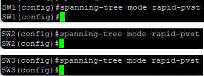
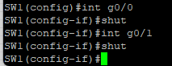
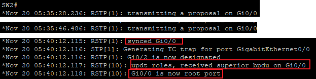
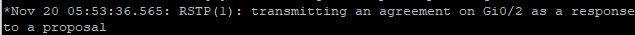
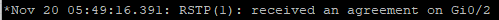
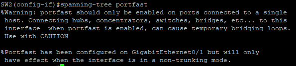
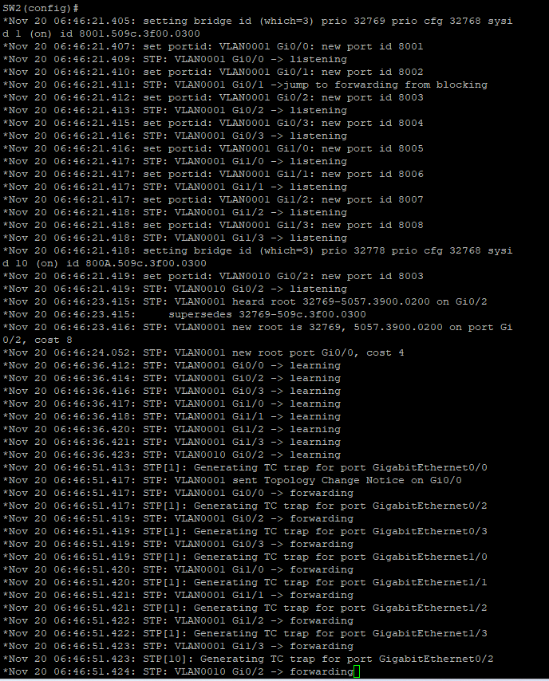

# Rapid Spanning-Tree (RSTP) Configuration

[한국어](../02-Rapid-Spanning-Tree-Configuration.md) | [English](02-Rapid-Spanning-Tree-Configuration.en.md) | [日本語](02-Rapid-Spanning-Tree-Configuration.ja.md) | **简体中文** | [Español](02-Rapid-Spanning-Tree-Configuration.es.md) | [Français](02-Rapid-Spanning-Tree-Configuration.fr.md)

上一篇笔记整理了 Classic Spanning Tree 与 Rapid Spanning Tree 的区别,以及 RSTP 的工作方式。这次我们实际配置 RSTP,并**用 debug 和 show 命令直接观察它的工作过程**。

> RSTP 的工作原理请先阅读 [01. Rapid Spanning-Tree](01-Rapid-Spanning-Tree.zh-CN.md)。

## 本实验使用的命令

| 命令 | 用途 |
| --- | --- |
| `spanning-tree mode rapid-pvst` | 启用 RSTP(Rapid PVST+) |
| `spanning-tree mode pvst` | 改回 Classic Spanning Tree(PVST) |
| `debug spanning-tree events` | 查看 Proposal / Agreement 以及端口角色变化 |
| `debug spanning-tree bpdu` | 查看 BPDU 的收发 |
| `show spanning-tree` | 查看 Root Bridge、端口角色/状态、Link type |
| `spanning-tree portfast` | 把端口设为 **Edge port** |

---

## 实验拓扑


这是由 3 台交换机组成的三角形拓扑,SW1 作为 Root Bridge。首先在所有交换机上启用 Rapid Spanning Tree。



**一条命令**就够了。Cisco 的 RSTP 实现是 **rapid-pvst**,会**为每个 VLAN** 单独计算 Rapid Spanning Tree。

---

## 1. Sync 机制

先来看 Sync 的过程。把 SW1 的接口全部 shutdown。



为了观察过程,在三台交换机上都开启 debug。


现在重新开启 SW1 的一个接口。


SW1 上显示的内容如下。


SW1 的 Gi0/0 成为 Designated,但不会马上进入 Forwarding,而是先向 SW2 发送 **Proposal**。



在此之前,SW2 一直以为自己是 Root Bridge,并在发送 Proposal。当它在 Gi0/0 上收到 **superior BPDU** 后,就把这个端口改为 **Root port**,然后把连接 SW3 的 Gi0/2 置为 **Sync** 状态。


Gi0/2 是连接 SW3 的接口。Sync 完成后,SW2 用 **Agreement** 回复 SW1。


在 SW1 上也能看到收到了 Agreement。


收到 Agreement 后,SW1 的 Gi0/0 立即进入 **Forwarding**。接着 SW2 也向 SW3 发送 Proposal。


SW3 收到 Proposal 后发送 Agreement。



SW2 收到 SW3 的 Agreement。



收到 SW3 的 Agreement 后,SW2 的接口也进入 Forwarding。就这么简单:**不用任何定时器,只需几次握手**,接口就进入 Forwarding。

---

## 2. 端口状态与端口角色

为了完全恢复连通性,把剩下的接口也开启。


查看整体状态。


- SW1 是 **Root Bridge**(`This bridge is the root`)。
- `Spanning tree enabled protocol rstp`:正在以 RSTP 运行。
- Link type 是 **P2p**,因为接口默认是 **Full duplex**。

在另外两台交换机上执行同样的命令。


没有新内容,和 Classic Spanning Tree 的信息相同。把当前拓扑画成图就是下面这样。


> 图按照教材示例绘制(MAC AAA/BBB/CCC,FastEthernet 编号)。实验设备中 SW3 的 MAC 比 SW2 小,所以 Alternate port 出现在 **SW2 Gi0/2**。Bridge ID 较小的一方成为 Designated,这个原理是一样的。

在 SW2 和 SW3 之间再加一条链路,看看是否影响拓扑。


没有什么特别的变化。只是一侧多了一个 **Designated port**,另一侧多了一个 **Alternate port**。


### 加入 Hub:Backup port

到目前为止,RSTP 的拓扑看起来和 Classic Spanning Tree 完全一样。下面来看一个新东西:**在 SW2 和 SW3 之间放一个 Hub。**(Hub 实验是教材示例,使用 FastEthernet 接口。)


再次查看接口。

```
SW2#show spanning-tree
VLAN0001
  Spanning tree enabled protocol rstp
  Root ID    Priority    32769
             Address     0001.C73E.A040
             Cost        19
             Port        14(FastEthernet0/14)
             Hello Time  2 sec  Max Age 20 sec  Forward Delay 15 sec

  Bridge ID  Priority    32769  (priority 32768 sys-id-ext 1)
             Address     0003.E489.C1D8
             Hello Time  2 sec  Max Age 20 sec  Forward Delay 15 sec
             Aging Time  20

Interface        Role Sts Cost      Prio.Nbr Type
---------------- ---- --- --------- -------- --------------------------------
Fa0/19           Back BLK 19        128.19   Shr
Fa0/14           Root FWD 19        128.14   P2p
Fa0/16           Desg FWD 19        128.16   Shr
```

```
SW3#show spanning-tree
VLAN0001
  Spanning tree enabled protocol rstp
  Root ID    Priority    32769
             Address     0001.C73E.A040
             Cost        19
             Port        14(FastEthernet0/14)
             Hello Time  2 sec  Max Age 20 sec  Forward Delay 15 sec

  Bridge ID  Priority    32769  (priority 32768 sys-id-ext 1)
             Address     00E0.F757.02B5
             Hello Time  2 sec  Max Age 20 sec  Forward Delay 15 sec
             Aging Time  20

Interface        Role Sts Cost      Prio.Nbr Type
---------------- ---- --- --------- -------- --------------------------------
Fa0/14           Root FWD 19        128.14   P2p
Fa0/16           Altn BLK 19        128.16   Shr
Fa0/19           Altn BLK 19        128.19   Shr
```

- SW2 的 Fa0/19 变成了 **Backup port(Back BLK)**,因为它会通过 Hub 收到自己 Fa0/16 发出的 BPDU。
- Link type 是 **Shr(shared)**,因为 Hub 让接口变成了 **Half duplex**。

现在几乎不用 Hub 了,所以在实际网络中很少会看到 Backup port。不过如果看到了,现在你就知道原因了。

---

## 3. BPDU

在 RSTP 中,所有交换机**每 2 秒(hello time)**发送一次 BPDU。可以用 debug 直接确认。


`debug spanning-tree bpdu` 命令会显示收发的 BPDU。


用它查看 BPDU 的详细内容不太方便,但可以确认 SW2 正在**接收** BPDU,并从自己的接口**发送** BPDU。想详细查看 BPDU 内容的话,推荐用 **Wireshark** 抓包。

---

## 4. 链路故障

拿掉 Hub,这次制造链路故障,看看 RSTP 如何应对。


### 直接故障(Direct link failure)


shutdown SW1 的 Gi0/1(连接 SW3 的一侧)。


SW3 上显示的内容如下。


SW3 **几乎立即**发现 Root port(Gi0/1)出了问题,并把 **Alternate port(Gi0/2)改为 Root port**。这和 Classic Spanning Tree 的 **UplinkFast** 是同样的动作,但在 RSTP 中**默认启用**。

在下一个实验前恢复连接。


### 间接故障(Indirect link failure)

Classic Spanning Tree 有 **BackboneFast** 功能。RSTP 也**默认**内置了类似的机制。在 SW1 上 shutdown 连接 SW2 的接口。


对 SW3 来说,这是间接故障。SW2 上显示的内容如下。


SW2 失去 Root port 后,短暂地认为**自己是 Root Bridge**(`we become the root bridge`)。随后它从 SW3 收到 **superior BPDU**,并把 Gi0/2 改为新的 Root port。整个过程**一眨眼**就结束了。取消 shutdown,继续下一步。


---

## 5. Edge Port

现在来看 Edge port。在 SW2 的 Gi0/1 上连接了一台 **VPC(PC)**。


看看 RSTP 如何处理连接其他设备的接口。


由于 Sync 机制,它会向 PC **不断发送 Proposal。** PC 不会回复 Agreement,所以要等到超时(`fdwhile Expired`)之后才进入 Forwarding。最终还是会进入 Forwarding,但**需要一段时间**。

因此,需要告诉 RSTP 连接 PC 的接口是 **Edge port**。"Edge"指的是 Spanning Tree 拓扑的**边缘**。启用 **portfast** 即可。



为了看出差别,先 shutdown 接口再重新开启。


结果如下。


接口**立即进入 Forwarding**。交换机知道这个端口是 Spanning Tree 的边缘,所以不需要向它发送 Proposal。

---

## 6. 兼容性(Compatibility)

最后看与 Classic Spanning Tree 的兼容性。把 SW2 改为 **PVST 模式**,SW1 和 SW3 保持 Rapid PVST。


SW2 上显示的内容如下。



可以看到 SW2 从 Root Bridge 收到 BPDU,接口要经过 **Listening → Learning → Forwarding** 各个阶段。RSTP 交换机收到 Classic Spanning Tree 的 BPDU 后,**自己也会生成并发送 Classic BPDU**,因此网络能继续正常工作。

再次查看接口。


- SW1 Gi0/0、SW3 Gi0/2:与 SW2 相连的端口带有 **`Peer(STP)`**,表示对端运行的是 Classic STP。
- SW2 Gi0/1:连接 PC 的端口显示为 **`Edge`**。

所有交换机对端口状态的判断依然一致,一切都正常工作。

---

## 核心总结

- 用 `spanning-tree mode rapid-pvst` **一条命令**启用 RSTP。每个 VLAN 单独计算 Rapid Spanning Tree。
- 通过 **Proposal → Sync → Agreement** 握手,不用定时器就能进入 Forwarding(用 `debug spanning-tree events` 确认)。
- Full duplex 链路是 **P2p**,像 Hub 这样的 Half duplex 链路是 **Shr**。Hub 会产生 **Backup port**。
- 所有交换机**每 2 秒**发送 BPDU(`debug spanning-tree bpdu`)。查看内容用 Wireshark 更方便。
- 与 **UplinkFast**(直接故障)和 **BackboneFast**(间接故障)相同的动作是**默认**内置的。
- PC 等终端设备的端口要用 **`spanning-tree portfast`** 设为 **Edge port**,才能立即进入 Forwarding。
- 与 Classic STP **兼容**。相连的端口显示为 **`Peer(STP)`**,并按 Classic 方式运行。
