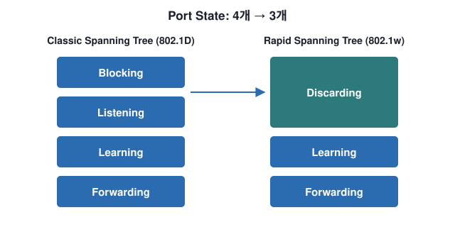
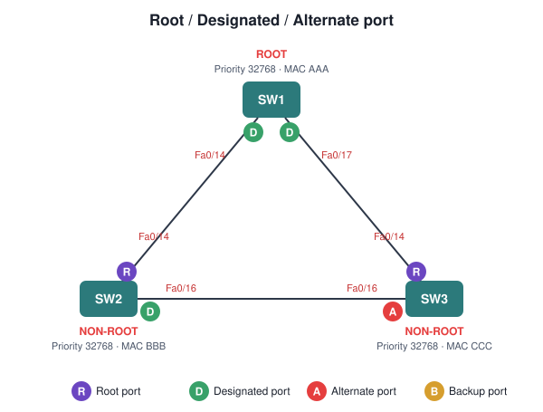
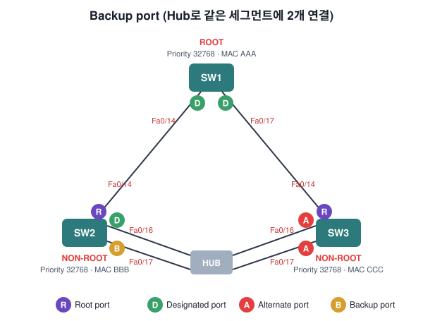
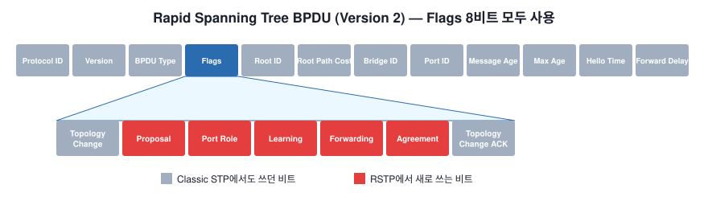
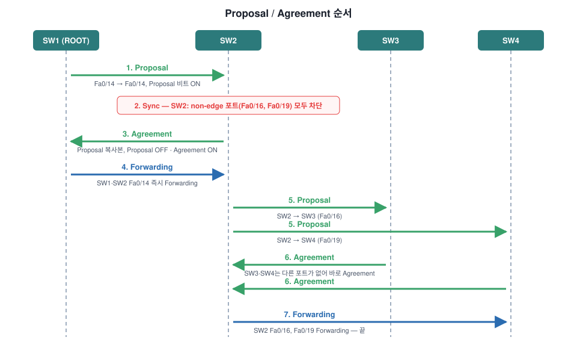

# Rapid Spanning-Tree (RSTP)

[한국어](../README.md) | [English](README.en.md) | [日本語](README.ja.md) | [简体中文](README.zh-CN.md) | [Español](README.es.md) | **Français**

Nos réseaux utilisent de plus en plus le routage. Les protocoles de routage comme OSPF et EIGRP réagissent aux changements du réseau bien plus vite que le spanning tree. C'est pour suivre ce rythme qu'a été créé le **Rapid Spanning Tree (RSTP, IEEE 802.1w)**.

RSTP est **une évolution, pas une révolution** du spanning tree d'origine. Quelques mécanismes internes ont changé pour le rendre plus rapide, mais **la configuration reste la même**. Dans la suite, le spanning tree d'origine (802.1D) est appelé **classic spanning tree**.

## Les différences en un coup d'œil

| Élément | Classic STP (802.1D) | RSTP (802.1w) |
| --- | --- | --- |
| États de port | Blocking / Listening / Learning / Forwarding | **Discarding** / Learning / Forwarding |
| Rôles de port | Root, Designated, Alternate (bloqué) | Root, Designated, Alternate, **Backup** |
| BPDU | Seulement 2 bits de flags (TC, TCA) | **BPDU version 2**, tous les flags utilisés |
| Qui envoie les BPDU | Seul le root ; les autres relaient | **Tous les switchs, à chaque hello time (2 s)** |
| Détection de panne | Max age 20 s | **3 BPDU manquées** (keepalive) |
| BPDU inférieures | Ignorées | **Acceptées** (comme BackboneFast) |
| Passage en forwarding | Par temporisateurs (listening → learning, ~30 s) | **Négociation proposal / agreement (sync)** |
| PortFast | PortFast | **Edge port** |
| UplinkFast | À configurer soi-même | **Intégré par défaut** |
| Changement de topologie | TCN remonté au root, le root prévient | **Le switch qui le détecte l'inonde aussitôt** |

---

## 1. États de port : 4 → 3

RSTP n'a que trois états de port : **discarding, learning et forwarding**. **Discarding** regroupe les états blocking et listening du classic.

| Classic Spanning Tree | Rapid Spanning Tree | Port actif dans la topologie ? | Apprend les MAC ? |
| --- | --- | --- | --- |
| Blocking | Discarding | No | No |
| Listening | Discarding | Yes | No |
| Learning | Learning | Yes | Yes |
| Forwarding | Forwarding | Yes | Yes |

---

## 2. Rôles de port

- **Root bridge** : le switch avec le meilleur bridge ID (priority + MAC). Ici, SW1 (MAC AAA).
- **Root port** : le port d'un switch non-root dont le coût vers le root est le plus faible.
- **Designated port** : un seul par segment. C'est le port qui **peut envoyer la meilleure BPDU**.
- **Alternate port** : Fa0/16 de SW3 reçoit de meilleures BPDU de SW2, il est donc bloqué. C'est un chemin de secours pour le root port.

Jusqu'ici, rien ne change par rapport au classic spanning tree. Le nouveau rôle de RSTP est le **backup port**.

### Backup port

Un **hub** a été ajouté entre SW2 et SW3. Sans le hub, Fa0/16 et Fa0/17 de SW2 seraient tous deux des designated ports.

À cause du hub, Fa0/16 et Fa0/17 de SW2 sont maintenant dans **le même domaine de collision**. SW2 reçoit ses propres BPDU sur Fa0/16 et Fa0/17 ; il comprend donc qu'il a deux connexions vers le même segment.

- Fa0/16 → **designated port**
- Fa0/17 → **backup port** de Fa0/16

> On ne voit presque jamais de backup port en production. Si l'on retire le hub, les deux redeviennent des designated ports.

---

## 3. BPDU (version 2)

Le classic spanning tree n'utilisait que **deux bits** du champ flags :
- Topology Change
- Topology Change Acknowledgement

RSTP utilise **tous les bits du champ flags**. Le champ **port role**, en particulier, indique le rôle du port qui a envoyé la BPDU :
- Unknown
- Alternate / backup port
- Root port
- Designated port

Cette nouvelle BPDU s'appelle **BPDU version 2**. Les switchs qui ne font que du classic spanning tree la rejettent.

---

## 4. Autres changements

### Tous les switchs envoient des BPDU à chaque hello time
En classic spanning tree, **seul le root bridge** générait des BPDU, et les switchs non-root se contentaient de relayer celles reçues sur leur root port. En RSTP, **tous les switchs génèrent des BPDU toutes les 2 secondes (hello time)**. Le hello time est modifiable.

### BPDU = keepalive
Le classic spanning tree attendait le **max age (20 s)** avant de rejeter une BPDU. RSTP utilise les BPDU comme **keepalive**, comme les hello d'OSPF ou d'EIGRP. Si un switch **manque trois BPDU d'affilée** d'un voisin, il considère la connexion perdue et efface immédiatement toutes les adresses MAC.

### Les BPDU inférieures sont acceptées
Le classic spanning tree ignore les BPDU inférieures ; RSTP les accepte. C'est pratiquement la fonction **BackboneFast** du classic spanning tree.

### La négociation remplace les temporisateurs
Le classic spanning tree devait passer par listening et learning avant forwarding, ce qui prenait **30 secondes** avec les temporisateurs par défaut. RSTP décide si un port peut passer en forwarding par **négociation**, sans temporisateurs. C'est le changement le plus important : la **convergence rapide**.

### PortFast = edge port
Avec PortFast en classic spanning tree, un port saute listening et learning pour passer directement en forwarding, et ne génère pas de changement de topologie quand il monte ou tombe. RSTP utilise toujours PortFast, mais l'appelle **edge port**.

### Type de lien
RSTP ne peut faire passer rapidement un port en forwarding que sur les **edge ports** et les liens **point-to-point**.

| Type de lien | Duplex | Description |
| --- | --- | --- |
| Point-to-point | Full duplex | Liens normaux entre switchs |
| Shared | Half duplex | Liens avec un hub au milieu |

---

## 5. Sync : proposal / agreement

SW1 est le root bridge ; SW2, SW3 et SW4 sont non-root.

1. Quand le lien SW1–SW2 monte, les deux ports commencent **bloqués**. Quand SW2 reçoit la BPDU de SW1, une négociation appelée **sync** démarre.
2. Dès que SW2 reçoit la BPDU du root, il **bloque tous ses designated ports non-edge** (non-edge = ports vers d'autres switchs, edge = ports en PortFast). Le lien SW1–SW2 passe alors en **forwarding**.
3. SW2 fait ensuite un sync avec SW3 et SW4 pour que ces liens passent rapidement en forwarding eux aussi.

Voici précisément les messages échangés, étape par étape :

| Étape | Ce qui se passe |
| --- | --- |
| 1. Proposal | SW1 active le **bit proposal** dans les flags de la BPDU. SW2 apprend que SW1 est le root |
| 2. Sync | SW2 **bloque tous ses ports non-edge** et se prépare à synchroniser SW3 et SW4 |
| 3. Agreement | SW2 envoie un **agreement** (copie de la BPDU proposal avec proposal OFF et agreement ON). Fa0/14 de SW2 passe en forwarding |
| 4. Forwarding | À la réception de l'agreement, SW1 passe Fa0/14 en **forwarding immédiatement** |
| 5. Proposal | SW2 envoie la même proposal sur Fa0/16 (SW3) et Fa0/19 (SW4) |
| 6. Agreement | SW3 et SW4 n'ont pas d'autres ports, ils répondent tout de suite par un agreement |
| 7. Forwarding | SW2 passe Fa0/16 et Fa0/19 en forwarding — terminé |

> Il ne s'agit que de quelques messages échangés, c'est donc **bien plus rapide** que le mécanisme à temporisateurs du classic (listening → learning → forwarding).

---

## 6. UplinkFast est intégré

En classic spanning tree, il fallait activer **UplinkFast** soi-même. RSTP l'intègre par défaut. Quand un switch perd son root port, il **passe immédiatement son alternate port en forwarding**.

L'UplinkFast classique devait envoyer des trames multicast pour mettre à jour les tables MAC de tous les switchs. RSTP n'en a plus besoin, car son mécanisme de changement de topologie est différent.

---

## 7. Changement de topologie

En classic spanning tree, **une panne de lien déclenchait un changement de topologie**. En RSTP, une panne de lien n'est pas un changement de topologie. **Seul le passage en forwarding d'un port non-edge (vers un autre switch)** en est un.

Le switch qui **détecte** le changement de topologie :
- Lance un **topology change while timer** sur tous ses designated ports non-edge et son root port. Sa valeur est **le double du hello time**.
- **Efface les adresses MAC** apprises sur ces ports.
- Tant que le temporisateur tourne, active le **bit TC** dans les BPDU envoyées sur ces ports. Il envoie aussi des BPDU sur son root port.

Un **switch voisin qui reçoit** une BPDU avec le bit TC :
- Efface les adresses MAC de **tous ses ports sauf** celui où il a reçu la BPDU.
- Lance son propre topology change while timer et envoie des BPDU avec le bit TC sur tous ses designated ports et son root port.

> Au lieu de remonter jusqu'au root bridge comme en classic spanning tree, le changement de topologie est **rapidement inondé dans tout le réseau**.

---

## 8. Compatibilité avec le classic spanning tree

RSTP et le classic spanning tree **sont compatibles**. Cependant, là où un switch RSTP dialogue avec un switch classic, **toutes les fonctions qui rendent RSTP rapide cessent de fonctionner**.

Sur le schéma, SW1–SW2 utilise RSTP, mais SW2–SW3 **repasse en classic spanning tree**.

---

## À retenir

- RSTP (802.1w) est une **évolution** du classic STP. Même configuration, fonctionnement interne plus rapide.
- Trois états : **discarding / learning / forwarding**. Nouveau rôle : **backup port**.
- **BPDU version 2** : tous les flags utilisés, port role inclus. Chaque switch en envoie toutes les 2 s ; 3 manquées = panne.
- Convergence par **proposal → sync → agreement** au lieu de temporisateurs. Transitions rapides seulement sur les **edge ports** et les liens **point-to-point**.
- **UplinkFast intégré**. Un changement de topologie n'a lieu **que lorsqu'un port non-edge passe en forwarding**, et se propage vite par **inondation**.
- Compatible avec le classic STP, mais le segment commun fonctionne en classic.
