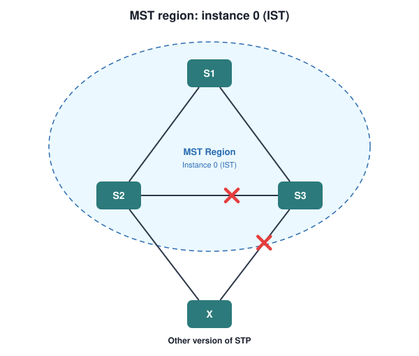
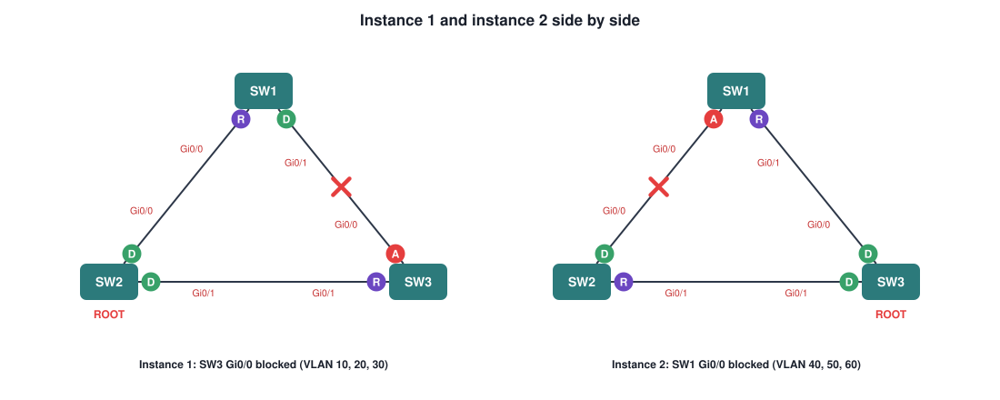

# Multiple Spanning-Tree (MST)

**한국어** | [English](README/01-Multiple-Spanning-Tree.en.md) | [日本語](README/01-Multiple-Spanning-Tree.ja.md) | [简体中文](README/01-Multiple-Spanning-Tree.zh-CN.md) | [Español](README/01-Multiple-Spanning-Tree.es.md) | [Français](README/01-Multiple-Spanning-Tree.fr.md)

Cisco Catalyst 스위치는 기본으로 **PVST+** 또는 **Rapid PVST+**(Per VLAN Spanning Tree)로 동작합니다. 즉 **VLAN 하나마다 spanning-tree 인스턴스가 하나씩** 만들어집니다. VLAN이 20개면 spanning-tree도 20개가 돕니다. 이 문서에서는 여러 VLAN을 하나의 인스턴스로 묶는 **MST(Multiple Spanning Tree)** 의 개념을 정리하고, 실습으로 설정과 동작을 확인합니다.

## 이번 실습에서 쓰는 명령어

| 명령어 | 용도 |
| --- | --- |
| `spanning-tree mode mst` | MST 켜기 |
| `spanning-tree mst configuration` | MST 설정 모드로 들어가기 |
| `name` / `revision` / `instance N vlan …` | region 이름, revision 번호, 인스턴스-VLAN 매핑 |
| `spanning-tree mst N priority P` | 인스턴스 N의 bridge priority 설정 |
| `show spanning-tree mst configuration` | region 설정과 매핑 확인 |
| `show spanning-tree mst [N]` | 인스턴스별 root bridge와 포트 역할 확인 |

---

## 1. PVST+의 문제: VLAN마다 계산한다

VLAN마다 spanning-tree를 따로 계산하는 것이 문제일까요? 늘 그렇듯 **상황에 따라 다릅니다.** 예를 들어 보겠습니다.

스위치 세 대에 VLAN이 많습니다. VLAN 100~300, 모두 **201개**입니다. PVST나 Rapid PVST를 쓰면 VLAN마다 한 번씩, **201번의 계산**을 합니다. CPU와 메모리를 많이 씁니다.

SW2가 VLAN 100~200의 root bridge이고, SW3가 VLAN 201~300의 root bridge라면 토폴로지는 이렇게 됩니다.

- **VLAN 100~200**: SW2가 root bridge입니다. SW1의 Gi0/1이나 SW3의 Gi0/0 중 하나가 차단됩니다. 계산은 100번 하지만 결과는 모두 **똑같습니다.**
- **VLAN 201~300**: SW3가 root bridge입니다. SW1이나 SW2의 Gi0/0 중 하나가 차단됩니다.

결과는 **두 가지뿐**인데, spanning-tree 인스턴스는 200개가 넘게 돌고 있습니다. CPU와 메모리 낭비입니다.

---

## 2. MST의 개념: 인스턴스와 region

**MST** 는 이 문제를 해결합니다. VLAN마다 spanning-tree를 계산하는 대신 **인스턴스(instance)** 를 만들고, VLAN을 인스턴스에 **매핑**합니다. 위 네트워크라면 이렇게 할 수 있습니다.

- Instance 1: VLAN 100~200
- Instance 2: VLAN 201~300

이렇게 하면 모든 VLAN에 대해 **계산은 두 번(인스턴스 2개)** 만 하면 됩니다.

### MST region

MST는 **region** 개념으로 동작합니다. MST를 쓰는 스위치는 이웃 스위치도 MST로 동작하는지 알아내야 합니다.

다음 속성이 **모두 같으면** 같은 region에 속합니다. region은 하나일 수도, 여러 개일 수도 있습니다.

| 속성 | 설명 |
| --- | --- |
| MST configuration name | region을 구분하는 이름입니다. 마음대로 정하면 됩니다. |
| MST configuration revision number | 역시 마음대로 정하는 숫자입니다. 설정을 바꿀 때마다 올려 쓰는 용도이고, region 안의 모든 스위치에서 같기만 하면 됩니다. |
| MST instance to VLAN mapping table | 어떤 VLAN을 어떤 인스턴스에 넣을지 정하는 표입니다. 직접 설정해야 합니다. |

속성이 다르면 그 스위치는 **region의 경계(boundary)** 에 있는 것으로 봅니다. 경계에서는 다른 MST region과 연결될 수도 있고, 다른 버전의 spanning-tree를 쓰는 스위치와 통신할 수도 있습니다.

### IST (Internal Spanning Tree)

region 안에서는 루프 없는 토폴로지를 만드는 **spanning-tree 인스턴스 하나**가 항상 있습니다. MST를 설정하면 region 안의 토폴로지를 계산하는 기본 인스턴스가 하나 생기는데, 이것을 **IST(Internal Spanning Tree)** 라고 부릅니다. Cisco는 기본으로 **instance 0** 을 IST로 쓰고, IST는 **rapid spanning-tree** 로 동작합니다.

여기에 instance 1(VLAN 100~200)과 instance 2(VLAN 201~300)를 만들 수 있습니다. 인스턴스마다 어느 스위치가 root bridge가 되느냐에 따라 **차단되는 포트가 달라집니다.**

region 밖의 스위치는 region 안이 어떻게 생겼는지 모릅니다. 바깥 스위치에게 MST region은 **큰 스위치 한 대**, 즉 '블랙박스'처럼 보입니다.

> MST와 PVST+가 함께 동작하는 자세한 방식은 [02. MST and PVST+ Interoperability](../02-MST-and-PVST-Interoperability/02-MST-and-PVST-Interoperability.md) 에서 정리합니다.

---

## 3. MST 설정

다음 토폴로지로 실습합니다.

region 하나를 다음 속성으로 만듭니다.

- MST configuration name: **NETWORKLESSONS**
- MST configuration revision number: **1** (임의로 정한 숫자)
- 인스턴스-VLAN 매핑: **Instance 1** = VLAN 10, 20, 30 / **Instance 2** = VLAN 40, 50, 60

먼저 세 스위치 모두 MST를 켭니다.

기본 MST 인스턴스를 확인합니다.

`show spanning-tree mst configuration` 으로 MST 인스턴스를 볼 수 있습니다. 아직 인스턴스를 만들지 않아서 **instance 0** 만 있고, 모든 VLAN(1-4094)이 instance 0에 매핑되어 있습니다.

`show spanning-tree mst` 로도 VLAN 매핑과 root bridge 정보를 볼 수 있습니다. 인스턴스를 더 만들기 전에 준비 작업을 합니다. 스위치 사이의 링크를 trunk로 설정합니다.

VLAN 10~60을 만듭니다.

이제 MST와 인스턴스를 설정합니다.

`spanning-tree mst configuration` 으로 MST 설정 모드에 들어가서, `name` 으로 이름을 정하고 `revision` 번호를 지정한 뒤 `instance` 명령으로 VLAN을 인스턴스에 매핑합니다. 결과를 확인합니다.

이제 인스턴스가 3개(0, 1, 2)입니다. VLAN 10, 20, 30은 instance 1, VLAN 40, 50, 60은 instance 2에 매핑되었고, **나머지 VLAN은 모두 instance 0** 에 남아 있습니다.

---

## 4. 인스턴스별 root bridge 바꾸기

### Instance 0 (IST): SW1을 root bridge로

SW1이 region 안의 root bridge가 되도록 **IST(instance 0)** 의 priority를 바꿉니다.

확인합니다.

SW1이 IST의 root bridge입니다. 출력에는 **CIST**(Common and Internal Spanning Tree)라고 나옵니다. 인터페이스를 봅니다.

모든 인터페이스의 상태를 알았으니 IST를 그림으로 그려 보겠습니다.

### Instance 1: SW2를 root bridge로

이번에는 instance 1에서 **SW2** 가 root bridge가 되도록 SW2의 priority를 바꿉니다.

SW2가 instance 1의 root bridge가 된 것을 확인합니다.

인터페이스를 봅니다.

instance 1의 포트 역할을 그림으로 그리면 다음과 같습니다. **instance 0과 토폴로지가 다릅니다.**

### Instance 2: SW3를 root bridge로

마지막으로 instance 2에서 **SW3** 가 root bridge가 되도록 바꿉니다.

SW3가 instance 2의 root bridge가 되었습니다.

인터페이스를 봅니다.

instance 2의 토폴로지입니다.

instance 1과 2를 나란히 놓고 비교해 보겠습니다.

인스턴스마다 root bridge를 다르게 정하면 **토폴로지가 달라집니다.**

- **Instance 1**: SW3의 Gi0/0이 VLAN 10, 20, 30에 대해 차단됩니다.
- **Instance 2**: SW1의 Gi0/0이 VLAN 40, 50, 60에 대해 차단됩니다.

---

## 5. PVST 스위치를 추가하면?

PVST로 동작하는 스위치 SW4를 토폴로지에 추가하면 어떻게 될까요?

SW2와 SW3의 Gi0/2를 trunk로 설정합니다.

SW4의 Gi0/0과 Gi0/1도 trunk로 설정합니다.

Cisco 스위치의 기본 spanning-tree 모드는 **PVST** 라서 따로 바꿀 필요가 없습니다.

SW4에 VLAN 10~60을 추가합니다.

SW2, SW3와 trunk가 연결되었고 SW4가 모든 VLAN을 알고 있습니다. 이제 SW4가 보는 토폴로지를 확인합니다. 먼저 **VLAN 1** (instance 0에 매핑)입니다.

SW4는 **SW1**(503e.ac00.0200)을 root bridge로 봅니다. Gi0/0이 Forwarding(Root), Gi0/1이 Blocking(Alternate)입니다.

다음은 instance 1에 매핑된 **VLAN 10** 입니다.

instance 1의 root bridge는 SW2로 설정했지만, SW4는 VLAN 10에서도 **SW1** 을 root bridge로 봅니다. 정상입니다. MST는 region 밖으로 **IST의 BPDU만** 내보내기 때문에, SW4는 instance 1이나 instance 2의 정보를 볼 수 없습니다.

> 원문(NetworkLessons)은 VLAN 10에서 SW4가 SW2를 root로 본다고 적었지만, 실습 출력의 Root ID 주소는 SW1(503e.ac00.0200)입니다. 이 문서는 실습 출력을 기준으로 적었습니다.

instance 2에 매핑된 **VLAN 40** 도 확인합니다.

VLAN 40도 instance 2(root bridge SW3)에 속하지만, SW4는 역시 **SW1** 을 root bridge로 봅니다. SW4는 **모든 VLAN에 대해 같은 BPDU** 를 받습니다.

---

## 핵심 정리

- **PVST+ / Rapid PVST+** 는 VLAN마다 spanning-tree를 하나씩 계산합니다. VLAN이 많으면 결과가 같아도 CPU와 메모리를 낭비합니다.
- **MST** 는 VLAN을 **인스턴스**에 매핑해서, 인스턴스 수만큼만 계산합니다.
- **name, revision 번호, 인스턴스-VLAN 매핑** 이 모두 같은 스위치끼리 같은 **region** 이 됩니다. 하나라도 다르면 region 경계입니다.
- region 안에는 항상 **IST(instance 0)** 가 있고, rapid spanning-tree로 동작합니다. 출력에는 **CIST** 로 표시됩니다.
- `spanning-tree mst N priority P` 로 인스턴스마다 root bridge를 다르게 정하면 인스턴스마다 다른 포트가 차단되어 **부하 분산**이 됩니다.
- region 밖에서는 region 전체가 **스위치 한 대**처럼 보이고, 바깥으로는 **IST의 BPDU만** 나갑니다. 그래서 PVST 스위치는 모든 VLAN에서 IST의 root bridge를 봅니다.
