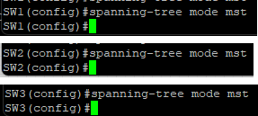
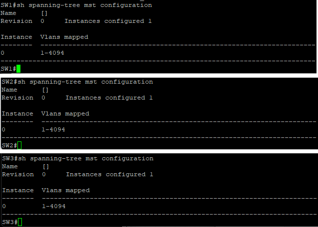
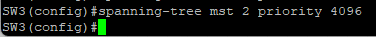
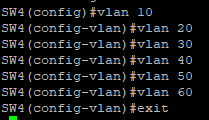
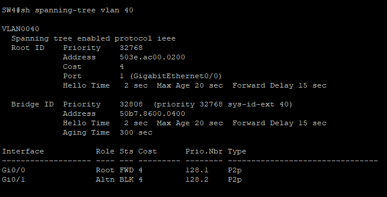

# Multiple Spanning-Tree (MST)

[한국어](../01-Multiple-Spanning-Tree.md) | **English** | [日本語](01-Multiple-Spanning-Tree.ja.md) | [简体中文](01-Multiple-Spanning-Tree.zh-CN.md) | [Español](01-Multiple-Spanning-Tree.es.md) | [Français](01-Multiple-Spanning-Tree.fr.md)

By default, Cisco Catalyst switches run **PVST+** or **Rapid PVST+** (Per VLAN Spanning Tree). That means **each VLAN gets its own spanning-tree instance**. With 20 VLANs, 20 spanning trees are running. This page explains **MST (Multiple Spanning Tree)**, which groups many VLANs into one instance, and then checks its configuration and behavior in a lab.

## Commands used in this lab

| Command | Purpose |
| --- | --- |
| `spanning-tree mode mst` | Turn on MST |
| `spanning-tree mst configuration` | Enter MST configuration mode |
| `name` / `revision` / `instance N vlan …` | Region name, revision number, instance-to-VLAN mapping |
| `spanning-tree mst N priority P` | Set the bridge priority for instance N |
| `show spanning-tree mst configuration` | Check the region settings and mapping |
| `show spanning-tree mst [N]` | Check the root bridge and port roles per instance |

---

## 1. The problem with PVST+: one calculation per VLAN

Is calculating a spanning tree per VLAN a problem? As always, **it depends.** Let's look at an example.

We have three switches and a lot of VLANs: VLAN 100–300, **201 in total**. With PVST or Rapid PVST, there is one calculation per VLAN — **201 calculations**. That takes a lot of CPU power and memory.

If SW2 is the root bridge for VLAN 100–200 and SW3 for VLAN 201–300, the topologies look like this:

- **VLAN 100–200**: SW2 is the root bridge. Either Gi0/1 on SW1 or Gi0/0 on SW3 is blocked. There are 100 calculations, but the results are all **the same**.
- **VLAN 201–300**: SW3 is the root bridge. Gi0/0 on SW1 or SW2 is blocked.

There are **only two outcomes**, yet more than 200 spanning-tree instances are running. That's a waste of CPU cycles and memory.

---

## 2. MST concepts: instances and regions

**MST** solves this. Instead of calculating a spanning tree for each VLAN, we create **instances** and **map** VLANs to them. For the network above we could do this:

- Instance 1: VLAN 100–200
- Instance 2: VLAN 201–300

Now only **two calculations (two instances)** are needed for all these VLANs.

### MST regions

MST works with the concept of **regions**. Switches running MST need to find out whether their neighbors are running MST too.

Switches end up in the same region when **all** of these attributes match. You can have one region or several.

| Attribute | Description |
| --- | --- |
| MST configuration name | A name that identifies the region. You can make it up. |
| MST configuration revision number | Also a number you make up. The idea is to change it whenever you change the configuration; it just has to be the same on every switch in the region. |
| MST instance to VLAN mapping table | The table that decides which VLAN goes into which instance. You configure it yourself. |

If the attributes differ, the switch is seen as being at the **region boundary**. At the boundary it can connect to another MST region or talk to a switch running another version of spanning tree.

### IST (Internal Spanning Tree)

Inside a region there is always **one spanning-tree instance** that builds a loop-free topology. When you configure MST, there is always a default instance that calculates the topology inside the region; it is called the **IST (Internal Spanning Tree)**. By default Cisco uses **instance 0** for the IST, and the IST runs **rapid spanning tree**.

On top of that we can create instance 1 (VLAN 100–200) and instance 2 (VLAN 201–300). Depending on which switch becomes the root bridge for each instance, **a different port is blocked**.

A switch outside the region doesn't see what the region looks like inside. To the outside switch, the MST region looks like **one big switch** — a "black box".

> How MST and PVST+ work together in detail is covered in [02. MST and PVST+ Interoperability](../../02-MST-and-PVST-Interoperability/README/02-MST-and-PVST-Interoperability.en.md).

---

## 3. MST configuration

We'll use this topology for the lab.

We create one region with these attributes:

- MST configuration name: **NETWORKLESSONS**
- MST configuration revision number: **1** (just a number I made up)
- Instance-to-VLAN mapping: **Instance 1** = VLAN 10, 20, 30 / **Instance 2** = VLAN 40, 50, 60

First, enable MST on all three switches.

Let's look at the default MST instance.

`show spanning-tree mst configuration` shows the MST instances. We haven't created any yet, so only **instance 0** exists, and every VLAN (1-4094) is mapped to instance 0.

`show spanning-tree mst` also shows the VLAN mapping and the root bridge. Before adding instances we do the chores: configure the links between the switches as trunks.

Create VLANs 10–60.

Now configure MST and the instances.

`spanning-tree mst configuration` enters MST configuration mode; `name` sets the name, `revision` sets the revision number, and the `instance` command maps VLANs to instances. Let's verify.

There are now three instances (0, 1, 2). VLANs 10, 20, 30 are mapped to instance 1 and VLANs 40, 50, 60 to instance 2; **all other VLANs stay in instance 0**.

---

## 4. Changing the root bridge per instance

### Instance 0 (IST): SW1 as root bridge

To make SW1 the root bridge inside the region, change the priority for the **IST (instance 0)**.

Let's verify.

SW1 is the root bridge for the IST. The output says **CIST** (Common and Internal Spanning Tree). Let's look at the interfaces.

Now that we know the state of every interface, let's draw the IST.

### Instance 1: SW2 as root bridge

Next, change the priority on SW2 so that **SW2** becomes the root bridge for instance 1.

This confirms that SW2 is the root bridge for instance 1.

Let's look at the interfaces.

Here are the port roles for instance 1. **The topology differs from instance 0.**

### Instance 2: SW3 as root bridge

Finally, make **SW3** the root bridge for instance 2.

SW3 is now the root bridge for instance 2.

Let's look at the interfaces.

Here is the topology for instance 2.

Let's put instances 1 and 2 side by side.

By choosing a different root bridge per instance, we end up with **different topologies**:

- **Instance 1**: Gi0/0 on SW3 is blocked for VLAN 10, 20 and 30.
- **Instance 2**: Gi0/0 on SW1 is blocked for VLAN 40, 50 and 60.

---

## 5. What if we add a PVST switch?

What happens when we add SW4, which runs PVST, to the topology?

Configure Gi0/2 on SW2 and SW3 as trunks.

Configure Gi0/0 and Gi0/1 on SW4 as trunks too.

**PVST** is the default spanning-tree mode on Cisco switches, so we don't have to change it.

Add VLANs 10–60 on SW4.

The trunks to SW2 and SW3 are up and SW4 knows all the VLANs. Let's see what SW4 thinks of the topology, starting with **VLAN 1** (mapped to instance 0).

SW4 sees **SW1** (503e.ac00.0200) as the root bridge. Gi0/0 is forwarding (root) and Gi0/1 is blocking (alternate).

Next is **VLAN 10**, mapped to instance 1.

We made SW2 the root bridge for instance 1, yet SW4 still sees **SW1** as the root bridge for VLAN 10. This is perfectly normal: MST only advertises **the IST's BPDUs** outside the region, so SW4 never sees anything about instance 1 or instance 2.

> The original (NetworkLessons) text says SW4 sees SW2 as the root for VLAN 10, but the Root ID address in the lab output is SW1 (503e.ac00.0200). This page follows the lab output.

Let's also check **VLAN 40**, mapped to instance 2.

VLAN 40 belongs to instance 2 (root bridge SW3), but SW4 again sees **SW1** as the root bridge. SW4 receives **the same BPDU for every VLAN**.

---

## Summary

- **PVST+ / Rapid PVST+** calculate one spanning tree per VLAN. With many VLANs this wastes CPU and memory even when the results are identical.
- **MST** maps VLANs to **instances** and only calculates as many trees as there are instances.
- Switches with the same **name, revision number and instance-to-VLAN mapping** form one **region**; if any of them differs, it's a region boundary.
- Every region always has the **IST (instance 0)**, which runs rapid spanning tree and shows up as **CIST** in the output.
- With `spanning-tree mst N priority P` you can pick a different root bridge per instance, so each instance blocks a different port — **load balancing**.
- From outside, the whole region looks like **one switch**, and **only IST BPDUs** leave the region. That's why a PVST switch sees the IST root bridge for every VLAN.
