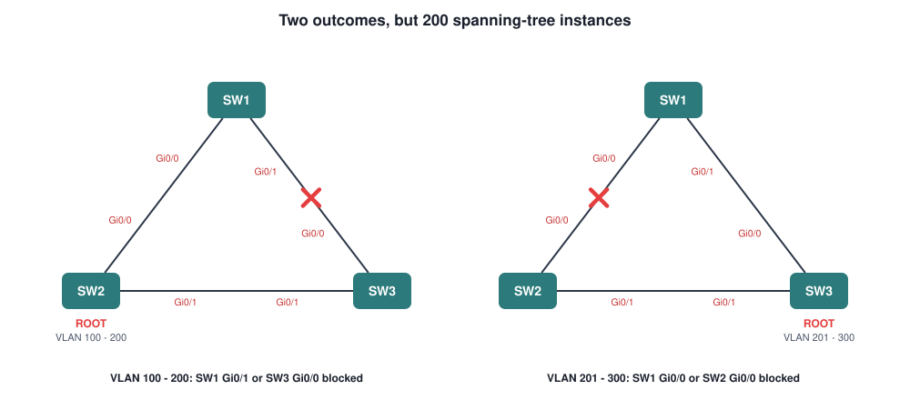
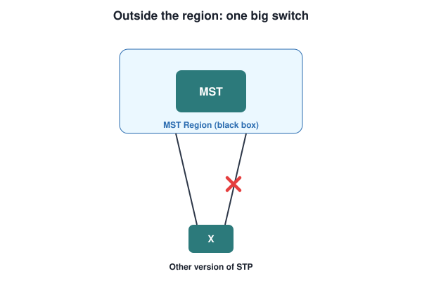
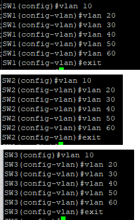
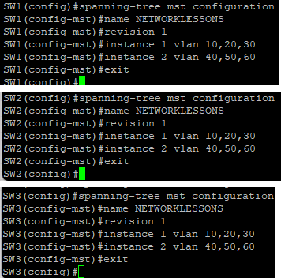
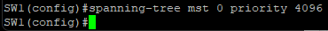
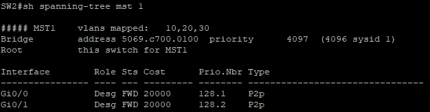
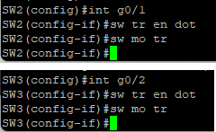
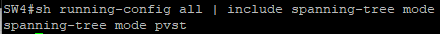
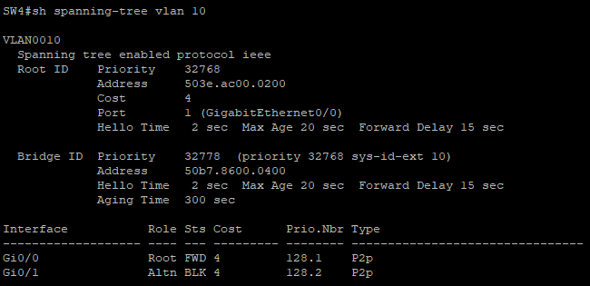

# Multiple Spanning-Tree (MST)

[한국어](../01-Multiple-Spanning-Tree.md) | [English](01-Multiple-Spanning-Tree.en.md) | [日本語](01-Multiple-Spanning-Tree.ja.md) | [简体中文](01-Multiple-Spanning-Tree.zh-CN.md) | **Español** | [Français](01-Multiple-Spanning-Tree.fr.md)

Por defecto, los switches Cisco Catalyst ejecutan **PVST+** o **Rapid PVST+** (Per VLAN Spanning Tree). Esto significa que **cada VLAN tiene su propia instancia de spanning-tree**. Con 20 VLAN hay 20 spanning trees funcionando. Esta página explica **MST (Multiple Spanning Tree)**, que agrupa muchas VLAN en una sola instancia, y después comprueba su configuración y funcionamiento en un laboratorio.

## Comandos usados en este laboratorio

| Comando | Uso |
| --- | --- |
| `spanning-tree mode mst` | Activar MST |
| `spanning-tree mst configuration` | Entrar en el modo de configuración de MST |
| `name` / `revision` / `instance N vlan …` | Nombre de la región, número de revisión, asignación de VLAN a instancias |
| `spanning-tree mst N priority P` | Fijar la bridge priority de la instancia N |
| `show spanning-tree mst configuration` | Ver la configuración de la región y la asignación |
| `show spanning-tree mst [N]` | Ver el root bridge y los roles de puerto por instancia |

---

## 1. El problema de PVST+: un cálculo por VLAN

¿Es un problema calcular un spanning tree por VLAN? Como siempre, **depende.** Veamos un ejemplo.

Tenemos tres switches y muchas VLAN: de la VLAN 100 a la 300, **201 en total**. Con PVST o Rapid PVST hay un cálculo por VLAN: **201 cálculos**. Eso consume mucha CPU y memoria.

Si SW2 es el root bridge de las VLAN 100–200 y SW3 el de las VLAN 201–300, las topologías quedan así:

- **VLAN 100–200**: SW2 es el root bridge. Se bloquea Gi0/1 en SW1 o Gi0/0 en SW3. Hay 100 cálculos, pero todos dan **el mismo** resultado.
- **VLAN 201–300**: SW3 es el root bridge. Se bloquea Gi0/0 en SW1 o en SW2.

Hay **solo dos resultados**, pero funcionan más de 200 instancias de spanning-tree. Es un desperdicio de ciclos de CPU y de memoria.

---

## 2. Conceptos de MST: instancias y regiones

**MST** resuelve esto. En lugar de calcular un spanning tree por VLAN, creamos **instancias** y **asignamos** las VLAN a ellas. Para la red anterior podríamos hacer esto:

- Instance 1: VLAN 100–200
- Instance 2: VLAN 201–300

Así solo hacen falta **dos cálculos (dos instancias)** para todas esas VLAN.

### Regiones MST

MST funciona con el concepto de **regiones**. Los switches que ejecutan MST necesitan saber si sus vecinos también ejecutan MST.

Los switches quedan en la misma región cuando coinciden **todos** estos atributos. Puede haber una región o varias.

| Atributo | Descripción |
| --- | --- |
| MST configuration name | Un nombre que identifica la región. Puedes inventarlo. |
| MST configuration revision number | También es un número inventado. La idea es cambiarlo cada vez que cambias la configuración; solo tiene que ser igual en todos los switches de la región. |
| MST instance to VLAN mapping table | La tabla que decide qué VLAN va en qué instancia. La configuras tú. |

Si los atributos no coinciden, el switch se considera en el **límite de la región (boundary)**. En el límite puede conectarse a otra región MST o hablar con un switch que ejecuta otra versión de spanning tree.

### IST (Internal Spanning Tree)

Dentro de una región siempre hay **una instancia de spanning-tree** que construye una topología sin bucles. Al configurar MST siempre existe una instancia predeterminada que calcula la topología dentro de la región; se llama **IST (Internal Spanning Tree)**. Por defecto Cisco usa la **instance 0** para la IST, y la IST ejecuta **rapid spanning tree**.

Además podemos crear la instance 1 (VLAN 100–200) y la instance 2 (VLAN 201–300). Según qué switch sea el root bridge de cada instancia, **se bloquea un puerto distinto**.

Un switch fuera de la región no ve cómo es la región por dentro. Para él, la región MST parece **un gran switch**, una "caja negra".

> Cómo funcionan juntos MST y PVST+ en detalle se explica en [02. MST and PVST+ Interoperability](../../02-MST-and-PVST-Interoperability/README/02-MST-and-PVST-Interoperability.es.md).

---

## 3. Configuración de MST

Usaremos esta topología para el laboratorio.

Creamos una región con estos atributos:

- MST configuration name: **NETWORKLESSONS**
- MST configuration revision number: **1** (un número inventado)
- Asignación de VLAN a instancias: **Instance 1** = VLAN 10, 20, 30 / **Instance 2** = VLAN 40, 50, 60

Primero activamos MST en los tres switches.

Veamos la instancia MST predeterminada.

`show spanning-tree mst configuration` muestra las instancias MST. Todavía no hemos creado ninguna, así que solo existe la **instance 0**, y todas las VLAN (1-4094) están asignadas a ella.

`show spanning-tree mst` también muestra la asignación de VLAN y el root bridge. Antes de añadir instancias hacemos las tareas previas: configurar como trunk los enlaces entre los switches.

Creamos las VLAN 10–60.

Ahora configuramos MST y las instancias.

`spanning-tree mst configuration` entra en el modo de configuración de MST; `name` fija el nombre, `revision` el número de revisión y el comando `instance` asigna las VLAN a las instancias. Lo comprobamos.

Ahora hay tres instancias (0, 1, 2). Las VLAN 10, 20, 30 están en la instance 1 y las VLAN 40, 50, 60 en la instance 2; **todas las demás VLAN siguen en la instance 0**.

---

## 4. Cambiar el root bridge por instancia

### Instance 0 (IST): SW1 como root bridge

Para que SW1 sea el root bridge dentro de la región, cambiamos la priority de la **IST (instance 0)**.

Lo comprobamos.

SW1 es el root bridge de la IST. La salida dice **CIST** (Common and Internal Spanning Tree). Veamos las interfaces.

Ya conocemos el estado de todas las interfaces; dibujemos la IST.

### Instance 1: SW2 como root bridge

Ahora cambiamos la priority en SW2 para que **SW2** sea el root bridge de la instance 1.

Esto confirma que SW2 es el root bridge de la instance 1.

Veamos las interfaces.

Estos son los roles de puerto de la instance 1. **La topología es distinta de la de la instance 0.**

### Instance 2: SW3 como root bridge

Por último, hacemos que **SW3** sea el root bridge de la instance 2.

SW3 es ahora el root bridge de la instance 2.

Veamos las interfaces.

Esta es la topología de la instance 2.

Pongamos las instancias 1 y 2 una al lado de la otra.

Al elegir un root bridge distinto por instancia, obtenemos **topologías distintas**:

- **Instance 1**: Gi0/0 en SW3 se bloquea para las VLAN 10, 20 y 30.
- **Instance 2**: Gi0/0 en SW1 se bloquea para las VLAN 40, 50 y 60.

---

## 5. ¿Y si añadimos un switch con PVST?

¿Qué ocurre si añadimos a la topología SW4, que ejecuta PVST?

Configuramos Gi0/2 en SW2 y SW3 como trunk.

También configuramos Gi0/0 y Gi0/1 de SW4 como trunk.

**PVST** es el modo de spanning-tree por defecto en los switches Cisco, así que no hay que cambiarlo.

Añadimos las VLAN 10–60 en SW4.

Los trunks hacia SW2 y SW3 están activos y SW4 conoce todas las VLAN. Veamos qué piensa SW4 de la topología, empezando por la **VLAN 1** (asignada a la instance 0).

SW4 ve a **SW1** (503e.ac00.0200) como root bridge. Gi0/0 está en forwarding (Root) y Gi0/1 en blocking (Alternate).

Ahora la **VLAN 10**, asignada a la instance 1.

Hicimos a SW2 root bridge de la instance 1, pero SW4 sigue viendo a **SW1** como root bridge de la VLAN 10. Es totalmente normal: MST solo anuncia **las BPDU de la IST** fuera de la región, así que SW4 no ve nada de la instance 1 ni de la instance 2.

> El texto original (NetworkLessons) dice que SW4 ve a SW2 como root de la VLAN 10, pero la dirección del Root ID en la salida del laboratorio es SW1 (503e.ac00.0200). Esta página sigue la salida del laboratorio.

Comprobemos también la **VLAN 40**, asignada a la instance 2.

La VLAN 40 pertenece a la instance 2 (root bridge SW3), pero SW4 vuelve a ver a **SW1** como root bridge. SW4 recibe **la misma BPDU para todas las VLAN**.

---

## Resumen

- **PVST+ / Rapid PVST+** calculan un spanning tree por VLAN. Con muchas VLAN se desperdician CPU y memoria aunque los resultados sean idénticos.
- **MST** asigna las VLAN a **instancias** y solo calcula tantos árboles como instancias haya.
- Los switches con el mismo **nombre, número de revisión y asignación de VLAN a instancias** forman una **región**; si alguno difiere, es un límite de región.
- Toda región tiene siempre la **IST (instance 0)**, que ejecuta rapid spanning tree y aparece como **CIST** en la salida.
- Con `spanning-tree mst N priority P` se puede elegir un root bridge distinto por instancia, de modo que cada instancia bloquee un puerto diferente: **equilibrio de carga**.
- Desde fuera, toda la región parece **un solo switch**, y **solo las BPDU de la IST** salen de la región. Por eso un switch PVST ve el root bridge de la IST en todas las VLAN.
