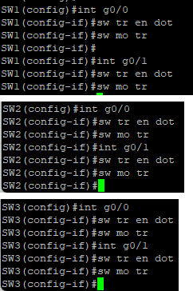
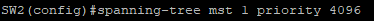
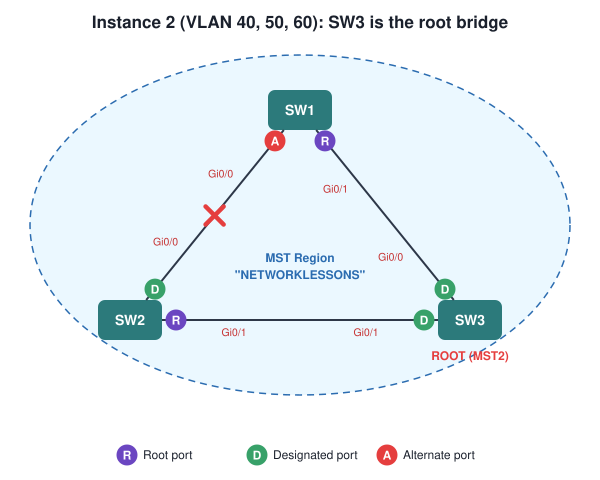
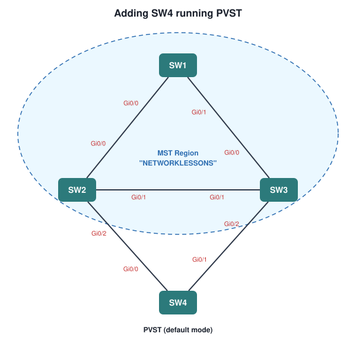
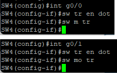

# Multiple Spanning-Tree (MST)

[한국어](../01-Multiple-Spanning-Tree.md) | [English](01-Multiple-Spanning-Tree.en.md) | [日本語](01-Multiple-Spanning-Tree.ja.md) | [简体中文](01-Multiple-Spanning-Tree.zh-CN.md) | [Español](01-Multiple-Spanning-Tree.es.md) | **Français**

Par défaut, les commutateurs Cisco Catalyst exécutent **PVST+** ou **Rapid PVST+** (Per VLAN Spanning Tree). Cela signifie que **chaque VLAN a sa propre instance de spanning-tree**. Avec 20 VLAN, 20 spanning trees tournent. Cette page présente **MST (Multiple Spanning Tree)**, qui regroupe plusieurs VLAN dans une seule instance, puis vérifie sa configuration et son fonctionnement en labo.

## Commandes utilisées dans ce labo

| Commande | Usage |
| --- | --- |
| `spanning-tree mode mst` | Activer MST |
| `spanning-tree mst configuration` | Entrer dans le mode de configuration MST |
| `name` / `revision` / `instance N vlan …` | Nom de la région, numéro de révision, correspondance VLAN-instances |
| `spanning-tree mst N priority P` | Définir la bridge priority de l'instance N |
| `show spanning-tree mst configuration` | Vérifier les paramètres de la région et la correspondance |
| `show spanning-tree mst [N]` | Vérifier le root bridge et les rôles de port par instance |

---

## 1. Le problème de PVST+ : un calcul par VLAN

Calculer un spanning tree par VLAN, est-ce un problème ? Comme toujours, **cela dépend.** Prenons un exemple.

Nous avons trois commutateurs et beaucoup de VLAN : de la VLAN 100 à la 300, **201 au total**. Avec PVST ou Rapid PVST, il y a un calcul par VLAN, soit **201 calculs**. Cela consomme beaucoup de CPU et de mémoire.

Si SW2 est le root bridge des VLAN 100–200 et SW3 celui des VLAN 201–300, les topologies sont les suivantes :

- **VLAN 100–200** : SW2 est le root bridge. Gi0/1 sur SW1 ou Gi0/0 sur SW3 est bloqué. Il y a 100 calculs, mais les résultats sont tous **identiques**.
- **VLAN 201–300** : SW3 est le root bridge. Gi0/0 sur SW1 ou sur SW2 est bloqué.

Il n'y a **que deux résultats**, et pourtant plus de 200 instances de spanning-tree tournent. C'est du gaspillage de cycles CPU et de mémoire.

---

## 2. Concepts de MST : instances et régions

**MST** résout ce problème. Au lieu de calculer un spanning tree par VLAN, on crée des **instances** et on y **associe** les VLAN. Pour le réseau ci-dessus, on pourrait faire ceci :

- Instance 1 : VLAN 100–200
- Instance 2 : VLAN 201–300

Il ne faut plus que **deux calculs (deux instances)** pour toutes ces VLAN.

### Régions MST

MST fonctionne avec la notion de **région**. Les commutateurs qui exécutent MST doivent savoir si leurs voisins exécutent aussi MST.

Les commutateurs se retrouvent dans la même région quand **tous** ces attributs correspondent. Il peut y avoir une ou plusieurs régions.

| Attribut | Description |
| --- | --- |
| MST configuration name | Un nom qui identifie la région. Vous pouvez l'inventer. |
| MST configuration revision number | Un numéro inventé lui aussi. L'idée est de le changer à chaque modification de la configuration ; il doit seulement être identique sur tous les commutateurs de la région. |
| MST instance to VLAN mapping table | La table qui décide quelle VLAN va dans quelle instance. Vous la configurez vous-même. |

Si les attributs diffèrent, le commutateur est considéré comme situé à la **limite de la région (boundary)**. À la limite, il peut se connecter à une autre région MST ou dialoguer avec un commutateur qui exécute une autre version de spanning tree.

### IST (Internal Spanning Tree)

Dans une région, il y a toujours **une instance de spanning-tree** qui construit une topologie sans boucle. Quand on configure MST, il existe toujours une instance par défaut qui calcule la topologie dans la région : on l'appelle l'**IST (Internal Spanning Tree)**. Par défaut, Cisco utilise l'**instance 0** pour l'IST, et l'IST exécute **rapid spanning tree**.

On peut en plus créer l'instance 1 (VLAN 100–200) et l'instance 2 (VLAN 201–300). Selon le commutateur qui devient root bridge de chaque instance, **un port différent est bloqué**.

Un commutateur hors de la région ne voit pas à quoi ressemble la région de l'intérieur. Pour lui, la région MST ressemble à **un seul gros commutateur**, une « boîte noire ».

> Le fonctionnement détaillé de MST avec PVST+ est expliqué dans [02. MST and PVST+ Interoperability](../../02-MST-and-PVST-Interoperability/README/02-MST-and-PVST-Interoperability.fr.md).

---

## 3. Configuration de MST

Nous utilisons cette topologie pour le labo.

Nous créons une région avec ces attributs :

- MST configuration name : **NETWORKLESSONS**
- MST configuration revision number : **1** (un numéro inventé)
- Correspondance VLAN-instances : **Instance 1** = VLAN 10, 20, 30 / **Instance 2** = VLAN 40, 50, 60

D'abord, activons MST sur les trois commutateurs.

Regardons l'instance MST par défaut.

`show spanning-tree mst configuration` affiche les instances MST. Nous n'en avons encore créé aucune, donc seule l'**instance 0** existe, et toutes les VLAN (1-4094) lui sont associées.

`show spanning-tree mst` affiche aussi la correspondance des VLAN et le root bridge. Avant d'ajouter des instances, faisons le travail préparatoire : configurer en trunk les liens entre les commutateurs.

Créons les VLAN 10 à 60.

Configurons maintenant MST et les instances.

`spanning-tree mst configuration` permet d'entrer dans le mode de configuration MST ; `name` définit le nom, `revision` le numéro de révision, et la commande `instance` associe les VLAN aux instances. Vérifions.

Il y a maintenant trois instances (0, 1, 2). Les VLAN 10, 20, 30 sont dans l'instance 1 et les VLAN 40, 50, 60 dans l'instance 2 ; **toutes les autres VLAN restent dans l'instance 0**.

---

## 4. Changer le root bridge par instance

### Instance 0 (IST) : SW1 comme root bridge

Pour que SW1 soit le root bridge dans la région, modifions la priority de l'**IST (instance 0)**.

Vérifions.

SW1 est le root bridge de l'IST. La sortie indique **CIST** (Common and Internal Spanning Tree). Regardons les interfaces.

Nous connaissons maintenant l'état de toutes les interfaces ; dessinons l'IST.

### Instance 1 : SW2 comme root bridge

Ensuite, modifions la priority sur SW2 pour que **SW2** devienne le root bridge de l'instance 1.

Cela confirme que SW2 est le root bridge de l'instance 1.

Regardons les interfaces.

Voici les rôles de port de l'instance 1. **La topologie est différente de celle de l'instance 0.**

### Instance 2 : SW3 comme root bridge

Enfin, faisons de **SW3** le root bridge de l'instance 2.

SW3 est maintenant le root bridge de l'instance 2.

Regardons les interfaces.

Voici la topologie de l'instance 2.

Comparons les instances 1 et 2 côte à côte.

En choisissant un root bridge différent par instance, on obtient des **topologies différentes** :

- **Instance 1** : Gi0/0 sur SW3 est bloqué pour les VLAN 10, 20 et 30.
- **Instance 2** : Gi0/0 sur SW1 est bloqué pour les VLAN 40, 50 et 60.

---

## 5. Et si l'on ajoute un commutateur PVST ?

Que se passe-t-il si l'on ajoute à la topologie SW4, qui exécute PVST ?

Configurons Gi0/2 sur SW2 et SW3 en trunk.

Configurons aussi Gi0/0 et Gi0/1 de SW4 en trunk.

**PVST** est le mode spanning-tree par défaut des commutateurs Cisco, il n'y a donc rien à changer.

Ajoutons les VLAN 10 à 60 sur SW4.

Les trunks vers SW2 et SW3 sont actifs et SW4 connaît toutes les VLAN. Voyons ce que SW4 pense de la topologie, en commençant par la **VLAN 1** (associée à l'instance 0).

SW4 voit **SW1** (503e.ac00.0200) comme root bridge. Gi0/0 est en forwarding (Root) et Gi0/1 en blocking (Alternate).

Voici la **VLAN 10**, associée à l'instance 1.

Nous avons fait de SW2 le root bridge de l'instance 1, mais SW4 voit toujours **SW1** comme root bridge de la VLAN 10. C'est tout à fait normal : MST n'annonce que **les BPDU de l'IST** hors de la région, donc SW4 ne voit rien de l'instance 1 ni de l'instance 2.

> Le texte d'origine (NetworkLessons) indique que SW4 voit SW2 comme root de la VLAN 10, mais l'adresse du Root ID dans la sortie du labo est celle de SW1 (503e.ac00.0200). Cette page suit la sortie du labo.

Vérifions aussi la **VLAN 40**, associée à l'instance 2.

La VLAN 40 appartient à l'instance 2 (root bridge SW3), mais SW4 voit encore **SW1** comme root bridge. SW4 reçoit **la même BPDU pour toutes les VLAN**.

---

## Résumé

- **PVST+ / Rapid PVST+** calculent un spanning tree par VLAN. Avec beaucoup de VLAN, on gaspille CPU et mémoire même quand les résultats sont identiques.
- **MST** associe les VLAN à des **instances** et ne calcule qu'autant d'arbres qu'il y a d'instances.
- Les commutateurs ayant les mêmes **nom, numéro de révision et correspondance VLAN-instances** forment une **région** ; si l'un d'eux diffère, c'est une limite de région.
- Chaque région a toujours l'**IST (instance 0)**, qui exécute rapid spanning tree et apparaît comme **CIST** dans la sortie.
- Avec `spanning-tree mst N priority P`, on peut choisir un root bridge différent par instance, si bien que chaque instance bloque un port différent : c'est la **répartition de charge**.
- Vue de l'extérieur, toute la région ressemble à **un seul commutateur**, et **seules les BPDU de l'IST** sortent de la région. C'est pourquoi un commutateur PVST voit le root bridge de l'IST dans toutes les VLAN.
