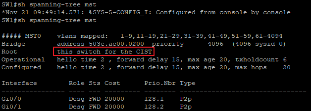
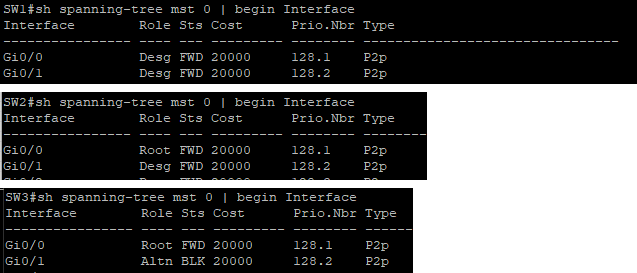
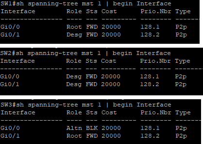
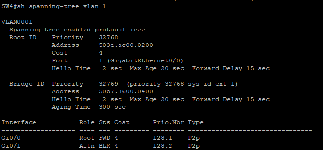

# Multiple Spanning-Tree (MST)

[한국어](../01-Multiple-Spanning-Tree.md) | [English](01-Multiple-Spanning-Tree.en.md) | **日本語** | [简体中文](01-Multiple-Spanning-Tree.zh-CN.md) | [Español](01-Multiple-Spanning-Tree.es.md) | [Français](01-Multiple-Spanning-Tree.fr.md)

Cisco Catalyst スイッチは、既定で **PVST+** または **Rapid PVST+**（Per VLAN Spanning Tree）で動作します。つまり **VLAN ごとに spanning-tree インスタンスが 1 つずつ**作られます。VLAN が 20 個あれば、spanning-tree も 20 個動きます。このページでは、複数の VLAN を 1 つのインスタンスにまとめる **MST（Multiple Spanning Tree）** の概念を整理し、実習で設定と動作を確認します。

## この実習で使うコマンド

| コマンド | 用途 |
| --- | --- |
| `spanning-tree mode mst` | MST を有効にする |
| `spanning-tree mst configuration` | MST 設定モードに入る |
| `name` / `revision` / `instance N vlan …` | region 名、revision 番号、インスタンスと VLAN の対応付け |
| `spanning-tree mst N priority P` | インスタンス N の bridge priority を設定 |
| `show spanning-tree mst configuration` | region の設定と対応付けを確認 |
| `show spanning-tree mst [N]` | インスタンスごとの root bridge とポートの役割を確認 |

---

## 1. PVST+ の問題: VLAN ごとに計算する

VLAN ごとに spanning-tree を計算するのは問題でしょうか？ いつものとおり、**状況しだい**です。例を見てみましょう。

スイッチが 3 台あり、VLAN がたくさんあります。VLAN 100〜300、全部で **201 個**です。PVST や Rapid PVST では VLAN ごとに 1 回、つまり **201 回の計算**を行います。CPU とメモリを多く使います。

SW2 が VLAN 100〜200 の root bridge、SW3 が VLAN 201〜300 の root bridge なら、トポロジーは次のようになります。

- **VLAN 100〜200**: SW2 が root bridge です。SW1 の Gi0/1 か SW3 の Gi0/0 のどちらかがブロックされます。計算は 100 回しますが、結果はすべて**同じ**です。
- **VLAN 201〜300**: SW3 が root bridge です。SW1 か SW2 の Gi0/0 がブロックされます。

結果は **2 通りだけ**なのに、spanning-tree インスタンスは 200 個以上動いています。CPU とメモリの無駄です。

---

## 2. MST の概念: インスタンスと region

**MST** はこの問題を解決します。VLAN ごとに spanning-tree を計算する代わりに**インスタンス（instance）** を作り、VLAN をインスタンスに**対応付け（マッピング）** します。上のネットワークなら、次のようにできます。

- Instance 1: VLAN 100〜200
- Instance 2: VLAN 201〜300

こうすれば、すべての VLAN に対して**計算は 2 回（インスタンス 2 つ）** だけで済みます。

### MST region

MST は **region** という概念で動作します。MST を使うスイッチは、隣のスイッチも MST で動作しているかを知る必要があります。

次の属性が**すべて同じ**なら、同じ region に属します。region は 1 つでも、複数でもかまいません。

| 属性 | 説明 |
| --- | --- |
| MST configuration name | region を識別する名前です。自由に決めてかまいません。 |
| MST configuration revision number | これも自由に決める番号です。設定を変えるたびに上げる用途で、region 内のすべてのスイッチで同じでさえあれば問題ありません。 |
| MST instance to VLAN mapping table | どの VLAN をどのインスタンスに入れるかを決める表です。自分で設定する必要があります。 |

属性が違うと、そのスイッチは **region の境界（boundary）** にあるとみなされます。境界では別の MST region とつながることも、別のバージョンの spanning-tree を使うスイッチと通信することもできます。

### IST（Internal Spanning Tree）

region の中には、ループのないトポロジーを作る **spanning-tree インスタンスが常に 1 つ**あります。MST を設定すると、region 内のトポロジーを計算する既定のインスタンスが 1 つでき、これを **IST（Internal Spanning Tree）** と呼びます。Cisco は既定で **instance 0** を IST として使い、IST は **rapid spanning-tree** で動作します。

これに加えて instance 1（VLAN 100〜200）と instance 2（VLAN 201〜300）を作れます。インスタンスごとにどのスイッチが root bridge になるかによって、**ブロックされるポートが変わります**。

region の外のスイッチには、region の中がどうなっているかわかりません。外のスイッチにとって MST region は**大きなスイッチ 1 台**、つまり「ブラックボックス」のように見えます。

> MST と PVST+ が一緒に動作する詳しい仕組みは [02. MST and PVST+ Interoperability](../../02-MST-and-PVST-Interoperability/README/02-MST-and-PVST-Interoperability.ja.md) で整理します。

---

## 3. MST の設定

次のトポロジーで実習します。

region を 1 つ、次の属性で作ります。

- MST configuration name: **NETWORKLESSONS**
- MST configuration revision number: **1**（適当に決めた番号）
- インスタンスと VLAN の対応付け: **Instance 1** = VLAN 10、20、30 / **Instance 2** = VLAN 40、50、60

まず 3 台すべてで MST を有効にします。

既定の MST インスタンスを確認します。

`show spanning-tree mst configuration` で MST インスタンスを確認できます。まだインスタンスを作っていないので **instance 0** だけがあり、すべての VLAN（1-4094）が instance 0 に対応付けられています。

`show spanning-tree mst` でも VLAN の対応付けと root bridge の情報を確認できます。インスタンスを追加する前に準備をします。スイッチ間のリンクを trunk に設定します。

VLAN 10〜60 を作ります。

いよいよ MST とインスタンスを設定します。

`spanning-tree mst configuration` で MST 設定モードに入り、`name` で名前を、`revision` で番号を決め、`instance` コマンドで VLAN をインスタンスに対応付けます。結果を確認します。

インスタンスは 3 つ（0、1、2）になりました。VLAN 10、20、30 は instance 1、VLAN 40、50、60 は instance 2 に対応付けられ、**残りの VLAN はすべて instance 0** のままです。

---

## 4. インスタンスごとに root bridge を変える

### Instance 0（IST）: SW1 を root bridge に

SW1 が region 内の root bridge になるように、**IST（instance 0）** の priority を変えます。

確認します。

SW1 が IST の root bridge です。出力には **CIST**（Common and Internal Spanning Tree）と表示されます。インターフェイスを見てみます。

すべてのインターフェイスの状態がわかったので、IST を図にしてみましょう。

### Instance 1: SW2 を root bridge に

次に、instance 1 で **SW2** が root bridge になるように SW2 の priority を変えます。

SW2 が instance 1 の root bridge になったことを確認します。

インターフェイスを見てみます。

instance 1 のポートの役割を図にすると次のとおりです。**instance 0 とはトポロジーが違います。**

### Instance 2: SW3 を root bridge に

最後に、instance 2 で **SW3** が root bridge になるようにします。

SW3 が instance 2 の root bridge になりました。

インターフェイスを見てみます。

instance 2 のトポロジーです。

instance 1 と 2 を並べて比べてみましょう。

インスタンスごとに root bridge を変えると、**トポロジーが変わります**。

- **Instance 1**: SW3 の Gi0/0 が VLAN 10、20、30 でブロックされます。
- **Instance 2**: SW1 の Gi0/0 が VLAN 40、50、60 でブロックされます。

---

## 5. PVST のスイッチを追加すると？

PVST で動作するスイッチ SW4 をトポロジーに追加するとどうなるでしょうか？

SW2 と SW3 の Gi0/2 を trunk に設定します。

SW4 の Gi0/0 と Gi0/1 も trunk に設定します。

Cisco スイッチの既定の spanning-tree モードは **PVST** なので、変更する必要はありません。

SW4 に VLAN 10〜60 を追加します。

SW2、SW3 との trunk がつながり、SW4 はすべての VLAN を知っています。では SW4 から見たトポロジーを確認します。まず **VLAN 1**（instance 0 に対応）です。

SW4 は **SW1**（503e.ac00.0200）を root bridge と見ています。Gi0/0 が Forwarding（Root）、Gi0/1 が Blocking（Alternate）です。

次は instance 1 に対応する **VLAN 10** です。

instance 1 の root bridge は SW2 にしましたが、SW4 は VLAN 10 でも **SW1** を root bridge と見ています。これは正常です。MST は region の外に **IST の BPDU だけ**を送るので、SW4 には instance 1 や instance 2 の情報は見えません。

> 原文（NetworkLessons）では VLAN 10 で SW4 が SW2 を root と見ると書かれていますが、実習出力の Root ID のアドレスは SW1（503e.ac00.0200）です。このページは実習出力に合わせています。

instance 2 に対応する **VLAN 40** も確認します。

VLAN 40 は instance 2（root bridge は SW3）に属しますが、SW4 はやはり **SW1** を root bridge と見ています。SW4 は**すべての VLAN で同じ BPDU** を受け取っています。

---

## まとめ

- **PVST+ / Rapid PVST+** は VLAN ごとに spanning-tree を 1 つずつ計算します。VLAN が多いと、結果が同じでも CPU とメモリを無駄にします。
- **MST** は VLAN を**インスタンス**に対応付け、インスタンスの数だけ計算します。
- **name、revision 番号、インスタンスと VLAN の対応付け**がすべて同じスイッチどうしが同じ **region** になります。1 つでも違えば region の境界です。
- region の中には常に **IST（instance 0）** があり、rapid spanning-tree で動作します。出力には **CIST** と表示されます。
- `spanning-tree mst N priority P` でインスタンスごとに root bridge を変えると、インスタンスごとに別のポートがブロックされ、**負荷分散**になります。
- region の外からは region 全体が**スイッチ 1 台**に見え、外へは **IST の BPDU だけ**が出ます。そのため PVST のスイッチは、すべての VLAN で IST の root bridge を見ます。
